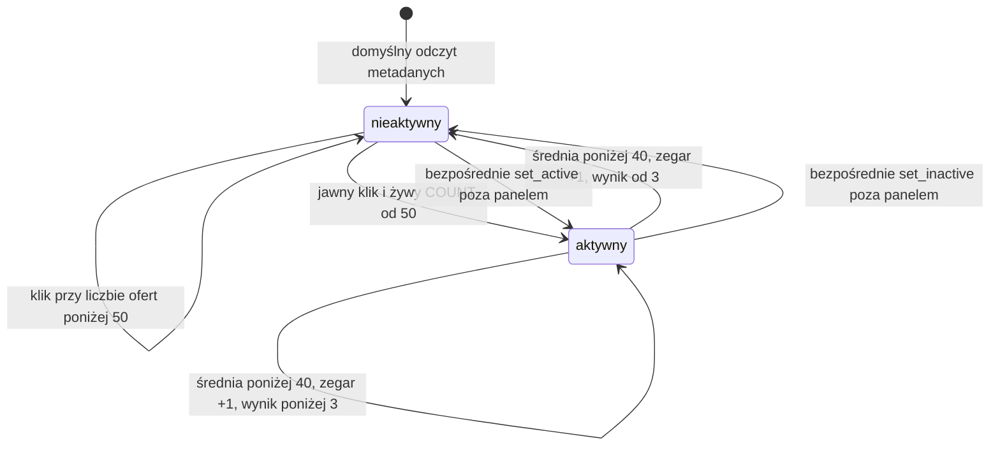

# AquaSmart Shop — analiza modułu do projektu v2

## 1. Cel i zakres

Moduł **Aikwarium Shop 1.6.13** obsługuje panel sklepu, przygotowanie i publikację ofert powiązanych z bazą rekomendacji, publiczne ministrony, tracking kliknięć, pomiary do rozliczeń, administrację i powiadomienia. Nagłówek i stała wersji podają `1.6.13`, nagłówek wymaga PHP `8.0`, a migracje używają wersji schematu `1.0.13`. Git odnotowuje synchronizację produkcji `1.6.2 → 1.6.13` w `58df85f`, poprawkę C-04 w `018eb9c` i dodanie A24 w `cd98f48`. Zakres obejmuje **26 plików i 5 637 fizycznych linii**, z pustymi i komentarzami: 24 PHP / 4 947 linii, JS / 265, CSS / 425. Przejrzano plik startowy, 11 klas w `includes/`, osiem szablonów funkcjonalnych, cztery pliki osłonowe `index.php` i oba zasoby panelu. Ścieżki `includes/`, `templates/`, `assets/` i `aquasmart-shop.php` w raporcie są względne wobec `AquaSmart-plugins/aquasmart-shop/`. Oceny opisują analizę statyczną kopii repozytorium. `działa` oznacza kompletną ścieżkę w kodzie. Stan bazy produkcyjnej, renderowanie, wysyłka poczty i wykonanie zadań cron pozostają niezweryfikowane. `aquasmart-shop.php:3`, `aquasmart-shop.php:15`, `aquasmart-shop.php:20`, `aquasmart-shop.php:66`, `includes/class-aqs-shop-db.php:168`.

## 2. Inwentarz funkcji

| ID | Funkcja (z perspektywy użytkownika) | Rola (gość/user/sklep/admin) | Gdzie (path:line) | Status | Uwagi |
|---|---|---|---|---|---|
| S01 | Zarejestrować sklep i potwierdzić konto | gość | `AquaSmart-plugins/aquasmart-auth/includes/class-aqs-auth.php:175`, `:243`; `AquaSmart-plugins/aquasmart-auth/includes/class-aqs-trial.php:19` | działa | Auth wysyła link. Po kliknięciu sam nadaje `aqs_shop` i `aqs_user`, tworzy jedną subskrypcję `trial` na 90 dni i loguje. Akceptacja administratora nie występuje w tej ścieżce. |
| S02 | Zalogować się i wejść do panelu sklepu | sklep | `AquaSmart-plugins/aquasmart-auth/includes/class-aqs-auth.php:105`, `:155`; `AquaSmart-plugins/aquasmart_v103/includes/class-aqs-portal.php:94`; `includes/class-aqs-shop-panel.php:8` | działa | Po logowaniu `/dashboard/`, stamtąd `/panel-sklepu/`. Panel sprawdza rolę `aqs_shop`. |
| S03 | Zobaczyć stan sklepu, plan, trial, oferty i ruch | sklep | `includes/class-aqs-shop-panel.php:476`; `templates/panel-dashboard.php:10`, `:70`, `:87`, `:101` | działa | Stan publikacji, plan z liczby ofert, postęp do 50, trial i jego data, żywe oferty, bufor, statystyki, pięć ostatnich publikacji. |
| S04 | Przeszukać katalog Aikwarium i wybrać rekord | sklep | `templates/panel-catalog.php:15`, `:48`, `:102`; `includes/class-aqs-shop-db.php:503` | działa | Cztery obszary, filtr ID/nazwy w bieżącym obszarze, dane renderowane po stronie serwera. |
| S05 | Dodać rekord do bufora | sklep | `templates/panel-catalog.php:84`; `includes/class-aqs-shop-panel.php:158`; `includes/class-aqs-shop-buffer.php:20`, `:54` | błąd | Pierwsze dodanie działa. Ponowne dodanie tego samego klucza pustego wariantu może wyzerować zapisane URL i cenę, mimo komunikatu o niedodaniu ponownie. |
| S06 | Wybrać typ oferty i zapisać wariant, URL, cenę | sklep | `templates/panel-buffer.php:74`, `:107`, `:160`, `:170`; `includes/class-aqs-shop-panel.php:203`, `:376` | częściowo | Dwa typy, formularz zbiorczy i sprawdzenie kompletności. Błąd zapisu wiersza może pozostać ukryty. |
| S07 | Opublikować kompletne szkice jednym działaniem | sklep | `includes/class-aqs-shop-panel.php:217`; `includes/class-aqs-shop-buffer.php:112`, `:148`, `:175`, `:232` | częściowo | Poprawne szkice tworzą nowe oferty. Błąd walidacji zostawia szkic. Zapis oferty i przeniesienie do historii mogą się rozjechać. |
| S08 | Usunąć szkic i zobaczyć historię bufora | sklep | `includes/class-aqs-shop-panel.php:245`, `:586`; `includes/class-aqs-shop-buffer.php:189`, `:209`; `templates/panel-buffer.php:147`, `:193` | częściowo | Usuwanie dotyczy własnego `draft`, ale UI zawsze zgłasza sukces. Historia obejmuje do 200 pozycji z 30 dni. |
| S09 | Przeglądać „Moje produkty”, cenę, URL i kliknięcia | sklep | `includes/class-aqs-shop-panel.php:596`; `templates/panel-products.php:16`, `:24` | działa | Do 500 najnowszych pozycji, link z powrotem do katalogu. Wykaz pokazuje zapisany URL, czyli dla oferty wewnętrznej adres bazowy portalu. |
| S10 | Zmienić wariant opublikowanej oferty | sklep | `includes/class-aqs-shop-panel.php:262`; `templates/panel-products.php:48`, `:67`; `includes/class-aqs-shop-db.php:45` | częściowo | Aktualizacja istniejącego ID, zachowuje kliknięcia. Pole UI ma limit 190 znaków przy kolumnie `VARCHAR(50)`. |
| S11 | Usunąć ofertę i zastąpić ją ofertą z inną ceną lub URL-em | sklep | `includes/class-aqs-shop-panel.php:344`; `includes/class-aqs-shop-buffer.php:148`; `templates/panel-products.php:22`, `:73` | częściowo | Twarde usunięcie własnej oferty, a ponowne dodanie nadaje nowe ID. Stary adres i widoczność historycznych kliknięć w raporcie produktu przepadają. |
| S12 | Opublikować albo ponownie opublikować sklep | sklep | `includes/class-aqs-shop-panel.php:310`; `includes/class-aqs-shop-state.php:88`, `:191`; `templates/panel-dashboard.php:27` | działa | Jawny klik po uzyskaniu co najmniej 50 żywych ofert. Generuje lub zachowuje slug, ustawia stan i zeruje zegar. |
| S13 | Zobaczyć oferty przy rekomendacji | user/sklep | `includes/class-aqs-shop-display.php:56`, `:79`, `:98`; `AquaSmart-plugins/aquasmart_v103/akwasmart-k1k2-r27-final-result.php:663`, `:776` | działa | Dopasowanie po obszarze i ID. Tylko oferty opublikowanych sklepów. Legenda rozróżnia zakup online i kontakt. |
| S14 | Przejść do sklepu zewnętrznego z pomiarem kliknięcia | gość/user/sklep | `includes/class-aqs-shop-display.php:136`, `:162`, `:180` | częściowo | Publiczny tracker i przekierowanie 302. Zapis zdarzenia i inkrementacja licznika są niezależne od siebie. |
| S15 | Otworzyć publiczny indeks sklepu | gość/user/sklep | `includes/class-aqs-catalog-display.php:72`, `:147`; `templates/catalog-shop-page.php:42` | działa | Lista ofert wewnętrznych sklepu, nazwy, warianty, ceny i śledzone przejście do konkretnej oferty. |
| S16 | Otworzyć ministronę oferty i skontaktować się ze sprzedawcą | gość/user/sklep | `includes/class-aqs-catalog-display.php:103`, `:190`, `:219`; `templates/catalog-product-page.php:53`, `:76` | częściowo | Kontakt i dane oferty są podłączone. Odczyt opisu oczekuje pól na innym poziomie struktury rekordu. |
| S17 | Przeglądać miesięczny raport kliknięć | sklep | `includes/class-aqs-shop-report.php:8`, `:29`, `:97`; `templates/panel-report.php:8` | działa | Raport w zakładce i osobnym shortcodzie, liczba kliknięć według oferty, kod, nazwa, wariant, bieżąca cena. Raport obejmuje oferty nadal istniejące. |
| S18 | Zobaczyć listę sklepów i ustawić e-mail, domenę, kontakt, prowizję | admin | `includes/class-aqs-shop-admin.php:61`, `:215`; `includes/class-aqs-shop-db.php:455`, `:469`; `includes/class-aqs-shop-buffer.php:133` | częściowo | Ustawienia zapisują się. Domena i reguły prowizji nie są egzekwowane przez bieżącą publikację i raport. |
| S19 | Podejrzeć produkty, ceny, linki i wynik kontroli URL | admin | `includes/class-aqs-shop-admin.php:423` | działa | Do 500 najnowszych pozycji ze wszystkich sklepów, status, kod HTTP i ostrzeżenie. Widok odczytowy. |
| S20 | Odczytać prowizję i pobrać CSV | admin | `includes/class-aqs-shop-admin.php:141`, `:474`; `includes/class-aqs-shop-report.php:49`, `:70` | błąd | Eksport jest dostępny. Raport i CSV oczekują `product_label` i `commission`, których zapytanie nie tworzy. Suma prowizji wynosi `0`, a odczyt brakującego klucza `commission` może generować ostrzeżenia PHP. |
| S21 | Zobaczyć „Stan ofert” i dzienną próbkę | admin | `includes/class-aqs-shop-admin.php:314`, `:381`; `includes/class-aqs-shop-billing.php:252` | działa | Stan żywy, dzisiejszy pomiar, bieżąca średnia i liczba dni próbkowanych. Ekran nie pokazuje zamkniętych rollupów ani zegara. |
| S22 | Wymusić kontrolę ofert i czyszczenie bufora | admin | `includes/class-aqs-shop-admin.php:126`, `:227`; `includes/class-aqs-shop-notify.php:69` | częściowo | Uruchamia powiadomienia, kontrolę linków, starzenie i purge. Migawka i rollup mają osobne callbacki. UI nie podaje per operacja wyniku. |
| S23 | Otrzymać e-mail po kliknięciu oferty | sklep | `includes/class-aqs-shop-display.php:162`; `includes/class-aqs-shop-notify.php:27` | działa | Opt-in admina per sklep, e-mail konfigurowalny z fallbackiem na adres konta. Każde wejście uruchamia próbę wysyłki. |
| S24 | Otrzymać przypomnienie o trialu i nieaktualnej ofercie | sklep | `includes/class-aqs-shop-notify.php:91`, `:125`, `:190` | częściowo | Zakres przypomnień trialowych obejmuje też konta indywidualne i inne statusy. Limit 200 i deduplikacja po pobraniu mogą blokować ostrzeżenia dla dalszych ofert. |
| S25 | Rozliczyć miesięczną aktywność i wygasić publikację | sklep/admin | `includes/class-aqs-shop-billing.php:122`, `:149`, `:179`; `includes/class-aqs-shop-state.php:226` | częściowo | Rollup i zegar działają jako ścieżki. Powtórzenie oceny tego samego okresu zwiększa zegar ponownie. Warstwa kwot, faktur i płatności nie ma implementacji. |
| S26 | Zapisać ślad zmiany reguł prowizji | admin | `includes/class-aqs-shop-admin.php:82`; `includes/class-aqs-shop-audit.php:9`, `:31` | częściowo | Log zdarzenia `commission_rules_changed`. Brak widoku audytu i sprawdzenia skuteczności wpisu. |
| S27 | Dodać lub edytować produkt przez stary formularz z selektorem AJAX | sklep | `templates/panel-add-product.php:26`; `assets/shop-panel.js:57`, `:155`; `includes/class-aqs-shop-panel.php:25`, `:59` | martwy kod | Formularz jest w repozytorium bez aktywnego renderera, `save_product` bez dispatchu. Endpoint katalogowy wciąż odpowiada bezpośrednio. |
| S28 | Importować CSV, prowadzić osobne ogłoszenia OLX, potwierdzać sprzedaż webhookiem | sklep/admin | `aquasmart-shop.php:20`, `:88`; `includes/class-aqs-shop-panel.php:23`, `:59`; `includes/class-aqs-shop-admin.php:10`; `includes/class-aqs-shop-display.php:162` | martwy kod | Historyczne CSV i OLX wycofano z bieżącego drzewa w `58df85f`. Potwierdzenie transakcji webhookiem jest wymaganiem dokumentacji i nie ma aktualnej implementacji. |

## 3. Model danych

### Tabele i indeksy

Prefiks pochodzi z `$wpdb->prefix`. Każda tabela shopu ma `id BIGINT UNSIGNED NOT NULL AUTO_INCREMENT`, z `PRIMARY KEY (id)`. Poniżej wymieniono wszystkie pozostałe kolumny i indeksy. DDL shopu nie deklaruje kluczy obcych. `includes/class-aqs-shop-db.php:27`, `:39`, `:160`, `:340`; `includes/class-aqs-shop-audit.php:9`, `:58`.

| Tabela | Kolumny poza `id` | Indeksy poza PK | Zapis i odczyt |
|---|---|---|---|
| `aqs_shop_products` | `shop_id BIGINT UNSIGNED NOT NULL`, `aqs_db VARCHAR(20) NOT NULL`, `aqs_record_id VARCHAR(40) NOT NULL`, `record_name VARCHAR(255) NULL`, `variant VARCHAR(50) NULL`, `url VARCHAR(2048) NOT NULL`, `price DECIMAL(10,2) NULL`, `last_updated DATETIME NOT NULL`, `published_at DATETIME NULL`, `click_count INT UNSIGNED NOT NULL DEFAULT 0`, `row_checksum VARCHAR(64) NULL`, `url_status VARCHAR(20) NOT NULL DEFAULT 'unchecked'`, `url_status_code INT UNSIGNED NULL`, `url_last_checked DATETIME NULL`, `url_final_url VARCHAR(2048) NULL`, `url_warning TEXT NULL`, `created_at DATETIME DEFAULT CURRENT_TIMESTAMP`, `updated_at DATETIME DEFAULT CURRENT_TIMESTAMP ON UPDATE CURRENT_TIMESTAMP`. | `idx_shop_id(shop_id)`, `idx_aqs_record(aqs_db, aqs_record_id)`, `idx_url_status(url_status)`, `idx_last_updated(last_updated)` | Publikacja wstawia, panel edytuje wariant i usuwa, tracker zwiększa licznik, kontrole URL i wieku aktualizują diagnostykę. Czytają rekomendacje, publiczne strony, oba panele, raport kliknięć, automat wejścia i snapshot. `includes/class-aqs-shop-db.php:39`, `:770`; `includes/class-aqs-shop-buffer.php:152`; `includes/class-aqs-shop-panel.php:280`, `:360`, `:487`, `:596`; `includes/class-aqs-shop-display.php:65`, `:144`, `:174`; `includes/class-aqs-catalog-display.php:103`, `:147`; `includes/class-aqs-shop-admin.php:324`, `:423`; `includes/class-aqs-shop-report.php:29`; `includes/class-aqs-shop-state.php:191`; `includes/class-aqs-shop-billing.php:267`; `includes/class-aqs-shop-notify.php:125`. |
| `aqs_shop_clicks` | `product_id BIGINT UNSIGNED NOT NULL`, `shop_id BIGINT UNSIGNED NOT NULL`, `user_id BIGINT UNSIGNED NULL`, `clicked_at DATETIME DEFAULT CURRENT_TIMESTAMP`, `ip_hash VARCHAR(64) NULL`. | `idx_product_id(product_id)`, `idx_shop_id(shop_id)`, `idx_clicked_at(clicked_at)` | Wstawia tracker. Czytają raporty z obu paneli i agregaty pulpitu sklepu. `includes/class-aqs-shop-db.php:66`; `includes/class-aqs-shop-display.php:157`; `includes/class-aqs-shop-report.php:29`, `:49`; `includes/class-aqs-shop-panel.php:530`. |
| `aqs_shop_notifications_log` | `shop_id BIGINT UNSIGNED NOT NULL`, `type VARCHAR(50) NOT NULL`, `sent_at DATETIME DEFAULT CURRENT_TIMESTAMP`. | `idx_shop_id(shop_id)`, `idx_type(type)` | Cron czyta i zapisuje deduplikację przypomnień trialowych i ostrzeżeń o starych ofertach. `includes/class-aqs-shop-db.php:79`; `includes/class-aqs-shop-notify.php:99`, `:135`, `:190`. |
| `aqs_shop_buffer` | `shop_id BIGINT UNSIGNED NOT NULL`, `aqs_db VARCHAR(20) NOT NULL`, `aqs_record_id VARCHAR(40) NOT NULL`, `record_name VARCHAR(255) NULL`, `variant VARCHAR(50) NULL`, `url VARCHAR(2048) NULL`, `price DECIMAL(10,2) NULL`, `status ENUM('draft','published') NOT NULL DEFAULT 'draft'`, `created_at DATETIME DEFAULT CURRENT_TIMESTAMP`, `updated_at DATETIME DEFAULT CURRENT_TIMESTAMP ON UPDATE CURRENT_TIMESTAMP`, `published_at DATETIME NULL`, `draft_lock VARCHAR(150) GENERATED ALWAYS AS (...) STORED`. Dla `draft` wyrażenie `CONCAT(shop_id, '\|', aqs_db, '\|', aqs_record_id, '\|', COALESCE(variant, ''))`, dla `published` `NULL`. | `idx_shop_id(shop_id)`, `idx_status(status)`, `idx_shop_status(shop_id, status)`, `UNIQUE idx_draft_lock(draft_lock)` | Zapisują katalog, formularz bufora i publikacja. Usuwają właściciel i purge. Czytają bufor, walidacja, publikacja, historia i pulpit. `includes/class-aqs-shop-db.php:89`, `:234`, `:320`; `includes/class-aqs-shop-buffer.php:8`, `:92`, `:112`, `:189`, `:209`, `:232`; `includes/class-aqs-shop-panel.php:376`, `:487`, `:546`. |
| `aqs_shop_billing_snapshots` | `shop_id BIGINT UNSIGNED NOT NULL`, `sample_date DATE NOT NULL`, `products_count INT UNSIGNED NOT NULL DEFAULT 0`, `internal_count INT UNSIGNED NOT NULL DEFAULT 0`, `sampled_at DATETIME NOT NULL`. | `UNIQUE uniq_shop_date(shop_id, sample_date)`, `idx_shop_id(shop_id)`, `idx_sample_date(sample_date)` | Zapis A24, dzienny upsert. Czytają A25, trzy miesiące na pulpicie i „Stan ofert”. `includes/class-aqs-shop-db.php:123`; `includes/class-aqs-shop-billing.php:179`, `:252`; `includes/class-aqs-shop-panel.php:506`; `includes/class-aqs-shop-admin.php:343`. |
| `aqs_shop_billing_monthly` | `shop_id BIGINT UNSIGNED NOT NULL`, `period CHAR(7) NOT NULL`, `avg_products DECIMAL(7,2) NOT NULL DEFAULT 0.00`, `avg_internal DECIMAL(7,2) NOT NULL DEFAULT 0.00`, `active_days SMALLINT UNSIGNED NOT NULL DEFAULT 0`, `rolled_at DATETIME NOT NULL`. | `UNIQUE uniq_shop_period(shop_id, period)`, `idx_shop_id(shop_id)`, `idx_period(period)` | Zapis A25, miesięczny upsert. Automat czyta `shop_id` i `avg_products` dla wskazanego okresu. Ekran „Stan ofert” wylicza swoją bieżącą średnią z dziennych próbek. `includes/class-aqs-shop-db.php:146`; `includes/class-aqs-shop-billing.php:149`, `:179`, `:223`; `includes/class-aqs-shop-admin.php:357`. |
| `aqs_shop_audit_log` | `user_id BIGINT UNSIGNED NOT NULL`, `action VARCHAR(64) NOT NULL`, `object_type VARCHAR(32) NOT NULL`, `object_id BIGINT UNSIGNED NOT NULL`, `old_value LONGTEXT NULL`, `new_value LONGTEXT NULL`, `created_at DATETIME DEFAULT CURRENT_TIMESTAMP`. | `idx_object(object_type, object_id)`, `idx_user(user_id)`, `idx_created(created_at)` | Zapis przy konfiguracji prowizji przez admina. Brak odczytu i retencji w aktualnych ścieżkach shopu. `includes/class-aqs-shop-db.php:221`; `includes/class-aqs-shop-audit.php:9`, `:31`; `includes/class-aqs-shop-admin.php:82`, `:180`. |
| `aqs_subscriptions` — własność auth | `user_id BIGINT UNSIGNED NOT NULL`, `role VARCHAR(20) NOT NULL`, `status VARCHAR(20) NOT NULL DEFAULT 'trial'`, `trial_start DATETIME NOT NULL`, `trial_end DATETIME NOT NULL`, `notes TEXT NULL`, `created_at DATETIME DEFAULT CURRENT_TIMESTAMP`, `updated_at DATETIME DEFAULT CURRENT_TIMESTAMP ON UPDATE CURRENT_TIMESTAMP`. `ENGINE=InnoDB`. | `UNIQUE idx_user_id(user_id)`, `idx_status(status)` | Auth tworzy, aktualizuje i usuwa. Shop czyta najnowszy wiersz wg `id` na pulpit i listę admina, a cron odpytuje `trial_end` bezpośrednio. `AquaSmart-plugins/aquasmart-auth/aquasmart-auth.php:155`, `:303`; `AquaSmart-plugins/aquasmart-auth/includes/class-aqs-trial.php:19`, `:61`; `AquaSmart-plugins/aquasmart-auth/includes/class-aqs-auth.php:298`; `includes/class-aqs-shop-db.php:405`; `includes/class-aqs-shop-panel.php:479`; `includes/class-aqs-shop-admin.php:244`; `includes/class-aqs-shop-notify.php:91`. |

Migracje usuwają `product_name`, `is_active`, `is_sponsored`, dodają `published_at`, bufor i audyt, wymieniają dawny indeks bufora na `idx_draft_lock` i tworzą tabele billingowe. Dawne `aqs_catalog_products` i `aqs_catalog_views` mogą nadal istnieć w bazie. Aktualny kod przestał je tworzyć i używać, a komentarz przewiduje ewentualne osobne usunięcie. `includes/class-aqs-shop-db.php:168`, `:182`, `:196`, `:221`, `:234`, `:305`, `:316`; `aquasmart-shop.php:29`, `:88`.

### Opcje, metadane, pliki

| Nośnik / klucz | Zapis → odczyt |
|---|---|
| `wp_options`: `aqs_shop_db_version` | Migrator odczytuje wartość i po wykonaniu sekwencji zapisuje `1.0.13` z autoload `false`. Harmonogram i reguły rewrite są utrzymywane przez API WordPressa. `includes/class-aqs-shop-db.php:168`, `:992`; `aquasmart-shop.php:88`, `:100`; `includes/class-aqs-shop-billing.php:51`, `:91`. |
| `user_meta`: `aqs_shop_state`, `aqs_shop_deactivation_clock`, `aqs_shop_ever_activated` | `AQS_Shop_State` zapisuje stan, zegar i flagę pierwszej aktywacji. Czytają automat, pulpit, rekomendacje, tracker i publiczny katalog. `includes/class-aqs-shop-state.php:26`, `:74`, `:88`, `:146`, `:155`, `:165`, `:226`; `includes/class-aqs-shop-panel.php:525`; `includes/class-aqs-shop-display.php:79`, `:149`; `includes/class-aqs-catalog-display.php:89`. |
| `user_meta`: `aqs_shop_slug`, `aqs_shop_name` | Auth zapisuje nazwę i pierwotny slug. Shop uzupełnia pusty slug. Nazwę i slug czytają publiczne strony, generator linku i logika generowania sluga. Katalog szuka właściciela w `usermeta` po kluczu i wartości sluga. `AquaSmart-plugins/aquasmart-auth/includes/class-aqs-auth.php:496`; `includes/class-aqs-shop-state.php:103`; `includes/class-aqs-catalog-display.php:58`, `:173`, `:239`. |
| `user_meta`: `aqs_shop_order_notify`, `aqs_shop_notify_email`, `aqs_shop_allowed_domain`, `aqs_shop_public_contact`, `aqs_shop_commission_rules` | Admin zapisuje i odczytuje wszystkie. Dwa pierwsze czyta mailer kliknięć, kontakt czyta ministrona. Domenę oraz prowizję czytają zachowane funkcje DB bez wywołania na aktywnej ścieżce publikacji lub raportowania. `includes/class-aqs-shop-admin.php:75`, `:253`, `:269`; `includes/class-aqs-shop-notify.php:27`; `includes/class-aqs-catalog-display.php:190`; `includes/class-aqs-shop-db.php:430`, `:469`, `:660`; `includes/class-aqs-shop-buffer.php:112`; `includes/class-aqs-shop-report.php:29`. |
| `user_meta` w auth | `aqs_account_type`, `aqs_full_name`, `aqs_nip`, `aqs_shop_address`, `aqs_shop_url`, `aqs_phone`, `aqs_rodo_accepted_at`, `aqs_marketing_consent`, `aqs_marketing_consent_at`, `aqs_marketing_consent_ip` zapisuje rejestracja. `aqs_pending_activation`, `aqs_activation_token`, `aqs_activation_expires` obsługują weryfikację konta i są czyszczone po sukcesie. Shop używa z profilu biznesowego nazwy i sluga. `aqs_phone` i `aqs_shop_url` nie zasilają automatycznie publicznego kontaktu i dozwolonej domeny. `AquaSmart-plugins/aquasmart-auth/includes/class-aqs-auth.php:219`, `:255`, `:477`; `AquaSmart-plugins/aquasmart-auth/includes/class-aqs-registration-security.php:164`, `:178`, `:201`, `:247`; `includes/class-aqs-catalog-display.php:190`, `:239`; `includes/class-aqs-shop-admin.php:75`. |
| Transienty shopu | `aqs_shop_notice_{user_id}` i `aqs_shop_validation_{shop_id}` zapisuje panel, `aqs_shop_admin_notice` zapisuje admin wspólnie dla wszystkich administratorów. Każdy ma TTL `5 * MINUTE_IN_SECONDS`, widok go konsumuje i kasuje. `includes/class-aqs-shop-panel.php:203`, `:616`; `includes/class-aqs-shop-admin.php:538`. Auth ma osobny transient rejestracyjny `aqs_reg_rl_` + MD5 IP. `AquaSmart-plugins/aquasmart-auth/includes/class-aqs-registration-security.php:129`. |
| WordPressowe strony, CPT, taksonomie, `post_meta` | Shop szuka istniejącej strony `panel-sklepu` i osadza funkcje shortcode’ami. Publiczne strony sklepu i oferty są trasami rewrite i plikami PHP. W rejestracji startowej brak CPT, taksonomii, zapisu `post_meta` i tworzenia własnych wpisów WP. `aquasmart-shop.php:46`, `:88`; `includes/class-aqs-shop-panel.php:8`, `:610`; `includes/class-aqs-catalog-display.php:30`, `:137`, `:147`. |
| Pliki na dysku | Shop czyta rekordy przez `AquaSmart_Data::all()`, awaryjnie pliki danych lub tabele. Nie zapisuje katalogu produktowego na dysku. CSV raportu płynie przez `php://output`. Zasoby i szablony są dostarczane w paczce. `includes/class-aqs-shop-db.php:503`, `:787`, `:808`, `:881`, `:960`; `includes/class-aqs-shop-admin.php:148`, `:155`; `aquasmart-shop.php:66`; `includes/class-aqs-shop-panel.php:561`, `:580`; `includes/class-aqs-catalog-display.php:143`, `:169`. |

## 4. Punkty styku z WordPressem

| Styk WP | Wejście, uprawnienie i nonce | Odpowiednik w v2 |
|---|---|---|
| Aktywacja, dezaktywacja, `plugins_loaded` | `register_activation_hook`, `register_deactivation_hook`, `plugins_loaded` dla opięcia usług i zadań. Migrator na `plugins_loaded` z priorytetem `20`. Aktywacja instaluje schemat, rejestruje rewrite, planuje notify/purge i odświeża rewrite. Dezaktywacja zdejmuje zadania i odświeża reguły. `aquasmart-shop.php:46`, `:88`, `:100`, `:122`; `includes/class-aqs-shop-db.php:992`. | Migracje uruchamiane podczas wdrożenia, jawna rejestracja tras i zadań. |
| Shortcode i odczyt panelu | `[aqs_shop_panel]`, `[aqs_shop_report]`. Auth: tak, sesja i `aqs_shop`. Nonce przy odczycie: nie. Parametry `aqs_tab`, `aqs_catalog_db`, `aqs_month`. U gościa panel zwraca komentarz HTML, osobny raport pusty wynik. `includes/class-aqs-shop-panel.php:8`, `:13`, `:59`; `templates/panel-catalog.php:22`; `includes/class-aqs-shop-report.php:105`. | Chronione strony aplikacji i autoryzacja po członkostwie w sklepie. |
| POST w shortcode | `add_to_buffer` → `aqs_shop_add_to_buffer`, `validate_buffer`/`publish_buffer` → `aqs_shop_buffer_action`, `remove_draft` → `aqs_shop_remove_draft`, `save_variant` → `aqs_shop_save_variant`, `delete_product` → `aqs_shop_delete_product`, `activate_catalog` → `aqs_shop_activate_catalog`. Auth: `aqs_shop`. Nonce: tak, dla każdej czynności. Akcje kończą się redirectem `303`. `includes/class-aqs-shop-panel.php:13`, `:25`, `:158`, `:203`, `:217`, `:245`, `:262`, `:310`, `:344`. | Endpointy zapisu z CSRF, autoryzacją właściciela i kontrolą ponowień. |
| `admin-ajax.php` | GET `wp_ajax_aqs_shop_get_records`, auth: rola `aqs_shop`, nonce: `aqs_shop_ajax`. `wp_ajax_nopriv_aqs_shop_get_records`: auth i nonce nie sprawdza, od razu `401`. Zalogowany: `403` za nonce lub rolę, `400` za obszar, `404` za brak danych, sukces `id/name/checksum`. `aquasmart-shop.php:52`, `:66`; `includes/class-aqs-shop-panel.php:98`, `:108`, `:135`. | Wyszukiwarka katalogu ze stronicowaniem. Kody błędów bez debugowania domeny i konfiguracji instalacji w odpowiedzi. |
| Admin UI / `admin_post` | `admin_menu` priorytet `30`, menu `aquasmart`, podmenu `aquasmart-shop`, zakładki `shops`, `products`, `report`, `offers`. Odczyt: `manage_options`, bez nonce. `admin_post_aqs_shop_admin_save_settings`, `...force_cron`, `...export_report`: `manage_options` i nonce o nazwie akcji. Ustawienia i cron przez POST, link eksportu przez GET z nonce. `includes/class-aqs-shop-admin.php:8`, `:17`, `:38`, `:61`, `:126`, `:141`, `:185`, `:227`, `:264`, `:492`. | Osobny panel operacyjny, uprawnienia do konfiguracji, eksportu i zadań. |
| Publiczne rewrite i kontrolery | `init`, `query_vars`, `template_redirect` dla `/go/shop/{id}/` (`aqs_shop_go`) i `/sklep/{slug}/`, `/sklep/{slug}/{record_id}-{id}/` (`aqs_catalog_shop`, `aqs_catalog_product`). Auth sesji: nie. Nonce: nie. Bramka domenowa: stan `aktywny`, a dla produktu na ministronie również własność po `shop_id`. `includes/class-aqs-shop-display.php:8`, `:15`, `:136`; `includes/class-aqs-catalog-display.php:23`, `:30`, `:72`, `:103`. | Publiczne trasy z zachowaniem starych adresów lub przekierowaniami, sprawdzanie stanu sklepu, kanoniczne adresy produktu. |
| Filtr rekomendacji | `aqs_recommendation_output`, priorytet `10`, 3 argumenty. Synchroniczne dopisanie linków do HTML. Auth doradcy obsługuje oddzielnie shortcode `[akwa_filtr_r37]`. `includes/class-aqs-shop-display.php:8`, `:56`; `AquaSmart-plugins/aquasmart_v103/akwasmart-k1k2-r27-final-result.php:663`, `:776`; `AquaSmart-plugins/aquasmart-auth/includes/class-aqs-trial.php:105`. | Wzbogacanie rekomendacji danymi ofert przed renderowaniem. |
| WP-Cron: A24 i A25/A26 | `aqs_shop_daily_snapshot` (`daily`, pierwsze najbliższe lokalne `03:00`), `aqs_shop_monthly_rollup` (jednorazowy, pierwszy dzień o lokalnej `04:00`, planowanie następnego w `finally`). Oba samonaprawiają harmonogram przy starcie. Callbacki nie są endpointami HTTP. `includes/class-aqs-shop-billing.php:26`, `:40`, `:51`, `:72`, `:91`, `:102`, `:122`. | Trwałe zadania okresowe z kluczem daty/okresu, retry i nadrobieniem pominiętych okresów. |
| WP-Cron: notify i purge | `aqs_shop_daily_cron`, `aqs_shop_purge_old_buffer`, `daily` od `time() + HOUR_IN_SECONDS` przy aktywacji, jeśli nie zaplanowano. Admin może wymusić oba. `aquasmart-shop.php:37`, `:55`, `:88`, `:107`; `includes/class-aqs-shop-notify.php:8`, `:13`, `:69`; `includes/class-aqs-shop-admin.php:126`. | Osobne zadania wysyłki przypomnień, kontroli linków i retencji bufora. |
| Role i zdarzenia auth | Auth rejestruje `aqs_shop` z `read`, `aqs_use_advisor`, `aqs_manage_shop`. Shop sprawdza nazwę roli. Role panelu admina zastępuje `manage_options`. Listener `aqs_subscription_status_changed` ma trzy argumenty i nie wykonuje zmiany. Filtry `aqs_shop_active_subscription_statuses`, `aqs_shop_inactive_subscription_statuses` istnieją w niewywoływanych metodach prywatnych. `AquaSmart-plugins/aquasmart-auth/includes/class-aqs-roles.php:17`; `includes/class-aqs-shop-db.php:389`; `includes/class-aqs-shop-admin.php:47`; `includes/class-aqs-shop-notify.php:8`, `:62`, `:75`. | Rozdzielone uprawnienia panelu, narzędzi hobbysty, doradcy i administracji. Jawne zdarzenie subskrypcji, jeżeli ma wykonywać regułę biznesową. |
| Zasoby UI | `wp_enqueue_scripts`, `admin_enqueue_scripts`, `wp_register_style`, `wp_register_script`, `wp_localize_script`. JS zależy od `jquery`. Front panelu dołącza `aqs-design`. CSS obejmuje karty, tabele, formularze i sidebar `220px`, składany przy `860px`. `aquasmart-shop.php:62`, `:66`, `:80`; `includes/class-aqs-shop-panel.php:52`; `assets/shop-panel.js:1`; `assets/shop-panel.css:110`, `:210`, `:348`, `:405`. | Wspólny system wizualny, natywne wyszukiwanie i kontrolki formularza. |
| `wp_mail`, HTTP, cache | `wp_mail` dla kliknięć, trialu i wieku ofert. HTTP wychodzi przez `wp_remote_head` i awaryjnie `wp_remote_get` do adresów ofert w kontroli URL. Diagnostyka AJAX wspomina LiteSpeed. W shopie nie ma rejestracji REST, integracji WooCommerce, bramki płatniczej ani webhooka transakcji. `includes/class-aqs-shop-notify.php:27`, `:91`, `:125`, `:168`; `includes/class-aqs-shop-db.php:726`; `includes/class-aqs-shop-panel.php:98`; `aquasmart-shop.php:46`; `includes/class-aqs-shop-admin.php:10`. | Kolejka maili, kontrolowany serwis HTTP, jawne polityki cache dla kont i publicznych tras. Ewentualny kontrakt transakcyjny zależy od modelu rozliczeń. |

## 5. Zależności od innych pluginów AquaSmart

| Kierunek | Kontrakt i rzeczywiste zachowanie |
|---|---|
| `auth → shop` — konto | Auth zapisuje profil, ustawia `aqs_shop` i `aqs_user` po potwierdzeniu e-maila, tworzy jeden sklepowy trial. Shop czyta rolę, nazwę, slug i tabelę subskrypcji. `AquaSmart-plugins/aquasmart-auth/includes/class-aqs-auth.php:243`, `:496`; `AquaSmart-plugins/aquasmart-auth/includes/class-aqs-trial.php:19`; `includes/class-aqs-shop-db.php:389`, `:405`; `includes/class-aqs-catalog-display.php:58`, `:239`. |
| `shop → auth` — dane | Bezpośrednie `SHOW TABLES LIKE` i odczyty `aqs_subscriptions` w panelach i cron. Auth ma publiczne `AQS_Trial::get_subscription()`, shop go nie wykorzystuje. `has_active_subscription()` akceptujące `trialing` jest osierocone. Zmiana subskrypcji emituje `aqs_subscription_status_changed($user_id, $old_status, $new_status)`. Listener shopu niczego nie synchronizuje. `includes/class-aqs-shop-db.php:405`, `:421`; `includes/class-aqs-shop-notify.php:9`, `:62`, `:91`; `AquaSmart-plugins/aquasmart-auth/includes/class-aqs-trial.php:35`, `:61`; `AquaSmart-plugins/aquasmart-auth/aquasmart-auth.php:130`. |
| `v103 → shop` — afiliacja | v103 podaje HTML, `unit_area` i ID pozycji do filtra przy kartach i weryfikacji. Shop dopasowuje parę `(aqs_db, aqs_record_id)` i dopisuje oferty. v103 nie wykonuje zapytania do tabel shopu w tej ścieżce. Umieszczenie i sortowanie ofert odbywa się po etapie rankingu rekomendacji. `AquaSmart-plugins/aquasmart_v103/akwasmart-k1k2-r27-final-result.php:485`, `:567`, `:663`, `:776`; `includes/class-aqs-shop-display.php:56`, `:132`. |
| `shop → v103` — katalog i UI | `AquaSmart_Data::all()` dostarcza słownik rekordów, a `aqs-design` wspólne style. Portal v103 daje roli `aqs_shop` kafel „Panel sklepu” z `/panel-sklepu/`. `includes/class-aqs-shop-db.php:787`; `includes/class-aqs-shop-panel.php:52`; `AquaSmart-plugins/aquasmart_v103/includes/class-akwasmart-data.php:20`; `AquaSmart-plugins/aquasmart_v103/akwasmart-k1k2-r27-final-result.php:84`; `AquaSmart-plugins/aquasmart_v103/includes/class-aqs-portal.php:94`. |
| `shop ↔ user` — wspólne konto przez auth | Punkt styku to dodatkowa rola `aqs_user` i wspólna subskrypcja konta. Panel usera czyta dostęp z auth. W sprawdzonych punktach wejścia brak bezpośredniego kontraktu danych między tabelami shopu i usera. `AquaSmart-plugins/aquasmart-auth/includes/class-aqs-auth.php:255`; `AquaSmart-plugins/aquasmart-user/includes/class-aqs-user-panel.php:34`; `includes/class-aqs-shop-panel.php:8`; `includes/class-aqs-shop-db.php:340`. |
| `auth → usunięcie konta → shop` | Auth usuwa subskrypcję i użytkownika WP. Shop nie rejestruje kaskady dla swoich tabel. Rollup filtruje nieistniejących użytkowników przy agregacji nowych wyników. Adminowski raport ofert używa `LEFT JOIN` do użytkowników. `AquaSmart-plugins/aquasmart-auth/includes/class-aqs-auth.php:298`; `aquasmart-shop.php:46`; `includes/class-aqs-shop-db.php:39`; `includes/class-aqs-shop-billing.php:192`; `includes/class-aqs-shop-report.php:59`. |

## 6. Zgodność z dokumentacją

W audycie SPDI odwołania do sekcji dotyczą treści odczytanej z Base64 w pamięci. Plik repozytorium ma jedną fizyczną linię. UAT i E2E traktuję jako scenariusze oczekiwane, ponieważ pola PASS/FAIL w sprawdzonych dokumentach są niewypełnione. `AQUAWiedza/audyty/AUDYT_SPDI_aquasmart-shop.md:1`; `AQUAWiedza/taski/PLAN_TESTOW_UAT_A25_automat_stanow.md:16`; `AQUAWiedza/taski/PLAN_TESTOW_UAT_A25_rollup_miesieczny.md:18`; `AQUAWiedza/testy/CHECKLISTA_E2E_PILOT.md:662`.

| Twierdzenie | Źródło (plik dokumentacji + sekcja) | Stan w kodzie (path:line) | Werdykt |
|---|---|---|---|
| SPDI #1: bufor i produkty powielają dane, zapis może rozdzielić stan | `AQUAWiedza/audyty/AUDYT_SPDI_aquasmart-shop.md`, §5 znalezisko 1 | Nadal dwa zestawy kolumn i dwa zapisy. Historia jest ograniczona do 30 dni, a aktualna oferta ma własne ID. Problem atomowości pozostał. `includes/class-aqs-shop-db.php:39`, `:89`, `:320`; `includes/class-aqs-shop-buffer.php:152`, `:175`. | zgodne |
| SPDI #2 i #4: trzy aktywne ścieżki zapisu pełnej oferty i ciche błędy dwóch starych metod | `AQUAWiedza/audyty/AUDYT_SPDI_aquasmart-shop.md`, §5 znaleziska 2 i 4 | Aktualnie pełną ofertę tworzy publikacja z bufora. Dwie starsze metody nadal ignorują wynik zapisu, ale bieżący dispatch ich nie wywołuje. Ryzyko zniknęło z normalnej ścieżki. `includes/class-aqs-shop-db.php:605`, `:651`, `:660`, `:705`; `includes/class-aqs-shop-panel.php:25`, `:262`; `includes/class-aqs-shop-buffer.php:148`. | niezgodne |
| SPDI #3, C-04: dawny unikalny indeks blokuje ponowną publikację i bufor zostaje szkicem | `AQUAWiedza/audyty/AUDYT_SPDI_aquasmart-shop.md`, §5 znalezisko 3; `AQUAWiedza/taski/TASK_A12_do_E2_Bug_C04.md`, §PROBLEM i §DANE DO ANALIZY; `AQUAWiedza/audyty/MAPA_INTEGRACJI_CROSS_PLUGIN.md`, §5 SHOP-Z1 | C-04 w DDL naprawiony przez `draft_lock`. Ciche `false` przy `mark_published()` częściowo naprawiono, bo błędy trafiają do komunikatu. `0` nadal uznaje się za sukces, licznik `published` rośnie również po błędzie oznaczenia. `includes/class-aqs-shop-db.php:102`, `:225`, `:234`; `includes/class-aqs-shop-buffer.php:175`, `:232`. | niezgodne |
| SPDI #5 i #6: niezauważone błędy edycji szkicu i rozjazd kliknięć | `AQUAWiedza/audyty/AUDYT_SPDI_aquasmart-shop.md`, §5 znaleziska 5 i 6; `AQUAWiedza/audyty/MAPA_INTEGRACJI_CROSS_PLUGIN.md`, §5 SHOP-Z2 | Obie usterki nadal występują. Wynik edycji szkicu ignorowany, zdarzenie i licznik kliknięcia osobno. `includes/class-aqs-shop-panel.php:405`; `includes/class-aqs-shop-display.php:162`, `:174`. | zgodne |
| SPDI #7: bezpośredni odczyt tabeli auth | `AQUAWiedza/audyty/AUDYT_SPDI_aquasmart-shop.md`, §5 znalezisko 7; `AQUAWiedza/audyty/MAPA_INTEGRACJI_CROSS_PLUGIN.md`, §5 SHOP-Z6 | Pozostał w panelu, adminie i powiadomieniach, bez zapisu do tabeli auth. `includes/class-aqs-shop-db.php:405`; `includes/class-aqs-shop-panel.php:479`; `includes/class-aqs-shop-admin.php:244`; `includes/class-aqs-shop-notify.php:91`. | zgodne |
| SPDI #8: niezależny System B na tabelach ogłoszeń i wyświetleń | `AQUAWiedza/audyty/AUDYT_SPDI_aquasmart-shop.md`, §3.5 i §5 znalezisko 8 | Model OLX wycofany. Indeks i ministrony korzystają z `aqs_shop_products`. Tabele historyczne pozostawiono poza migracją. `aquasmart-shop.php:29`, `:88`; `includes/class-aqs-catalog-display.php:103`, `:147`. | niezgodne |
| SPDI #9: purge sprawdza istnienie tabeli | `AQUAWiedza/audyty/AUDYT_SPDI_aquasmart-shop.md`, §5 znalezisko 9 | Sprawdzenie i usuwanie wyłącznie starych `published` nadal działają. `includes/class-aqs-shop-db.php:320`. | zgodne |
| PS-02 / Z2 oraz dokumentacja techniczna: `active/trial` steruje ofertami, a rozbieżność w dacie trialu wpuszcza wygasły sklep | `AQUAWiedza/audyty/MAPA_INTEGRACJI_CROSS_PLUGIN.md`, §2 PS-02 i §3 Z2; `AquaSmart-plugins/dokumentacja-techniczna-aquasmart.md`, §5.1 i §7 | Widoczność ofert odpięto od subskrypcji i oparto o `aqs_shop_state`. Stary bypass i `trialing` pozostały w niewywoływanej metodzie. Reguła trialu pozostaje w auth dla doradcy i narzędzi usera. `includes/class-aqs-shop-display.php:79`, `:149`; `includes/class-aqs-catalog-display.php:89`; `includes/class-aqs-shop-db.php:421`; `AquaSmart-plugins/aquasmart-auth/includes/class-aqs-trial.php:46`, `:105`. | niezgodne |
| PS-03: filtr rekomendacji z HTML, obszarem i ID | `AQUAWiedza/audyty/MAPA_INTEGRACJI_CROSS_PLUGIN.md`, §2 PS-03; `AquaSmart-plugins/dokumentacja-techniczna-aquasmart.md`, §5.2–5.4 | Kontrakt i aliasy zgodne. Emisja występuje w dwóch miejscach renderowania. Opis „asynchroniczny” w mapie jest nieścisły, wywołanie filtra jest synchroniczne. `includes/class-aqs-shop-display.php:8`, `:56`; `includes/class-aqs-shop-db.php:374`; `AquaSmart-plugins/aquasmart_v103/akwasmart-k1k2-r27-final-result.php:663`, `:776`. | zgodne |
| PS-04: auth emituje zmianę statusu, shop nasłuchuje | `AQUAWiedza/audyty/MAPA_INTEGRACJI_CROSS_PLUGIN.md`, §2 PS-04 | Rejestracja i trzy parametry są zgodne. Listener nie powoduje skutku biznesowego. `AquaSmart-plugins/aquasmart-auth/includes/class-aqs-trial.php:61`; `includes/class-aqs-shop-notify.php:8`, `:62`. | zgodne |
| A-02: natychmiastowy trial 90 dni bez akceptacji admina, URL obowiązkowy, maska NIP później | `AQUAWiedza/testy/CHECKLISTA_E2E_PILOT.md`, A-02; commit dokumentacji `99449d3`; `AquaSmart-plugins/dokumentacja-techniczna-aquasmart.md`, §7; `AQUAWiedza/zakres-prac-v2.0.md`, §2 moduł C | Pozostał brak akceptacji admina. Trial startuje po potwierdzeniu e-maila. URL jest opcjonalny. NIP po oczyszczeniu ma 10 cyfr. Auth ma rejestrację, powitanie i powiadomienie admina po potwierdzeniu. `AquaSmart-plugins/aquasmart-auth/includes/class-aqs-auth.php:219`, `:243`, `:361`, `:417`, `:511`; `AquaSmart-plugins/aquasmart-auth/templates/register-form.php:64`; `AquaSmart-plugins/aquasmart-auth/includes/class-aqs-trial.php:19`. | niezgodne |
| C-01/C-02: produkt wolno opisać w buforze i zapisać jako `draft` | `AQUAWiedza/testy/CHECKLISTA_E2E_PILOT.md`, C-01/C-02 | Draft działa po wybraniu rekordu w katalogu. Edytowalne są wariant, typ, URL i cena. Pole opisu produktu w obecnym buforze nie występuje. `templates/panel-catalog.php:74`; `templates/panel-buffer.php:74`; `includes/class-aqs-shop-panel.php:158`, `:376`. | niezgodne |
| C-03/C-04 i dokumentacja techniczna: produkt ma `status='published'`, bufor jest fizycznie pusty, opublikowaną ofertę aktualizuje się przez bufor, a publikację zatwierdza admin | `AQUAWiedza/testy/CHECKLISTA_E2E_PILOT.md`, C-03/C-04; `AquaSmart-plugins/dokumentacja-techniczna-aquasmart.md`, §8 i §11 | `products` nie ma statusu, `buffer` zachowuje wiersz `published`. Sam sklep tworzy kolejną ofertę, edytuje wariant w miejscu, a zmianę ceny lub URL wykonuje przez usunięcie i dodanie. POST sklepu w shortcode zgodny z §11, operacje admina idą przez `admin-post.php`. `includes/class-aqs-shop-db.php:39`, `:89`; `includes/class-aqs-shop-buffer.php:152`, `:232`; `includes/class-aqs-shop-panel.php:23`, `:262`; `templates/panel-products.php:22`; `includes/class-aqs-shop-admin.php:10`. | niezgodne |
| C-05, C-07, D-04, E-03 i E-06: usuwanie szkicu, link zewnętrzny i tracking | `AQUAWiedza/testy/CHECKLISTA_E2E_PILOT.md`, wskazane przypadki | Usunięcie własnego `draft` działa. Tracker oblicza klik na każde wejście i przekierowuje dla istniejącej oferty opublikowanego sklepu. Deduplikacji po sesji i przerwy `60 s` nie ma w kodzie. `includes/class-aqs-shop-buffer.php:189`; `includes/class-aqs-shop-display.php:107`, `:136`, `:162`. | zgodne |
| C-06: „Raport prowizji” w panelu sklepu, nazwy i kliknięcia | `AQUAWiedza/testy/CHECKLISTA_E2E_PILOT.md`, C-06; `AQUAWiedza/zakres-prac-v2.0.md`, §2 moduł D | Nazwy i kliknięcia są w „Raporcie kliknięć”. Prowizja w panelu sklepu nie jest wyświetlana. Administracyjna wersja ma błąd danych. `templates/panel-report.php:8`, `:21`; `includes/class-aqs-shop-panel.php:466`; `includes/class-aqs-shop-report.php:49`; `includes/class-aqs-shop-admin.php:474`. | niezgodne |
| C-08/E-05: bezpośredni kontakt przy rekomendacji, osobny slug produktu i opis/zdjęcie | `AQUAWiedza/testy/CHECKLISTA_E2E_PILOT.md`, C-08 i E-05 | Kontakt na ministronie po trackerze. Adres z `{record_id}-{id}`, kontakt z konfiguracji admina, tytuł zawiera ofertę i sklep. Brak uploadu zdjęcia i uszkodzony odczyt opisu. `includes/class-aqs-shop-display.php:114`, `:180`; `includes/class-aqs-catalog-display.php:58`, `:190`, `:219`; `templates/catalog-product-page.php:23`, `:58`; `includes/class-aqs-shop-db.php:917`. | niezgodne |
| E-02/E-08: wyłączenia cache i klucz `unique_user_id` | `AQUAWiedza/testy/CHECKLISTA_E2E_PILOT.md`, E-02 i E-08; `AQUAWiedza/zakres-prac-v2.0.md`, §2 moduł E | Shop diagnozuje cache w treści odpowiedzi. Produkcyjne wyłączenia LiteSpeed **[HIPOTEZA]** mogą być ustawione poza repozytorium. Unikalność subskrypcji ma obecnie nazwę `idx_user_id`, więc test oczekuje innej nazwy. `includes/class-aqs-shop-panel.php:98`, `:108`; `AquaSmart-plugins/aquasmart-auth/aquasmart-auth.php:161`, `:258`. | niezgodne |
| A25 rollup: „Stan ofert”, dni próbkowane, `ceil`, upsert | `AQUAWiedza/taski/PLAN_TESTOW_UAT_A25_rollup_miesieczny.md`, Tory 1–2 | Reguły zgodne. Przypadek testowy z nieistniejącym ID `99999` zostanie pominięty przez aktualny `INNER JOIN`. Samo dodanie do bufora nie podnosi licznika. Przycisk admina nie wykonuje snapshotu, zgodnie z uwagą UAT. `includes/class-aqs-shop-admin.php:126`, `:314`; `includes/class-aqs-shop-state.php:191`; `includes/class-aqs-shop-billing.php:192`, `:216`. | zgodne |
| A25 automat: próg 50, trzy słabe miesiące, reset, komunikaty i filtr duchów | `AQUAWiedza/taski/PLAN_TESTOW_UAT_A25_automat_stanow.md`, Tory 1–4 | Ścieżka aktywacja/reset/dezaktywacja realizuje progi przy pojedynczym przebiegu każdego okresu. Inne napisy i brak informacji pod przyciskiem o przyszłym naliczaniu. Zapisany rollup usuniętego konta nie znika przy przeliczeniu. Okresów automatu nie deduplikuje się. `includes/class-aqs-shop-state.php:36`, `:226`; `includes/class-aqs-shop-billing.php:149`, `:192`, `:223`; `templates/panel-dashboard.php:27`. | niezgodne |
| Techniczny schemat, wersja `1.0.10`, wskazane pliki danych i wycofanie starego formularza | `AquaSmart-plugins/dokumentacja-techniczna-aquasmart.md`, §1, §3, §9, §14; `AQUAWiedza/zakres-prac-v2.0.md`, §2 moduł E | Aktualnie `1.6.13`, nowsze DDL, najpierw słownik v103 z plikami `*_end*.txt`. Formularz `panel-add-product.php` jest w repozytorium jako pozostałość. `aquasmart-shop.php:5`; `includes/class-aqs-shop-db.php:39`, `:182`, `:787`; `AquaSmart-plugins/aquasmart_v103/includes/class-akwasmart-data.php:230`; `templates/panel-add-product.php:26`; `includes/class-aqs-shop-panel.php:25`, `:59`. | niezgodne |
| CSV import z EAN, automapowaniem, walidacją i podglądem, UTM i webhook zamówienia | `AQUAWiedza/specyfikacja/specyfikacja_v2.0.md`, §2 i §4; `AQUAWiedza/zakres-prac-v2.0.md`, §2 moduły D/E; `AquaSmart-plugins/dokumentacja-techniczna-aquasmart.md`, §14 | Aktualny katalog korzysta z rekordów Aikwarium. Jedyny aktywny CSV to eksport raportu admina. Tracker przechodzi do URL z oferty, bez automatycznego doklejania UTM. Potwierdzenia zakupu i webhooka brak. `aquasmart-shop.php:20`, `:46`; `includes/class-aqs-shop-panel.php:25`; `templates/panel-catalog.php:74`; `includes/class-aqs-shop-admin.php:141`; `includes/class-aqs-shop-display.php:180`. | brak w kodzie |
| Sklep `500 zł/mies.`, prowizja `<100 zł` 5%, `≥100 zł` 2% | `AQUAWiedza/README.md`, §Model biznesowy; `AQUAWiedza/specyfikacja/specyfikacja_v2.0.md`, §4–5; `AquaSmart-plugins/dokumentacja-techniczna-aquasmart.md`, §4 | `500 zł` nie jest naliczane. Formuły w kodzie używają `<=100` i `>100`, zgodnie ze starszym zakresem prac §2 moduł D, oraz liczby kliknięć. Formuły nie są podłączone do raportów. `includes/class-aqs-shop-db.php:469`, `:484`; `includes/class-aqs-shop-report.php:49`, `:70`; `includes/class-aqs-shop-billing.php:179`; `templates/panel-dashboard.php:10`. | niezgodne |
| Brak bramki płatniczej, ręczny model pilota | `AQUAWiedza/specyfikacja/specyfikacja_v2.0.md`, §2 i §4; `AQUAWiedza/zakres-prac-v2.0.md`, §2 moduł D i §5 | Brak integracji płatniczej. Kod mierzy oferty i kliknięcia. Ręczne fakturowanie oraz porównanie z transakcjami sprzedawcy są procesem opisanym w dokumentach, bez ścieżki w aplikacji. `aquasmart-shop.php:46`; `includes/class-aqs-shop-admin.php:180`; `includes/class-aqs-shop-billing.php:179`; `includes/class-aqs-shop-report.php:49`. | zgodne |
| Aktualne funkcje bez odpowiednika w starszych opisach zakresu i architektury | `AquaSmart-plugins/dokumentacja-techniczna-aquasmart.md`, §3/§6/§8; `AQUAWiedza/zakres-prac-v2.0.md`, §2 moduł D; `AQUAWiedza/specyfikacja/specyfikacja_v2.0.md`, §4 | Osobny `[aqs_shop_report]`, dostępny już eksport CSV, wariant w miejscu, wybór typu oferty i per-oferta ministrona. Szczegóły A24/A25 mają częściowe pokrycie w osobnych UAT. `includes/class-aqs-shop-panel.php:8`, `:262`; `includes/class-aqs-shop-admin.php:141`; `templates/panel-buffer.php:107`; `includes/class-aqs-catalog-display.php:58`; `includes/class-aqs-shop-billing.php:40`. | brak w dokumentacji |

## 7. Problemy

| Severity (krytyczny/wysoki/średni/niski) | Opis | path:line | Wpływ |
|---|---|---|---|
| wysoki | Ocena miesiąca nie zapisuje `period` razem ze zmianą stanu. Ten sam słaby okres może podnieść zegar kilka razy. Brak próbki za miesiąc i przeliczenia poza kolejnością nie mają osobnej reguły. | `includes/class-aqs-shop-billing.php:122`, `:149`; `includes/class-aqs-shop-state.php:165`, `:226` | Przedwczesne wyłączenie sklepu lub potraktowanie miesięcy z przerwą jako kolejnych. |
| wysoki | Publikacja to odczyt szkiców, insert oferty, potem update bufora bez transakcji i bez warunku `status='draft'` w ostatnim zapisie. `draft_lock` działa na szkice, tabela ofert nie ma unikalnego identyfikatora źródłowego szkicu. | `includes/class-aqs-shop-buffer.php:112`, `:152`, `:175`, `:232`; `includes/class-aqs-shop-db.php:39`, `:102` | Równoległy POST lub ponowienie po błędzie może zdublować ofertę, kliknięcia rozbijają się między ID, a próg publikacji i billing liczą oba wiersze. |
| wysoki | Aktualny zapis oferty nie egzekwuje skonfigurowanej domeny i nie weryfikuje istnienia rekordu w bazie wiedzy. Przyjmuje też niepustą nazwę z formularza. | `includes/class-aqs-shop-panel.php:158`; `includes/class-aqs-shop-buffer.php:133`, `:152`; `includes/class-aqs-shop-db.php:455`, `:577`, `:660`; `includes/class-aqs-shop-display.php:180` | Błędne rekordy lub linki spoza domeny sklepu mogą zwiększyć liczniki i pojawić się publicznie po aktywacji. |
| wysoki | Kontrola HTTP weryfikuje pierwotny URL i podąża maksymalnie za trzema przekierowaniami przez `wp_remote_*`, bez jawnej wymuszonej walidacji każdego celu w tej metodzie. | `includes/class-aqs-shop-db.php:726`; `includes/class-aqs-shop-notify.php:168` | **[HIPOTEZA]** W zależności od transportu i zabezpieczeń instalacji istnieje ryzyko SSRF przez cel przekierowania. Kontrola wymaga izolacji sieciowej i walidacji celów. |
| wysoki | Raport prowizji czyta pola, których źródło nie wypełnia. Konfiguracja stawki nie wpływa na raport ani CSV. | `includes/class-aqs-shop-report.php:49`, `:70`, `:86`; `includes/class-aqs-shop-admin.php:161`, `:474`, `:507` | Prowizja, suma i etykieta produktu są nieprzydatne do rozliczeń. Ostrzeżenia PHP mogą wpływać na wyjście CSV zależnie od konfiguracji. |
| wysoki | Publiczny tracker przyjmuje powtarzalne wejścia bez limitu, rozróżnienia źródła lub duplikatów. Wysyłka e-mail może być synchroniczna dla każdego wejścia. | `includes/class-aqs-shop-display.php:136`, `:157`, `:174`, `:202`; `includes/class-aqs-shop-notify.php:27` | Zawyżone statystyki, możliwość nadużycia powiadomień. Pierwsze IP z nagłówków proxy jest akceptowane bez sprawdzenia zaufanego proxy. |
| średni | Ponowny wybór rekordu z pustym wariantem nadpisuje szkic. Osobno formularz edycji ignoruje błędy SQL i usunięcie szkicu ignoruje wynik metody. | `includes/class-aqs-shop-panel.php:176`, `:191`, `:245`, `:405`; `includes/class-aqs-shop-buffer.php:39`, `:54` | Utrata URL/ceny lub wprowadzający w błąd sukces, szczególnie przy kolizji `draft_lock`. |
| średni | Brak kaskady danych shopu po usunięciu użytkownika. Rollup filtruje tylko nowe agregaty, pozostawiając poprzednie wpisy i brak historii po usunięciu pozycji z raportu. | `AquaSmart-plugins/aquasmart-auth/includes/class-aqs-auth.php:310`; `includes/class-aqs-shop-billing.php:192`, `:212`, `:223`; `includes/class-aqs-shop-report.php:38`, `:59`; `includes/class-aqs-shop-panel.php:360`, `:530` | Sieroty i możliwy zawyżony przyszły rollup. Pulpit może nadal liczyć kliknięcia usuniętej oferty, choć raport per produkt ją pomija. |
| średni | Auth zapisuje slug bez gwarancji unikalności. Shop sprawdza kolizję tylko przy pustym slugu i wybiera pierwszy wynik `LIMIT 1`. | `AquaSmart-plugins/aquasmart-auth/includes/class-aqs-auth.php:496`; `includes/class-aqs-shop-state.php:103`, `:132`; `includes/class-aqs-catalog-display.php:173` | Dwa sklepy o tej samej nazwie mogą mieć ten sam adres, z katalogiem nieodpowiedniego sklepu lub błędem dostępu do oferty. |
| średni | Dwie klasyfikacje `internal`: normalizacja hosta w buforze, billingu i adminie oraz surowe porównanie w publicznym katalogu i trackerze. | `includes/class-aqs-shop-db.php:435`, `:448`; `includes/class-aqs-shop-display.php:28`; `includes/class-aqs-catalog-display.php:131`, `:160`; `includes/class-aqs-shop-billing.php:272` | Różnice `www` lub wielkości liter mogą dać różny typ w rozliczeniu i publicznej nawigacji. |
| średni | Daty wygaśnięcia trialu nie są czytane z właściwej kolumny przez pulpit. Mail trialowy nie filtruje roli, statusu i okresu subskrypcji w kluczu deduplikacji. | `includes/class-aqs-shop-panel.php:566`; `AquaSmart-plugins/aquasmart-auth/aquasmart-auth.php:161`; `includes/class-aqs-shop-notify.php:99`, `:190` | Pulpit może pokazać „brak danych” przy istniejącym `trial_end`. Mail o subskrypcji sklepu może trafić na konto indywidualne, a porównywalny nowy okres nie wygeneruje drugiego maila tego typu. |
| średni | Kontrola wieku wybiera do 200 starych wpisów bez `ORDER BY` i deduplikuje po pobraniu. Kolejna kontrola HTTP może nadpisać ostrzeżenie po 90 dniach. Wynik `wp_mail` jest ignorowany. | `includes/class-aqs-shop-notify.php:69`, `:115`, `:125`, `:157`, `:168`; `includes/class-aqs-shop-db.php:770` | Dalsze oferty mogą nie dostać ostrzeżenia. Log może blokować ponowienie po nieudanej wysyłce. `url_status` miesza dostępność URL i wiek oferty. |
| średni | Migawki i rollupy ignorują wynik SQL. Brak nadrabiania miesiąca, gdy jego przebieg przepadł. Migrator zapisuje nową wersję po wywołaniach DDL bez sprawdzania końcowego schematu. | `includes/class-aqs-shop-billing.php:91`, `:122`, `:223`, `:286`; `includes/class-aqs-shop-db.php:168`, `:234` | Luka w danych lub w indeksach może wyglądać jak poprawne wdrożenie i trafić do automatu lub przyszłych rozliczeń. |
| średni | Skan wszystkich ofert w snapshotach i adminie, osobne zapytania per sklep na liście admina, pełne renderowanie obszaru katalogu, publiczny indeks bez paginacji. | `includes/class-aqs-shop-billing.php:267`; `includes/class-aqs-shop-admin.php:244`, `:331`; `templates/panel-catalog.php:22`, `:74`; `includes/class-aqs-catalog-display.php:147` | Koszt rośnie wraz z katalogiem. Formularz bufora przesyła cztery pola na wiersz, więc **[HIPOTEZA]** konfiguracja limitu zmiennych PHP może obciąć duży POST. `templates/panel-buffer.php:94`, `:107`, `:119`, `:134`. |
| średni | Dane kliknięcia i licznik zbiorczy są zapisywane bez transakcji i bez sprawdzania wyników. | `includes/class-aqs-shop-display.php:162`, `:174`; `templates/panel-products.php:65`; `includes/class-aqs-shop-report.php:38` | Licznik „Moje produkty” może różnić się od raportu i pulpitu. |
| średni | Brak wspólnego limitu długości wariantu. Bufor dopuszcza w UI 100 znaków, „Moje produkty” 190, obie tabele mają `VARCHAR(50)`. Daty raportu są walidowane wyłącznie formatem. | `templates/panel-buffer.php:94`; `templates/panel-products.php:48`; `includes/class-aqs-shop-db.php:45`, `:95`; `includes/class-aqs-shop-report.php:21` | Wpis poprawny według formularza może zostać odrzucony lub przycięty zależnie od DB. Miesiąc spoza `01–12` przejdzie sprawdzenie wzorca. |
| średni | Eksport CSV pomija neutralizację pól tekstowych ustawianych przez użytkownika. Endpoint AJAX w błędzie ujawnia ścieżki i dostępność plików zalogowanemu sklepowi. | `includes/class-aqs-shop-admin.php:155`, `:163`; `includes/class-aqs-shop-panel.php:140`; `includes/class-aqs-shop-db.php:527` | **[HIPOTEZA]** Arkusz może interpretować tekst jako formułę, zależnie od programu. Diagnostyka odsłania strukturę instalacji poza panelem admina. |
| niski | Opis jest szukany na najwyższym poziomie rekordu, podczas gdy pola źródłowe są zagnieżdżone pod `raw`. | `includes/class-aqs-catalog-display.php:219`; `includes/class-aqs-shop-db.php:917`; `templates/catalog-product-page.php:72` | Sekcja opisu nie ma danych nawet przy opisie dostępnym w rekordzie źródłowym. |
| niski | Niepełna obsługa stylów admina i stary JS. Rejestracja uchwytów jest w `wp_enqueue_scripts`, admin je tylko kolejkuje. Sam JS wiąże selektory osieroconego formularza i szuka DOM do 3 s. | `aquasmart-shop.php:62`, `:66`, `:80`; `assets/shop-panel.js:155`, `:215`; `templates/panel-add-product.php:35`; `templates/panel-buffer.php:160` | **[HIPOTEZA]** Admin nie dostanie stylów z tej rejestracji w typowym żądaniu wp-admin. Front wykonuje zbędne obserwacje i logowanie diagnostyczne. |
| niski | Ścieżki błędów ustawiają `status_header(404)`, następnie `wp_die()` bez jawnego `response => 404`. Klucz produktu jest rozpoznawany po sufiksie ID, bez porównania prefixu z rekordem. | `includes/class-aqs-shop-display.php:149`; `includes/class-aqs-catalog-display.php:84`, `:108`, `:126` | **[HIPOTEZA]** Końcowy status HTTP zależy od handlera WP. Różne adresy mogą wskazywać tę samą ofertę bez kanonizacji. |

## 8. Reguły biznesowe do zachowania w v2

### 8.1 Konto, dostęp i trzy osobne cykle

| Reguła | Dokładne zachowanie |
|---|---|
| Rejestracja sklepu | `account_type=shop`. Wymagane imię i nazwisko, poprawny i unikalny e-mail, hasło i identyczne potwierdzenie, akceptacja regulaminu, nazwa sklepu, NIP, adres i telefon. `strlen(password) >= 8`. NIP po usunięciu znaków niedziesiętnych ma `10` cyfr, bez sprawdzania sumy kontrolnej. URL i marketing opcjonalne. Telefon jest wymaganym tekstem. `AquaSmart-plugins/aquasmart-auth/includes/class-aqs-auth.php:361`, `:387`, `:417`; `AquaSmart-plugins/aquasmart-auth/templates/register-form.php:58`, `:77`. |
| Ochrona i potwierdzenie | Nonce formularza `aqs_form_action`, do `5` prób na IP w `900 s`, pusty honeypot, podpisany wiek formularza `3–3600 s` włącznie. Token aktywacyjny z `16` losowych bajtów, przechowywany jako hash HMAC, ważny `604800 s` (`7 dni`). Konto początkowo bez roli, z `aqs_pending_activation='1'`. Cron usuwa niepotwierdzone konta starsze niż `7 dni`, do `100` na przebieg. `AquaSmart-plugins/aquasmart-auth/includes/class-aqs-auth.php:175`, `:219`, `:349`; `AquaSmart-plugins/aquasmart-auth/includes/class-aqs-registration-security.php:16`, `:40`, `:91`, `:107`, `:129`, `:164`, `:178`, `:247`, `:287`. |
| Aktywacja konta | Prawidłowy link aktywacyjny ustawia `aqs_shop` i dodaje `aqs_user`. Zapisuje jedną subskrypcję z rolą `aqs_shop`, `status='trial'`, `trial_start=now`, `trial_end=now+90 dni` według strefy WP. Przy nieudanym zapisie trialu usuwa role, pozostawia stan oczekiwania. Po sukcesie czyści token, wysyła maile, loguje i przekierowuje na `/dashboard/?aqs_msg=trial_started`. Trial indywidualny ma `30 dni`. `AquaSmart-plugins/aquasmart-auth/includes/class-aqs-auth.php:243`; `AquaSmart-plugins/aquasmart-auth/includes/class-aqs-trial.php:19`. |
| Logowanie | Login od `sanitize_user(sanitize_title(nazwa sklepu), true)` z fallbackiem na prefiks e-maila lub `aqs_user`. Kolizje loginu dostają `_1`, `_2` itd. Formularz przyjmuje login lub e-mail, sesja niepotwierdzonego konta jest odrzucana w tej ścieżce. Po logowaniu rola portalowa trafia na `/dashboard/`. `AquaSmart-plugins/aquasmart-auth/includes/class-aqs-auth.php:105`, `:448`, `:533`. |
| Dostęp i subskrypcja | `trial`, `active`, `expired`, `suspended` to dozwolone statusy auth. Według auth `active` daje dostęp, a `trial` wymaga `trial_end > now`, przy końcu aktualizuje status na `expired`. Panel shopu wymaga roli `aqs_shop`; jego publikacja, katalog i tracking są sterowane własnym stanem. Ręczna zmiana statusu lub `trial_end` w auth nie zmienia tego stanu. `AquaSmart-plugins/aquasmart-auth/aquasmart-auth.php:130`, `:303`; `AquaSmart-plugins/aquasmart-auth/includes/class-aqs-trial.php:46`; `includes/class-aqs-shop-panel.php:13`; `includes/class-aqs-shop-state.php:74`; `includes/class-aqs-shop-notify.php:62`; `includes/class-aqs-shop-display.php:79`, `:149`. |

### 8.2 Automat sklepu — Model Y

Stany zapisane są dwa: `nieaktywny` i `aktywny`. Każda brakująca lub inna wartość niż dokładne `aktywny` jest odczytywana jako `nieaktywny`. `aqs_shop_ever_activated=1` pozwala pokazać komunikat o wycofaniu, a osiągnięcie 50 ofert zmienia widok przycisku. Obie informacje należą do prezentacji. Oferty istnieją w `products` od publikacji bufora, również przed publicznym uruchomieniem sklepu. `includes/class-aqs-shop-state.php:26`, `:74`, `:146`; `includes/class-aqs-shop-buffer.php:148`; `templates/panel-dashboard.php:27`.

| Stan przed | Wyzwalacz | Warunek | Stan po | Skutek |
|---|---|---|---|---|
| Brak stanu lub wartość nieznana | Odczyt profilu, też po potwierdzeniu nowego konta | `raw !== 'aktywny'` | `nieaktywny` w odczycie | Domyślne wygaszenie publiczne, bez zapisu nowego meta przy odczycie. `includes/class-aqs-shop-state.php:74`; `AquaSmart-plugins/aquasmart-auth/includes/class-aqs-auth.php:243`. |
| `nieaktywny` | Dodanie/usunięcie oferty, w tym przekroczenie 50 | Żywy `COUNT(*)` zmienia się | `nieaktywny` | W UI zmieniają się licznik, pasek i dostępność przycisku. Sam próg nie publikuje sklepu. `includes/class-aqs-shop-panel.php:519`; `templates/panel-dashboard.php:33`; `includes/class-aqs-shop-state.php:191`. |
| `nieaktywny` | POST „Opublikuj sklep” | Rola `aqs_shop`, ważny nonce, `COUNT(*) < 50` | `nieaktywny` | Odmowa, „Nie można opublikować sklepu — potrzebujesz co najmniej 50 ofert. Brakuje X.” `includes/class-aqs-shop-panel.php:13`, `:310`; `includes/class-aqs-shop-state.php:200`. |
| `nieaktywny` | POST „Opublikuj sklep”, pierwsza lub ponowna aktywacja | Rola `aqs_shop`, ważny nonce, `COUNT(*) >= 50` | `aktywny` | Zapewnij slug, ustaw stan i `ever=1`, zegar `0`, komunikat „Sklep został opublikowany.” Publicznie otwierają się trzy ścieżki: rekomendacje, tracker i katalog. `includes/class-aqs-shop-panel.php:310`, `:333`; `includes/class-aqs-shop-state.php:88`; `includes/class-aqs-shop-display.php:79`, `:149`; `includes/class-aqs-catalog-display.php:89`. |
| `aktywny` | Ponowny POST „Opublikuj sklep” | Rola i nonce, sklep już aktywny | `aktywny` | Komunikat „Sklep jest już opublikowany.” Licznik i stan pozostają takie same. `includes/class-aqs-shop-panel.php:310`, `:315`. |
| `aktywny` | Usunięcie, publikacja oferty lub zmiana subskrypcji | Dowolna żywa liczba, również `0` | `aktywny` | Bez natychmiastowej dezaktywacji. Oferta trwale usunięta znika, a pozostałe mogą być wciąż publiczne. `includes/class-aqs-shop-panel.php:217`, `:344`; `includes/class-aqs-shop-notify.php:62`; `includes/class-aqs-shop-state.php:226`. |
| `nieaktywny` | Ocena miesięczna | Istnieje wpis mierzony, dowolne `avg_products` | `nieaktywny` | „pominięto (nieaktywny)”. Zegar bez zmiany. `includes/class-aqs-shop-billing.php:149`; `includes/class-aqs-shop-state.php:226`. |
| `aktywny` | Ocena miesiąca z rollupu | `avg_products >= 40` | `aktywny` | Reset zegara do `0`. `includes/class-aqs-shop-state.php:36`, `:232`. |
| `aktywny` | Ocena miesiąca z rollupu | `avg_products < 40`, po zwiększeniu zegar `< 3` | `aktywny` | `clock := clock + 1`. `includes/class-aqs-shop-state.php:175`, `:237`. |
| `aktywny` | Ocena miesiąca z rollupu | `avg_products < 40`, po zwiększeniu zegar `>= 3` | `nieaktywny` | `set_inactive`, zegar `0`, `ever=1` pozostaje, oferty pozostają w `products`. Rekomendacje pomijają sklep, trasy katalogu i tracker wchodzą w obsługę błędu. Brak powiadomienia lub zapisu w audycie przy tej zmianie. `includes/class-aqs-shop-state.php:155`, `:237`; `includes/class-aqs-shop-display.php:79`, `:149`; `includes/class-aqs-catalog-display.php:89`; `includes/class-aqs-shop-billing.php:163`. |
| Dowolny | Brak wiersza za oceniany okres | Brak danych do iteracji | Bez zmiany | Ocena danego sklepu nie jest wywołana. Ponowne wywołanie z istniejącym słabym wierszem jest kolejną oceną niezależnie od daty. `includes/class-aqs-shop-billing.php:149`; `includes/class-aqs-shop-state.php:226`. |
| Dowolny | Bezpośrednie wywołanie `set_active()` lub `set_inactive()` | Brak weryfikacji progu w tych metodach. UAT używa ich z CLI. UI sklepu ma osobną bramkę. | Wskazany | `set_active` zapewnia slug, ustawia flagę i resetuje zegar. `set_inactive` zapisuje stan, resetuje zegar i zachowuje flagę. Brak takiego przełącznika w menu shop admina. `includes/class-aqs-shop-state.php:88`, `:155`; `includes/class-aqs-shop-panel.php:310`; `includes/class-aqs-shop-admin.php:180`; `AQUAWiedza/taski/PLAN_TESTOW_UAT_A25_automat_stanow.md`, Tor 1. |

- Próg liczy **wiersze ofert** obu typów. Nie liczy szkiców ani odrębnych ID wiedzy. Brakujące `max(0, 50 - liczba)` i pasek `min(100, floor(liczba / 50 * 100))`. Widok rozróżnia sklep publiczny, sklep gotowy do kliknięcia, pierwszy start poniżej 50 i sklep wycofany poniżej 50. Komunikaty zawierają „Sklep jest opublikowany.”, „Sklep został wycofany z publikacji.”, „Opublikuj sklep” i „min. do utrzymania publikacji: 40 szt”. `includes/class-aqs-shop-state.php:191`, `:200`; `includes/class-aqs-shop-panel.php:519`; `templates/panel-dashboard.php:27`, `:70`.
- Slug istniejący jest zachowywany. Przy pustym generuje się go z `aqs_shop_name`, dalej `display_name`, dalej `sklep-{id}` po `sanitize_title`. Kolizje w tej ścieżce dostają `-2`, `-3` itd. Auth podczas rejestracji zapisuje własny `sanitize_title(shop_name)` przed uruchomieniem tej ścieżki. `includes/class-aqs-shop-state.php:103`; `AquaSmart-plugins/aquasmart-auth/includes/class-aqs-auth.php:496`.

### 8.3 Katalog, bufor i cykl oferty

| Etap | Reguły, walidacje i limity |
|---|---|
| Tożsamość rekordu | `fauna`, `flora`, `equipment`, `maintenance`. `sprzet`/`biotop → equipment`, `pielegnacja`/`chemistry`/`chemia → maintenance`. ID: trim, wielkie litery, tylko `[A-Z0-9_-]`, maks. `40` znaków. Nazwa fauny to łacińska z polską w nawiasie, gdy obie są dostępne. Dla flory nawias występuje przy różnych nazwach. Sprzęt i pielęgnacja używają producenta i produktu, z fallbackiem na `name`. `includes/class-aqs-shop-db.php:7`, `:354`, `:374`, `:586`, `:917`, `:937`. |
| Źródło i sortowanie | Pierwszeństwo `AquaSmart_Data::all()`, dalej pliki, dalej tabele. Wyniki sortowane naturalnie po ID bez uwzględniania wielkości liter. Katalog panelu domyślnie otwiera `fauna`, `get_records($db, 0)` pobiera cały obszar, filtr tekstowy szuka fragmentu ID/nazwy/etykiety. AJAX zwraca do `2000` rekordów, SQL fallback do `3000` rekordów źródłowych. `includes/class-aqs-shop-db.php:503`, `:787`, `:960`; `templates/panel-catalog.php:15`, `:74`, `:102`; `includes/class-aqs-shop-panel.php:135`. |
| Pliki awaryjne | `fauna`: `baza_fauna6.txt`, `baza_fauna_end1.txt`, `baza_fauna.txt`. `flora`: `baza_flora6.txt`, `baza_flora_end1.txt`, `baza_flora.txt`. Sprzęt: `baza_biotop3.txt`, `baza_biotop_end2.txt`, `baza_biotop.txt`, `baza_sprzet.txt`. Pielęgnacja: `baza_chemia4.txt`, `baza_pielegnacja_end1.txt`, `baza_pielegnacja.txt`, `baza_chemia.txt`. Szukanie w `data` i `assistant/data` pod katalogami pluginów, również przez `glob`, oraz w uploads `aquasmart-k1k2-import`, `aquasmart-import`, `aquasmart`. Parser próbuje tabulatora, potem przecinka, pomija puste wiersze. Aktualny v103 wybiera `baza_fauna_end1.txt`, `baza_flora_end1.txt`, `baza_biotop_end2.txt`, `baza_pielegnacja_end1.txt` z trybu bundled lub imported z fallbackiem na bundled. `includes/class-aqs-shop-db.php:821`, `:871`, `:881`; `AquaSmart-plugins/aquasmart_v103/includes/class-akwasmart-data.php:230`, `:257`. |
| Tabele awaryjne katalogu | Fauna `aqs_fauna`, `aquasmart_fauna`, `akwa_fauna`. Flora `aqs_flora`, `aquasmart_flora`, `akwa_flora`. Sprzęt `aqs_equipment`, `aqs_sprzet`, `aquasmart_equipment`, `aquasmart_sprzet`. Pielęgnacja `aqs_maintenance`, `aqs_pielegnacja`, `aqs_chemia`, `aquasmart_maintenance`. Pierwsza tabela z wierszami i kolumną `id` lub `ID`, z prefiksem WP. `includes/class-aqs-shop-db.php:960`. |
| Katalog → `draft` | Wybrany obszar i niepuste znormalizowane ID. Nazwa z formularza lub lookup przy pustej. Początkowo wariant i URL puste, cena `null`. Klucz szkicu `(shop_id, aqs_db, aqs_record_id, COALESCE(variant,''))`. W razie dopasowania `upsert` aktualizuje wiersz, UI mówi „Ten produkt jest już w buforze — nie dodano ponownie. Uzupełnij dane w zakładce Bufor.” Kolejna oferta o tym samym kluczu może powstać po zwolnieniu szkicu. `includes/class-aqs-shop-panel.php:158`, `:191`; `includes/class-aqs-shop-buffer.php:8`; `includes/class-aqs-shop-db.php:89`, `:102`. |
| Typ i dane szkicu | W UI pusty URL oznacza domyślnie „Ministrona / kontakt na Aikwarium” (`internal`), drugi wybór to „Link do mojego sklepu” (`external`). Zapis `internal` stempluje `home_url('/')`, `external` zachowuje oczyszczony adres. Brak `link_type` w POST domyślnie daje `external`. Pola: wariant opcjonalny, URL typ `url` i `maxlength=2048`, cena `min=1`, `step=0.01`. Backend zamienia przecinek na kropkę, `sanitize_price` dopuszcza liczbę `>=0` i zaokrągla do dwóch miejsc. Przechowanie i publikacja mają osobne ograniczenia. `templates/panel-buffer.php:74`, `:94`, `:107`, `:119`, `:134`, `:170`; `includes/class-aqs-shop-panel.php:376`; `includes/class-aqs-shop-db.php:714`. |
| „Zapisz roboczo” | Zapis przesłanych pól wyłącznie w należących do konta `draft`, potem kontrola wszystkich jego szkiców. Problemy: „Brak URL”, „Nieprawidłowy URL” według `wp_http_validate_url()`, „Brak ceny”, „Cena poniżej 1,00 zł”. Wynik liczy kompletne i niekompletne wiersze, używa jednorazowego transientu na 5 min. `includes/class-aqs-shop-panel.php:203`, `:376`, `:424`, `:634`; `templates/panel-buffer.php:38`. |
| `draft → published` | „Zatwierdź i dodaj do oferty” zapisuje pola, potem sprawdza wszystkie własne szkice. Wymaga dodatniego ID bufora, dozwolonego obszaru, niepustego ID wiedzy, URL akceptowanego przez `wp_http_validate_url()` i ceny co najmniej `1,00 zł`. Wstawia nowy `products.id`, domyślnie `url_status='unchecked'` i `click_count=0`, następnie nadaje szkicowi `published` z czasem. Rekord z błędem walidacji zostaje w `draft`. `skipped` zaczyna od `0` i nie rośnie w tej implementacji. `templates/panel-buffer.php:160`; `includes/class-aqs-shop-panel.php:217`; `includes/class-aqs-shop-buffer.php:112`, `:133`, `:148`, `:175`, `:232`; `includes/class-aqs-shop-db.php:39`. |
| C-04 | Stary `UNIQUE idx_shop_record(shop_id, aqs_db, aqs_record_id, variant)` powodował kolizję z historycznym `published`. `STORED draft_lock` jest niepustym kluczem tylko dla szkicu i `NULL` dla historii. Migracja usuwa stary indeks i zakłada nowy unikalny. Rejestrowanie przebiegu publikacji i deduplikowanie wierszy `products` nie wynikają z tego klucza. `includes/class-aqs-shop-db.php:89`, `:225`, `:234`; `includes/class-aqs-shop-buffer.php:148`, `:175`. |
| Usunięcie i edycja | Właściciel może trwale usunąć własny szkic. W „Moje produkty” aktualizacja wariantu jest w miejscu, `'' → NULL`, zmienia też `last_updated` i `updated_at`. Cena i URL przez „usuń ofertę i dodaj ją ponownie z Katalogu”. Oferta jest usuwana fizycznie po `id` i `shop_id`. `includes/class-aqs-shop-buffer.php:189`; `includes/class-aqs-shop-panel.php:245`, `:262`, `:344`; `templates/panel-products.php:16`, `:67`. |
| Retencja i limity widoków | Historia `published_at >= now-30 dni`, do `200`, kolejność `published_at DESC, id DESC`. Purge usuwa `published_at < now-30 dni` tylko przy `status='published'`. Pulpit pokazuje `5` ostatnich publikacji, „Moje produkty” do `500` według `updated_at DESC, id DESC`. Admin „Sklepy” i „Stan ofert” do `200` kont według `display_name ASC`, „Produkty” do `500` według `updated_at DESC`. `includes/class-aqs-shop-buffer.php:209`; `includes/class-aqs-shop-db.php:320`; `includes/class-aqs-shop-panel.php:546`, `:596`; `includes/class-aqs-shop-admin.php:215`, `:314`, `:423`. |

### 8.4 Widoczność, przekierowania i raporty

| Reguła | Dokładne zachowanie |
|---|---|
| Oferty przy rekomendacji | Ścisłe dopasowanie `(aqs_db, aqs_record_id)` po normalizacji. Sortowanie `price IS NULL ASC`, `price ASC`, `record_name ASC`, `id ASC`. Odrzucane są sklepy z niedodatnim ID lub stanem innym niż `aktywny`. Brak limitu ofert na kartę. Blok „Dostępne w sklepach” używa `display_name` i ceny `0,00 zł` w polskim formacie albo „sprawdź cenę”. Zewnętrzny link ma nową kartę i `nofollow noopener noreferrer`, wewnętrzny `noopener noreferrer`. Legenda: „bezpośredni zakup online” i „kontakt ze sprzedawcą przed zakupem”. `includes/class-aqs-shop-display.php:56`, `:79`, `:98`, `:125`, `:195`. |
| Adres i typ | W billingu i buforze `internal` oznacza niepusty host równy znormalizowanemu `home_url`. Normalizacja usuwa protokół, ścieżkę i wiodące `www.`, używa małych liter. Publiczny rendering porównuje hosty bez tej normalizacji. Domena admina w starym helperze akceptuje URL portalu, pustą konfigurację, dokładny host sklepu lub jego subdomenę. Bieżąca publikacja nie wywołuje helpera. `includes/class-aqs-shop-db.php:430`, `:448`, `:455`, `:660`; `includes/class-aqs-shop-display.php:28`; `includes/class-aqs-shop-buffer.php:133`, `:152`. |
| Tracker | `/go/shop/{id}/`, dodatnie ID i istniejąca oferta opublikowanego sklepu. Zapis jednego zdarzenia per wejście, lokalne `clicked_at`, `user_id` lub `NULL`, `SHA-256(IP + NONCE_SALT)` z alternatywą `wp_salt('nonce')` albo `NULL` bez IP. IP to pierwszy poprawny kandydat z `HTTP_CF_CONNECTING_IP`, `HTTP_X_FORWARDED_FOR`, `REMOTE_ADDR`, tylko pierwsza część po przecinku. Następnie `click_count+1`, opcjonalny mail i `302` do zapisanego URL zewnętrznego lub ministrony. Nie ma zdarzenia sprzedaży ani automatycznego dodania parametrów śledzących do URL sprzedawcy. `includes/class-aqs-shop-display.php:136`, `:157`, `:174`, `:180`, `:202`. |
| Katalog i ministrona | `/sklep/{slug}/` zawiera tylko wewnętrzne oferty aktywnego sklepu, wg `record_name ASC, id ASC`, z wejściem przez tracker. `/sklep/{slug}/{record_id}-{id}/` identyfikuje ofertę po końcowych cyfrach i filtruje `shop_id`. Ścieżka zewnętrznej oferty przekierowuje 302 bezpośrednio, bez trackera. Bezpośrednie wejście na ministronę wewnętrzną też nie dodaje kliknięcia. Ministrona pokazuje nazwę, kategorię, wariant, cenę, kontakt i warunkowy opis. `includes/class-aqs-catalog-display.php:30`, `:58`, `:72`, `:103`, `:147`; `templates/catalog-shop-page.php:48`; `templates/catalog-product-page.php:53`, `:58`. |
| Kontakt na ministronie | `aqs_shop_public_contact` po trim. Pusty → „Kontakt przez portal Aikwarium”, `mailto:biuro@aikwarium.pl`. E-mail → „Napisz e-mail”. Numer zgodny z `/^\+?[0-9][0-9 ()\-]{5,}$/` → „Zadzwoń”, do `tel:` przechodzą cyfry i `+`. Inny tekst wyświetlany bez linku. `includes/class-aqs-catalog-display.php:190`; `templates/catalog-product-page.php:76`. |
| Raport kliknięć | Selektor generuje `12` pozycji od bieżącego miesiąca próbą `strtotime('-N months')`. Parametr walidowany wzorcem `YYYY-MM`, fallback bieżący miesiąc. Okno `[pierwszy dzień 00:00:00, pierwszy dzień kolejnego miesiąca 00:00:00)`. `LEFT JOIN` po `product_id` daje również oferty z `0` kliknięć. Sklep sortuje `clicks DESC, record_name ASC`, admin najpierw `shop_name ASC`. Raport historyczny używa aktualnej ceny i wariantu istniejącego `products.id`. Pulpit agreguje po `shop_id` za bieżący miesiąc i od daty `today -3 months`. `includes/class-aqs-shop-report.php:8`, `:21`, `:29`, `:49`; `includes/class-aqs-shop-panel.php:508`, `:530`; `templates/panel-report.php:21`. |
| Eksport admina | `aikwarium_raport_prowizji_{YYYY-MM}.csv`, UTF-8 BOM, pola `shop_id, shop_name, product_id, aqs_record, variant, clicks, price, commission`. Bieżące źródło daje puste pole rekordu i prowizji z powodu brakujących kluczy w wierszach. `includes/class-aqs-shop-admin.php:141`, `:160`; `includes/class-aqs-shop-report.php:49`. |

### 8.5 Billing i pieniądze

| Reguła | Dokładne zachowanie |
|---|---|
| A24 — próbka dzienna | Jeden wiersz na `(shop_id, sample_date)` za lokalne „dzisiaj”. Wszystkie konta z rolą `aqs_shop`, również niepubliczne i bez ofert. `products_count = COUNT(wierszy products)`, `internal_count = liczba URL zaklasyfikowanych jako internal`. Bez ofert `0/0`. Upsert nadpisuje liczniki i `sampled_at` przy kolejnym pomiarze tego dnia. Pierwsza kotwica `03:00` w strefie witryny, potem zdarzenie WP `daily`. `includes/class-aqs-shop-billing.php:51`, `:72`, `:252`, `:308`; `includes/class-aqs-shop-db.php:123`. |
| A25 — rollup miesięczny | Pierwszy dzień miesiąca o `04:00` w strefie witryny. Przelicza poprzedni zamknięty miesiąc `Y-m`, potem ocenia automat, w `finally` planuje następny przebieg. Wiersze z tego miesiąca z `INNER JOIN` do `users`, jeden wynik per sklep. `active_days=COUNT(*)`, `avg_products=ceil(AVG(products_count))`, `avg_internal=ceil(AVG(internal_count))`. `22,3 → 23`, `22,0 → 22`. `39,x`, przy `x>0`, może dać `40` przed oceną. `active_days` to liczba dostępnych próbek, także z wartością zero. Upsert po `(shop_id,period)` zastępuje wynik i `rolled_at`. `includes/class-aqs-shop-billing.php:91`, `:102`, `:122`, `:179`, `:192`, `:216`; `includes/class-aqs-shop-db.php:146`. |
| Pomiary w UI | „Stan ofert”: żywe wszystkie/wewnętrzne, zapisane dziś wszystkie/wewnętrzne i średnia z próbek bieżącego miesiąca z `ceil` oraz liczbą dni. Pulpit sklepu: `ceil(AVG(products_count))` z próbek od `today -3 months`, czyli średnia po poszczególnych próbkach w ruchomym oknie. To inna miara niż trzy osobne średnie miesięczne używane przez automat. `includes/class-aqs-shop-admin.php:314`, `:357`, `:396`; `includes/class-aqs-shop-panel.php:506`; `includes/class-aqs-shop-billing.php:149`. |
| Plan widoczny w panelu | Żywe oferty `<50`: brak planu, `50–100`: `S`, `101–200`: `M`, `201–400`: `L`, `>=401`: `XL`. W `1.6.13` dolna granica L spadła z `301` na `201`, XL z `501` na `401`. Plan jest liczony również przed publikacją, UI przy planie podaje „bezpłatnie w pilocie”. `includes/class-aqs-shop-state.php:36`, `:41`, `:57`; `includes/class-aqs-shop-panel.php:543`; `templates/panel-dashboard.php:10`. |
| Abonament | Dokumentacja podaje `500 zł/mies.` dla sklepu w v2.0. W PHP działa pomiar, litera planu i automat widoczności. `S/399` oraz `50%` za pierwszy okres pojawiają się w komentarzach jako odłożona warstwa faktury. Kod nie mapuje średniej na kwotę, nie ma faktur, checkoutu, bramki, webhooka płatności ani reakcji stanu na zaległość. Próbki zawierają też dni sklepów niepublicznych, a model bieżącego stanu nie zapisuje daty pierwszej publikacji. `AQUAWiedza/README.md:44`; `AQUAWiedza/specyfikacja/specyfikacja_v2.0.md:108`; `includes/class-aqs-shop-db.php:115`, `:136`; `includes/class-aqs-shop-state.php:88`; `includes/class-aqs-shop-billing.php:179`, `:252`; `includes/class-aqs-shop-admin.php:10`; `aquasmart-shop.php:46`. |
| Prowizja w kodzie historycznym | Dwie zachowane formuły. Helper DB czyta niepustą tablicę JSON per sklep, domyślnie `[{"threshold":100,"rate":0.05},{"threshold":null,"rate":0.02}]`. Pierwsza reguła z `threshold=null` albo `price <= threshold` wygrywa, domyślna stawka wcześniej `0.02`. Wynik `round(price * rate * clicks, 2)`. Prywatny dekorator raportu ma sztywne `<=100 → 0.05`, `>100 → 0.02`, brak ceny → `null`, suma zaokrąglona do dwóch miejsc. Dokładnie `100 zł` daje w tych formułach 5%, a w README i specyfikacji 2%. W bieżącej wersji obie formuły są martwe w ścieżkach raportów. `includes/class-aqs-shop-db.php:469`, `:484`; `includes/class-aqs-shop-report.php:29`, `:49`, `:70`, `:86`; `includes/class-aqs-shop-admin.php:474`; `AQUAWiedza/README.md:50`; `AQUAWiedza/specyfikacja/specyfikacja_v2.0.md:100`. |

### 8.6 Powiadomienia, kontrola jakości i audyt

| Wyzwalacz | Odbiorca, reguła i skutek |
|---|---|
| Wysłanie poprawnej rejestracji | Adres podany przy rejestracji, temat **„Aktywuj konto Aikwarium”**. Link z `uid` i tokenem, informacja o ważności `7 dni` i sklepowy trial `90 dni`. `AquaSmart-plugins/aquasmart-auth/includes/class-aqs-auth.php:224`; `AquaSmart-plugins/aquasmart-auth/includes/class-aqs-registration-security.php:210`, `:224`. |
| Prawidłowe potwierdzenie e-maila | Do sklepu **„Witaj w Aikwarium”**, informacja o aktywnym trialu i `/dashboard/`. Do `admin_email` albo adresu zapasowego wpisanego w kodzie **„Nowa rejestracja sklepu Aikwarium”**, treść zawiera ID, nazwę, e-mail, NIP i telefon. `AquaSmart-plugins/aquasmart-auth/includes/class-aqs-auth.php:276`, `:511`. |
| Kliknięcie w tracker | Jeżeli `aqs_shop_order_notify === '1'`, do `aqs_shop_notify_email`, a przy pustym do `user_email` sklepu. Temat **„Aikwarium – kliknięcie w produkt: {etykieta}”**, treść podaje produkt, wariant lub `—`, lokalną datę i godzinę oraz komunikat „Ten email jest informacyjny. Zamówienie obsłuż we własnym systemie.” Każde kliknięcie stanowi osobną próbę, poza logiem deduplikacji. `includes/class-aqs-shop-display.php:174`; `includes/class-aqs-shop-notify.php:27`. |
| Zbliżenie do `trial_end` | Cron przegląda osobno `14` i `7` dni. Dla `D` okno jest włącznie od lokalnego `dzisiaj+(D-1)` o `00:00:00` do `dzisiaj+(D+1)` o `23:59:59`, czyli 13–15 i 6–8 dni. Do `user_email`. Temat **„Aikwarium – Twoja subskrypcja wygasa za {D} dni”**. Klucz deduplikacji `shop_id + subscription_expiry_{D}`, niezależny od okresu, roli i statusu. `includes/class-aqs-shop-notify.php:91`, `:190`. |
| Oferta starsza niż 60 dni | `last_updated < now - 60 dni`, do `200` wierszy w przebiegu. Do `user_email` właściciela **„Aikwarium – oferta wymaga aktualizacji”**, instrukcja aktualizacji ceny lub linku. Klucz `shop_id + product_stale_warning_{product_id}`. Jeśli brak użytkownika lub adresu, kod nadal może zapisać deduplikację. `includes/class-aqs-shop-notify.php:125`, `:190`. |
| Oferta starsza niż 90 dni | `last_updated < now - 90 dni`, ustaw `url_status='warning'` i „Oferta nie była aktualizowana od ponad 90 dni. Wymaga weryfikacji ceny lub linku.”, gdy status nie jest już `warning` lub jest `NULL`. Bez e-maila przy samym progu 90 i bez ukrywania oferty. `includes/class-aqs-shop-notify.php:157`; `includes/class-aqs-shop-display.php:79`, `:149`. |
| Kontrola URL | Do `20` URL dziennie. Kandydat: `url_last_checked IS NULL`, starsze niż `30 dni` lub `url_status='unchecked'`. Kolejność `url_last_checked ASC, id ASC`, limit argumentu minimum `1`. `HEAD`, fallback `GET` po błędzie lub `405`. Timeout `4 s`, maksymalnie `3` przekierowania, UA `AquaSmart-Shop/{wersja}`. Pusty/niepoprawny URL daje `error`, błąd transportu, `HTTP >=400` lub `0` daje `warning`, pozostałe odpowiedzi dają `ok`. `final_url` pochodzi z nagłówka `Location`. `includes/class-aqs-shop-notify.php:69`, `:168`; `includes/class-aqs-shop-db.php:726`, `:770`. |
| Zapis ustawień sklepu | Admin edytuje tylko istniejącego `aqs_shop`. Checkbox zapisuje `'1'`/`'0'`, e-mail sanitizowany, domena normalizowana, kontakt sanitizowany jako tekst. Pusty JSON usuwa meta, nieparsowalny lub niespełniający `is_array` usuwa meta i pokazuje błąd. Walidacja nie sprawdza struktury progów i stawek. Pozostałe ustawienia zapisują się wcześniej. Log: administrator jako `user_id`, `commission_rules_changed`, `object_type='shop'`, `object_id=shop_id`, stara i nowa wartość, także przy zapisie bez rzeczywistej zmiany. `includes/class-aqs-shop-admin.php:61`, `:75`, `:82`, `:112`; `includes/class-aqs-shop-audit.php:31`. |
| Pozostałe zdarzenia | W ścieżkach publikacji oferty, aktywacji katalogu i automatycznej dezaktywacji są komunikaty panelu lub wynik funkcji. Brak wysyłki e-maili o publikacji, wyłączeniu, rollupie, fakturze lub zmianie statusu subskrypcji w shopie. `includes/class-aqs-shop-panel.php:217`, `:310`; `includes/class-aqs-shop-state.php:226`; `includes/class-aqs-shop-billing.php:122`; `includes/class-aqs-shop-notify.php:62`, `:69`. |

## 9. Pytania otwarte

1. **Cennik po pilocie.** Czy wiąże `500 zł/mies.`, taryfy `S/M/L/XL`, czy nowy cennik? Jak traktować `S/399`, 50% pierwszego okresu, średnią poniżej 50, oferty wewnętrzne i dni przed publiczną aktywacją? Kod mierzy wszystkie konta sklepowe, a pulpit liczy plan żywą liczbą ofert. `AQUAWiedza/README.md:44`; `includes/class-aqs-shop-db.php:115`, `:136`; `includes/class-aqs-shop-billing.php:252`; `includes/class-aqs-shop-panel.php:543`.
2. **Prowizja.** Czy zdarzeniem rozliczeniowym jest zakup potwierdzony przez sklep, kliknięcie, czy inne zdarzenie? Która stawka obowiązuje przy dokładnie `100 zł`, czy liczymy od produktu lub zamówienia i czy reguły per sklep mają pozostać? `AQUAWiedza/specyfikacja/specyfikacja_v2.0.md:100`; `AQUAWiedza/zakres-prac-v2.0.md:79`; `includes/class-aqs-shop-db.php:469`; `includes/class-aqs-shop-report.php:70`.
3. **Znaczenie 50 i 40.** Czy liczymy dowolne wiersze ofert, unikalne rekordy, warianty, tylko ważne URL, czy oferty rzeczywiście dostępne? Czy przy całym miesiącu bez danych zegar ma się zatrzymać, resetować albo oceniać jako 0? Od którego miesiąca liczyć po reaktywacji? `includes/class-aqs-shop-state.php:191`, `:226`; `includes/class-aqs-shop-billing.php:192`, `:252`.
4. **Zawieszenie i odwołanie publikacji.** Czy `expired`, `suspended`, brak płatności, cofnięcie zgody lub interwencja admina mają blokować publikację, panel, doradcę lub kilka z tych funkcji? Jak ma wyglądać powrót oraz powiadomienie sklepu? `includes/class-aqs-shop-panel.php:13`, `:310`; `includes/class-aqs-shop-notify.php:62`; `includes/class-aqs-shop-state.php:155`, `:226`; `AquaSmart-plugins/aquasmart-auth/includes/class-aqs-trial.php:46`.
5. **Tożsamość oferty i historia.** Czy edycja ceny lub URL ma zachować `product_id`, kliknięcia i publiczny adres? Czy usunięte oferty mają być widoczne w zamkniętych raportach? Czy wiele identycznych ofert powinno być dozwolone, czy tylko odrębne warianty? `templates/panel-products.php:22`; `includes/class-aqs-shop-buffer.php:148`; `includes/class-aqs-shop-report.php:29`; `includes/class-aqs-catalog-display.php:58`.
6. **Onboarding.** Czy samo potwierdzenie e-maila wystarcza po pilocie? Czy potrzebna jest weryfikacja NIP, domeny, admina lub status oczekiwania B2B? Czy kontakt z rejestracji może być używany publicznie za osobną zgodą? `AQUAWiedza/testy/CHECKLISTA_E2E_PILOT.md:44`; `AquaSmart-plugins/aquasmart-auth/includes/class-aqs-auth.php:243`, `:417`; `includes/class-aqs-catalog-display.php:190`.
7. **Zakres oferty v2.** Czy wraca import CSV z EAN, webhook i UTM, czy obowiązuje ścieżka katalogu wiedzy i ręcznego rozliczenia? Czy ministrona ma dostać opis z bazy, zdjęcie, stan dostępności lub osobne pola sklepu? `AQUAWiedza/specyfikacja/specyfikacja_v2.0.md:90`; `AQUAWiedza/zakres-prac-v2.0.md:74`; `templates/panel-catalog.php:74`; `templates/catalog-product-page.php:58`.
8. **Dane i retencja.** Jaki okres przechowywania kliknięć, hasha IP, powiadomień i audytu jest potrzebny? Co zachować po usunięciu konta? Czy dawne tabele OLX zawierają dane objęte migracją? **[HIPOTEZA]** Mogły pozostać po wycofaniu modelu. `includes/class-aqs-shop-db.php:66`, `:79`; `includes/class-aqs-shop-audit.php:9`; `AquaSmart-plugins/aquasmart-auth/includes/class-aqs-auth.php:298`; `aquasmart-shop.php:88`.
9. **Stan wdrożenia.** Które sklepy rzeczywiście są opublikowane, które indeksy i zadania istnieją oraz czy cache respektuje zmianę stanu? Tego nie rozstrzygają źródła PHP i niewypełnione checklisty. `includes/class-aqs-shop-state.php:74`; `includes/class-aqs-shop-db.php:168`; `includes/class-aqs-shop-billing.php:51`, `:91`; `AQUAWiedza/testy/CHECKLISTA_E2E_PILOT.md:662`.

## 10. Wnioski dla v2

| Decyzja | Zakres |
|---|---|
| **Zachować 1:1 na poziomie funkcji** | Samodzielny onboarding z potwierdzeniem e-maila, wspólne konto sklep/hobbysta, dostęp do panelu sklepów, powiązanie oferty z domenowym ID wiedzy, przygotowanie wielu szkiców, publikację kompletnych wierszy, warianty, dwa typy linków, jawne włączenie katalogu, indeks i ministrony, przejścia z rekomendacji i pomiar ruchu. Zachować próg `50`, podłogę `40` i trzy kolejne ocenione miesiące jako bieżącą regułę produktu do potwierdzenia. `AquaSmart-plugins/aquasmart-auth/includes/class-aqs-auth.php:243`; `includes/class-aqs-shop-panel.php:158`, `:217`, `:262`, `:310`; `includes/class-aqs-shop-state.php:36`, `:226`; `includes/class-aqs-shop-display.php:56`, `:136`; `includes/class-aqs-catalog-display.php:30`. |
| **Zachować pomiar i uprościć zapis** | Jedna atomowa operacja publikacji z identyfikatorem szkicu, trwały identyfikator oferty i odrębna historia zmian. Bufor nadal jest funkcją użytkową. Dzienną próbkę i zamknięty agregat utrzymać jako fakty pomiarowe, a rozliczenie okresu i decyzję stanu zapisywać raz na sklep i okres, z możliwością kontrolowanej korekty. Raport ruchu oprzeć na jednym źródle zdarzeń i zachować dostęp do danych usuniętych ofert według ustalonej retencji. `includes/class-aqs-shop-buffer.php:112`, `:175`, `:232`; `includes/class-aqs-shop-billing.php:149`, `:223`, `:286`; `includes/class-aqs-shop-display.php:162`, `:174`; `includes/class-aqs-shop-report.php:29`. |
| **Uprościć integracje techniczne** | Jeden kontrakt katalogu wiedzy i jedna klasyfikacja rodzaju linku dla zapisu, renderu i pomiarów. Oddzielić aktywację konta, subskrypcję i widoczność. Dodać jednoznaczne granice czasu, ponowienia zadań, statusy dostarczenia maila, autoryzację per sklep i widoczny ślad decyzji administratora oraz automatu. `includes/class-aqs-shop-db.php:448`, `:503`; `includes/class-aqs-shop-display.php:28`; `includes/class-aqs-shop-state.php:74`, `:226`; `includes/class-aqs-shop-notify.php:115`, `:148`; `includes/class-aqs-shop-audit.php:31`. |
| **Usunąć pozostałości po nieaktywnych ścieżkach** | `panel-add-product.php`, jego kod selektorów AJAX i debug DOM, osierocone metody `save_product`, `upsert_product_fast`, `verify_checksum`, `has_active_subscription`, puste listenery oraz ślady OLX można pominąć po sprawdzeniu zewnętrznych odbiorców endpointu i odczycie danych archiwalnych. Formularz, wyszukiwanie, walidacja URL i funkcje ministron pozostają wymaganiami użytkowymi. `templates/panel-add-product.php:26`; `assets/shop-panel.js:57`, `:155`, `:215`; `includes/class-aqs-shop-panel.php:25`, `:59`; `includes/class-aqs-shop-db.php:421`, `:597`, `:605`, `:660`; `includes/class-aqs-shop-notify.php:62`, `:75`; `aquasmart-shop.php:29`, `:88`. |
| **Migracja kont i adresów** | Przenieść profile, role, subskrypcję z datami i statusami, ustawienia kontaktu, stan sklepu, `ever`, zegar i mapę `WP user ID → ID v2`. Wykryć kolizje slugów. Zachować działające `/go/shop/{id}/`, `/sklep/{slug}/` i `/sklep/{slug}/{record_id}-{id}/` przez mapowanie adresów. Dane aktywacji oczekującej, dowody zgód i hasła wymagają decyzji co do sposobu przeniesienia. `AquaSmart-plugins/aquasmart-auth/includes/class-aqs-auth.php:219`, `:255`, `:477`; `AquaSmart-plugins/aquasmart-auth/includes/class-aqs-trial.php:35`; `includes/class-aqs-shop-state.php:26`, `:103`; `includes/class-aqs-shop-display.php:15`; `includes/class-aqs-catalog-display.php:30`, `:58`. |
| **Migracja ofert, zdarzeń i agregatów** | Przenieść bieżące oferty z `products.id` lub jawnie odwzorować ID, oddzielnie własne `draft` i potrzebną historię `published`. Przenieść parę obszar–ID wiedzy, wariant, cenę, typ i URL, daty, kliknięcia, powiadomienia, audyt, próbki i rollupy według retencji. Przed przeliczeniem sprawdzić sieroty, duplikaty, zgodność `click_count` z logiem, źródło cennika, zera i luki w próbkach, a także rzeczywisty DDL `draft_lock`. Zachować rozróżnienie zapisanych faktów i wartości wyliczonych na nowo. `includes/class-aqs-shop-db.php:39`, `:66`, `:79`, `:89`, `:123`, `:146`, `:234`; `includes/class-aqs-shop-audit.php:9`; `includes/class-aqs-shop-billing.php:192`; `includes/class-aqs-shop-display.php:162`. |
| **Domknąć komercję po decyzji właściciela** | Zachować raport ruchu i dane umożliwiające rozliczenie. Przed użyciem kwot ustalić wiążący cennik, zdarzenie prowizyjne, podstawę stawki, zaokrąglenie, regułę pierwszego okresu i status po zaległości. Obecny CSV i pola prowizji wymagają naprawy funkcjonalnej, a komentarze `S/399` i `50%` wymagają potwierdzenia. `includes/class-aqs-shop-admin.php:141`, `:474`; `includes/class-aqs-shop-report.php:49`, `:70`; `includes/class-aqs-shop-db.php:115`, `:136`; `AQUAWiedza/specyfikacja/specyfikacja_v2.0.md:100`. |

Analiza objęła bieżące pliki i wskazaną historię w repozytoriach. Testów UAT/E2E, zapytań do produkcyjnej bazy, rzeczywistej wysyłki e-maili i operacji zmieniających stan nie wykonywano. Najważniejsze kontrole przed migracją to stan `draft_lock` w bazie, zgodność źródeł kliknięć i idempotencja miesięcznej zmiany stanu. `includes/class-aqs-shop-db.php:234`; `includes/class-aqs-shop-display.php:162`; `includes/class-aqs-shop-billing.php:149`.