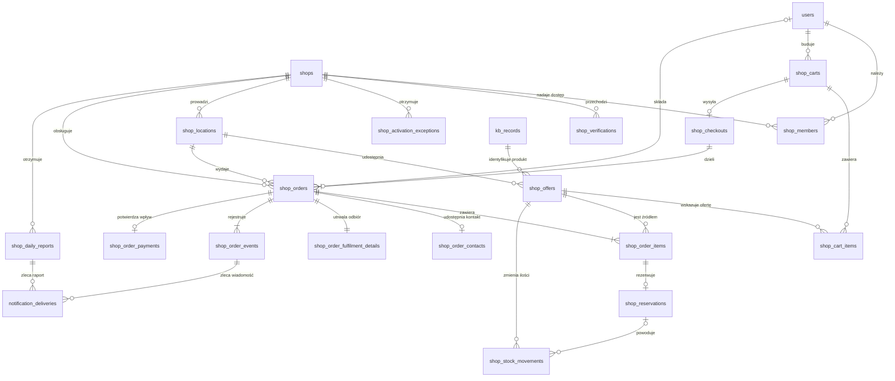
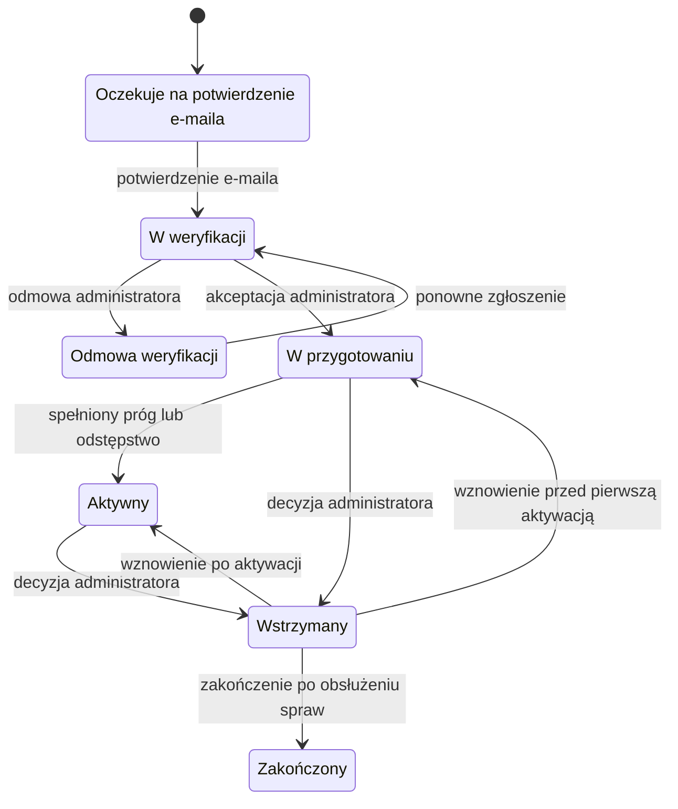
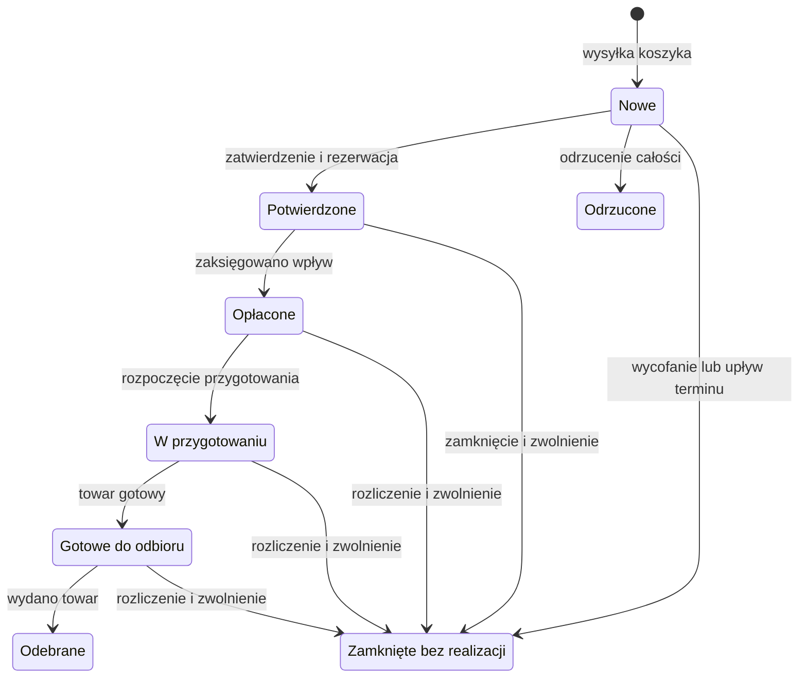

# Aikwarium v2 — domena sklepów

## 1. Cel i zakres

Shops 1.0 pozwala złożyć jeden koszyk z ofert wielu sklepów. Platforma tworzy osobne zamówienie dla każdego sklepu. Sklep podejmuje jedną decyzję dla całego zamówienia, rezerwuje towar przy zatwierdzeniu, potwierdza wpływ przelewu, przygotowuje towar i wydaje go osobiście.

| Zakres | Projekt |
|---|---|
| **Shops 1.0 — pilot** | Weryfikacja sklepu, placówki odbioru, oferty z katalogu, dostępna ilość i jej historia, koszyk wielosklepowy, decyzja per sklep, EAN-13, przelew poza platformą, odbiór osobisty, zamknięcie bez realizacji, powiadomienia, raport dobowy i audyt. |
| **Shops 1.1 — rozszerzenie** | Decyzje per pozycja, korekty ilości z uzasadnieniem, ponowne wyliczenie braków, aktualizacja koszyka na żywo i monitoring zamówień oraz ilości. W pilocie utrwalamy dane i granice operacji potrzebne do rozszerzenia. |
| **„Zmieść mój zakup” — rozszerzenie** | Osobny moduł oblicza wariant zakupu z publicznych danych Shops. Po akceptacji klient korzysta ze zwykłych operacji koszyka i wysyłki. |
| **Poza pilotem** | Dostawa, płatność online, abonament sklepu, prowizje, afiliacja, kontrpropozycje oraz korekty ceny i ilości zamówienia. Importy ofert, zewnętrzne feedy i automatyzacja płatności wymagają osobnej decyzji. |
| **Technologia** | Nowa aplikacja Laravel 13, Filament i Livewire, MySQL 8.4, InnoDB. Operacje domenowe współdzielone przez web i przyszłe API mobilne. Panel i zadania kolejki wywołują te same operacje. |

Kierunek wiążący pochodzi z mapy z 22.11.2026, w tym z decyzji z 18.11. Poprzedni projekt afiliacyjny traci zastosowanie w pilocie. Semantyka zaproponowana w tym dokumencie, której mapa nie rozstrzyga, jest wskazana w §10. Stan WordPressa przytoczono za przekazaną analizą z odsyłaczami do kodu. Stagingu, PHP i danych wdrożeniowych nie weryfikowano ponownie. `AquaSmart-plugins-aktualne/docs/mapa-funkcjonalnosci.md:225–304` · `aquawiedza-v2/docs/02-projekt/00-decyzje.md:5–26` · `aquawiedza-v2/docs/02-projekt/10-domena-sklepu.md:3–14,387–402` · `aquawiedza-v2/docs/01-analiza/60-aktualizacja-do-galezi-aktualnej.md:3–9,302–328`

### Stan wyjściowy WordPressa i wymagane poprawki

Ścieżki kodu w tabeli są względne wobec `AquaSmart-plugins-aktualne/`.

| Status | Zachowanie w badanej wersji | Rozwiązanie w v2 |
|---|---|---|
| **Działa** | Sklep wybiera rekordy z czterech obszarów katalogu. Zalogowany klient buduje koszyk, który jest grupowany według sklepu. `aquasmart-shops/includes/class-aqss-offers.php:40–53,110–139` · `aquasmart-shops/includes/class-aqss-cart.php:56–98,104–184` | Wspólny kontrakt katalogu i jawne nagłówki zamówień per sklep. |
| **Częściowo działa** | Wysyłka zapisuje pozycje pojedynczo, przy każdym wykonaniu losuje klucz grupy, a wynik może zgłosić sukces dla sklepu mimo niepełnego zapisu. Limit **5** liczy pozycje. `aquasmart-shops/includes/class-aqss-cart.php:136–184` · `aquasmart-shops/includes/class-aqss-requests.php:38–108` | Atomowa wysyłka i jawny klucz ponowienia. Proponowana jednostka limitu to wysłane zamówienie per sklep. |
| **Błąd** | Ten sam EAN jest zapisywany na kilku wierszach z `UNIQUE(number)`. Wynik zapisu numeru nie jest sprawdzany. `aquasmart-shops/includes/class-aqss-db.php:142–174` · `aquasmart-shops/includes/class-aqss-requests.php:506–529` | Jeden nullable EAN na nagłówku. Błąd numeracji wycofuje całą decyzję. |
| **Błąd** | Edycja oferty używa niezdefiniowanego `$pool` przy uwzględnianiu rezerwacji. `aquasmart-shops/includes/class-aqss-offers.php:225–227,268–296` | Zmiana dostępnej ilości jest odrębną operacją z blokadą i historią. |
| **Częściowo działa** | Decyzja całego podkoszyka współistnieje z decyzją per pozycja. Stan mieszany blokuje decyzję zbiorczą. Zapis historii i ponowna kontrola warunków oferty są niepełne. `aquasmart-shops/includes/class-aqss-controller.php:72–88,112–145` · `aquasmart-shops/includes/class-aqss-basket.php:26–29,44–114,148–198` · `aquasmart-shops/includes/class-aqss-offers.php:340–353` | Jedna ścieżka decyzji pilota. Blokada nagłówka i ofert, wspólna walidacja, obowiązkowy zapis historii. |
| **Błąd** | Zbiorcze zatwierdzenie nie nadaje kodu odbioru, którego wymaga operacja wydania. `aquasmart-shops/includes/class-aqss-basket.php:88–109` · `aquasmart-shops/includes/class-aqss-requests.php:251–269,554–570` | Uprawniony pracownik oznacza wydanie z poziomu zamówienia. Kod i kartka odbioru są wyłączone. |
| **Udokumentowane, brakuje pełnego przepływu** | Mapa wymaga ręcznego potwierdzenia wpływu, atomowego zamknięcia ze zwrotem rezerwacji i raportu o **10:00**. Bieżący kontroler nie ma operacji potwierdzenia wpływu, a zmiana stanu i zwrot są odrębnymi zapisami. `AquaSmart-plugins-aktualne/docs/mapa-funkcjonalnosci.md:225–248` · `aquasmart-shops/includes/class-aqss-controller.php:112–145` · `aquasmart-shops/includes/class-aqss-requests.php:202–236,331–342,532–551` | Pełny automat zamówienia i odtwarzalny raport dobowy. |
| **Zaimplementowane poza opisem pilota** | Obecne reguły i widoki zawierają abonament i odbiór z kodem. Decyzja z 18.11 wyłącza je w pilocie. `aquasmart-shops/includes/class-aqss-rules.php:66–70,101–105,135–147` · `aquasmart-shops/includes/class-aqss-views.php:51–99,933–945` · `AquaSmart-plugins-aktualne/docs/mapa-funkcjonalnosci.md:235–239` | Kod odbioru i abonament pozostają oddzielnymi punktami rozszerzeń. |
| **Martwe w zwykłym wejściu użytkownika** | Stare demo A/B/C jest wyłączone, choć metody i dane pozostają dostępne w kodzie. `aquasmart_v103/includes/class-aqs-demo.php:110–120` · `aquasmart_v103/includes/class-akwasmart-engine.php:26–47,143–222` | Demo A/B/C pomijamy przy budowie katalogu, koszyka i ścieżek doboru. |

Wynik odbioru Shops 0.4.0 na stagingu pozostaje niepotwierdzony w dostępnych źródłach. Mapa podaje wdrożenie tej wersji na staging i brak wdrożenia na produkcji. `AquaSmart-plugins-aktualne/docs/mapa-funkcjonalnosci.md:241–245,382` · `aquawiedza-v2/docs/01-analiza/60-aktualizacja-do-galezi-aktualnej.md:289–299`

## 2. Role, dostęp i uruchomienie sklepu

| Aktor | Dostęp w kontekście klienta | Dostęp w kontekście sklepu |
|---|---|---|
| **Drop** (`anon`) | Odczyt publicznych ofert. Rejestracja i logowanie przed dodaniem do koszyka. | Publiczna wizytówka. |
| **Tank** (`free`) | Bezterminowe konto po aktywacji. Koszyk, wysyłka i własne zamówienia. | Panel po przyznaniu członkostwa. |
| **Fishroom** (`full`) | Te same prawa zakupowe. Dodatkowe uprawnienia akwarystyczne i katalogowe wynikają z płatnego dostępu. | Panel po przyznaniu członkostwa. |
| **Właściciel sklepu** | Indywidualny dostęp jak dla własnego konta. | Profil, placówki, członkowie, oferty, ilości, zamówienia, wpływy, odbiór i raporty własnego sklepu. |
| **Pracownik sklepu** | Indywidualny dostęp jak dla własnego konta. | Oferty, ilości i obsługa zamówień własnego sklepu według nadanych uprawnień. Raport i potwierdzanie wpływu wymagają odpowiedniego uprawnienia. |
| **Administrator** | Dostęp indywidualny według poziomu konta. | Weryfikacja firmy, odstępstwa, wstrzymanie i wznowienie, wersje ustawień, audyt i wsparcie w zakresie nadanych uprawnień. |

Jedno `users.id` może należeć do klienta i członka kilku sklepów. Zmiana kontekstu panelu wybiera sklep, a Policy sprawdza aktywne członkostwo, uprawnienie i identyfikator zasobu. Rekomendujemy blokadę zakupu we własnym sklepie dla właściciela i aktywnego personelu, sprawdzaną przy modyfikacji i wysyłce koszyka. Bieżący WordPress blokuje własną placówkę w koszyku. `aquasmart-shops/includes/class-aqss-cart.php:56–98` · `AquaSmart-plugins-aktualne/docs/mapa-funkcjonalnosci.md:106–113`

| Krok | Warunek i rezultat |
|---|---|
| Rejestracja | Nazwa firmy, NIP, adres, dane kontaktowe, e-mail i hasło. Potwierdzenie e-maila otwiera kolejkę weryfikacji firmy. |
| Weryfikacja | Administrator sprawdza podmiot i reprezentanta. Akceptacja otwiera przygotowanie. Odmowa wymaga powodu, a ponowne zgłoszenie tworzy nową próbę. |
| Przygotowanie | Sklep uzupełnia profil, co najmniej jedną czynną placówkę odbioru i publikuje oferty z katalogu. Panel pokazuje licznik kwalifikujących się ofert. |
| Aktywacja | Automatyczna po spełnieniu progu **50** ofert albo po przyznaniu odstępstwa pilota. Obie ścieżki wymagają zweryfikowanej firmy i gotowej placówki. |
| Limit ofert | Startowo **150**. Liczą się opublikowane, jeszcze niewygasłe oferty, także przyszłe i z zerową ilością, oraz oferty oczekujące na moderację, jeśli ją włączono. Szkice nie zajmują limitu. |
| Odstępstwo | Administrator podaje powód i zakres czasowy. W pilocie odstępstwo zastępuje warunek progu startu. Limit ofert i weryfikacja obowiązują dalej. |
| Spadek poniżej progu | Proponowana reguła utrzymuje stan aktywny po zwykłym spadku liczby ofert. Publiczny odczyt pokazuje wyłącznie oferty spełniające bieżące warunki. |
| Wstrzymanie | Blokuje nową sprzedaż i zatwierdzanie nowych zamówień. Sklep może odrzucić oczekujące zamówienia i obsłużyć już zatwierdzone. Wsparcie administracyjne przejmuje sprawy, gdy dostęp sklepu został odebrany. |
| Zakończenie udziału | Dopiero po zamknięciu spraw otwartych. Historia i rozliczenie ewentualnych wpływów pozostają dostępne w granicach retencji. |

Proponowany licznik aktywacji obejmuje różne opublikowane oferty ważne w chwili oceny i wskazujące aktywne rekordy katalogu oraz czynne placówki. Oferta z ilością zero liczy się do progu, a klienci kupują wyłącznie przy ilości dodatniej. Zmiana progu lub terminu oferty uruchamia ponowną ocenę sklepów w przygotowaniu. `AquaSmart-plugins-aktualne/docs/mapa-funkcjonalnosci.md:244–248,359–372` · `aquawiedza-v2/docs/01-analiza/60-aktualizacja-do-galezi-aktualnej.md:284–285,304–313`

## 3. Model danych MySQL 8.4

### Konwencje i ustawienia

- Wewnętrzne identyfikatory i FK to `BIGINT UNSIGNED`. Daty operacji to `DATETIME(6)` w UTC. Dzień biznesowy wyznacza strefa `Europe/Warsaw`. Przedziały ważności mają postać `[od, do)`.
- Kwoty przechowujemy w groszach jako liczby całkowite, z walutą na nagłówku. Pilot używa PLN oraz ceny końcowej dla klienta. Mnożenie ceny przez ilość i sumowanie sprawdzają zakres typu przed zapisem.
- `UQ` oznacza klucz unikalny, `IX` indeks odczytu. FK historii mają domyślnie `RESTRICT`. Dla usuwalnych powiązań z osobą stosujemy jawne `SET NULL` albo usuwamy chronioną migawkę kontaktu.
- Stany i lokalne warunki wiersza mają `CHECK`. Zgodność w obrębie sklepu zabezpieczają złożone FK. Warunki między wierszami, datami i wersjami ustawień sprawdza operacja domenowa.
- Jedna tabela `setting_versions(id, key, value JSON, effective_from, created_by, reason)`, `UQ(key,effective_from)`. `Settings::at(czas)` wybiera obowiązujące wartości. Definicje i walidacja typów są w aplikacji.
- Powiązane zmiany administrator publikuje jedną transakcją z tą samą datą wejścia w życie. Historia zachowuje identyfikatory wersji rzeczywiście użytych w danej operacji. Wycofanie wartości oznacza nową wersję. `aquawiedza-v2/docs/02-projekt/00-decyzje.md:20–26` · `aquawiedza-v2/docs/02-projekt/11-model-domenowy.md:50–56,411–423`

| Ustawienie | Wartość początkowa i zastosowanie |
|---|---|
| Próg aktywacji i limit ofert | **50 / 150**. Próg dodatni i nie większy od limitu. Obniżenie limitu blokuje przyrost, a istniejące zamówienia pozostają obsługiwane. |
| Dzienny limit wysyłki | Propozycja **5 zamówień per klient na dzień lokalny**. Wysyłka do trzech sklepów zużywa trzy jednostki. Zapis zachowuje wersję reguły użytej przy naliczeniu. |
| Cena i ilości oferty | Punkt wyjścia do zatwierdzenia **0 < cena ≤ 100 000 zł**, ilość handlowa **0–1000**, **1–50 sztuk** w pozycji klienta. To wartości z bieżącej analizy, z osobnym ustawieniem każdej granicy. |
| Moderacja ofert | Domyślnie wyłączona. Po włączeniu nowa oferta oczekuje na decyzję. |
| Terminy odpowiedzi, wpłaty i odbioru | Osobne opcjonalne ustawienia. Rekomendowane postępowanie w pilocie opisano w §10. Termin zapisany na zamówieniu pozostaje odtwarzalny. |
| Pseudonimizacja | **90 dni** od stanu końcowego. Zamówienie utrwala `pseudonymize_at` i wersję reguły. |
| Raport dobowy | **10:00**, `Europe/Warsaw`. Jeden raport na sklep i dzień, wysyłka ograniczona do jednej próby na sklep w ruchomym oknie **60 minut**. |
| Pilot i dostęp sklepu | Pilot bez opłat. Oddzielny, historyczny okres próbny sklepu ma punkt odniesienia **60 dni od akceptacji**. W pilocie start i wygaśnięcie płatniczego trialu są nieaktywne. |
| Fishroom | **19 zł/mies.** jako wartość robocza do zatwierdzenia. Aktywacja sprzedaży wymaga zatwierdzonej ceny, waluty, okresu i operatora. |
| Ponowienia i retencja techniczna | Limity prób i okresy przechowywania logów, kluczy operacji, koszyków i raportów mają odrębne wersje. Retencja kluczy pokrywa obsługiwane okno ponowień. |
| Rozszerzenia | Kod odbioru i abonament sklepu wyłączone w pilocie. Limit odbiorów optymalizatora początkowo **2**, do zatwierdzenia przed jego wdrożeniem. |

Podstawa wartości i ich statusu. `AquaSmart-plugins-aktualne/docs/mapa-funkcjonalnosci.md:90–110,235–252,278–295` · `aquawiedza-v2/docs/01-analiza/60-aktualizacja-do-galezi-aktualnej.md:257–265,289–313` · `aquasmart-shops/includes/class-aqss-offers.php:185–265` · `aquasmart-shops/includes/class-aqss-cart.php:56–98` · `aquasmart-auth/includes/class-aqs-trial.php:20–45`

### Sklep, placówki, członkostwo i katalog

| Tabela | Dane i ograniczenia |
|---|---|
| `shops` | `id`, publiczny identyfikator i `slug` unikalne, nazwa, znormalizowany NIP, stan, `version`, `activated_at`, `created_at`. Propozycja `UQ(nip)` dla jednego sklepu na podmiot. `IX(state,id)`. |
| `shop_locations` | `id`, `shop_id`, nazwa, adres odbioru, kontakt operacyjny, godziny, `active`. `UQ(shop_id,id)`, `IX(shop_id,active,id)`. |
| `shop_members` | `shop_id`, `user_id`, rola właściciela lub pracownika, uprawnienia, stan, daty. `UQ(shop_id,user_id)`, `IX(user_id,state,shop_id)`. Jeden aktywny właściciel wymuszony nullable kluczem wygenerowanym z roli i stanu albo równoważnym ograniczeniem unikalnym. Przeniesienie własności atomowe. |
| `shop_verifications` | `id`, `shop_id`, numer próby, dane reprezentanta, chronione odwołanie do dokumentów, stan, decyzja, `decided_by`, `decided_at`, powód. `UQ(shop_id,attempt_no)`, `IX(state,submitted_at,id)`. Maksymalnie jedna próba w toku per sklep. |
| `shop_activation_exceptions` | `id`, `shop_id`, od–do, powód, autor, ewentualne odwołanie i jego autor. `IX(shop_id,effective_from,id)`. Operacja odrzuca nakładające się aktywne odstępstwa. |
| `shop_offers` | `id`, `shop_id`, `location_id`, `kb_record_id`, wariant i znormalizowany klucz wariantu, cena, `valid_from`, `valid_to`, stan, `free_qty`, `reserved_qty`, `version`, `terms_version`. FK placówki `(shop_id,location_id)`. `UQ(shop_id,id)`, `UQ(shop_id,location_id,kb_record_id,variant_key)`. |
| `shop_stock_movements` | `id`, `shop_id`, `offer_id`, opcjonalna rezerwacja, rodzaj ruchu, `delta_free`, `delta_reserved`, stany po zmianie, aktor, powód i czas. `UQ(operation_id,offer_id,movement_kind)`, `IX(offer_id,occurred_at,id)`. |

- Oferta ma stabilny klucz katalogowy i tożsamość wariantu w placówce. Wycofaną ofertę można ponownie opublikować jako ten sam rekord, z historią. Zmiana produktu, placówki lub tożsamości wariantu wymaga odrębnej oferty.
- Katalog jest do odczytu dla sklepu. Sklep wybiera spośród aktywnych pozycji fauny, flory, sprzętu i pielęgnacji. Wycofanie wpisu z katalogu zachowuje FK dla historii.
- `valid_to > valid_from`, cena dodatnia, liczniki ilości nieujemne. Indeksy ofert `IX(kb_record_id,state,valid_to,shop_id,id)` pod odczyt katalogu i `IX(shop_id,state,valid_to,id)` pod panel oraz aktywację. Wyszukiwanie ostatecznie sprawdza obie granice czasu, stan sklepu, placówki i katalogu.
- `terms_version` obejmuje cenę, prezentowany wariant i warunki ważności. Uzupełnienie ilości zmienia `version` do kontroli współbieżności, zachowując wersję warunków.
- Edycja ilości podaje **nową dostępną ilość**. Operacja sprawdza potwierdzenie stanu fizycznego, zachowuje `reserved_qty` i egzekwuje limit dla `free_qty + reserved_qty`. Zmniejszenie dostępnej ilości nigdy nie pomniejsza istniejących rezerwacji.
- Historia ilości zaczyna się od stanu otwarcia. Rezerwacja przenosi sztuki z wolnych do zarezerwowanych. Zwolnienie odwraca ten ruch, także dla wygasłej oferty. Wydanie odejmuje sztuki wyłącznie z zarezerwowanych.

### Koszyk, zamówienie i obsługa

| Tabela | Dane i ograniczenia |
|---|---|
| `shop_carts` | `id`, `customer_id → users`, `state`, `version`, daty. Jedna aktywna wersja koszyka użytkownika przez unikalny nullable klucz aktywności. |
| `shop_cart_items` | `cart_id`, `shop_id`, `offer_id`, `qty`, ostatnio zaakceptowane `terms_version` i cena do porównania. `PK(cart_id,offer_id)`, FK `(shop_id,offer_id)`, `CHECK(qty>0)`. |
| `shop_checkouts` | `id`, publiczny identyfikator, opcjonalny `customer_id` po retencji, koszyk lub jego trwałe odniesienie, `submitted_at`, `business_date`, liczba zamówień, identyfikator wersji limitu, `operation_id UQ`. |
| `shop_customer_request_days` | `customer_id`, `business_date`, `used_orders`. `PK(customer_id,business_date)`. Jeden wiersz do współbieżnej kontroli limitu. |
| `shop_orders` | `id`, `public_id UQ`, `checkout_id`, `shop_id`, `location_id`, nullable `customer_id`, stan, `version`, waluta, kwota zamówienia, `ean13 CHAR(13) ASCII NULL UQ`, znaczniki decyzji, zamknięcia i retencji. `UQ(checkout_id,shop_id)`, `UQ(shop_id,id)`, FK `(shop_id,location_id)`. |
| `shop_order_items` | `id`, `shop_id`, `order_id`, `offer_id`, stabilny klucz katalogowy, migawka nazwy, wariantu i ceny, wersja warunków, `qty_requested`, `qty_confirmed NULL`. FK do zamówienia i oferty w tym samym sklepie. `UQ(order_id,offer_id)`. |
| `shop_order_contacts` | `order_id PK`, chronione migawki nicku, e-maila i telefonu. Jeden rekord na zamówienie. |
| `shop_order_fulfilment_details` | `order_id PK`, migawka miejsca i instrukcji odbioru. Przy zatwierdzeniu zapis odbiorcy przelewu i rachunku sklepu w chronionych polach. |
| `shop_order_events` | `id`, `shop_id`, `order_id`, `order_version`, typ zdarzenia, stan przed i po, powód, opcjonalny opis, aktor lub automat, czas, `operation_id`, wersje reguł. `UQ(order_id,order_version)`, `IX(shop_id,occurred_at,id)`. |
| `shop_order_rejection_reasons` | Stabilne kody `brak_aktualnej_oferty` i `inne`, polskie etykiety oraz warunek opisu. Kod historyczny pozostaje czytelny po zmianie etykiety. |
| `shop_reservations` | `id`, `order_item_id UQ`, `shop_id`, `offer_id`, ilość, stan, `held_at`, `resolved_at NULL`. Złożone FK wiążą tę samą pozycję, ofertę i sklep. `IX(offer_id,state,id)`. |
| `shop_order_payments` | `order_id PK`, operator potwierdzenia, kwota, waluta, `confirmed_at`, opcjonalna data wpływu, `operation_id UQ`. Przy zamknięciu opłaconego zamówienia opis rozliczenia poza platformą trafia do historii. |
| `shop_operations` | `id`, zakres aktora i podmiotu, rodzaj operacji, klucz UUID, skrót kanonicznych danych, referencja wyniku, czas. `UQ(scope,operation_kind,idempotency_key)`. Wynik i skrót nie przechowują jawnego kontaktu klienta. |

- Indeksy nagłówków `IX(shop_id,state,created_at,id)`, `IX(customer_id,created_at,id)`, `IX(pseudonymize_at,id)` oraz unikalny EAN. Wiersze raportu wyszukuje się po sklepie i czasie zdarzenia.
- Pilot przyjmuje jedną placówkę odbioru w ramach zamówienia danego sklepu. Przy ofertach z różnych placówek tego samego sklepu koszyk wskazuje konflikt przed wysyłką. Nie rozdziela zamówienia bez decyzji klienta.
- Każde zamówienie ma przynajmniej jedną pozycję. Ilość potwierdzona w pilocie równa się żądanej albo pozostaje `NULL`. Wycena i sumy pochodzą z migawek. Po zatwierdzeniu dane handlowe są utrwalone.
- Kontakt jest osobnym rekordem do trwałego odłączenia. Historyczna tożsamość sklepu, pozycje, kwoty, EAN i stany pozostają czytelne po pseudonimizacji w uzgodnionym okresie retencji.
- Klucze techniczne lub relacje prowadzące pośrednio do klienta, w tym przez koszyk, wysyłkę lub deduplikację, podlegają tej samej procedurze prywatności.

### Raporty, powiadomienia i audyt

| Tabela | Dane i ograniczenia |
|---|---|
| `shop_daily_reports` | `id`, `shop_id`, `business_date`, `period_from`, `period_to`, `generated_at`, wersja reguły, agregaty. `UQ(shop_id,business_date)`. |
| `notification_deliveries` | Modułowy rejestr dostarczeń. Zdarzenie źródłowe, typ komunikatu, odbiorca jako chroniona referencja, kanał, stan, liczba prób, ostatnia i następna próba, identyfikator dostawcy. `UQ(source_type,source_id,purpose,recipient_key,channel)`, `IX(state,next_attempt_at,id)`. |
| `shop_report_delivery_state` | `shop_id PK`, czas ostatniej próby wysyłki. Blokada jednego wiersza serializuje wysyłki dobowe i zaległe. |
| `activity_log` | Audyt administracyjny i operacyjny przez `laravel-activitylog`. Typ obiektu, identyfikator, sklep, akcja, aktor, powód, dozwolone pola przed/po i czas. Indeksy po sklepie, obiekcie i czasie. |

ERD pokazuje relacje biznesowe. Odwołanie rejestru dostarczeń do zdarzenia lub raportu identyfikuje źródło komunikatu. Pola chronione i ograniczenia retencji obowiązują także przy eksporcie.

## 4. Automaty stanów

### Sklep i oferta

| Przejście oferty | Kto i kiedy |
|---|---|
| Utworzenie → **Szkic** | Właściciel lub pracownik z uprawnieniem. W czasie weryfikacji można uzupełnić profil, a tworzenie ofert otwiera stan przygotowania. |
| Szkic → **Opublikowana** albo **Oczekuje na moderację** | Sklep. Walidacja rekordu katalogu, placówki, wariantu, ceny, ilości, dat i limitu. |
| Oczekuje → **Opublikowana** lub **Odrzucona** | Administrator przy włączonej moderacji. Odmowa ma powód. |
| Odrzucona → **Szkic** | Sklep wprowadza poprawki i ponownie zgłasza. |
| Opublikowana → **Wygasła** | Harmonogram oznacza wygaśnięcie. Granica `valid_to` działa w odczycie i zakupie natychmiast, także przed uruchomieniem harmonogramu. |
| Opublikowana → **Wycofana** | Sklep lub administrator w swoim zakresie. Wycofanie blokuje nowe rezerwacje i zachowuje istniejące. |
| Wygasła lub wycofana → **Opublikowana** albo **Oczekuje na moderację** | Sklep po ponownej walidacji. Wersja i historia zachowują poprzednie warunki. |

Opublikowana oferta z przyszłą datą jest zaplanowana. Oferta opublikowana z zerową ilością może być widoczna w panelu jako niedostępna. W publicznym wyborze i przy dodawaniu do koszyka obowiązuje jedna polityka kwalifikacji.

### Zamówienie per sklep

| Stan docelowy | Kto | Warunek i skutek |
|---|---|---|
| **Nowe** | Klient | Złożony koszyk. `ean13=NULL`, brak rezerwacji i instrukcji płatności. |
| **Potwierdzone** | Uprawniony członek sklepu | Cały nagłówek w stanie nowym, bieżące warunki wszystkich pozycji zgodne, ilość dostępna. Wspólny zapis EAN, rezerwacji, informacji o przelewie i historii. |
| **Odrzucone** | Uprawniony członek sklepu | Całe nowe zamówienie. Kod `brak_aktualnej_oferty` lub `inne`, dla `inne` obowiązkowy opis. Jeden EAN identyfikacyjny, bez instrukcji płatności. |
| **Opłacone** | Sklep z uprawnieniem do wpływów | Ręczne potwierdzenie otrzymania pełnej kwoty poza platformą. Jedna operacja na zamówienie, stan rezerwacji pozostaje aktywny. |
| **W przygotowaniu** | Uprawniony członek sklepu | Po potwierdzeniu wpływu. Wydanie wcześniej jest zablokowane. |
| **Gotowe do odbioru** | Uprawniony członek sklepu | Towar fizycznie odłożony, klient dostaje miejsce i informacje o odbiorze. |
| **Odebrane** | Uprawniony członek sklepu | Potwierdzenie wydania po fakcie. Rezerwacje przechodzą w zużyte. Pilot przyjmuje wydanie z panelu bez kodu i kartki. |
| **Zamknięte bez realizacji** | Klient dla nowego, sklep dla otwartego, system dla włączonego terminu nowego lub nieopłaconego, administrator w trybie wsparcia | Powód obowiązkowy. Wszystkie aktywne rezerwacje zwolnione w tej samej transakcji. Po wpływie sklep zapisuje sposób rozliczenia poza platformą przed zamknięciem. |

- `Nowe → Zamknięte bez realizacji` może pozostać bez EAN, ponieważ nie było decyzji sklepu. Po nadaniu EAN jest trwały, także po zamknięciu. Powody zamknięcia mają własny słownik, odrębny od powodów odrzucenia.
- **Odrzucone**, **Odebrane** i **Zamknięte bez realizacji** są końcowe. Ponowienie komendy zwraca zapisany efekt, a inna komenda próbująca zmienić stan końcowy otrzymuje konflikt.
- Aktywna rezerwacja ma ilość równą potwierdzonej pozycji. Stan końcowy pozycji rezerwacji to **Zwolniona** albo **Zużyta**. Każda zmiana ma odpowiadający ruch ilości.
- Odmowa zatwierdzenia z powodu rozbieżności zostawia zamówienie w stanie **Nowe** i zwraca listę problemów. Sklep może wykonać odrębną decyzję o odrzuceniu. `AquaSmart-plugins-aktualne/docs/mapa-funkcjonalnosci.md:227–248` · `aquawiedza-v2/docs/01-analiza/60-aktualizacja-do-galezi-aktualnej.md:257–273,309–314`

## 5. Operacje domenowe

Każda mutacja ma wejście niezależne od interfejsu, identyfikator aktora i wynik strukturalny. Filament, Livewire i późniejsze API tłumaczą wynik na komunikat lub odpowiedź transportową. Reguła katalogu, uprawnienie i warunki stanu mają wspólną implementację.

| Operacja | Wejście | Gwarancje i wynik po zatwierdzeniu transakcji |
|---|---|---|
| **Zgłoś i zweryfikuj sklep** | Dane firmy, użytkownik, próba, decyzja i powód | Jedna aktualna próba, aktywny właściciel, historia decyzji. Po akceptacji zdarzenie o weryfikacji. |
| **Oceń gotowość sklepu** | Sklep, czas reguły i przyczyna oceny | Blokada sklepu. Aktualny próg, limit, ważność i ewentualne odstępstwo. Jedno zdarzenie przy zmianie stanu. |
| **Opublikuj lub zmień ofertę** | Sklep, placówka, katalog, wariant, warunki, oczekiwana wersja | Wspólna walidacja, kontrola limitu pod blokadą sklepu, zachowane rezerwacje. Po zmianie zdarzenie o ofercie lub jej widoczności. |
| **Ustaw dostępną ilość** | Oferta, oczekiwana wersja, nowa dostępna ilość, potwierdzenie fizyczne, powód, klucz | Blokada oferty, stała ilość zarezerwowana, jeden ruch ilości. Stara wersja zwraca aktualną wartość do ponownego sprawdzenia. |
| **Zmień koszyk** | Klient, koszyk, oferta, ilość, oczekiwana wersja | Kontrola własności, uprawnienia i bieżącej oferty. W koszyku zapis oczekiwanej ceny i wersji, bez rezerwacji. |
| **Wyślij koszyk** | Klient, koszyk, oczekiwana wersja, jawny klucz ponowienia, potwierdzony kontakt | Jeden zapis wysyłki i wszystkich nagłówków, pozycji oraz kontaktów, inkrementacja limitu, zamknięcie koszyka. Jeden sygnał do sklepu per nagłówek, jedno podsumowanie dla klienta. |
| **Zdecyduj o zamówieniu** | Sklep, zamówienie, wersja, decyzja, kod/powód, klucz | Jedyny zapis decyzji pilota. Zatwierdzenie sprawdza warunki wszystkich ofert i rezerwuje razem. Odrzucenie zapisuje powód. Obie decyzje utrwalają jeden EAN i historię. |
| **Potwierdź wpływ** | Zamówienie, wersja, pełna kwota, opcjonalna data wpływu, klucz | Jedno potwierdzenie na zamówienie, kwota i waluta zgodne z nagłówkiem. Zdarzenie o wpływie. |
| **Rozpocznij przygotowanie / oznacz gotowość** | Zamówienie, wersja, klucz | Tylko dozwolone przejście. Gotowość uruchamia powiadomienie klienta. |
| **Potwierdź wydanie** | Zamówienie, wersja, klucz | Stan gotowości, komplet aktywnych rezerwacji. Jednorazowe zużycie rezerwacji i wpis wydania w jednej transakcji. |
| **Zamknij bez realizacji** | Zamówienie, wersja, powód, ewentualne rozliczenie, klucz | Atomowe zamknięcie, zwolnienie wszystkich aktywnych rezerwacji i historia. Powtórka nie zwraca sztuk drugi raz. |
| **Zbuduj raport / pseudonimizuj** | Sklep i dzień albo zamówienie i obowiązujący termin | Raport unikalny w zakresie sklepu i dnia. Pseudonimizacja blokuje zamówienie i odłącza kontakt, kończy się wpisem bez danych kontaktowych. |

### Wysyłka koszyka

1. Sprawdź sesję, własność koszyka i poziom konta. Zablokuj wiersz klienta, koszyka i dziennego licznika dla ustalonego czasu biznesowego.
2. Rozpoznaj klucz ponowienia **przed** odrzuceniem zamkniętego koszyka lub nieaktualnej wersji. Dla klucza z tym samym skrótem zwróć poprzedni wynik. Inna treść pod tym samym kluczem daje konflikt.
3. Zgrupuj po sklepach, sprawdź jedną placówkę per sklep, ponownie odczytaj warunki oraz ilości pod blokadami i porównaj z ostatnią akceptacją klienta.
4. Jeśli oferta się zmieniła, wskaż pozycje wymagające ponownego przeglądu. Jeśli limit nie wystarcza na wszystkie grupy, pokaż wykorzystanie i pozostałą liczbę zamówień. Cały koszyk pozostaje otwarty.
5. Zapisz wysyłkę, zamówienia, pozycje, chroniony kontakt, historię i wynik operacji. Nalicz limit i zamknij koszyk w tej samej transakcji. Kolejna zmiana klienta otwiera nowy koszyk.
6. Wysyłka rejestruje zapotrzebowanie. Dostępna ilość może się zmienić przed decyzją sklepu, co ekran klienta komunikuje obok stanu **Nowe**.

### Zatwierdzenie, blokady i ponowienia

- Mutacje mają stały porządek blokad. Najpierw potrzebne rekordy tożsamości lub koszyka, następnie sklepy rosnąco po ID, nagłówki, oferty rosnąco po ID, rezerwacje i na końcu licznik EAN. Operacje biorą podzbiór w tym porządku. Zmiana członkostwa też serializuje się na sklepie.
- Operacja używa jednego znacznika czasu i jednego zestawu wartości ustawień. Walidacja katalogu korzysta ze spójnego wydania. Jeśli zatwierdzenie ma się serializować z publikacją katalogu, oba przebiegi współdzielą blokadę wskaźnika wydania pobieraną przed blokadami sklepów.
- Sprawdzenie oferty przy zatwierdzeniu obejmuje sklep, placówkę, rekord katalogu, daty, cenę, identyfikację wariantu, wersję warunków i łączne zapotrzebowanie na daną ofertę. Proponowana reguła wymaga ponownego złożenia po zmianie warunków handlowych.
- Aktualizacja ilości ma warunek `free_qty ≥ potrzebna_ilość`. Operacja sprawdza wynik każdego zapisu. Numer, pozycje, rezerwacje, historia, audyt i wynik ponowienia zatwierdzają się wspólnie. Błąd zapisu oznacza rollback.
- Klucz ponowienia należy do operacji biznesowej. Skrót obejmuje m.in. zakres, wersję i kanoniczne wartości wejściowe. Ponowienie wyniku ponownie sprawdza prawo odczytu. Konflikt po zmianie stanu zwraca bieżący status do odświeżenia.
- Zakleszczenie można ponowić w granicach ustawień, używając tego samego klucza. Zadanie kolejki i żądanie webowe stosują te same ograniczenia, więc równoległe zatwierdzenie lub wydanie zwraca jeden efekt.
- Zdarzenia i zadania wysyłamy przez `ShouldDispatchAfterCommit` lub `afterCommit()`. Historia domenowa jest częścią transakcji. Wysyłka ma własny rejestr dostarczeń, a harmonogram potrafi odtworzyć brakujące zlecenie z zapisanej historii. `aquawiedza-v2/docs/02-projekt/11-model-domenowy.md:411–423`

## 6. Numeracja EAN-13 i migracja

Bieżący format Shops ma prefiks `2`, cztery cyfry identyfikatora placówki, siedem cyfr globalnej sekwencji i cyfrę kontrolną. v2 zachowuje format z osobnym, stabilnym numerem placówki, niezależnym od klucza głównego MySQL. `aquasmart-shops/includes/class-aqss-numbering.php:18–81` · `AquaSmart-plugins-aktualne/docs/mapa-funkcjonalnosci.md:227–232`

1. Nadaj placówce trwały numer techniczny z zakresu **1–9999**, unikalny także po zamknięciu placówki. Zapisz mapowanie starszych numerów przed przydzielaniem nowych.
2. Zablokuj jednorzędową tabelę `shop_ean_sequence` i pobierz następny globalny numer **1–9 999 999**. Nie używaj `MAX()+1`.
3. Zbuduj 12 cyfr `2` + numer placówki uzupełniony zerami do czterech cyfr + sekwencja uzupełniona do siedmiu.
4. Policz sumę cyfr od lewej, naprzemiennie z wagami `1,3`. Cyfra kontrolna to `(10 − suma mod 10) mod 10`.
5. Zapisz pełne 13 znaków w `shop_orders.ean13` w transakcji decyzji. Wymuś 13 cyfr, potwierdź sumę kontrolną i polegaj na `UNIQUE` jako ostatniej ochronie kolizji.
6. Po osiągnięciu granicy sekwencji decyzja kończy się błędem operacyjnym z rollbackiem i alertem dla administratora. Kolejny zakres wymaga decyzji przed wyczerpaniem. Numer jest identyfikatorem zamówienia w Aikwarium.
7. Dla potwierdzonego zamówienia ten sam ciąg jest widocznym numerem, treścią kodu kreskowego i tytułem przelewu. W odrzuconym zamówieniu identyfikuje sprawę. EAN nigdy nie daje samodzielnego dostępu do danych.

| Dane starszego systemu | Reguła importu |
|---|---|
| Podkoszyk ma spójne pozycje i jeden prawidłowy EAN | Grupuj według źródła, sklepu i podkoszyka. Zachowaj EAN znak w znak na nagłówku, także jeśli źródło zapisało go tylko przy jednej pozycji. |
| Samodzielne zgłoszenie bez klucza podkoszyka | Import jako osobne zamówienie wyłącznie po potwierdzeniu samodzielności rekordu. Zachowaj mapę źródłowego ID i docelowego nagłówka. |
| Kilka numerów w grupie, kolizja między grupami, zła suma kontrolna lub mieszana decyzja | Kolejka uzgodnienia z oryginalnymi identyfikatorami i stanami. Potwierdź, jaki numer dostał klient i czy wpłynął przelew, zanim sprawa stanie się operacyjna. |
| Stan **Nowe** bez EAN | Zachowaj `NULL`. Numer nada standardowa decyzja. |
| Historyczna decyzja bez EAN | Zachowaj brak numeru w archiwum z oznaczeniem migracji. Otwartą sprawę potwierdzoną uzgodnij przed dopuszczeniem płatności. Jeśli potrzebuje numeru, nadaj go kontrolowaną operacją administracyjną, z historią i bez ponownej rezerwacji. |
| Ilości i rezerwacje przy przenoszeniu | Porównaj aktywne rezerwacje z zapisanym `reserved_qty` oraz stanem fizycznym. Dane niespójne wymagają uzgodnienia przed aktywowaniem oferty. |
| Po imporcie | Ustaw sekwencję co najmniej na najwyższą odczytaną wartość z zachowanych numerów tego formatu i wiarygodnego licznika źródła. Import po kluczu źródłowym jest powtarzalny i nie emituje wiadomości historycznych. |

**[HIPOTEZA]** W źródłowych danych używanych do migracji mogą istnieć decyzje wielopozycyjne z EAN równym `NULL`. Analiza potwierdza ścieżkę błędu, a samą obecność i skalę przypadków ustali kontrola przed importem. `aquasmart-shops/includes/class-aqss-db.php:142–174` · `aquasmart-shops/includes/class-aqss-requests.php:506–529` · `aquasmart-shops/includes/class-aqss-basket.php:98–121,177–198`

## 7. Powiadomienia, raport i dane klienta

| Zdarzenie po zatwierdzeniu | Odbiorca i treść |
|---|---|
| Wysłano koszyk | Każdy sklep dostaje jedno powiadomienie o swoim nowym zamówieniu. Klient dostaje jedno podsumowanie wysyłki i link do własnych spraw. |
| Potwierdzono | Klient dostaje EAN, kwotę, instrukcję przelewu do sklepu i informację o dalszym przebiegu. |
| Odrzucono | Klient dostaje powód i zamówienie, którego dotyczy decyzja. |
| Potwierdzono wpływ | Klient dostaje informację o wpływie od sklepu, z odsyłaczem do stanu zamówienia. |
| Gotowe, odebrane lub zamknięte | Klient dostaje odpowiedni komunikat. Gotowość zawiera dane odbioru. Zamknięcie zawiera powód i informację o uzgodnionym rozliczeniu, jeśli dotyczy. |
| Weryfikacja i aktywacja sklepu | Właściciel dostaje decyzję, wymagane poprawki lub informację o uruchomieniu sprzedaży. |
| Raport dobowy | Zweryfikowany odbiorca operacyjny sklepu dostaje link do raportu. Dostęp do raportu sprawdza członkostwo i uprawnienie. |

Deduplikacja używa trwałego klucza zdarzenia, celu, odbiorcy i kanału. Ponowienie używa tego samego klucza dostawcy, jeżeli dostawca go obsługuje. Jeżeli dostawca przyjął wiadomość, a odpowiedź zaginęła, system próbuje uzgodnić stan. Przy braku takiej funkcji dostarczenie zewnętrzne może się powtórzyć. Błąd dostarczenia pozostaje widoczny w panelu operacyjnym i nie cofa decyzji sklepu.

### Raport dobowy

- Raport o **10:00 Europe/Warsaw** obejmuje poprzedni zamknięty dzień lokalny od północy do północy, także przy zmianie czasu. Datę i faktyczne granice UTC zapisujemy przy generowaniu.
- Agregaty według zdarzeń z dnia obejmują nowe, potwierdzone, odrzucone, opłacone, gotowe, odebrane i zamknięte zamówienia, powody odrzucenia oraz sztuki zarezerwowane, zwolnione i wydane. Jedno zamówienie może wystąpić w kilku kolumnach z różnych etapów.
- Kwotę wpływów liczymy z ręcznych potwierdzeń z dnia. Ewentualne zapisane rozliczenia po zamknięciu wykazuje się osobno. Raport pokazuje potwierdzenia operacyjne, bez przypisywania im funkcji księgowej.
- Stan oczekujących na koniec dnia odtwarzamy z historii. Raport ma zera dla aktywnego sklepu bez ruchu. Sklep wstrzymany z obsługiwanymi sprawami zachowuje raport w tym zakresie.
- Unikalność po sklepie i dniu zabezpiecza ponowne uruchomienie. Wysyłka późniejsza używa tej samej wersji raportu oraz limitu jednej próby na sklep w ciągu godziny. Widok sklepu pozostaje dostępny przy awarii poczty.
- Zaległe raporty są odtwarzane po dacie biznesowej w kolejności od najstarszego. Raporty mają wyłącznie dane operacyjne i agregaty. `AquaSmart-plugins-aktualne/docs/mapa-funkcjonalnosci.md:244–248`

### Widoczność i retencja

- Decyzja z **18.11** pozwala sklepowi zobaczyć **nick, e-mail i telefon** swojego klienta. Formularz wysyłki pokazuje ten zakres przed złożeniem. Sklep otrzymuje migawkę kontaktu bez imienia, nazwiska i adresu dostawy. `AquaSmart-plugins-aktualne/docs/mapa-funkcjonalnosci.md:205–218,235–239`
- Dane kontaktowe otwiera wyłącznie uprawniony członek sklepu w szczegółach zamówienia. Dostęp administracyjny wymaga uprawnienia, wskazania celu i zapisu audytu. Wiadomość do sklepu zawiera link do panelu bez danych klienta.
- Po **90 dniach od zamknięcia** zadanie pod blokadą usuwa migawkę kontaktu i odłącza identyfikator klienta oraz pośrednie powiązania w zakresie Shops. Usuwa kontakt z danych wysyłek i technicznych kopii pozostających pod kontrolą aplikacji.
- Utrzymujemy EAN, daty, stany, kwoty, pozycje i ruchy ilościowe w uzgodnionych okresach. Pole opisu odrzucenia lub zamknięcia może przypadkowo zawierać dane osobowe. Jest ograniczone w długości, wyłączone z raportu i podlega czyszczeniu według tej samej polityki.
- Pseudonimizacja jest powtarzalna. Odczyt po terminie ukrywa kontakt także podczas opóźnienia zadania. Ponowienie wysyłki sprawdza retencję przed pobraniem odbiorcy i treści.
- Osobne wersje retencji dotyczą logów, kopii zapasowych, dokumentów weryfikacyjnych, raportów i żądań usunięcia. Audyt przechowuje identyfikatory i niezbędne zmiany bez migawek kontaktu, rachunków i treści wiadomości. `aquawiedza-v2/docs/01-analiza/60-aktualizacja-do-galezi-aktualnej.md:294–296,313` · `aquawiedza-v2/docs/02-projekt/11-model-domenowy.md:68–71,87–88,423`

## 8. Ekrany pilota i kryteria odbioru

| Ekran | Zawartość i główna czynność |
|---|---|
| **Publiczna oferta** | Nazwa, wariant, cena, dostępna ilość, sklep, placówka odbioru i ważność. Główna czynność „Dodaj do koszyka”. Gość dostaje ścieżkę logowania lub rejestracji. |
| **Koszyk** | Jeden widok z sekcjami sklepów, placówką, ilościami i sumami. Przed „Wyślij do sklepów” pokazuje liczbę powstających zamówień, dane przekazywane sklepom i informację o przelewie po decyzji. |
| **Moje zamówienia** | Stan, sklep, data, suma i szczegóły. Przed decyzją „Czeka na decyzję sklepu”. Po potwierdzeniu EAN, przycisk kopiowania tytułu przelewu, kwota i dane sklepu. |
| **Sklep — uruchomienie** | Stan weryfikacji, powód odmowy, dane placówki i licznik ofert do aktywacji. |
| **Sklep — oferty** | Wyszukiwarka katalogu, wariant, cena, ważność, status, dostępna ilość, zarezerwowana ilość. Edycja warunków i potwierdzenie dostępnej ilości to osobne formularze. |
| **Sklep — nowe zamówienia** | Zamówienie z pełną listą, migawką warunków, kontaktem i bieżącą dostępnością. „Potwierdź zamówienie” i „Odrzuć zamówienie” działają na całym nagłówku. |
| **Sklep — realizacja** | Następna dozwolona czynność według stanu. Potwierdzenie wpływu, przygotowanie, gotowość, wydanie. Zamknięcie bez realizacji pokazuje zwalnianą ilość i pole powodu. |
| **Sklep — raport dobowy** | Data, liczby zamówień i sztuk, wpływy, powody odrzuceń oraz informacja o wysłaniu raportu. |
| **Administrator** | Kolejka weryfikacji, gotowość sklepów, odstępstwa z terminem, wstrzymanie i wznowienie, wersje ustawień z podglądem daty wejścia, awarie dostarczeń i przeszukiwalny audyt. |

Język UI jest prosty i polski. Stosujemy „dostępna ilość”, „zamówienie w sklepie” i „potwierdź wpływ”. Formularze działają na telefonie, zachowują wprowadzone wartości po konflikcie i pokazują konkretną pozycję do poprawy. Widoczność przycisku wynika z uprawnienia, stanu i aktualnych danych, a serwer sprawdza je przy wykonaniu. `AquaSmart-plugins-aktualne/docs/mapa-funkcjonalnosci.md:367–372` · `aquawiedza-v2/docs/02-projekt/00-decyzje.md:41–46`

| Odbiór na MySQL 8.4 | Wynik wymagany |
|---|---|
| Jeden koszyk, dwa sklepy, kilka pozycji | Dwa nagłówki bez EAN. Po decyzji każdego sklepu maksymalnie jeden jego EAN. Odrzucenie jednego nie zmienia zamówienia drugiego. |
| Powtórna wysyłka i równoległe wysyłki | Ten sam klucz odtwarza wynik. Zmieniona treść daje konflikt. Dwa żądania nie przekraczają limitu dziennego i nie wysyłają tego samego koszyka ponownie. |
| Zmiana ceny, daty lub wariantu | Oferta w starej wersji wymaga odświeżenia. Przy decyzji po zmianie warunków nie powstaje rezerwacja ani EAN. |
| Dwie decyzje lub dwa zamówienia na ostatnią sztukę | Jedna decyzja na nagłówek, brak ujemnego stanu, jawny konflikt albo niedobór dla drugiej operacji. |
| Błąd numeru, ruchu ilości lub historii | Cała decyzja wycofana. Brak wiadomości o niezapisanej decyzji. |
| Wpływ, odbiór i zamknięcie | Wydanie bez kodu zużywa rezerwację dokładnie raz. Zamknięcie zwalnia ją dokładnie raz, również dla wygasłej oferty. |
| Odebranie członkostwa i obcy identyfikator | Kolejna operacja i bezpośredni odczyt obcego zamówienia są odrzucone, także w eksporcie i zadaniu. |
| Raport, opóźniona kolejka i retencja | Jeden raport na sklep i dzień, zachowane granice przy zmianie czasu, brak cofnięcia decyzji po awarii poczty. Po terminie kontakt znika także przy podglądzie i ponowieniu powiadomienia. |
| Aktywacja i ustawienia | Sklep aktywuje się na progu lub po odstępstwie, z zachowaniem weryfikacji i limitu. Wersje ustawień pozwalają odtworzyć warunki decyzji. |

## 9. Punkty rozszerzeń

### Shops 1.1

| Funkcja | Przygotowanie w 1.0 i zakres późniejszego projektu |
|---|---|
| Decyzja na pozycji | Stabilne ID pozycji, ilość żądana i potwierdzona, migawka warunków. Rozszerzenie dodaje wersjonowane decyzje pozycji i stan nagłówka odpowiedni dla decyzji częściowej. |
| Korekta ilości | Odrębna propozycja z ilością i obowiązkowym uzasadnieniem widocznym dla klienta. Oryginalny wniosek zachowuje historię. Akceptacja propozycji ma własny klucz i wersję. |
| Ponowne wyliczenie braków | Lista brakujących pozycji i aktualnych danych, wyliczenie przez optymalizator, akceptacja klienta przed wysłaniem zamówienia uzupełniającego. |
| Koszyk na żywo | Zdarzenie o zmianie dostępnej ilości pozwala odświeżyć ofertę. Pozycja ograniczona do aktualnej ilości pokazuje ostrzeżenie i wymaga potwierdzenia przed wysłaniem. |
| Zmiana po wysłaniu | Sygnał „ilość się zmieniła” na oczekującym zamówieniu i jedno powiadomienie sklepu dla danej zmiany. Każda decyzja nadal waliduje bieżące dane pod blokadą. |
| Monitoring | Panel odczytuje oczekujące zamówienia i dostępną ilość według placówki i oferty. Historia ilości daje podstawę do wyjaśnienia rozbieżności. |

W 1.0 działa wyłącznie decyzja całego nagłówka. Implementacja korekt, dalszych rezerwacji i rozliczeń częściowych wymaga projektu 1.1 oraz odbioru pilota. `AquaSmart-plugins-aktualne/docs/mapa-funkcjonalnosci.md:256–270`

### „Zmieść mój zakup”

- Osobny moduł korzysta z publicznych funkcji Shops. `Znajdź dostępne oferty` zwraca wsadowo stabilne ID oferty, klucz katalogowy, wariant, cenę, walutę, dostępną ilość, ważność, wersję warunków, identyfikatory sklepu i placówki oraz odnośnik do oferty.
- Wejście to lista konkretnych produktów albo wymagań, ilości, wybrany szablon, opcjonalny budżet i przypięta oferta. Dopasowanie wymagań używa publicznych danych katalogowych dostępnych przez Shops. Wynik pochodzący z wymagań jest opisany jako „dobrany do zbiornika”.
- Wspólny odczyt stosuje tę samą kwalifikację co katalog publiczny, Doradca i walidacja koszyka. Wyliczenie oznacza czas odczytu. Dostępność i cena są ponownie sprawdzane po akceptacji oraz przy wysyłce.
- Optymalizator zwraca propozycję. Interfejs klienta po akceptacji wywołuje zwykłą operację koszyka. Własność bazy ofert, rezerwacji i zapisu pozostaje w Shops.

| Szablon | Wynik |
|---|---|
| **Najtaniej** | Najtańszy kompletny zakup w limicie odbiorów. |
| **W budżecie** | Najtańszy kompletny zakup mieszczący się w zadanej kwocie i limicie odbiorów. Przy braku rozwiązania czytelna przyczyna. |
| **Z kluczowym produktem** | Wariant zawiera przypiętą ofertę, której cena jest liczona raz w zakresie wymaganej ilości. Przy budżecie pozostałe pozycje mieszczą się w jego reszcie. |

Porządek wyboru to pełna cena, liczba różnych punktów odbioru, a następnie stała kolejność identyfikatorów. Propozycja respektuje regułę jednej placówki na sklep z pilota. Zakres pierwszej wersji używa reguł i danych katalogowych. `AquaSmart-plugins-aktualne/docs/mapa-funkcjonalnosci.md:274–304`

## 10. Otwarte pytania i rekomendowane wartości

| Decyzja do podjęcia | Rekomendowany wariant |
|---|---|
| Co zużywa limit i co zrobić z jedną błędną pozycją? | **5 zamówień per sklep dziennie** na klienta, z atomową wysyłką całego koszyka. Użytkownik usuwa lub aktualizuje wskazane pozycje przed ponowieniem. |
| Jak traktować zmianę ceny lub ważności po wysłaniu? | Utrwalić cenę przy wysyłce, a przy decyzji wymagać zgodności warunków i aktualnej dostępności. Po zmianie odrzucenie i nowe zamówienie w zaakceptowanych warunkach. |
| Co liczyć do progu i kiedy cofnąć widoczność? | Ważne opublikowane oferty z czynnym katalogiem i placówką, także chwilowo wyczerpane. Aktywację utrzymać po spadku liczby ofert. Osobno blokować zakup oferty niedostępnej i wstrzymywać sklep decyzją administratora. |
| Czy jeden NIP może prowadzić kilka sklepów i jak obsłużyć kilka placówek? | Jeden sklep na NIP z wieloma placówkami. Jeden punkt odbioru na zamówienie danego sklepu. Przypadki wielu marek i wielu niezależnych odbiorów rozstrzygnąć na danych pilota. |
| Kiedy upływa termin odpowiedzi, wpłaty i odbioru? | Włączyć konfigurowalne wygaśnięcie nowych oraz potwierdzonych nieopłaconych zamówień po zatwierdzeniu terminów. Po wpływie użyć przypomnienia i ręcznego zamknięcia z zapisem rozliczenia. |
| Co zrobić z wpłatą częściową, spóźnioną lub z innym tytułem? | Sklep uzgadnia poza platformą. Potwierdzenie w aplikacji dopiero po przypisaniu pełnej kwoty do właściwego zamówienia. Wpłata po zamknięciu wymaga rozliczenia operacyjnego, a stan końcowy pozostaje wiążący. |
| Jakie dane i jak długo przechowywać poza kontaktem zamówienia? | Zachować **90 dni** dla kontaktu po zamknięciu. Przed pilotem uzgodnić okresy dla historii zamówień, danych weryfikacyjnych, audytu i kopii oraz treść informacji o udostępnianiu kontaktu. |
| Jak przenieść historyczne, otwarte sprawy bez wiarygodnego numeru lub stanu? | Uzgodnić ze sklepem i importować operacyjnie po potwierdzeniu. Dane nieuzgodnione przechować w chronionej kolejce migracyjnej. |
| Jak korekta w 1.1 wpływa na potwierdzoną część i budżet? | Zachować potwierdzoną część, obliczać brak z reszty budżetu, wymagać akceptacji korekty przez klienta przed wiążącym skutkiem. Instrukcję płatności wydać po ustaleniu ostatecznego zakresu danego zamówienia. |
| Jakie limity i zasady wyboru ma mieć optymalizator? | **2 odbiory** jako ustawienie, budżet dostępny także przy przypiętym produkcie. Nadmiar z zestawu wymaga wyraźnej akceptacji. Inną markę można dobrać przy wymaganiu funkcjonalnym, a dokładnie wskazany produkt zmienia klient. |
| Jak zatwierdzić jakość danych do optymalizacji? | Przed startem ustalić obowiązkowe atrybuty z zespołem katalogu, sprawdzić pokrycie typów sprzętu i pasm zbiornika, zmierzyć czas obliczeń. Sklep odpowiada za powiązanie zdjęcia konkretnego okazu z własną ofertą. |
| Kiedy włączyć płatny Fishroom i mechanikę próbną sklepu? | Fishroom po zatwierdzeniu ceny, okresu i operatora. Przy ewentualnym trialu sklepu zacząć od wersjonowanych **60 dni od akceptacji firmy**. Pilot pozostaje bez abonamentu. |

Zakres pytań wynika z rozbieżności analizy i otwartych decyzji właściciela. `AquaSmart-plugins-aktualne/docs/mapa-funkcjonalnosci.md:90–102,205–218,267–304` · `aquawiedza-v2/docs/01-analiza/60-aktualizacja-do-galezi-aktualnej.md:312–325,330–341`

## Zmiany w modelu domenowym (11-model-domenowy.md)

### §1 — moduły i granice

| Fragment | Treść zastępcza |
|---|---|
| Tożsamość i dostęp | Właściciel `users`, aktywacji e-mailowej, uprawnień platformy, dostępu Fishroom i historii. Publiczna decyzja dostępu per funkcja obejmuje poziom, stan konta i kontekst. |
| Shops | Właściciel firmy, placówek, członkostwa, ofert, koszyków, zamówień, rezerwacji, wpływów i raportu dobowego. |
| Interfejs Shops | Zachować wsadowe `FindVisibleOffers` z kluczem katalogowym, ceną, ilością, ważnością i placówką. Dodać publiczne operacje koszyka, wysyłki i odczytu własnych zamówień oraz decyzję sklepu. Optymalizator korzysta z odczytu publicznego. |
| Doradca i sklep | Zakup Tank korzysta z klucza zwycięzcy. Przycisk pokazuje się przy widocznej, dostępnej ofercie. Każda karta weryfikacji korzysta z własnego obszaru, także gdy korekta to sprzęt, a główna karta to fauna. |
| Tracking i Metrics | Raport operacyjny pilota liczy zdarzenia zamówień. Stare adresy przekierowań utrzymywać wyłącznie na podstawie uzgodnionej mapy migracji. Plan miesięczny, prowizje i próbki afiliacyjne pozostają poza rdzeniem. |
| Powiadomienia i prywatność | Konsumują zdarzenia po zatwierdzeniu, z trwałymi kluczami dostarczeń. Shops odpowiada za retencję kontaktu i powiązań w zamówieniach. |

Podstawa zmian kontraktów. `aquawiedza-v2/docs/02-projekt/11-model-domenowy.md:15–46` · `aquawiedza-v2/docs/01-analiza/60-aktualizacja-do-galezi-aktualnej.md:316–328`

### §2.2 — konta, uprawnienia i okres próbny

- Zastąpić model `accounts` standardową tabelą `users` we wszystkich FK i diagramach. Zostawić aktywację e-mailową, datę aktywacji, wersje Regulaminu i informacji o prywatności, osobną zgodę marketingową oraz historię zmian dostępu.
- Rozdzielić stan konta, poziom akwarysty, członkostwo sklepu i stan aktywacji placówki. Konto oczekujące na aktywację albo zablokowane przechodzi własną kontrolę przed oceną uprawnień.
- `anon` oznacza **Drop** bez konta. `free` oznacza **Tank** z bezterminowym prawem dla aktywnego konta. `full` oznacza **Fishroom** przy ważnym dostępie płatnym. Model płatnego dostępu przechowuje daty, źródło, stan i historię.
- Hobbysta po aktywacji ma Tank. Trial hobbysty usunąć z rejestracji, macierzy, schedulerów i ekranów. Przy migracji uprawnienia historyczne odwzorować jawnie. Konta `trial` i `expired` hobbystów stają się Tank, aktywne płatne wymagają odwzorowania rzeczywistej ważności, a zawieszenia zachowania ograniczenia zgodnego z jego powodem.
- Po upływie Fishroom aktywne konto wraca do Tank. Odczyt uprawnień jest bez zapisu. Harmonogram odnotowuje wygaśnięcie, używając tej samej reguły daty co bieżący odczyt. Administrator zmienia stan i daty w transakcji z historią.
- Weryfikacja B2B nie zmienia poziomu akwarysty. Jeżeli po pilocie uruchomimy trial sklepu, oddzielny rekord uprawnienia B2B zaczyna go raz od akceptacji firmy. Początkowy okres to **60 dni** jako wersjonowane ustawienie. Aktywacja publikacji nadal zależy od progu lub odstępstwa.
- Zastąpić wszystkie bramki dowolnego wejścia jednolitą decyzją serwera. Dotyczy to zwłaszcza wyszukiwarki, pełnych opisów, historii pomiarów, dodawania zbiornika oraz koszyka. `AquaSmart-plugins-aktualne/docs/mapa-funkcjonalnosci.md:90–128` · `aquasmart-auth/includes/class-aqs-trial.php:20–89,103–175,222–231` · `aquasmart-user/includes/class-aqs-access.php:40–83` · `aquawiedza-v2/docs/02-projekt/11-model-domenowy.md:58–98,417`

### §2.4 — akwarium

| Zmiana | Treść zastępcza |
|---|---|
| Limit zbiorników | Drop nie zapisuje zbiornika. Tank tworzy maksymalnie **jeden**, Fishroom tworzy wiele. Walidacja tworzenia i zmiany właściciela blokuje `users` właściciela przed liczeniem i zapisem. |
| Zbiorniki ponad limitem | Import i powrót z Fishroom zachowują wszystkie istniejące zbiorniki i ich dane. Tank może edytować już posiadane zbiorniki i wybrać własny zbiornik do doboru. Nowy zbiornik można dodać po zejściu poniżej limitu. |
| `size_band` | Wymagane przy nowej konfiguracji doboru. Słownik `<40 / 40–100 / 101–250 / 251–500 / >500 l`, wartości reprezentatywne **30 / 70 / 175 / 375 / 600 l**. |
| `fish_size_band` | Opcjonalne `do 3 / 3–5 / 5–10 / 10–15 / >15 cm`. Brak oznacza „Dopasuj do zbiornika”. |
| `temp_band`, `ph_band` | Opcjonalne pasma temperatury `<18 / 18–21,5 / 22–25,5 / 26–30 °C` i pH `<6,8 / 6,8–7,5 / >7,5`. Kod, nazwa, porządek i metadane pasma pochodzą z jednego słownika. |
| Migracja pojemności | Zachować stary litraż w oddzielnym polu pochodzenia. Nie zgadywać pasma przy braku jednoznacznego mapowania. Doradca kieruje do uzupełnienia pasma w zbiorniku. |
| Kontekst doboru | `GetTankContext(user_id,tank_id)` zwraca pasma i typ po sprawdzeniu własności. Doradca może utrwalić wejście zakończonego wyniku dla odtwarzalności. Bieżąca edycja parametrów odbywa się w akwarium. |
| Pomiary i funkcje panelu | Rzeczywiste pomiary liczbowe pozostają odrębne. Tank ma zbiorniki, ostatni pomiar i dodanie pomiaru. Dziennik, przypomnienia, historia i trendy wymagają Fishroom. Funkcje dostępowe obowiązują na serwerze, także w odczycie historii. |

Źródło słowników i zachowania migracyjnego. `aquasmart-user/includes/class-aqs-tank-bands.php:19–74` · `aquasmart-user/includes/class-aqs-user-db.php:192–230,277–291` · `aquasmart-user/includes/class-aqs-user-tanks.php:36–101` · `aquasmart-user/includes/class-aqs-user-params.php:9–31,35–70` · `AquaSmart-plugins-aktualne/docs/mapa-funkcjonalnosci.md:132–151`

### §2.5 i reguły Doradcy — trzy ścieżki

| Ścieżka | Reguła i prezentacja |
|---|---|
| **Drop** | Jeden publiczny dobór w oknie cookie **30 dni**. Krótki formularz z wymaganym pasmem zbiornika i opcjonalnymi pasmami ryby, temperatury i pH. Dobór ryby w kontekście ogólnym przez silnik sekwencyjny. Jedna jawna karta, reszta jako liczba i zasłonięte wyniki, z przejściem do rejestracji. Licznik długookresowy po IP pozostaje wyłączony. |
| **Tank** | Dobór bez limitu biznesowego z własnego `tank_id`. Ważony ranking fauny, jeden zwycięzca z opisem z bazy wiedzy i opcjonalnym zakupem. Pozostałe wyniki pokazują nazwę i procent. Brak pasma ryby uruchamia dopasowanie z pasma zbiornika i komunikat. |
| **K1/K2/K3 i weryfikacja** | Zachować sekwencyjny silnik dla wskazanych celów fauny, flory, sprzętu i pielęgnacji, wyszukiwanie oraz weryfikację konkretnego rekordu z alternatywą, korektą i produktami wspierającymi. Pełne wyszukiwanie, pełne karty i interaktywna ścieżka za uprawnieniem Fishroom. Drop wykorzystuje obliczenia przez wewnętrzny kontrakt z własną projekcją. |

- W Tank typ akwarium jest bramką, podobnie granica różnicy rozmiarów `>=3`. Wagi **4/3/2/1** są przypisywane kolejno obecnym kryteriom wejściowym. Dla rekordu odejmij od mianownika wagę tylko kryterium bez wyniku. `procent = round(100 × punkty / (3 × suma wag ocenianych))`.
- Porządek Tank to procent, wynik wielkości zbiornika, ryby, temperatury i pH, a następnie nazwa łacińska. Rekomendacja dodaje stabilny klucz ID na końcu. Zaliczenie wielowartościowego pasma akwarium według najlepszego dopuszczonego dopasowania jest proponowaną zmianą do zatwierdzenia.
- Dla legacy bieżąca referencja obejmuje `DOPASUJ_DO_ZBIORNIKA`, granicę `>=3` i nieaktywny `REGIONFIX`. Region stosuje **3/0**, a weryfikacja rozważa alternatywę i korektę przy wyniku **<70%**. Zachować wyniki silnika, jawnie poprawiając pusty stan, typ obszaru korekty i politykę dostępu do pełnych opisów.
- W `advisor_sessions` i `advisor_results` utrwalić ścieżkę, właściciela, wydanie katalogu, wersję algorytmu i polityki prezentacji, wersję zapisu i wynik. Tank zachowuje wektor ocen i mianownik per rekord. Brak osobnej tabeli komend na start.
- Fishroom może rozszerzyć rodzinę rankingu o strefę, temperament i region po zatwierdzeniu kryteriów i wag. Rozdzielić wersje algorytmu, aby rozszerzenie nie zmieniało wyników Tank.
- Rekomendacja dla Drop to zużycie limitu przy skutecznym wyniku z kartą zwycięzcy, a dla ankiety jedno zdarzenie po pierwszym skutecznym doborze zalogowanego klienta. To oczekiwania v2 wymagające odrębnej asercji wobec bieżącej referencji. `aquasmart_v103/includes/class-aqs-doradca-public.php:109–122,180–285` · `aquasmart_v103/includes/class-aqs-tank-match.php:44–156,161–173,223–232` · `aquasmart_v103/includes/class-akwasmart-engine.php:6–9,796–803,970–993,1511–1658,2129–2134` · `aquawiedza-v2/docs/01-analiza/60-aktualizacja-do-galezi-aktualnej.md:125–186,323–326,334–341`

### §2.3 i testy — baza wiedzy i przypadki referencyjne

| Fragment | Treść zastępcza |
|---|---|
| Dane aktywne | Wydanie referencyjne 1.1.60 zawiera **200 / 194 / 108 / 110** rekordów odpowiednio fauny, flory, sprzętu i pielęgnacji. Manifest utrwala zawartość i sumy plików chronionych TSV/JSON. Import poza katalogiem publicznym. `aquasmart_v103/data/baza_fauna_end1.txt.php:2–202` · `aquasmart_v103/data/baza_flora_end1.txt.php:2–196` · `aquasmart_v103/data/baza_biotop_end2.txt.php:2–110` · `aquasmart_v103/data/baza_pielegnacja_end1.txt.php:2–112` |
| Opisy i zdjęcia | Wersjonować opis, źródło opisu, referencję pliku, autora, licencję, źródłowy URL, stan weryfikacji i uprawnienie do publikacji. Karta pobiera dane przez kontrakt KB. Dostęp użytkownika i weryfikacja zdjęcia decydują o prezentacji. `aquasmart_v103/data/opisy_fauna.json.php:2–2003` · `aquasmart_v103/data/opisy_flora.json.php:2–1943` · `aquasmart_v103/includes/class-aqs-jj-images.php:105–197` |
| Rejestr identyfikatorów | Stabilny klucz obszar plus ID. Rejestr obejmuje aktywne, przyszłe, zarezerwowane i wstrzymane. ID zachować po wycofaniu i zakazać ponownego użycia. Nowy rekord przechodzi walidację klucza przed wejściem do manifestu. `aquasmart_v103/data/rejestr_id.json.php:2–1714` |
| Rekordy przyszłe | Przechowywać poza aktywnym wydaniem. **31 rekordów** w pliku referencyjnym obejmuje przyszłe, rezerwacje i wstrzymany wpis. Nie trafiają do doboru, publicznego wyszukiwania ani wyboru produktu przez sklep aż do publikacji. `aquasmart_v103/data/rekordy_przyszle.json.php:2–251` · `aquasmart_v103/includes/class-akwasmart-data.php:282–288` |
| Golden historyczny **1.1.6** | Zachować dawnych 16 przypadków z ich danymi i oczekiwaniami jako zapis historyczny. Opisać pochodzenie wyniku, w tym różnicę między dawnym modelem analitycznym a wykonaniem PHP. |
| Golden bieżący **1.1.60** | Osobny manifest, oczekiwania dla ponownie sprawdzonych 16 przypadków oraz czterech scenariuszy Drop i pięciu Tank. Dla Drop między innymi `FN0060` w Nano i `FN0001` w Małym. Dla Tank `FN0153` w Nano, `FN0136` przy pełnym wejściu Małego i `FN0041` z ujawnionym pominięciem litrażu. |
| Golden v2 | Osobne asercje decyzji produktowych i poprawek. Pusty wynik ma odpowiedni komunikat, karta korekty `SP0057` używa obszaru sprzętu, a zwycięzca Tank pobiera rzeczywisty opis. Zachować pełne kolejności, mianowniki, wektory ocen i wersję prezentacji. |

Podstawa rozdziału zestawów referencyjnych i znaczenia przypadków. `aquawiedza-v2/docs/01-analiza/60-aktualizacja-do-galezi-aktualnej.md:149–214,320–326` · `aquawiedza-v2/docs/02-projekt/11-model-domenowy.md:100–143,372–387`

W §9 pozostają obowiązujące `users`, jedna tabela wersji ustawień, `afterCommit`, unikalne klucze operacji, audyt `laravel-activitylog` i Larastan od poziomu **6**. W planie wdrożenia zastąpić zadania afiliacyjne i okresowe testami atomowej wysyłki, decyzji, ruchów ilościowych, raportu dobowego, retencji i izolacji sklepów. Bramką odbioru jest lokalne `composer check` z testami na MySQL 8.4. `aquawiedza-v2/docs/02-projekt/11-model-domenowy.md:389–423` · `aquawiedza-v2/docs/02-projekt/00-decyzje.md:15–26`