# Aikwarium v2 — model domenowy

Aikwarium v2 powstaje jako nowa aplikacja w **Laravel 13, Filament 5, Livewire 4 i PHP 8.4**, z bazą **MySQL 8.4**. Zachowujemy funkcje produktu i sprawdzone reguły doboru. Ekrany publiczne oraz panele akwarysty, sklepu i administratora korzystają z tych samych operacji domenowych, przygotowanych także do przyszłego API. Bramką każdego kroku jest lokalne `composer check` z Larastan na poziomie **6** i testami na MySQL 8.4. `aquawiedza-v2/docs/02-projekt/00-decyzje.md:7–27` · `aquawiedza-v2/docs/02-projekt/11-model-domenowy.md:413–425`

Kierunek produktu wyznacza mapa funkcjonalności. Granice i przebieg zakupów określa [projekt domeny sklepów](10-domena-sklepu.md). Analiza aktualnych wtyczek i przegląd stagingu służą do odtwarzania zachowań, rozpoznawania błędów i przygotowania migracji. Przegląd stagingu objął panel administratora oraz ścieżkę gościa. Logowanie kontem testowym się nie powiodło, więc ścieżki zalogowanego akwarysty i sprzedawcy wymagają oddzielnego odbioru. `AquaSmart-plugins-aktualne/docs/mapa-funkcjonalnosci.md:17–52` · `aquawiedza-v2/docs/01-analiza/80-staging-przeglad.md:1–12,48–58`

## 1. Moduły i granice

| Moduł | Odpowiedzialność | Własność tabel |
|---|---|---|
| Konta i dostęp | Tożsamość, logowanie, aktywacja e-mailowa, uprawnienia platformy, Tank i Fishroom | `users`, `user_roles`, `activation_tokens`, `password_reset_tokens`, `sessions`, `fishroom_grants`, `access_changes` |
| Baza wiedzy | Klucze katalogowe, słowniki, rewizje, partie importu i aktywne wydanie | `catalog_records`, `catalog_import_batches`, `catalog_import_files`, `catalog_revisions`, `catalog_releases`, `catalog_release_records`, `active_catalog_release`, `dictionary_values`, `catalog_release_dictionary` |
| Opisy i zdjęcia | Redakcja opisów, pliki, autorstwo, licencje, kontrola publikacji | Tabele Bazy wiedzy `catalog_descriptions`, `catalog_photos`, `catalog_revision_photos` |
| Doradca | Drop, ranking Tank, prowadzony dobór i weryfikacja Fishroom | `advisor_sessions`, `advisor_results` |
| Moje Akwarium | Własne zbiorniki, obsada, pomiary, dziennik, przypomnienia i obliczenia Redfielda | `tanks`, `tank_livestock`, `water_measurements`, `journal_entries`, `reminders`, `reminder_occurrences` |
| Sklepy | Firmy, placówki, członkowie, weryfikacje, oferty, koszyki, zamówienia, rezerwacje, wpływy i raport dobowy | Własne tabele wskazane w [projekcie domeny sklepów](10-domena-sklepu.md) |
| Ankiety | Wersje formularzy, kwalifikacja użytkownika, odpowiedzi i rezygnacja | `survey_versions`, `survey_participations`, `survey_responses` |
| Powiadomienia | Szablony, preferencje tematów, dostarczenia i ponowienia | `notification_templates`, `notification_preferences`, `notification_deliveries`, `notification_attempts` |
| Prywatność | Dokumenty, potwierdzenia i zgody, eksport, usunięcie konta i retencja | `privacy_documents`, `privacy_decisions`, `privacy_requests`, `privacy_request_steps` |
| Ustawienia admina | Wersje wartości biznesowych, walidacja i odczyt według daty | `setting_versions` |
| Panel admina | Widoki administracyjne, sprawy wymagające interwencji i audyt | `activity_log` z `laravel-activitylog`. Dane operacyjne zmieniają akcje modułów |
| Migracja | Powiązania identyfikatorów, rozbieżności i przekierowania | `legacy_id_mappings`, `migration_issues`, `legacy_redirects` |

### Komunikacja między modułami

- Moduł zapisuje własne tabele. Pozostałe moduły korzystają z jawnych akcji, DTO i zdarzeń. Klucze obce zabezpieczają integralność bazy.
- Konta rozstrzygają dostęp do funkcji. Akwarium sprawdza własność zbiornika. Sklepy sprawdzają członkostwo, zakres uprawnień i przynależność zasobu do sklepu.
- `PobierzKontekstZbiornika` zwraca własny zbiornik i zapisane pasma. `PobierzWydanieKatalogu` zwraca spójny katalog. `ZnajdzWidoczneOferty` przyjmuje listę kluczy katalogowych.
- `ZnajdzWidoczneOferty` zwraca klucz produktu, identyfikator oferty, sklep i placówkę, wariant, cenę w groszach, walutę, wolną ilość i koniec ważności. Ta sama polityka widoczności obowiązuje w Doradcy, listach i koszyku.
- Ekrany oraz zadania harmonogramu wywołują akcje domenowe. Silniki doboru przyjmują dane, reguły i katalog jako wartości. Eloquent, Filament i Livewire pozostają poza silnikami.
- Zdarzenia i zadania uruchamiamy po zatwierdzeniu transakcji przez `ShouldDispatchAfterCommit` lub `afterCommit()`. Trwałą historię operacji zapisujemy w transakcji, a powtarzalne efekty chronimy kluczami operacji i `UNIQUE`. Własnego outboxa nie przewidujemy. `aquawiedza-v2/docs/02-projekt/10-domena-sklepu.md:427–438,494` · `aquawiedza-v2/docs/02-projekt/11-model-domenowy.md:413–425`

### Sklepy w pilocie

| Obszar | Reguła v2 |
|---|---|
| Uruchomienie | Weryfikacja firmy, przygotowana placówka odbioru i próg **50** kwalifikujących się ofert lub terminowe odstępstwo admina. Limit startowy **150** ofert według reguł projektu sklepów. |
| Koszyk | Zalogowany klient wysyła jeden koszyk. System tworzy po jednym zamówieniu na sklep, wskazuje punkt odbioru i zapisuje uzgodnione warunki pozycji. W stanie **Nowe** zamówienie ma pusty numer i nie rezerwuje puli. |
| Decyzja sklepu | Zatwierdzenie albo odrzucenie całości. Zatwierdzenie obejmuje sprawdzenie ważności i puli, rezerwację, EAN-13 oraz historię w jednej transakcji. Odrzucenie zachowuje powód i EAN identyfikacyjny. |
| Realizacja | **Potwierdzone → Opłacone → W przygotowaniu → Gotowe do odbioru → Odebrane**. Wpływ pełnej kwoty potwierdza sklep. Przelew trafia bezpośrednio do sklepu. EAN potwierdzonego zamówienia służy też jako kod kreskowy i tytuł przelewu. |
| Zamknięcie | **Odrzucone**, **Odebrane** i **Zamknięte bez realizacji** są końcowe. Zamknięcie zwalnia aktywne rezerwacje, wydanie je zużywa. Kod i kartka odbioru oraz abonament sklepu mają wyłączone funkcje w pilocie. |
| Dane i raport | Uprawniony sklep widzi nick, e-mail i telefon swojego klienta. Kontakt podlega pseudonimizacji po **90 dniach od zamknięcia**. Raport z poprzedniego dnia lokalnego jest planowany na **10:00**. |
| Rozszerzenia | Shops 1.1 obejmuje decyzje per pozycja, korekty i bieżący koszyk. „Zmieść mój zakup” składa propozycję z aktualnych ofert przez publiczny kontrakt Shops, a klient zatwierdza ją przed utworzeniem koszyka. |

Źródło przebiegu i warunków pilota. `AquaSmart-plugins-aktualne/docs/mapa-funkcjonalnosci.md:225–291` · `aquawiedza-v2/docs/02-projekt/10-domena-sklepu.md:35–60,212–252,292–346`

## 2. Konta i dostęp

### Tożsamość, role i ważność

- **Drop** to anonimowy gość. Identyfikator i wykorzystanie bezpłatnych doborów wynikają z podpisanego cookie. Startowo **1** skuteczny dobór w oknie **30 dni**.
- **Tank** powstaje po aktywacji konta i jest bezpłatny bezterminowo. Konto z zakończonym dostępem Fishroom automatycznie otrzymuje zakres Tank.
- **Fishroom** wymaga aktywnego nadania w przedziale `[od, do)`. Administrator nadaje, przedłuża i cofa dostęp ręcznie, z powodem. Cena, waluta i okres są ustawieniami. Start ręcznych nadań jest niezależny od uruchomienia sprzedaży przez operatora.
- Przy nadaniu zapisujemy rzeczywisty przedział, źródło i użyte wersje ustawień. Zmiana cennika działa na przyszłe nadania. Harmonogram materializuje wygaśnięcie z historią, a odczyt dostępu stosuje datę także wtedy, gdy zadanie się opóźniło.
- Konto sklepowe korzysta z tego samego `users`. Po aktywacji e-mailowej użytkownik ma Tank, a sprawa firmy trafia do weryfikacji. Członkostwo i weryfikacja sklepu są niezależne od dostępu Fishroom.
- Administrator używa osobnej roli platformowej i jawnych uprawnień panelu. Zmiana stanu konta, okresu Fishroom i ról wymaga uprawnienia, powodu i historii w tej samej transakcji.
- Stany konta to `oczekuje_na_aktywacje`, `aktywne`, `zablokowane`, `w_usuwaniu`. Stany nadania Fishroom to `aktywne`, `cofniete`, `wygasle`. Zawieszenie całego konta działa przed oceną poziomu. Zawieszenie prawa płatnego pozostawia Tank przy aktywnym koncie.

Podstawa poziomów i rozdzielenia tożsamości od członkostwa. `AquaSmart-plugins-aktualne/docs/mapa-funkcjonalnosci.md:56–125` · `aquawiedza-v2/docs/02-projekt/10-domena-sklepu.md:440–448`

### Jedna decyzja dostępu

`RozstrzygnijDostep(aktor, funkcja, kontekst, czas)` zwraca `dozwolone`, `poziom`, `powod`, opcjonalnie `pozostaly_limit` i `akcja_dla_uzytkownika`. Kontekst zawiera identyfikator zasobu lub sklepu, jeśli operacja go wymaga. Aktor wynika z uwierzytelnienia. Decyzja jest odczytem. Operacja zapisu ponawia rozstrzygnięcie po uzyskaniu potrzebnej blokady. Odmowa dla cudzego zasobu nie potwierdza jego istnienia.

| Funkcja | Drop | Tank | Fishroom | Warunek dodatkowy |
|---|---|---|---|---|
| Krótki dobór Drop | Do limitu | Przejście do Tank | Przejście do Doradcy | Podpisane cookie, opcjonalny licznik IP, techniczny limit prób |
| Ranking z zapisanego zbiornika | — | Tak | Tak | Własny zbiornik, wymagane pasmo wielkości |
| Opis trafienia z rankingu Tank | — | Tak | Tak | Karta wskazana przez projekcję własnego wyniku |
| Prowadzony dobór, wyszukiwanie, weryfikacja i pełny katalog | — | Tak (ustawienie `advisor.guided.tank_access`, domyślnie tak; wyłączone: tylko Fishroom) | Tak | Przypięte wydanie, własna sesja przy weryfikacji |
| Wyświetlanie i edycja zbiornika | — | Tak | Tak | Własność. Dotyczy również zachowanych zbiorników ponad limitem |
| Dodawanie zbiornika | — | Do **1** | Wiele | Limit sprawdzony w transakcji |
| Ostatni pomiar i dodawanie pomiaru | — | Tak | Tak | Własny zbiornik |
| Historia, trendy, dziennik i przypomnienia | — | Zaproszenie | Tak | Własny zbiornik |
| Kalkulator Redfielda | — | Tak | Tak | Obliczenie bez zapisu pomiaru. Przyjęty wariant zachowujący dostęp konta Tank |
| Publiczna wizytówka i widoczne oferty | Tak | Tak | Tak | Polityka publikacji Shops |
| Koszyk, wysyłka i odczyt własnych zamówień | — | Tak | Tak | Reguły Shops, w tym zakres klienta i zakupy we własnym sklepie |
| Panel sklepu | — | Według członkostwa | Według członkostwa | Aktywne członkostwo, uprawnienie i właściwy sklep lub placówka |
| Panel administratora | — | Według roli | Według roli | Uprawnienie do konkretnej operacji |
| Ankieta, preferencje, eksport i wniosek o usunięcie | — | Tak | Tak | Własne dane i warunki właściwe dla danej funkcji |

Wybór Redfielda zachowuje dotychczasową dostępność dla kont, którym Auth zezwala na korzystanie z narzędzi. Panel akwarysty i bezpośrednie wywołanie obliczenia mają stosować tę samą bramkę. `AquaSmart-plugins-aktualne/aquasmart-user/includes/class-aqs-redfield.php:14–24` · `AquaSmart-plugins-aktualne/aquasmart-auth/includes/class-aqs-trial.php:161–175` · `aquawiedza-v2/docs/02-projekt/10-domena-sklepu.md:35–46`

### Rejestracja, aktywacja i prywatność

1. Akwarysta podaje imię, e-mail i hasło. Reprezentant sklepu dodaje nazwę firmy, NIP, adres i dane kontaktowe. Rejestracja wymaga oświadczenia o pełnoletności, bez zbierania daty urodzenia.
2. Serwer stosuje kolejno ochronę CSRF, limit **5 prób/IP na 900 s**, ukryte pole antybotowe, podpisany czas formularza **3–3600 s** i walidację danych. Laravel przechowuje hasło w standardowym polu `users.password`. E-mail jest normalizowany i unikalny.
3. W tej samej transakcji powstają konto oczekujące, skrót tokenu oraz potwierdzenia wersji dokumentów. Regulamin wymaga akceptacji, Polityka prywatności wymaga potwierdzenia zapoznania się, newsletter ma odrębny dobrowolny wybór.
4. E-mail aktywacyjny jest wysyłany po zatwierdzeniu transakcji. Token jest jednorazowy i ważny **604 800 s**. Aktywacja blokuje wiersz konta, ustawia `email_verified_at`, zużywa token i uruchamia odpowiednią ścieżkę. Powtórne kliknięcie zwraca informację o stanie bez ponownego logowania.
5. Ponowne wydanie linku unieważnia wcześniejszy token. Zadanie usuwa nieaktywowane konta po upływie ważności ostatniego tokenu. Logowanie przed aktywacją nie przyznaje sesji aplikacji.
6. Cookie gościa zawiera identyfikator przeglądarki, początek okna i licznik. Jest podpisane przez serwer, `HttpOnly`, `Secure` i `SameSite=Lax` w produkcji. Rozliczanie zakończonego doboru jest powiązane z kluczem żądania. Wyczy­szczenie cookie pozwala zacząć od nowa przy wyłączonym liczniku IP.
7. Długookresowy licznik IP jest domyślnie wyłączony. Jego flaga, techniczny limit prób Drop i limit rejestracji to trzy odrębne mechanizmy. Klucze limitów używają skrótu IP z sekretem aplikacji po ustaleniu adresu przez zaufane proxy.
8. Informacja o prywatności uwzględnia niezbędne cookies, logi i zakres kontaktu przekazywanego sklepowi. Podstawa użycia długookresowego licznika IP oraz retencja danych poza okresem ustalonym dla kontaktu czekają na rozstrzygnięcie.

Punkt odniesienia rejestracji i decyzji o zgodach. `aquawiedza-v2/docs/01-analiza/60-aktualizacja-do-galezi-aktualnej.md:218–227` · `AquaSmart-plugins-aktualne/aquasmart-auth/includes/class-aqs-auth.php:176–240,244–304` · `AquaSmart-plugins-aktualne/aquasmart-auth/includes/class-aqs-registration-security.php:16–35,91–142,164–204,249–291` · `AquaSmart-plugins-aktualne/docs/mapa-funkcjonalnosci.md:205–221`

## 3. Baza wiedzy, opisy i zdjęcia

| Obszar | Plik referencyjny | Rekordy | Zakres danych |
|---|---|---:|---|
| Fauna | `baza_fauna_end1.txt.php` | **200** | **12** kolumn. ID, nazwa polska przed łacińską, region, wielkość, temperatura, pH, temperament, strefa, typ organizmu, wielkość i typ akwarium. **189 ryb, 6 skorupiaków, 5 ślimaków**. |
| Flora | `baza_flora_end1.txt.php` | **194** | **11** kolumn. ID, **nazwa łacińska przed polską**, region, wielkość, trudność, strefa, CO₂, kolor, wielkość i typ akwarium. |
| Sprzęt | `baza_biotop_end2.txt.php` | **108** | **11** kolumn. ID, kategoria, rodzaj, producent, marka, produkt, doświadczenie, zdalne sterowanie, wielkość i typ akwarium, opis. |
| Pielęgnacja | `baza_pielegnacja_end1.txt.php` | **110** | **8** kolumn. ID, kategoria i rodzaj zadania, obszar zastosowania, producent, marka, produkt, opis. |

Ścieżki plików i format. `AquaSmart-plugins-aktualne/aquasmart_v103/data/baza_fauna_end1.txt.php:2–202` · `AquaSmart-plugins-aktualne/aquasmart_v103/data/baza_flora_end1.txt.php:2–196` · `AquaSmart-plugins-aktualne/aquasmart_v103/data/baza_biotop_end2.txt.php:2–110` · `AquaSmart-plugins-aktualne/aquasmart_v103/data/baza_pielegnacja_end1.txt.php:2–112`

### Import i edycja

- Czytaj pliki jako dane UTF-8 z prywatnego katalogu. Usuń opcjonalny BOM na początku pliku i przy pierwszej linii danych oraz dokładny tekst `<?php exit; ?>`. Parsuj TSV z tabulatorem, także pola cytowane. Mapuj nazwy według nagłówków właściwych obszarowi.
- Rozdzielaj pola wielowartościowe po `;`. Zachowuj surową wartość, kolejność wiersza i znormalizowane tokeny. `Wszystkie` jest wartością katalogu, a `Nie wiem` odpowiedzią Doradcy.
- Klucz publiczny to para **`(obszar, legacy_id)`**. MySQL używa dodatkowego wewnętrznego ID. Każda referencja między modułami zawiera obszar. Identyfikatory zachowują wielkość liter i nigdy nie wracają do puli.
- `rejestr_id.json.php` obejmuje **425** pozycji fauny i flory, w tym **394** aktywne, **27** przyszłych, **3** rezerwacje i **1** wpis wstrzymany. `rekordy_przyszle.json.php` zawiera ostatnie **31** z tych pozycji. Sprzęt i pielęgnacja uzupełniają rejestr v2 własnymi kluczami z TSV.
- Rezerwacja klucza i szkic mogą istnieć bez publikacji. Przyszłe, zarezerwowane i wstrzymane wpisy pozostają poza aktywnym wydaniem, doborem, wyszukiwaniem i wyborem w nowej ofercie.
- Partia zapisuje źródło, SHA-256, liczbę i nazwę plików, wydanie bazowe, walidatora oraz raport pola i wiersza. Walidacja sprawdza nagłówki, UTF-8, ID, duplikaty, liczbę pól, słowniki, dozwoloną wielokrotność i osierocone opisy lub zdjęcia.
- Aktywacja obejmuje komplet czterech obszarów. Blokuje pojedynczy wskaźnik publikacji, sprawdza wydanie bazowe, zapisuje niezmienny manifest i zmienia wskaźnik w jednej transakcji. Nowsza publikacja wymusza ponowną walidację. Edycja ręczna i przywrócenie wcześniejszego zestawu również publikują kompletne wydanie.
- Wycofanie rekordu usuwa go z nowego wydania. Klucz, rewizje i pozycja źródłowa pozostają dostępne dla istniejących wyników, obsady, ofert historycznych i testów referencyjnych.
- Import produkcyjny zaczyna się od porównania manifestu ze źródłem faktycznie aktywnym w produkcji. **[HIPOTEZA]** Aktywne wydanie na produkcji może różnić się od kopii referencyjnej. Staging potwierdza liczebności **200 / 194 / 108 / 110**. `aquawiedza-v2/docs/01-analiza/80-staging-przeglad.md:37–40`

Źródło loadera i rejestru. `AquaSmart-plugins-aktualne/aquasmart_v103/includes/class-akwasmart-data.php:20–70,72–147,282–334,376–427` · `AquaSmart-plugins-aktualne/aquasmart_v103/data/rejestr_id.json.php:2–1714` · `AquaSmart-plugins-aktualne/aquasmart_v103/data/rekordy_przyszle.json.php:2–251`

### Publikacja opisów i zdjęć

- Importuj `opisy_fauna.json.php` i `opisy_flora.json.php` po kluczu rekordów. Wersja opisu ma treść, źródło, autora redakcji i stan. Brak opublikowanego opisu jest jawnym stanem karty.
- Zdjęcie ma referencję pliku albo źródłowy URL, autora, licencję, zakres prawa publikacji, skrót pliku, datę i osobę weryfikującą. Statusy to `do_weryfikacji`, `zweryfikowane`, `odrzucone`, `wycofane`. Publiczny odczyt wymaga weryfikacji i prawa do bieżącego użycia.
- Importowane URL-e trafiają do weryfikacji. Stare zdjęcie zastępcze może stać się neutralnym tłem, bez podpisywania go jako zdjęcia konkretnego gatunku.
- Mapa podaje **200** zdjęć na produkcji. Analiza kopii wykazała **190** niepustych URL-i fauny i **0** flory. Są to różne miary, więc przed migracją trzeba porównać identyfikatory, dostępność plików i prawa publikacji.
- Tank pobiera opis wskazanej karty przez Bazę wiedzy. Fishroom może czytać pełne karty katalogu. Propozycja publikowania zdjęcia lub skrótu opisu w Drop pozostaje wyłączona do decyzji właściciela.

Źródło opisów, zdjęć i stanu importu. `AquaSmart-plugins-aktualne/aquasmart_v103/data/opisy_fauna.json.php:1–2003` · `AquaSmart-plugins-aktualne/aquasmart_v103/data/opisy_flora.json.php:1–1943` · `AquaSmart-plugins-aktualne/aquasmart_v103/includes/class-aqs-jj-images.php:92–197` · `aquawiedza-v2/docs/01-analiza/60-aktualizacja-do-galezi-aktualnej.md:145–147` · `AquaSmart-plugins-aktualne/docs/mapa-funkcjonalnosci.md:58–67,188–201`

## 4. Doradca

### Kontrakty domenowe

`KluczRekordu` ma pola `obszar` i `legacy_id`. `KodPasma` to stabilna wartość słownikowa, niezależna od etykiety widocznej na ekranie. `OdniesienieWersji` zawiera `wydanie_katalogu`, `wersja_algorytmu`, `wersja_prezentacji` i mapę użytych identyfikatorów `setting_versions`. Wersje wybiera serwer.

| Operacja | Wejście | Wyjście |
|---|---|---|
| `WykonajDoborDrop` | `pasmo_zbiornika`, `pasmo_ryby?`, `pasmo_temperatury?`, `pasmo_ph?`, `klucz_zadania`. Zakres cookie i wynik kontroli prób podaje adapter | `stan`, `karta?`, `liczba_najlepszych`, `najlepszy_procent?`, `liczba_dopasowan`, `liczba_ukrytych`, `pozostaly_limit`, `komunikaty[]` |
| `WykonajRankingTank` | Autoryzowany aktor, `zbiornik_id`, `klucz_zadania` | `stan`, `wynik_id?`, `profil`, `zrodlo_pasma_ryby`, `ocenione`, `wykluczone`, `bez_danych`, `polecana?`, `liczba_rownych_merytorycznie`, `pozostale[]`, `komunikaty[]`, `wersje` |
| `RozpocznijDoborProwadzony` | Aktor, `cele[]` z czterech obszarów lub `klucz_rekordu` do weryfikacji, `zbiornik_id?` jako kontekst do potwierdzenia | `WidokSesji` |
| `ZapiszOdpowiedzDoradcy` | Aktor, `sesja_id`, `oczekiwana_wersja`, `klucz_pytania`, `kod_opcji` | Nowy `WidokSesji`, błąd wskazanej odpowiedzi lub konflikt z bieżącą wersją |
| `WyszukajRekordy` | Aktor, `fraza`, `obszary[]?`, `sesja_id?` | `trafienia[]` z kluczem, rewizją, etykietą i obszarem oraz `wydanie_katalogu` |
| `RozpocznijWeryfikacjeRekordu` | Aktor, `klucz_rekordu`, `wydanie_wyniku_wyszukiwania`, `zbiornik_id?` | `WidokSesji` z trybem weryfikacji. Przypięcie wydania następuje po sprawdzeniu rekordu i dostępu |
| `PobierzKarteRekordu` | Aktor, `klucz_rekordu`, `wynik_id?` | Rewizja, treść i media według decyzji dostępu. Dla Tank wymagane jest wskazanie dostępnej karty własnego wyniku |

`WidokSesji` zawiera `sesja_id`, `wersja`, `etap`, `tryb`, `obszar`, `postep`, `pytanie? {klucz, pole, opcje[]}`, `podsumowanie[]`, `wynik?` i `komunikaty[]`. Etapy to `kwalifikacja`, `pytania`, `zakonczona`. Pytanie i dozwolone opcje są odtwarzane przez serwer.

`WynikDoradcy` zawiera `stan`, `wersje`, `podstawa_oceny[]`, `liczba_kandydatow`, `grupa_najlepszych[]`, `pozostale[]`, `wybrany_rekord?`, `alternatywa?`, `korekta?` i `wspierajace[]`. Wewnętrzna karta oceny ma klucz, rewizję, nazwy, punkty, maksymalne punkty, procent, wektor ocen, powody, ostrzeżenia i ewentualną zgodność per kryterium.

- Projekcja Drop wysyła wyłącznie pola jawne. Ukryte rekordy są liczbą i opcjonalnymi pustymi wierszami. Projekcja Tank wysyła z kolejnych rekordów nazwę i procent. Zakup jest dostępny wyłącznie dla wskazanej karty, gdy istnieje dostępna oferta.
- `brak_dopasowan`, `nieprawidlowe_wejscie`, `limit_wykorzystany`, `sesja_wygasla`, `konflikt_wersji` i `nieznaleziony_zasob` rozróżniają stany UI. Pusta pula nie tworzy karty. Do klienta nie trafia wewnętrzny wektor ukrytej pozycji.
- Zaczęta sesja zachowuje katalog i politykę z chwili startu. Zapis odpowiedzi zwiększa `version` tylko przy zgodności oczekiwanej wersji. Zakończony wynik ma unikalną sesję. Ponowienie zakończonego żądania zwraca utrwalony efekt przy zgodnej treści.
- `DoborZakonczony` oznacza pierwsze utrwalenie skutecznego wyniku. Odczyt wyniku nie emituje zdarzenia. Konsument Ankiet idempotentnie zapisuje pierwsze ukończenie zalogowanego użytkownika.

### Drop — krótki formularz gościa

1. Wymagane jest pasmo zbiornika. Opcjonalne są pasma ryby, temperatury i pH. Puste pasmo ryby oznacza „Dopasuj do zbiornika”. Nieznany kod podany jawnie zwraca błąd odpowiedniego pola.
2. Dobór używa ścieżki sekwencyjnej dla **Fauna → Ryba → Ogólne / Towarzyskie**. Strefa, temperament i region pozostają nieokreślone. Domyślne pasmo ryby odpowiada indeksowi pasma zbiornika.
3. Niedostępne pasmo ryby zastępuje się najbliższym dostępnym. Przy równej odległości wybiera się mniejsze. Zmiana jawnej preferencji ma komunikat. Punkt odniesienia kończy przechodzenie pytań po maksymalnie **24** iteracjach.
4. Jedno najlepsze trafienie daje jedną jawną kartę. Przy remisie ekran pokazuje „N dopasowań na X%”, liczbę pozostałych wyników i przycisk utworzenia konta. Proponowany wybór UX pozwala odkryć **jedną** kartę z grupy przez doprecyzowanie preferencji albo wyraźne wybranie „Pokaż przykład”. Przykład ma etykietę wskazującą, że jest jedną z równorzędnych propozycji.
5. Limit zużywa się przy wydaniu jawnej karty. Ekran remisu przed odkryciem karty, pusty wynik, błąd i nieukończony przebieg pozostawiają limit. Jawna karta i wykorzystanie są związane z jednym kluczem żądania. Długookresowy licznik IP, gdy jest włączony, rozlicza ten sam skuteczny wynik.
6. Dodatkowy techniczny limit prób działa przy obu stanach flagi licznika IP. Widok z licznikiem i wynikiem ma prywatne nagłówki cache oraz wysyła cookie w odpowiedzi HTTP przed treścią.

Punkt odniesienia wykonania i prezentacji. `AquaSmart-plugins-aktualne/aquasmart_v103/includes/class-aqs-doradca-run.php:23–36,49–134,141–234` · `AquaSmart-plugins-aktualne/aquasmart_v103/includes/class-aqs-doradca-public.php:74–122,180–327` · `aquawiedza-v2/docs/01-analiza/80-staging-przeglad.md:48–53`

### Tank — „dowódca i awans”

1. Odczytaj własny zbiornik po ID. Brak pasma wielkości kieruje do edycji zbiornika. Ranking obejmuje aktywną faunę, także skorupiaki i ślimaki. Brak preferencji wielkości ryby podstawia pasmo o indeksie wielkości zbiornika.
2. Ułóż obecne kryteria `zbiornik, ryba, temperatura, pH`. Nadaj im kolejno wagi **4, 3, 2, 1**. Bez temperatury pH awansuje na wagę **2**.
3. Odrzuć rekord, gdy znany typ zbiornika nie pasuje do żadnego z rozdzielonych średnikiem typów rekordu ani do `Wszystkie`. Odrzuć też, gdy oba indeksy są znane i `indeks rozmiaru organizmu − indeks pasma zbiornika ≥ 3`.
4. Policz punkty w przedziale **0–3** według tabeli. Brak wyniku kryterium pomniejsza mianownik danego rekordu. Zero jest oceną i pozostaje w mianowniku.

| Kryterium | Punkty |
|---|---|
| Wielkość zbiornika | **3** za pasmo identyczne lub `Wszystkie`. Dla `indeks zbiornika − indeks pasma rekordu` wynik **2** przy `+1`, **1** przy `−1`, **0** dla innych znanych różnic. |
| Wielkość ryby i temperatura | **3** za identyczny indeks, **1** za sąsiedni, **0** za dalszy. |
| pH | **3**, gdy dowolne pasmo rekordu jest identyczne, **1**, gdy najlepsze jest sąsiednie, **0** dla dalszych znanych pasm. |
| Brak danych | Puste lub nierozpoznane kryterium nie wnosi punktów ani wagi. Rekord bez żadnego ocenionego kryterium trafia do licznika `bez_danych`. |
| Wielowartościowe pasmo zbiornika | **Propozycja v2 do zatwierdzenia:** licz najlepszą ocenę z rozpoznanych pasm. Wykonanie 1.1.60 pomija pole, jeśli nie potrafi odczytać go jako jednej etykiety. |

5. `punkty = Σ(ocena × waga)`. `maksimum = 3 × Σ(wag ocenionych u rekordu)`. `procent = round(100 × punkty / maksimum)`. Typowe maksima to **30 / 27 / 21** dla czterech, trzech i dwóch kryteriów.
6. Sortuj malejąco po procencie, następnie po ocenach zbiornika, ryby, temperatury i pH. Brak oceny ma wartość sortowania **−1**. Dla równych wyników techniczny porządek wyznacza nazwa łacińska bez rozróżniania wielkości liter, na końcu stabilny klucz rekordu.
7. Przy równym procencie i różnych wektorach pokaż jedną polecaną kartę wraz z kryterium rozstrzygającym. Przy identycznym procencie i wektorze pokaż grupę równorzędnych propozycji. Nazwa i klucz porządkują listę. Lider lub wskazana karta grupy pokazuje opis, oferty i formularz dodania do akwarium. Pozostałe karty pokazują miniaturę, nazwę, procent i skrót ofert. Każda karta prowadzi do strony produktu.
8. Brak pasma ryby wyświetla „Wielkość dopasowana do zbiornika”. Pusty ranking pokazuje stan braku dopasowań. Tank nie ma limitu biznesowego doborów. Użytkownik może wybrać dowolny własny zachowany zbiornik.

Punktacja i kolejność referencji. `AquaSmart-plugins-aktualne/aquasmart_v103/includes/class-aqs-tank-match.php:20–34,44–173,206–243` · `AquaSmart-plugins-aktualne/aquasmart_v103/includes/class-aqs-tank-view.php:41–73,98–142` · `aquawiedza-v2/docs/02-projekt/10-domena-sklepu.md:465–478`

### Strona produktu i akcje wyniku

Publiczna strona `/katalog/{area}/{id}` pokazuje rekord z aktywnego katalogu, najważniejsze parametry, zweryfikowane zdjęcie, zajawkę opisu i oferty. Pełny opis i pozostałe parametry są dostępne po zalogowaniu z uprawnieniem `tank_hit_description` (Tank i Fishroom). Koszyk wymaga `shop_cart`. Gdy z karty kompaktowej można kupić produkt, przycisk dodaje jedną sztukę najtańszej dostępnej oferty.

Faunę i florę można dodać do własnego zbiornika z pełnej karty wyniku lub ze strony produktu. Zapis blokuje zbiornik. Klucz żądania jest unikalny na konto i trafia do bazy w tej samej transakcji co przyrost obsady.

### Prowadzony dobór, wyszukiwanie i weryfikacja

Ekran `/doradca` pokazuje dostępne sposoby doboru oraz powody niedostępności. Gość może przejść do `/dobor`. Ranking zapisanego zbiornika jest pod `/doradca/moj-zbiornik`. Dawne odnośniki `/doradca?tank=ID` przekierowują do rankingu z zachowaniem wyboru zbiornika i opcjonalnej karty.

Kreator `/doradca/kreator` ma dostęp `guided_advisor` na obu metodach HTTP. Parametr `s` przechowuje zaszyfrowany JSON z identyfikatorem partii katalogu i uporządkowanymi odpowiedziami. Po POST następuje przekierowanie na GET; błędna odpowiedź zachowuje stan, a nieczytelny zapis rozpoczyna nowy przebieg. Wstecz usuwa ostatnią odpowiedź. Dobór kolejnego obszaru przejmuje litraż i typ, jeżeli oba pasują do nowej ścieżki. Wyszukanie produktu i pytania weryfikacji korzystają z tej samej partii. Etykiety w profilu pochodzą z odtworzonych pytań, a dane kart z kontraktu `Catalog`.

| Krok | Reguła |
|---|---|
| K1 — kwalifikacja | Cztery cele zachowują kwalifikację po wielkości i typie akwarium. Dla fauny i flory przepuszcza pasmo z indeksem `≤` wyboru. Sprzęt wymaga zgodnego pasma, a `Wszystkie` dopuszcza dowolne. Pielęgnacja bez pól akwarium przechodzi. Fauna ma twardą granicę różnicy rozmiaru `≥3`. |
| K2 — fauna | Typ organizmu jest pytaniem również przy jednej opcji. Ryba przechodzi przez wielkość, strefę, temperament, temperaturę, pH i region. Skorupiak i ślimak używają wielkości, pH i regionu. Preferencja rozmiaru punktuje. |
| K2 — pozostałe obszary | Flora pyta o wielkość, strefę, CO₂, kolor i region. Sprzęt o kategorię, rodzaj, markę i producenta. Pielęgnacja o kategorię zadania, rodzaj zadania, obszar, markę i producenta. Kategoria i rodzaj zawężają pulę, marka i producent punktują. |
| K3 — ocena i kolejność | Suma bez wag Tank. `round(100 × suma/(3 × n))`. Przy `n=0` historyczna ocena wynosi **100%**. Standardowe skale odległości mają **3/2/1/0**, a region, marka i producent stosują w bieżącej referencji dopasowanie binarne. Kolejność obejmuje sumę, liczbę ocen `3`, mniejszą liczbę ocen `1`, wektor, dogrywkę akwarium i ID. |
| K3 — prezentacja | Zachowaj rozróżnienie `single`, `tiebreak`, `partial_tie`, `full_tie` w danych referencyjnych. Pokaż liczebność grupy najwyżej ocenionej oraz przyczynę dogrywki, jeśli rozstrzyga merytorycznie. Pusta pula ma osobny stan. Przy braku ocen pokaż „Za mało danych do porównania”. |
| Wyszukiwanie | Od **3 znaków**, maksymalnie **20** trafień. Fauna i flora po ID i obu nazwach. Sprzęt i pielęgnacja po ID, produkcie i producencie. Serwer wyszukuje w przypiętym wydaniu. Identyczne etykiety mogą reprezentować różne klucze. |
| Weryfikacja | Fauna używa litrażu, typu, pH i temperatury. Flora używa litrażu, typu i CO₂. Sprzęt używa litrażu i typu. Pielęgnacja kończy bez dodatkowych pytań. Wynik **≥90%** jest zgodny, **70–89%** warunkowy, **<70%** pozwala pokazać alternatywę i korektę. |
| Alternatywa i korekta | Najwyżej jedna alternatywa tego samego obszaru i klasy z wynikiem **≥90%** oraz jedna korekta. Kolejność poszukiwania korekty to pH, temperatura, CO₂. Produkty wspierające należą do karty głównej. Każda karta ma własny klucz i obszar. |

Źródło zachowania silnika. `aquawiedza-v2/docs/02-projekt/11-model-domenowy.md:269–280` · `AquaSmart-plugins-aktualne/aquasmart_v103/includes/class-akwasmart-engine.php:6–9,330–340,796–803,970–1043,1084–1276,1511–1658,1999–2054,2129–2134` · `AquaSmart-plugins-aktualne/aquasmart_v103/includes/class-akwasmart-data.php:637–680`

**Silnik kreatora (zaimplementowany).** `app/Domain/Advisor/Engine/Guide` jest czystym PHP (bez Illuminate) i działa na wartościach: lista `Item` (obszar, ID, nazwy, surowe pola i pola rozbite po `;`), `Rules` (progi dopasowania i weryfikacji, polityka wyniku, reguły korekty — wszystko z ustawień `advisor.*`) i lista `Answer(klucz_pytania, kod_opcji)`. Stan to wyłącznie lista odpowiedzi: `Guide::next($odpowiedzi)` odtwarza ścieżkę od początku i zwraca `Question` (klucz, treść, opcje ze stabilnymi kodami, postęp, kontekst) albo `Result` (grupa: `leader`, `tiebreak`, `partial_tie`, `full_tie`, `empty`; karty z obszarem i ID, procent, punkty, wektor ocen, powody, ostrzeżenia) albo `Verification` (werdykt, tabela zgodności, alternatywa, korekta, produkty współistniejące). `Guide::submit` dopisuje odpowiedź albo odrzuca ją z komunikatem (nieznany kod, inne pytanie, pusta pula), cofnięcie to usunięcie ostatniej odpowiedzi. `Guide::verify` weryfikuje wskazany rekord bez kwalifikacji. Adapter `GuideSource` czyta cztery obszary przez `Catalog` z wybranej partii (`Catalog::snapshot/find/search` przyjmują opcjonalne ID partii, `activeBatchId()` podaje aktywną), a akcje `RunGuidedAdvisor`, `VerifyRecord` i `FindProduct` tylko delegują. Świadome różnice względem referencji: flora w zbiorniku Nano nie proponuje „Wysoka (>30 cm)”; zero aktywnych kryteriów daje wynik z informacją „Za mało danych do porównania”; korekta z innego obszaru zachowuje własny obszar; pusty wynik jest osobnym typem grupy; wartości wielokrotne pola (np. pH) liczą się najlepszą z nich; kolejność opcji temperamentu, marki pielęgnacji i weryfikacji (pH, temperatura, CO₂) idzie według skali, nie naturalnego sortowania.

Fishroom korzysta również z rankingu Tank. Ważony ranking z dodatkowymi kryteriami strefy, temperamentu i regionu wymaga oddzielnej wersji reguł i uzgodnienia wag. Asystent regułowy może korzystać z wyników domenowych. Asystent AI należy do późniejszego zakresu. `AquaSmart-plugins-aktualne/docs/mapa-funkcjonalnosci.md:71–102` · `aquawiedza-v2/docs/02-projekt/10-domena-sklepu.md:473–478`

### Testy referencyjne i poprawki v2

| Zestaw testów | Zakres | Oczekiwania |
|---|---|---|
| Historyczny **1.1.6** | **16** dawnych przypadków czterech obszarów, wyszukiwania i weryfikacji. Oryginalne wejścia, dane i oczekiwania archiwalne | Zachowaj pochodzenie każdej asercji. Przykład różnicy między obliczeniem analitycznym a PHP to **67%** w dawnej analizie i **50%** dla `[1,0,2,3]` w bieżącym wykonaniu. |
| Sekwencyjny **1.1.60** | **16** ponownie sprawdzonych przypadków | Uwzględnij nowe pytanie o wielkość, zmiany puli, region **3/0**, `invalid_answer`, `missing_session`, pusty wynik oraz korektę sprzętową `SP0057` przy weryfikacji fauny. |
| Drop **1.1.60** | **4** przypadki. Nano bez preferencji, Małe z pełnym wejściem, korekta rozmiaru ryby i wykorzystany limit | Nano `FN0060` **3/100%**, pula **11**, **9** kart ex aequo. Małe `FN0001` **9/100%**, pula **81**, **8** kart ex aequo w fixture. Zmiana z `>15 cm` na `5–10 cm` daje `FN0090` **5/83%**. Następne żądanie z wykorzystanym limitem jest blokowane. |
| Tank **1.1.60** | **5** przypadków. Nano, pełne Małe, awans wagi pH, wielowartościowy litraż, brak pasma i odmowa dla obcego zbiornika | Nano `FN0153` **21/21**, **114** ocenionych i **86** wykluczonych. Małe `FN0136` **30/30**, **142/58**. Średnie bez temperatury `FN0117` **27/27**, **168/32**. Duże `FN0041` **18/18** przy pominiętym litrażu. |
| V2 | Oddzielne asercje zatwierdzonych zmian | Prawidłowy Nano, brak naliczenia pustego Drop, równorzędne trafienia, prawdziwy opis widocznej karty, obszar korekty, jednolita bramka Fishroom i bezpieczna wersja sesji. |

Fixture przypina pełny manifest i SHA-256, kolejność rekordów, wejścia, pytania, wektory, mianowniki i wyniki. Punktem odniesienia dla zachowania silnika i dla HTTP są oddzielne testy. Przegląd stagingu z **36** trafieniami na **100%** jest obserwacją UI z konkretnego przebiegu. Fixture Małego z **8** kartami ex aequo ma własne dokładne wejście i mierzy zwrócone karty. `aquawiedza-v2/docs/02-projekt/11-model-domenowy.md:374–389` · `aquawiedza-v2/docs/01-analiza/60-aktualizacja-do-galezi-aktualnej.md:149–186` · `aquawiedza-v2/docs/01-analiza/80-staging-przeglad.md:48–53`

| Stan w WordPressie | Zachowanie v2 | Źródło |
|---|---|---|
| **Błąd** — pierwszy wybór „Nano (< 40L)” jest odrzucany na stagingu. **[HIPOTEZA]** Znak `<` ginie podczas przetwarzania pola | Stabilny kod opcji i test przejścia formularz → serwer → wynik | `aquawiedza-v2/docs/01-analiza/80-staging-przeglad.md:48–53` · `AquaSmart-plugins-aktualne/aquasmart_v103/includes/class-aqs-doradca-public.php:127–159` |
| **Błąd** — pusty lub nieukończony Drop może zużyć dobór | Rozliczenie wyłącznie za wydanie jawnej karty | `AquaSmart-plugins-aktualne/aquasmart_v103/includes/class-aqs-doradca-public.php:109–122,215–218,276–285` |
| **Błąd** — Tank oczekuje `AQS_Descriptions`, a ładowana jest `AquaSmart_Descriptions`. Test podstawia błędną nazwę | Odczyt opisu przez rzeczywistą Bazę wiedzy w teście integracyjnym | `AquaSmart-plugins-aktualne/aquasmart_v103/includes/class-aqs-tank-view.php:98–142` · `AquaSmart-plugins-aktualne/aquasmart_v103/includes/class-aqs-descriptions.php:14` · `AquaSmart-plugins-aktualne/aquasmart_v103/testy/test_tank_view.php:36–51` |
| **Błąd** — pusty wynik może mieć tytuł „Gotowe dopasowanie”, a korekta sprzętowa dostaje obszar fauny | Jawny stan pusty oraz klucz obszaru każdej karty | `AquaSmart-plugins-aktualne/aquasmart_v103/akwasmart-k1k2-r27-final-result.php:624–627,1142–1147,1250–1256,1371–1392` |
| **Częściowo działa** — stary Doradca i opisy mają osobne bramki, a wyszukiwanie POST omija limit stosowany w AJAX | Wspólna decyzja funkcji również dla bezpośrednich wywołań i wspólny limit wyszukiwania | `AquaSmart-plugins-aktualne/aquasmart_v103/akwasmart-k1k2-r27-final-result.php:149–175,303–316,413–441,1071–1104` |
| **Częściowo działa** — most może pokazać zakup bez ofert i różnie obsługuje obszary | Widoczność z jednego kontraktu ofert dla wszystkich czterech obszarów | `AquaSmart-plugins-aktualne/aquasmart-shops/includes/class-aqss-advisor-bridge.php:20–61` |
| **Martwe w zwykłym UI** — demo A/B/C pozostaje wywoływalne w kodzie i testach | Zachowaj dowody historyczne w testach, uruchamiaj Drop oraz Tank jako ścieżki publiczne i bezpłatne | `AquaSmart-plugins-aktualne/aquasmart_v103/includes/class-aqs-demo.php:110–120` · `AquaSmart-plugins-aktualne/aquasmart_v103/includes/class-akwasmart-engine.php:26–47,143–222` |

## 5. Moje Akwarium

### Zbiorniki, pasma i pomiary

| Słownik | Kolejność wartości | Użycie |
|---|---|---|
| Wielkość zbiornika | `<40`, `40–100`, `101–250`, `251–500`, `>500 l` | Odpowiednio **30, 70, 175, 375, 600 l**. Zbiornik konfigurowany do doboru wymaga pasma. |
| Wielkość ryby | `do 3`, `3–5`, `5–10`, `10–15`, `>15 cm` | Opcjonalna preferencja. Puste pole uruchamia dopasowanie do zbiornika. |
| Temperatura | `<18`, `18–21,5`, `22–25,5`, `26–30 °C` | Opcjonalna preferencja. |
| pH | `<6,8`, `6,8–7,5`, `>7,5` | Opcjonalna preferencja. |
| Typ akwarium | Słownik zgodny z katalogiem | Wspólne kody dla konfiguracji zbiornika i bramki zgodności Doradcy. |

Formularz konfiguracji używa list i bierze reprezentatywny litraż z metadanych pasma. Zbiornik jest źródłem bieżących preferencji. Pomiary są rzeczywistymi liczbami i nie nadpisują profilu doboru. `AquaSmart-plugins-aktualne/aquasmart-user/includes/class-aqs-tank-bands.php:19–74` · `AquaSmart-plugins-aktualne/aquasmart-user/includes/class-aqs-user-db.php:192–230,277–291` · `aquawiedza-v2/docs/02-projekt/10-domena-sklepu.md:450–463`

- Tworzenie blokuje wiersz `users`, przelicza istniejące zbiorniki i zapisuje nowy w tej samej transakcji. Ten sam warunek obowiązuje przy zmianie właściciela, jeśli taka operacja będzie dostępna.
- Wszystkie istniejące zbiorniki zachowują edycję i wybór do rankingu po imporcie albo powrocie do Tank. Utworzenie kolejnego czeka, aż liczba własnych zbiorników spadnie poniżej limitu.
- Pomiary obejmują pH, temperaturę, KH, GH, NO₃ i PO₄. Można dodać kilka pomiarów tego samego dnia. `NULL` w parametrze oznacza brak odczytu. Co najmniej jeden parametr musi mieć poprawną wartość. Rozsądne zakresy ostrzegawcze są ustawieniami.
- Ostatni pomiar ustala się po dacie, dostępnej godzinie i stabilnym rozstrzygnięciu po ID. Tank może czytać ostatni pomiar i dodawać nowe. Tylko Fishroom pobiera historię i trendy.
- Obsada wiąże własny zbiornik z kluczem fauny z katalogu. Jest częścią konfiguracji zbiornika. Dodatkowe użycie obsady w punktacji wymaga wersji reguł.
- Implementacja v2: pasma zbiornika (wielkość, ryba, temperatura, pH) to te same enumy co w silniku Doradcy (`nano`, `small`, ...), zapisane w bazie jako stabilne kody; etykiety (np. `Nano (< 40L)`) pochodzą z enuma i są tylko do wyświetlania. Typ akwarium to enum z etykietą katalogu jako wartością. Zbiornik trafia do Doradcy bez mapowania. Wielkość zbiornika może być pusta (np. po imporcie); widok Tank kieruje wtedy do edycji zbiornika. Widok Tank (`/doradca/moj-zbiornik?tank=ID`) działa wyłącznie na własnym zbiorniku (obcy = 404), a ze strony zbiornika prowadzi link „Dobierz ryby do tego zbiornika”. Dodawanie zwycięzcy do obsady z widoku Tank to dalszy krok. Obsada wskazuje rekord kluczem `(area, catalog_id)` zamiast `record_id`. Pomiar ma jedną kolumnę `measured_at` (UTC) zamiast pary `measured_on` i `measured_at`, a dodatkowo opcjonalne NO₂ i NH₄. Funkcje dziennika, przypomnień i historii bramkuje wiersz „Historia, trendy, dziennik i przypomnienia” (`Feature::MeasurementHistory`).
- Dziennik przechowuje datę i treść. Zakładki „Dziennik”, „Przypomnienia” i „Historia parametrów” są widoczne w Tank jako zaproszenia do Fishroom. Zaproszenia nie pobierają zawartości.

### Przypomnienia i Redfield

| Operacja | Reguła |
|---|---|
| Utworzenie przypomnienia | Ustaw typ, nazwę opcjonalną, najbliższy termin i opcjonalny interwał dni. Jednorazowe ma pusty interwał. |
| Edycja | Zweryfikuj wersję i właściciela, zablokuj przypomnienie oraz przyszłe wystąpienie. Zmień harmonogram oczekujący, utrwal historię wykonanych wystąpień. Przy kolizji tej samej daty użyj istniejącego nieukończonego wystąpienia. |
| Wykonanie | Operacja dotyczy wskazanego wystąpienia. Powtórzenie odczytuje zapisany efekt. Cykliczne tworzy dokładnie jedno następne wystąpienie od daty terminu plus interwał. Jednorazowe zamyka przypomnienie. |
| Kalendarz | Lista obejmuje zaległości i przyszłe terminy w ustawionym horyzoncie. Daty terminów mają precyzję dnia. |
| Redfield | `ObliczRedfield(no3_mg_l, po4_mg_l)` zwraca `stosunek_molowy_np`, `stosunek_masowy_no3_po4`, `strefa`, `komunikat`. Każda wartość musi być skończona, NO₃ **≥0**, PO₄ **>0**, obie **≤100 mg/l** według domyślnej reguły. |
| Wynik Redfielda | `N:P = (NO₃/62,004)/(PO₄/94,97)`. Stosunek masowy jonów to `NO₃/PO₄`. Dla **10 i 1 mg/l** wynik molowy wynosi około **15,3**. Strefę ustala się przed zaokrągleniem według granic **5, 10, 20, 30**, z zakresem zbilansowanym **[10,20]**. |

| Stan bieżący | Konsekwencja dla odbioru v2 |
|---|---|
| **Działa** — limit jednego zbiornika i zachowanie starszych zbiorników. **Częściowo działa** — odczyt liczby oraz insert są osobne | Test dwóch równoczesnych prób tworzenia. `AquaSmart-plugins-aktualne/aquasmart-user/includes/class-aqs-user-tanks.php:36–101` |
| **Błąd** — Tank może dostać historię przez panel pomiarów | Test odczytu historii w widoku i bezpośredniej akcji. `AquaSmart-plugins-aktualne/aquasmart-user/includes/class-aqs-user-params.php:9–31,35–70` · `AquaSmart-plugins-aktualne/aquasmart-user/templates/panel-params.php:59–89` |
| **Częściowo działa** — istnieje zapis przypomnienia, edycja nie ma działającego wejścia w panelu | Przejście edycji od formularza po zmianę terminu oraz wykonywanie bez duplikatu. `AquaSmart-plugins-aktualne/aquasmart-user/includes/class-aqs-user-db.php:560` · `AquaSmart-plugins-aktualne/aquasmart-user/aquasmart-user.php:58–66` |
| **Działa w przeglądarce** — Redfield | Wynik i walidacja na serwerze, testy wszystkich granic. `AquaSmart-plugins-aktualne/aquasmart-user/includes/class-aqs-redfield.php:81–124` |

## 6. Ankiety

- „Poznajmy się” pokazuje się aktywnemu użytkownikowi po **pierwszym skutecznym doborze po zalogowaniu** albo po **3 dniach od aktywacji e-mailowej**, zależnie od tego, co nastąpi wcześniej. Drop pozostaje anonimowy. Historyczna aktywacja o nieznanej dacie używa jawnie oznaczonej daty rejestracji na potrzeby kwalifikacji.
- Jedno zdarzenie ukończenia zapisuje `first_advisor_success_at` w trwałym uczestnictwie. Odczyt kwalifikacji wykorzystuje znacznik i czas. Jeżeli wykonanie zadania się opóźni, odczyt może użyć utrwalonego własnego wyniku Doradcy.
- `survey_versions` utrwala pytania, opcje, reguły warunkowe i ustawienia formularza. Odpowiedź jest związana z niezmienną wersją. Przy zmianie formularza nie przepisujemy już złożonych odpowiedzi.
- Checkbox „Nie chcę wypełniać” zapisuje trwały opt-out dla rodzaju ankiety, także po zmianie wersji formularza. Zamknięcie ekranu bez tego wyboru jest odroczeniem. Złożenie odpowiedzi kończy ankietę dla użytkownika.
- Użytkownik widzi swoje odpowiedzi. Administrator odczytuje odpowiedzi i podsumowania według uprawnienia. Newsletter ma odrębny stan zgody.
- Mapa opisuje **4 pytania**, a bieżący formularz ma **6** i pole tekstowe do **500 znaków** przy odpowiedzi „częściowo” lub „nie”. Proponowany model zachowuje sześciopytaniową wersję jako schemat importu. Treść nowej wersji, liczba pytań i opcja „Inne” wymagają decyzji redakcyjnej przed publikacją.
- Ankieta o przydatności Doradcy może otrzymać osobną wersję i warunek po wyniku. Rejestracja prób użycia zablokowanych funkcji jest oddzielnym pomiarem zainteresowania, bez formularza. Oba mechanizmy pozostają wyłączone do ustalenia zakresu i celu.

W WordPressie ankieta **działa częściowo**. Wyzwalacz używa rejestracji i ukończeń starej ścieżki. Tank nie emituje tego zdarzenia. **Udokumentowane bez implementacji** są trwała historia odpowiedzi oraz widoki klienta i admina. `aqs_survey_login_pending` jest kolejką wysyłki z maksymalnie **20** ponowieniami i partią **50** kont. `AquaSmart-plugins-aktualne/docs/mapa-funkcjonalnosci.md:169–184` · `AquaSmart-plugins-aktualne/aquasmart_v103/includes/class-aqs-login-survey.php:25–173,284–413` · `AquaSmart-plugins-aktualne/aquasmart_v103/includes/class-aqs-tank-view.php:56–73` · `AquaSmart-plugins-aktualne/aquasmart_v103/akwasmart-k1k2-r27-final-result.php:171–175`

## 7. Model danych MySQL 8.4

**Konwencje.** InnoDB i `utf8mb4`. `id` i FK używają `BIGINT UNSIGNED`, o ile podano typ bardziej szczegółowy. Identyfikatory publiczne mają `BINARY(16)`, skróty SHA-256 `BINARY(32)`. Czas operacji to `DATETIME(6)` w UTC, dzień biznesowy wyznacza `Europe/Warsaw`. `UQ` oznacza klucz unikalny, `IX` indeks, `→` klucz obcy. Domyślnie FK używa `RESTRICT`. Dzieci usuwalne razem z rodzicem używają `CASCADE`, a odłączalne ślady aktora `SET NULL`. Walidację między wierszami i sprawdzanie uprawnień wykonuje akcja domenowa.

### Konta, prywatność i ustawienia

| Tabela | Kolumny i klucze |
|---|---|
| `users` | Laravel `id`, `name`, `email`, `email_verified_at`, `password`, `remember_token`, znaczniki czasu. Dodatkowo `nickname`, `state`, `adult_declared_at`, `password_scheme?`. `UQ(email)`, `IX(state,created_at,id)`. |
| `user_roles` | `user_id → users`, `role`, `granted_at`. `PK(user_id,role)`, `IX(role,user_id)`. Usuwanie wraz z kontem. |
| `activation_tokens` | `user_id PK → users`, `token_digest UQ`, `issued_at`, `expires_at`. `CHECK(expires_at>issued_at)`, `IX(expires_at)`. Usuwanie wraz z kontem. |
| `password_reset_tokens`, `sessions` | Standardowe tabele Laravel dla wybranych sterowników. Klucz e-maila tokenu oraz indeksy sesji po użytkowniku i ostatniej aktywności. Unieważnienie przy blokadzie i usunięciu. |
| `fishroom_grants` | `user_id → users`, `state`, `starts_at`, `ends_at`, `source`, `issued_by?`, `price_grosze?`, `currency?`, `setting_version_ids JSON`. `CHECK(ends_at>starts_at)`, `IX(user_id,state,ends_at,starts_at)`, `IX(state,ends_at,id)`. Kolizje aktywnych okresów sprawdzane pod blokadą użytkownika. |
| `access_changes` | `user_id → users`, `grant_id? → fishroom_grants`, `actor_id? → users`, `previous JSON`, `current JSON`, `reason`, `operation_key UQ`, `occurred_at`. `IX(user_id,occurred_at,id)`. |
| `privacy_documents` | `kind`, `version`, `text`, `digest`, `effective_from`. `UQ(kind,version)` i `UQ(kind,effective_from)`. |
| `privacy_decisions` | `user_id → users`, `document_id? → privacy_documents`, `kind`, `decision`, `source`, `occurred_at`. `IX(user_id,kind,occurred_at,id)`. Brak wersji dokumentu dopuszczalny przy jawnie oznaczonym dowodzie historycznym. |
| `privacy_requests` | `public_id UQ`, `user_id? → users`, `kind`, `state`, `requested_at`, `completed_at?`, `artifact_ref?`, `artifact_expires_at?`. `IX(state,requested_at,id)`, `IX(user_id,kind,requested_at)`. |
| `privacy_request_steps` | `request_id → privacy_requests`, `module`, `state`, `attempts`, `updated_at`. `PK(request_id,module)`. |
| `setting_versions` | `id`, `key`, `value JSON`, `effective_from`, `created_by? → users`, `reason`. `UQ(key,effective_from)`. Wiersz jest niezmienny po publikacji. |

### Baza wiedzy, opisy i zdjęcia

| Tabela | Kolumny i klucze |
|---|---|
| `catalog_records` | `area`, `legacy_id VARBINARY(64)`, `editorial_state`, `created_at`. `UQ(area,legacy_id)`, `IX(editorial_state,area,id)`. Zachowuje klucze także po wycofaniu. |
| `catalog_import_batches` | `base_release_id?`, `actor_id?`, `state`, `manifest JSON`, `validation_report JSON`, `created_at`. `IX(state,created_at,id)`. |
| `catalog_import_files` | `batch_id → catalog_import_batches`, `file_role`, `name`, `sha256`, `row_count`, `private_ref`. `UQ(batch_id,file_role)`. Role obejmują cztery TSV, opisy, rejestr i rekordy przyszłe. |
| `catalog_descriptions` | `record_id → catalog_records`, `revision_no`, `body`, `source_ref`, `state`, `edited_by? → users`. `UQ(record_id,revision_no)` i `UQ(record_id,id)`. |
| `catalog_revisions` | `record_id → catalog_records`, `batch_id`, `revision_no`, `raw_fields JSON`, `attributes JSON`, `name_pl?`, `name_latin?`, `product_name?`, `search_text`, `description_id?`, `content_digest`. `UQ(record_id,revision_no)` i `UQ(record_id,id)`. Złożony FK wymusza zgodność opisu i rekordu. |
| `catalog_photos` | `private_ref?`, `source_url?`, `sha256?`, `author`, `license`, `permitted_use`, `verification_state`, `verified_by?`, `verified_at?`. `IX(verification_state,id)`, `IX(sha256)`. Zmiana praw do publikacji zachowuje zapis audytu. |
| `catalog_revision_photos` | `revision_id → catalog_revisions`, `photo_id → catalog_photos`, `position`, `alt_text`. `PK(revision_id,photo_id)`, `UQ(revision_id,position)`. |
| `catalog_releases` | `batch_id → catalog_import_batches UQ`, `release_no UQ`, `digest`, `activated_at`, `actor_id?`. Wydanie bazowe partii wskazuje tę tabelę. |
| `catalog_release_records` | `release_id`, `record_id`, `revision_id`, `area`, `source_position`. `PK(release_id,record_id)`, `UQ(release_id,area,source_position)`. Złożone FK kontrolują rewizję i obszar rekordu. |
| `active_catalog_release` | `id TINYINT PK CHECK(id=1)`, `release_id → catalog_releases`. |
| `dictionary_values` | `dictionary`, `code`, `retired_at?`. `UQ(dictionary,code)` i klucz złożony dla FK odwołujących się do rodzaju słownika. |
| `catalog_release_dictionary` | `release_id → catalog_releases`, `value_id → dictionary_values`, `label`, `sort_order`, `metadata JSON`. `PK(release_id,value_id)`. Etykiety, kolejność i wartości reprezentatywne są odtwarzalne dla wydania. |

### Akwarium i Doradca

| Tabela | Kolumny i klucze |
|---|---|
| `tanks` | `user_id → users`, `name VARCHAR(100)`, `type_id`, `size_band_id?`, `fish_size_band_id?`, `temp_band_id?`, `ph_band_id?`, `legacy_volume_liters?`, `notes?`, znaczniki czasu. FK pasm i typu odwołują się do właściwego słownika. `IX(user_id,id)`. |
| `tank_livestock` | `tank_id → tanks`, `record_id → catalog_records`, `quantity`, `notes?`. `UQ(tank_id,record_id)`, `CHECK(quantity>0)`. Zachowuje powiązanie z wycofanym kluczem. |
| `water_measurements` | `tank_id`, `measured_on DATE`, `measured_at?`, `ph DECIMAL(4,2)`, `temp_c DECIMAL(4,1)`, `kh` i `gh DECIMAL(5,1)`, `no3 DECIMAL(6,1)`, `po4 DECIMAL(6,3)`, pola pomiaru nullable. `CHECK` co najmniej jednej wartości, `IX(tank_id,measured_on,measured_at,id)`. |
| `journal_entries` | `tank_id`, `entry_date DATE`, `content TEXT`, znaczniki czasu. `IX(tank_id,entry_date,id)`. |
| `reminders` | `tank_id`, `type_id`, `label?`, `starts_on`, `interval_days?`, `state`, `version`. `CHECK(interval_days IS NULL OR interval_days>0)`, `IX(tank_id,state,id)`. |
| `reminder_occurrences` | `reminder_id`, `due_on DATE`, `state`, `completed_at?`, `completed_by? → users`. `UQ(reminder_id,due_on)`, `IX(state,due_on,id)`. `completed_at` wymagane przy stanie wykonanym. |
| `advisor_sessions` | `public_id UQ`, `user_id? → users`, `guest_scope_digest?`, `path`, `catalog_release_id`, `tank_id? → tanks`, `algorithm_version`, `presentation_version`, `setting_version_ids JSON`, `stage`, `state JSON`, `version`, `expires_at`, `created_at`. `CHECK` dokładnie jednego właściciela. `IX(expires_at,id)`, `IX(user_id,created_at,id)`. |
| `advisor_results` | `session_id PK → advisor_sessions`, `operation_key UQ`, `request_digest`, `input_snapshot JSON`, `result JSON`, `completed_at`. Wynik Tank zawiera również mianownik i wektor per rekord. |
| Reguły usuwania | Dzieci zbiornika i wystąpienia przypomnień usuwają się kaskadowo. Sesje użytkownika i wyniki usuwa operacja prywatności. `tank_id` w sesji jest opcjonalną referencją i może zostać odłączony. |

### Ankiety, powiadomienia, administracja i migracja

| Tabela | Kolumny i klucze |
|---|---|
| `survey_versions` | `survey_key`, `version`, `definition JSON`, `effective_from`, `published_by?`. `UQ(survey_key,version)`, `IX(survey_key,effective_from)`. |
| `survey_participations` | `user_id → users`, `survey_key`, `first_advisor_success_at?`, `dismissed_at?`, `opted_out_at?`, `completed_at?`. `UQ(user_id,survey_key)`. |
| `survey_responses` | `participation_id → survey_participations UQ`, `survey_version_id → survey_versions`, `answers JSON`, `submitted_at?`, `source`. Wersja musi należeć do rodzaju uczestnictwa. |
| `notification_templates` | `topic`, `locale`, `version`, `subject`, `body`, `published_at`. `UQ(topic,locale,version)`. |
| `notification_preferences` | `user_id → users`, `topic`, `channel`, `enabled`. `PK(user_id,topic,channel)`. Warunek zgody marketingowej pozostaje w Prywatności. |
| `notification_deliveries` | `event_key`, `recipient_key`, `channel`, `topic`, `user_id?`, `template_id`, `state`, `due_at`, `provider_message_id?`, `payload JSON`. `UQ(event_key,recipient_key,channel,topic)`, `IX(state,due_at,id)`. |
| `notification_attempts` | `delivery_id`, `attempt_no`, `started_at`, `outcome`, `provider_event_id?`. `UQ(delivery_id,attempt_no)`, unikalność dostępnego identyfikatora zdarzenia dostawcy. |
| `activity_log` | Tabela pakietu z aktorem, obiektem, zdarzeniem, czasem, powodem i niezbędną zmianą. Indeksy odczytu po obiekcie i po aktorze z czasem. Dane pola JSON mają listę dozwolonych kluczy. |
| `legacy_id_mappings` | `source_instance`, `source_entity`, `source_id`, `target_entity`, `target_id`, `source_digest`, `imported_at`. `UQ(source_instance,source_entity,source_id,target_entity)`, `IX(target_entity,target_id)`. |
| `migration_issues` | `source_instance`, `source_entity`, `source_id`, `kind`, `state`, `resolution?`, `resolved_by?`. `IX(state,kind,id)`. Dane diagnostyczne ograniczone do ustalenia rozbieżności. |
| `legacy_redirects` | `old_path`, `old_query_key?`, `target_path`, `status`, `enabled`. `UQ` na znormalizowanym kluczu wejścia. Cele z listy dozwolonych tras. |

```mermaid
erDiagram
    users ||--o{ user_roles : "ma role"
    users ||--o| activation_tokens : "potwierdza email"
    users ||--o{ fishroom_grants : "otrzymuje dostęp"
    users ||--o{ access_changes : "ma historię dostępu"
    fishroom_grants o|--o{ access_changes : "dotyczy nadania"
    users ||--o{ privacy_decisions : "składa oświadczenia"
    privacy_documents o|--o{ privacy_decisions : "ustala treść"
    users o|--o{ privacy_requests : "składa wnioski"
    privacy_requests ||--o{ privacy_request_steps : "ma kroki"
    users o|--o{ setting_versions : "publikuje wartości"
    catalog_import_batches ||--o{ catalog_import_files : "zawiera pliki"
    catalog_import_batches ||--o| catalog_releases : "publikuje wydanie"
    catalog_records ||--o{ catalog_revisions : "ma rewizje"
    catalog_records ||--o{ catalog_descriptions : "ma opisy"
    catalog_descriptions o|--o{ catalog_revisions : "opisuje"
    catalog_revisions ||--o{ catalog_revision_photos : "ma zdjęcia"
    catalog_photos ||--o{ catalog_revision_photos : "jest przypisane"
    catalog_releases ||--o{ catalog_release_records : "zawiera rekordy"
    catalog_records ||--o{ catalog_release_records : "identyfikuje"
    catalog_revisions ||--o{ catalog_release_records : "wskazuje rewizję"
    catalog_releases ||--o| active_catalog_release : "jest aktywne"
    catalog_releases ||--o{ catalog_release_dictionary : "przypina słownik"
    dictionary_values ||--o{ catalog_release_dictionary : "wersjonuje etykietę"
    users ||--o{ tanks : "posiada zbiorniki"
    tanks ||--o{ tank_livestock : "ma obsadę"
    catalog_records ||--o{ tank_livestock : "określa gatunek"
    tanks ||--o{ water_measurements : "ma pomiary"
    tanks ||--o{ journal_entries : "ma dziennik"
    tanks ||--o{ reminders : "ma przypomnienia"
    reminders ||--o{ reminder_occurrences : "wyznacza terminy"
    users o|--o{ advisor_sessions : "ma sesje"
    tanks o|--o{ advisor_sessions : "daje kontekst"
    catalog_releases ||--o{ advisor_sessions : "ustala katalog"
    advisor_sessions ||--o| advisor_results : "kończy się wynikiem"
    users ||--o{ survey_participations : "uczestniczy"
    survey_participations ||--o| survey_responses : "ma odpowiedź"
    survey_versions ||--o{ survey_responses : "ustala pytania"
    users ||--o{ notification_preferences : "wybiera tematy"
    users o|--o{ notification_deliveries : "otrzymuje"
    notification_templates ||--o{ notification_deliveries : "ustala treść"
    notification_deliveries ||--o{ notification_attempts : "ma próby"
```

## 8. Operacje domenowe i ustawienia administratora

| Moduł | Operacje |
|---|---|
| Konta i dostęp | `ZarejestrujKonto`, `WydajLinkAktywacji`, `AktywujKonto`, `UwierzytelnijUzytkownika`, `ZakonczSesje`, `ZresetujHaslo`, `RozstrzygnijDostep`, `NadajFishroom`, `ZmienDostepFishroom`, `OdnotujWygasniecieFishroom`, `ZablokujKonto`, `UsunNieaktywowaneKonta` |
| Baza wiedzy | `PrzyjmijPartieImportu`, `SprawdzPartieImportu`, `ZarezerwujKluczRekordu`, `ZredagujRekord`, `OpublikujWydanieKatalogu`, `PrzywrocWydanieKatalogu`, `PobierzWydanieKatalogu`, `RozwiazKluczeRekordow` |
| Opisy i zdjęcia | `ZredagujOpis`, `PrzypiszZdjecie`, `ZweryfikujZdjecie`, `CofnijPublikacjeZdjecia`, `PobierzMediaKarty` |
| Doradca | `WykonajDoborDrop`, `WykonajRankingTank`, `RozpocznijDoborProwadzony`, `ZapiszOdpowiedzDoradcy`, `PobierzWidokSesji`, `WyszukajRekordy`, `RozpocznijWeryfikacjeRekordu`, `PobierzKarteRekordu`, `UsunWygasleSesje` |
| Moje Akwarium | `UtworzZbiornik`, `ZmienZbiornik`, `UsunZbiornik`, `PobierzKontekstZbiornika`, `ZmienObsade`, `ZapiszPomiar`, `PobierzOstatniPomiar`, `PobierzHistoriePomiarow`, `ZapiszWpisDziennika`, `UtworzPrzypomnienie`, `ZmienPrzypomnienie`, `WykonajPrzypomnienie`, `AnulujPrzypomnienie`, `ObliczRedfield` |
| Sklepy | `ZweryfikujSklep`, `PrzyznajCzlonkostwo`, `OpublikujOferte`, `ZnajdzWidoczneOferty`, `ZmienKoszyk`, `WyslijKoszyk`, `PobierzZamowieniaKlienta`, `ZatwierdzZamowienie`, `OdrzucZamowienie`, `PotwierdzWplyw`, `OznaczGotowosc`, `PotwierdzOdbior`, `ZamknijZamowienie`, `WygenerujRaportDobowy`, `PseudonimizujKontakt` |
| Ankiety | `OpublikujAnkiete`, `SprawdzKwalifikacje`, `OdnotujPierwszyDobor`, `ZapiszOdpowiedz`, `ZapiszRezygnacje`, `PobierzWlasneOdpowiedzi` |
| Powiadomienia | `OpublikujSzablon`, `ZmienPreferencje`, `ZaplanujDostarczenie`, `WyslijPowiadomienie`, `OdnotujProbeDostarczenia` |
| Prywatność | `OpublikujDokument`, `ZapiszPotwierdzenie`, `ZapiszZgode`, `CofnijZgode`, `PrzyjmijWniosek`, `ZbudujEksport`, `UsunDaneUzytkownika`, `ZastosujRetencje` |
| Ustawienia i admin | `OdczytajUstawienia`, `OpublikujWersjeUstawien`, `PrzywrocWartoscUstawienia`, `PrzeszukajAudyt`, `RozstrzygnijRozbieznoscMigracji` |
| Migracja | `SprawdzZrodloMigracji`, `PrzeniesDane`, `UzgodnijIdentyfikatory`, `SprawdzPrzekierowania`, `PorownajWynikImportu` |

### Wersjonowanie

**Ustawienia admina są ukończone.** Kolejne moduły rejestrują definicje w aplikacji i odczytują wartości przez `Settings::at($time)`. Obowiązuje ostatnia wersja z `effective_from ≤ czas`. Powiązane zmiany mają wspólny czas wejścia w życie i jedną transakcję. Każda zmiana wymaga powodu. Przywrócenie publikuje nową wersję. DTO i historia operacji zachowują użyte identyfikatory wersji. Używamy jednej tabeli `setting_versions` oraz wbudowanego zegara Laravel z `Carbon::setTestNow()` w testach. Sekrety, połączenia i konfiguracja proxy należą do środowiska. `aquawiedza-v2/docs/02-projekt/00-decyzje.md:19–27` · `aquawiedza-v2/docs/02-projekt/11-model-domenowy.md:419–425` · `aquawiedza-v2/docs/02-projekt/10-domena-sklepu.md:64–85`

| Klucz | Typ | Domyślna wartość albo stan |
|---|---|---|
| `drop.free_selections`, `drop.cookie_days` | `int`, `int` | **1**, **30**. `AquaSmart-plugins-aktualne/aquasmart_v103/includes/class-aqs-doradca-public.php:25–31,45–49,276–285` |
| `drop.ip_enabled`, `drop.ip_limit`, `drop.ip_days` | `bool`, `int`, `int` | **false**, **3**, **30**. `AquaSmart-plugins-aktualne/aquasmart_v103/includes/class-aqs-doradca-public.php:25–31,45–49,288–327` |
| `drop.attempt_rate` | `{proby,sekundy}` | **20/3600 s**, odnawiane okno techniczne. `AquaSmart-plugins-aktualne/aquasmart_v103/includes/class-aqs-doradca-public.php:288–327` |
| `drop.max_steps`, `drop.max_placeholder_rows` | `int`, `int` | **24**, **3**. `AquaSmart-plugins-aktualne/aquasmart_v103/includes/class-aqs-doradca-run.php:49–134` · `AquaSmart-plugins-aktualne/aquasmart_v103/includes/class-aqs-doradca-public.php:197–248` |
| `drop.show_photo`, `drop.show_description_excerpt` | `bool`, `bool` | **false**, **false**, do decyzji właściciela. `AquaSmart-plugins-aktualne/docs/mapa-funkcjonalnosci.md:58–67` |
| `accounts.registration_rate`, `accounts.form_age_seconds` | `{proby,sekundy}`, `{min,max}` | **5/900 s**, **3–3600 s**. `AquaSmart-plugins-aktualne/aquasmart-auth/includes/class-aqs-registration-security.php:16–35,91–142` |
| `accounts.activation_seconds`, `accounts.password_min_bytes` | `int`, `int` | **604 800 s**, **8 bajtów**. `AquaSmart-plugins-aktualne/aquasmart-auth/includes/class-aqs-registration-security.php:164–204,249–291` · `AquaSmart-plugins-aktualne/aquasmart-auth/includes/class-aqs-auth.php:416` |
| `access.minimum_age_years` | `int` | **18**, wymaganie produktu dla v2. Ryzyko i sposób weryfikacji ograniczamy do oświadczenia przy rejestracji. |
| `fishroom.price_grosze`, `fishroom.currency`, `fishroom.period` | `int?`, `string`, `{liczba,jednostka}?` | Roboczo **1900**, **PLN**, **1 miesiąc**. Cennik do zatwierdzenia. Stała **26 zł** z dawnego dialogu jest wartością starego UI. `AquaSmart-plugins-aktualne/docs/mapa-funkcjonalnosci.md:90–100` · `AquaSmart-plugins-aktualne/aquasmart_v103/includes/class-aqs-app-shell.php:446–467` |
| `fishroom.manual_grants_enabled` | `bool` | **true**, v2. Akcja wymaga uprawnienia, jawnego końca dostępu i powodu. |
| `aquarium.tank_limit` | `{drop,tank,fishroom}` | **0, 1, null**. `null` oznacza brak limitu. `AquaSmart-plugins-aktualne/aquasmart-user/includes/class-aqs-access.php:58–61,90–107` |
| `aquarium.measurement_warnings` | `mapa zakresów` | Projektowo pH **0–14**, temperatura **10–40**, KH i GH **0–50**, NO₃ **0–500**, PO₄ **0–10**. `aquawiedza-v2/docs/02-projekt/11-model-domenowy.md:158–181` |
| `aquarium.reminder_horizon_days`, `aquarium.reminder_interval_days` | `int`, `{min,max}` | Projektowo **30** oraz **1–365**. `aquawiedza-v2/docs/02-projekt/11-model-domenowy.md:319–325` |
| `aquarium.redfield_input_max`, `aquarium.redfield_zone_edges` | `decimal`, `list<decimal>` | **100 mg/l**, **[5,10,20,30]**. Masy molowe są stałymi wzoru. `AquaSmart-plugins-aktualne/aquasmart-user/includes/class-aqs-redfield.php:85–122` |
| `advisor.tank_weights`, `advisor.size_exclusion_delta` | `list<int>`, `int` | **[4,3,2,1]**, **3**. Dodatnie wagi, cztery pozycje, walidacja zgodności z zestawem kryteriów. `AquaSmart-plugins-aktualne/aquasmart_v103/includes/class-aqs-tank-match.php:20–34,50–118` |
| `advisor.tank_score_rules`, `advisor.guided_score_rules` | `object`, `object` | Skale i bramki opisane w Doradcy. Wydanie reguł przypinane do doboru. `AquaSmart-plugins-aktualne/aquasmart_v103/includes/class-aqs-tank-match.php:75–211` · `AquaSmart-plugins-aktualne/aquasmart_v103/includes/class-akwasmart-engine.php:1096–1276,1999–2054,2129–2134` |
| `advisor.verification_thresholds`, `advisor.correction_priority` | `{warunkowy,zgodny}`, `list<string>` | **70/90**, kolejność **pH, temperatura, CO₂**. `AquaSmart-plugins-aktualne/aquasmart_v103/includes/class-akwasmart-engine.php:1511–1658` · `aquawiedza-v2/docs/02-projekt/11-model-domenowy.md:279–280` |
| `advisor.search_min_chars`, `advisor.search_max_hits` | `int`, `int` | **3**, **20**. `AquaSmart-plugins-aktualne/aquasmart_v103/includes/class-akwasmart-data.php:637–679` |
| `advisor.rates`, `advisor.session_seconds` | `object`, `int` | Wyniki prowadzone **30/h**, wyszukiwanie **120/10 min**, opisy **60/h**. Sesja **86 400 s**. Tank bez limitu biznesowego. `AquaSmart-plugins-aktualne/aquasmart_v103/includes/class-aqs-rate-limit.php:12–49` · `AquaSmart-plugins-aktualne/aquasmart_v103/includes/class-akwasmart-engine.php:11–18,245–251` |
| `surveys.onboarding_enabled`, `surveys.onboarding_days`, `surveys.text_max_chars` | `bool`, `int`, `int` | **true**, **3 dni**, **500 znaków**. V2 liczy od aktywacji. `AquaSmart-plugins-aktualne/aquasmart_v103/includes/class-aqs-login-survey.php:25–173,284–350` |
| `surveys.feedback_enabled`, `surveys.locked_intent_enabled` | `bool`, `bool` | **false**, **false**. `AquaSmart-plugins-aktualne/docs/mapa-funkcjonalnosci.md:181–184` |
| `shops.min_offers`, `shops.max_offers`, `shops.moderation_enabled` | `int`, `int`, `bool` | **50**, **150**, **false**. `AquaSmart-plugins-aktualne/aquasmart-shops/includes/class-aqss-core.php:17–25` |
| `shops.max_price_grosze`, `shops.offer_qty_max`, `shops.cart_item_qty_max` | `int`, `int`, `int` | **10 000 000**, **1000**, **50**. `AquaSmart-plugins-aktualne/aquasmart-shops/includes/class-aqss-offers.php:185–265` · `AquaSmart-plugins-aktualne/aquasmart-shops/includes/class-aqss-cart.php:56–98` |
| `shops.daily_order_limit`, `shops.advisor_links_enabled` | `int`, `bool` | **5** i **false**. Jednostkę v2 przyjmujemy jako jedno wysłane zamówienie na sklep, w ramach limitu klienta na lokalny dzień. W 0.4.0 domyślna piątka liczy pozycje. `AquaSmart-plugins-aktualne/aquasmart-shops/includes/class-aqss-core.php:17–27` · `AquaSmart-plugins-aktualne/aquasmart-shops/includes/class-aqss-requests.php:62–68` · `aquawiedza-v2/docs/02-projekt/10-domena-sklepu.md:73–85,408–414` |
| `shops.contact_retention_days`, `shops.daily_report_at`, `shops.report_retry_window_minutes` | `int`, `time`, `int` | **90**, **10:00**, **60**. `aquawiedza-v2/docs/02-projekt/10-domena-sklepu.md:330–345` |
| `shops.billing_enabled`, `shops.pickup_code_enabled`, `shops.trial_days` | `bool`, `bool`, `int` | **false**, **false**, **60** dni jako punkt odniesienia dla ewentualnego uruchomienia okresu próbnego sklepu. `AquaSmart-plugins-aktualne/docs/mapa-funkcjonalnosci.md:235–239` · `aquawiedza-v2/docs/02-projekt/10-domena-sklepu.md:82–85,440–448` |
| `shops.order_deadlines`, `privacy.retention`, `notifications.retry_policy` | `object`, `object`, `object` | Brak zatwierdzonych wartości dla całego zestawu. Terminy zamówień początkowo wyłączone. Okna ponowień i retencja kluczy muszą być ze sobą zgodne. `aquawiedza-v2/docs/02-projekt/10-domena-sklepu.md:79–85,414–416` |

Panel admina pokazuje wersję bieżącą i wersje oczekujące, a przed publikacją waliduje typy, granice i zależności. Zmiany algorytmu, progów prezentacji i słowników przechodzą zestaw referencyjny przed aktywacją. Dostarczenia poczty używają trwałego klucza zdarzenia, celu, kanału i odbiorcy. Błąd wysyłki pozostaje widoczny w panelu. Zewnętrzny transport bez idempotencji może powtórzyć wysyłkę po niejednoznacznym błędzie.

## 9. Migracja z WordPressa

### Zakres danych i reguły uzgodnienia

| Źródło | Przenoszenie |
|---|---|
| `wp_users`, `wp_usermeta`, `wp_aqs_subscriptions` | Istniejące konta, zweryfikowane dane kontaktowe, potwierdzenia, wiarygodny stan aktywacji i stan dostępu. Hobbyści `free`, `trial` i `expired` → Tank po aktywacji. Stan `active` daje Fishroom po potwierdzeniu ważności. `suspended` zachowuje właściwy typ ograniczenia po ustaleniu jego powodu. |
| Daty aktywacji i zgody | Przenoś znane dowody z pochodzeniem. Brak daty lub wersji dokumentu pozostaje jawny. Znacznika historycznej akceptacji Regulaminu nie używamy jako dowodu zapoznania się z osobną Polityką prywatności. Nowe zgody i potwierdzenia zbieramy na rzeczywistych tekstach v2. |
| Role i historia | Role WordPressa mapuj jawnie. Administratorzy wymagają potwierdzenia zakresu. Rolę sklepową odwzoruj przez członkostwo o potwierdzonym sklepie. Z `wp_aqs_status_log` zachowaj dostępne przejścia i daty jako historię migracyjną, z zaznaczeniem pól nieznanych. |
| `wp_aqs_user_tanks` | Nazwa, typ, notatka, pasma i właściciel. Stary litraż zachowaj osobno. Ręcznego uzupełnienia wymagają pasma, których nie da się odwzorować jednoznacznie. Zbiorniki ponad limit zachowaj. |
| `wp_aqs_user_parameters`, `wp_aqs_user_journal` | Pomiary, dokładna precyzja liczb, daty i dziennik. Właściciel dziecka musi odpowiadać właścicielowi zbiornika. Zachowaj pomiar z dokładnością daty. Jeśli historyczny dump ma NO₂, zachowaj odrębne pochodzenie lub umieść w danych do uzgodnienia. |
| `wp_aqs_user_reminders` | Typ, tekst, data `next_due`, wykonanie, powtarzalność i interwał. Utwórz wystąpienie zgodne z danymi źródłowymi. Brak daty faktycznego wykonania pozostaje jawny i nie powoduje wynalezienia wcześniejszych wystąpień. |
| `wp_aqss_shops`, `wp_aqss_locations`, `wp_aqss_shop_members`, `wp_aqss_verifications` | Firmy, placówki, NIP, członkowie i sprawdzone decyzje. Uzgodnij kilka placówek firmy i właścicieli, zanim uruchomisz konto sklepu. |
| `wp_aqss_offers`, `wp_aqss_buffer` | Oferty i szkice z kluczami katalogu, ceną, wariantem i ważnością. Nierozpoznany klucz wymaga rozstrzygnięcia przed publikacją. Porównaj pulę z rezerwacjami aktywnych zamówień. |
| `wp_aqss_requests`, `wp_aqss_request_events`, `wp_aqss_messages`, `wp_aqss_audit` | Grupuj po źródle, sklepie i `basket`. Zachowaj zgodny EAN z poprawną cyfrą kontrolną na nagłówku. Stany mieszane, kolizje oraz otwarte sprawy po decyzji bez numeru wymagają uzgodnienia. Historyczny brak numeru może pozostać w archiwum. |
| `wp_aqss_stats_daily`, `wp_aqss_subscriptions`, `aqss_cart` | Użyteczne agregaty i abonamenty przenoś jako historię. Koszyki robocze kwalifikuj tylko przy zgodnych aktywnych ofertach i wiarygodnej własności. Zapisane koszyki nie inicjują wysyłki przy imporcie. |
| Ankiety i pliki opisów | Przenieś dostępne odpowiedzi, stany `done` i `declined`, z oznaczeniem pochodzenia. Przy samym `done` zachowaj stan ukończenia bez tworzenia treści. URL-e zdjęć połącz po kluczu katalogowym i zweryfikuj. |
| Pliki katalogu | Import referencyjny z `aquasmart_v103/data/*.txt.php` i odpowiednich JSON. Osobno potwierdź aktywne źródło produkcji. `wp_aqs_shop_products` należy do starej afiliacji. |
| Poza importem | Stare tabele afiliacyjne `wp_aqs_shop_*`, kliknięcia i próbki rozliczeń, fikcyjne oferty demo, stare sesje i tokeny, osierocone subskrypcje, role i dzieci bez wiarygodnego właściciela. Odrzucenia raportuj według źródła i powodu. |

Korekta stagingu podaje **42 konta**, **687 subskrypcji** i **279 osieroconych wpisów ról**. Nowe sklepy mają w tej kopii **5 sklepów, 52 oferty, 14 wierszy zamówień lub pozycji, 39 zdarzeń, 5 członkostw i 5 weryfikacji**. Liczby służą do uzgodnienia stagingu. Odrębne liczniki i sieroty trzeba ustalić dla produkcji. `aquawiedza-v2/docs/01-analiza/70-baza-testowa-inwentarz.md:2691–2695` · `aquawiedza-v2/docs/01-analiza/60-aktualizacja-do-galezi-aktualnej.md:218–234,238–255` · `AquaSmart-plugins-aktualne/aquasmart-user/includes/class-aqs-user-db.php:30–120`

### Identyfikatory, hasła i przebieg

1. Zidentyfikuj instancję źródłową. Staging służy do prób, a produkcja zasila środowisko produkcyjne. Import używa mapowania `instancja + encja + ID źródłowe → ID docelowe`. Ponowienie tego samego wsadu zachowuje tożsamość i sprawdza skróty źródła.
2. Importuj najpierw konta i katalog, potem zbiorniki oraz zależności, następnie firmy i placówki, oferty, koszyki, zamówienia, historię i ankiety. Rejestruj rozbieżności, zanim zapisy staną się widoczne w normalnych przepływach.
3. Rozpoznaj rzeczywiste formaty `wp_users.user_pass` po zebraniu liczebności prefiksów, bez ujawniania skrótów. **[HIPOTEZA]** Produkcja może zawierać kilka formatów ze względu na wiek kont. Zweryfikuj obsługę na kontrolnych wektorach. Dla rozpoznanego formatu użyj ograniczonego weryfikatora migracyjnego i po prawidłowym logowaniu zapisz nowy skrót Laravel. Pozostałym wydaj ścieżkę resetu hasła.
4. Blokady i stan oczekujący przenoś przed przyznaniem dostępu. Stare tokeny zastępuje nowy link po złożeniu żądania. Po zmianie skrótu zeruj znacznik formatu poprzedniego hasła. Kopie robocze obejmujące skróty podlegają uzgodnionej retencji.
5. W sklepie zachowaj prawidłowy numer i stabilny numer placówki. Sekwencja EAN startuje co najmniej na największej wartości z zachowanych numerów i wiarygodnego licznika. Import istniejącej rezerwacji ustawia stan docelowy bez ponownego odejmowania puli. `aquawiedza-v2/docs/02-projekt/10-domena-sklepu.md:292–314`
6. Raport próbny porównuje liczbę rekordów wejściowych, przyjętych, odrzuconych i oczekujących na uzgodnienie. Wykazuje duplikaty kontaktów, stany dostępu, osierocenia, ograniczenia FK, brakujące pasma, numery zamówień i różnice puli.
7. Import historyczny nie wysyła wiadomości, nie nalicza doborów i nie wywołuje gotowości do odbioru. Przełączenie ruchu wymaga próby odtworzenia, uzgodnionego okna zapisu źródła, końcowego porównania i kontroli przekierowań.

### Adresy

| Adres źródłowy | Cel v2 |
|---|---|
| `/` i `/portal/` | Jedna strona publiczna. `/portal/` przekierowuje do strony głównej. |
| `/doradca/` | Wejście do Doradcy według poziomu. Własny `tank_id` z dawnego linku tłumaczymy przez mapę migracji. |
| `/dashboard/`, `/moje-akwarium/` | Panel akwarysty i jego sekcja zbiorników. Rozpoznane wartości `aqs_tab` prowadzą do właściwej zakładki, z normalną decyzją dostępu. |
| `/redfield/`, `/poznajmy-sie/` | Kalkulator i wejście do ankiety. Rozstrzygnięcie kwalifikacji i logowania odbywa się w aplikacji. |
| `/kup/`, `/oferty-w-twojej-okolicy/` | Jedna wyszukiwarka ofert. Znane parametry `aqss_kup`, `aqs_db`, `rid` mapują się na obszar i klucz katalogowy. |
| `/panel-sklepu/`, `/logowanie/`, `/rejestracja/` | Odpowiednie wejścia panelu sklepu i konta. Stare linki aktywacyjne prowadzą do ścieżki ponownego wydania. |
| Regulamin, polityka prywatności, polityka cookies | Kanoniczne adresy wersjonowanych dokumentów. Dokładne dawne slugi do potwierdzenia w inwentaryzacji produkcyjnej. |
| Historyczne `/go/shop/{id}/` | Tylko zweryfikowane mapowania aktywnych, istotnych URL-i. Brak mapowania kończy się komunikatem o niedostępności. |

Stosuj przekierowania trwałe dla publicznych, jednoznacznych adresów. Zasób prywatny nadal wymaga autoryzacji. Parametry spoza jawnej listy pomijamy. `aquawiedza-v2/docs/01-analiza/80-staging-przeglad.md:44–46` · `aquawiedza-v2/docs/01-analiza/60-aktualizacja-do-galezi-aktualnej.md:275–283,316–326`

## 10. Plan etapu 2

| Kolejność | Krok | Zakres i zależności | Równolegle | Kryterium odbioru |
|---:|---|---|---|---|
| 1 | Ustawienia admina — ukończone | Użycie istniejącej infrastruktury wartości efektywnych w czasie. Definicje poszczególnych kluczy dochodzą z modułami | Wszystkie kroki integrujące ustawienia | Testy wartości przed i po `effective_from`, historii i spójnego odczytu powiązanych zmian |
| 2 | Konta i dostęp | Rejestracja, aktywacja, zgody, Tank, ręczne nadania Fishroom, macierz, członkostwo przez Shops | Baza wiedzy, dane referencyjne | Przejście rejestracja → e-mail → aktywacja → logowanie. Test granicy Fishroom, blokady konta i rozdzielenia członkostwa |
| 3 | Baza wiedzy i materiały katalogu | Import z aktualnych plików, rejestr, słowniki, opisy, zdjęcia, edycja admina | Konta, testy historyczne | **200/194/108/110** w fixture, zgodne nagłówki fauny i flory, prywatne pliki, atomowa aktywacja oraz zachowanie klucza po wycofaniu |
| 4 | Przypadki referencyjne Doradcy | Przypięte dane **1.1.6** i **1.1.60**, osobne oczekiwania dla silnika, HTTP i zmian v2 | Baza wiedzy, Konta | **16** przypadków historycznych, **16** z ponowną oceną, **4** Drop i **5** Tank z udokumentowanymi wynikami i pochodzeniem |
| 5 | Doradca — Drop i Tank | Dostęp, katalog i kontrakt kontekstu zbiornika. Ranking, remisy, limit i projekcje | Moje Akwarium po uzgodnieniu DTO | Nano przechodzi, brak wyniku nie zużywa limitu, grupa remisu jest jawna, obcy zbiornik pozostaje niedostępny, wynik Tank pobiera właściwy opis |
| 6 | Moje Akwarium | Konta i słowniki. Zbiorniki, obsada, pomiary, dziennik, działająca edycja przypomnień, Redfield | Doradca, ankiety po ustaleniu zdarzenia | Wyścig tworzenia zbiornika, zachowanie zbiorników ponad limit, historia tylko dla Fishroom, pojedynczy skutek wykonania przypomnienia, obliczenia Redfielda na serwerze |
| 7 | Doradca — dobór prowadzony i weryfikacja | Baza wiedzy, dostęp, referencja sekwencyjna. Wyszukiwanie, karty i sesje Fishroom | Moje Akwarium, oferty sklepów | Cztery obszary, search od **3 znaków**, poprawna korekta sprzętowa, konflikt wersji sesji i spójne odmowy dla Tank |
| 8 | Sklepy — oferty | Konta, członkostwo, Baza wiedzy, weryfikacja firmy, placówka, katalog i widoczność | Prowadzony Doradca, panel admina | Izolacja sklepów, aktywacja progiem lub odstępstwem, zgodność odczytów przy wygaśnięciu oferty, poprawny link zakupowy |
| 9 | Sklepy — koszyk i zamówienia | Widoczne oferty, dostęp klienta, powiadomienia i mechanizmy transakcyjne Shops | Ankiety, prywatność i próba migracji | Atomowa wysyłka koszyka, rezerwacja, jeden EAN wielopozycyjnego zamówienia, powtórzenie decyzji, potwierdzenie wpływu, wydanie, raport dobowy i retencja kontaktu |
| 10 | Ankiety, powiadomienia i prywatność | Konta, wynik Doradcy i zdarzenia Shops. Wersje ankiet, opt-out, poczta, wnioski użytkownika | Panel admina, integracja Shops | Pierwszy wynik Tank uruchamia ankietę, opt-out jest trwały, potwierdzenia są wersjonowane, eksport i usuwanie działają wznawialnie, poczta obsługuje ponowienia |
| 11 | Panel admina | Akcje gotowych modułów, filtry, wyszukiwanie, powody decyzji i historia. Widoki importów, zdjęć, kont, sklepów, ankiet i poczty | Próby migracji po ustaleniu schematów | Operator odtwarza zmianę, obsługuje błąd i widzi wyłącznie zasoby w swoim zakresie. Spójne sprawdzenie praw w akcji i widoku |
| 12 | Migracja danych | Gotowe modele, uzgodnione mapowania, próbny import stagingu i porównanie z produkcją | Wcześniej mapowanie i próbki od chwili ustalenia kluczy | Powtarzalny import z raportem różnic, sprawdzone hasła lub reset, uzgodnione sieroty, EAN i ilości, test kluczowych starych adresów |
| 13 | Przegląd UX i wydajności | Pełne ścieżki gościa, akwarysty, sklepu i admina w środowisku odbiorowym | Pomiary zapytań i dostępności można rozpocząć po pierwszych ekranach | Mobilne formularze, sensowne remisy, czytelne stany, działanie klawiaturą i WCAG AA, wyszukiwanie bez ładowania całej bazy do przeglądarki, operacyjne scenariusze regresji |

### Warunki odbioru

- Testy jednostkowe obejmują czyste reguły rankingu, remisy, granice czasu, Redfield i automaty stanów. Testy integracyjne na MySQL 8.4 sprawdzają FK, `CHECK`, współbieżne zapisy, ponowienia oraz izolację użytkowników i sklepów.
- Testy architektury pilnują zależności silnika i dostępu do tabel. Lokalne `composer check` uruchamia styl, Larastan **6** i testy. Odbiór ekranów obejmuje stronę publiczną oraz wszystkie trzy panele.
- Interfejs używa sprawdzonych wzorców, jednej głównej akcji na ekranie oraz krótkich komunikatów o stanie i dalszym kroku. Zestaw ikon to bezpłatne **Heroicons**, w razie potrzeby **Lucide**. Marka i docelowy wygląd otrzymują odrębny etap. `aquawiedza-v2/docs/02-projekt/00-decyzje.md:9–13,17–21,41–47`
- Zakres do potwierdzenia przez właściciela obejmuje grupę remisową Drop i Tank, obsługę wielopasmowego litrażu Tank, ostateczny formularz „Poznajmy się”, cenę i okres Fishroom, terminy Shops oraz retencję i warunki włączenia licznika IP. Przyjęte wybory robocze to dostęp Redfielda z Tank, jeden limit zamówienia na sklep w ramach dziennego limitu klienta oraz sześciopytaniowa wersja ankiety do celów migracji.
