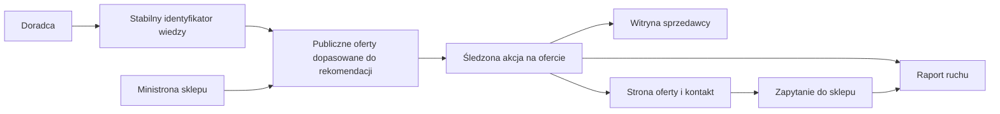
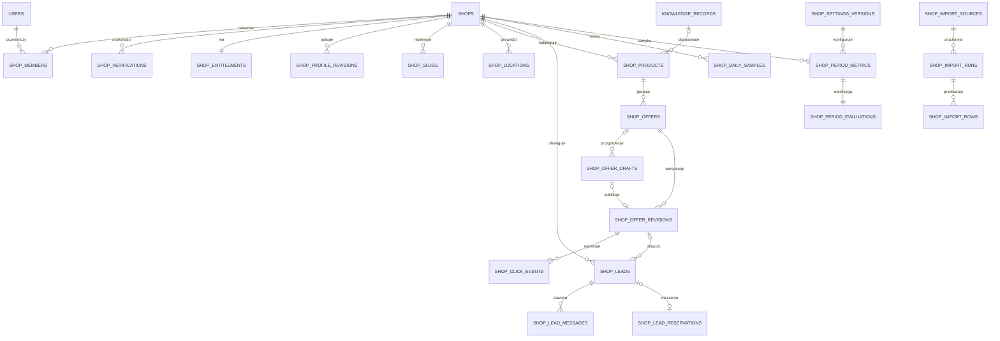
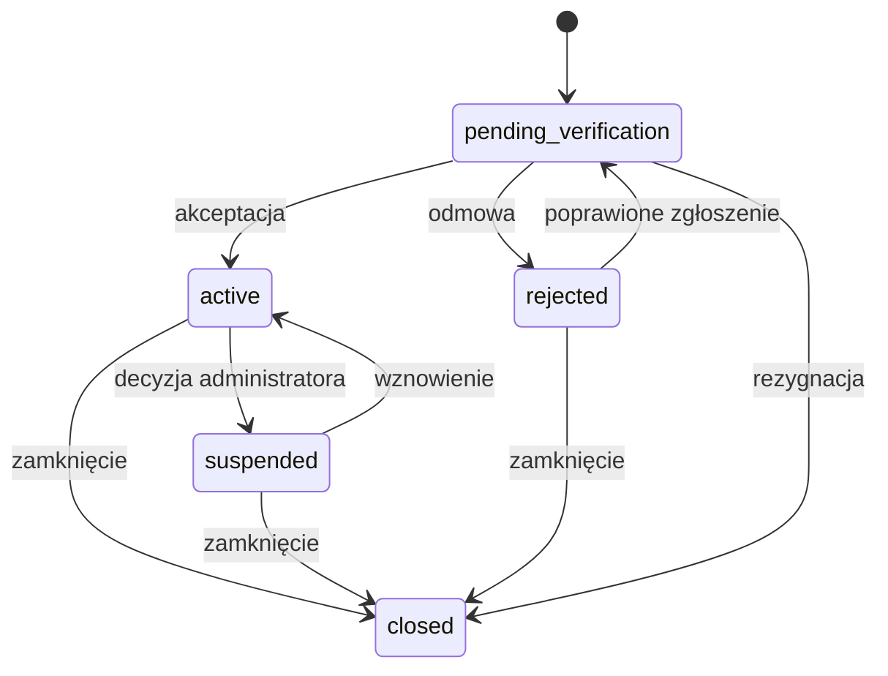
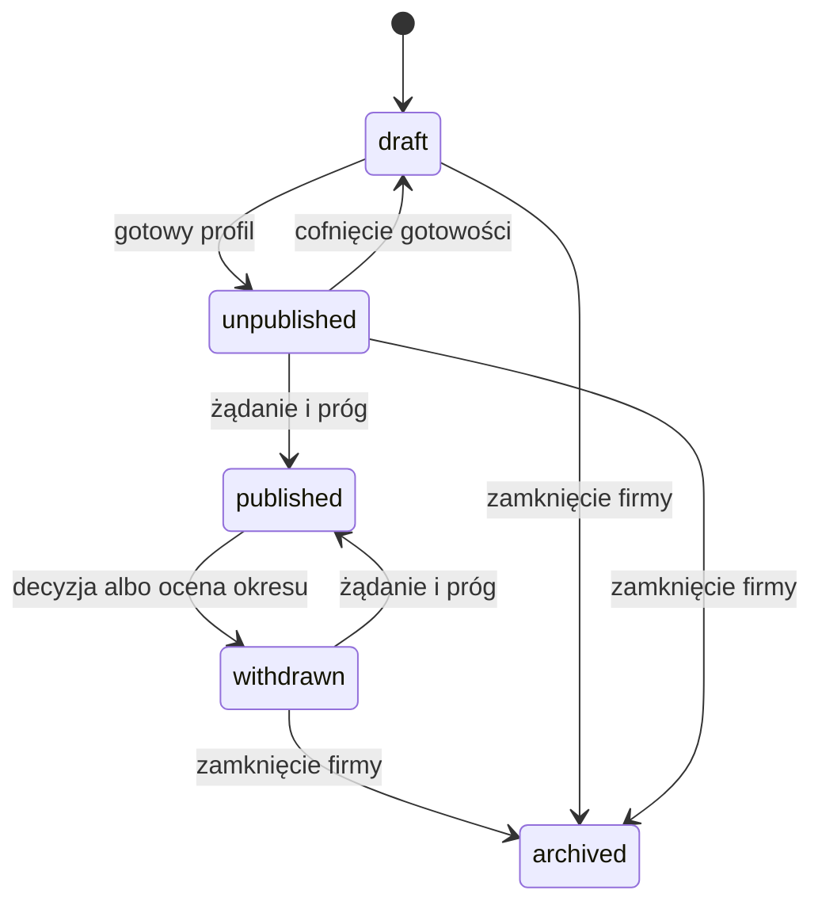
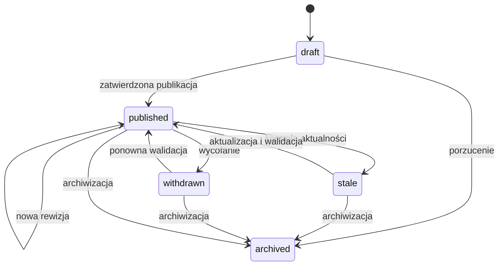
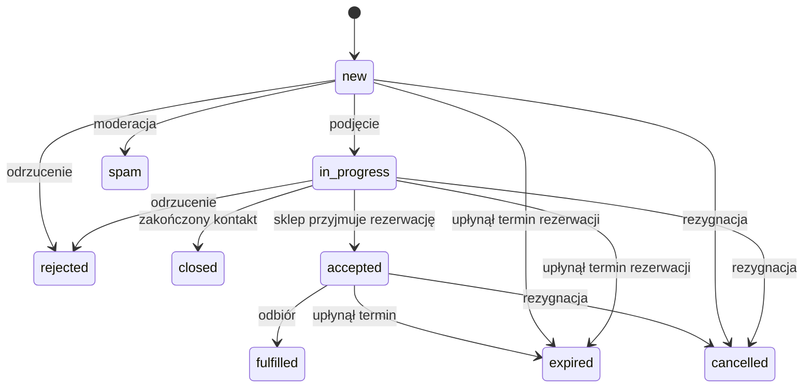

# Aikwarium v2 — projekt domeny sklepów

**Zakres.** Projekt nowej domeny B2B dla sklepów i hodowców. Etap 2 dostarcza działający przepływ od rejestracji partnera do rekomendacji, kontaktu i raportu. Etap 3 obejmuje wygląd paneli i stron publicznych. Etap 4+ rozszerza integracje i komercjalizację. Podział funkcji między etapy oraz reguły opisane jako proponowane wymagają akceptacji właściciela. `aquawiedza-v2/docs/02-projekt/00-decyzje.md:6–16`

**Podstawa.** Stan PoC podaję za czterema wskazanymi dokumentami. Statusy opisują ścieżki odnotowane w analizie, bez niezależnej weryfikacji PHP i produkcji. **[HIPOTEZA]** Dane produkcyjne mogą zawierać kolizje slugów, osierocone rekordy i rozbieżności między licznikiem a logiem kliknięć. Ich występowanie i skala pozostają do sprawdzenia przy migracji. `aquawiedza-v2/docs/01-analiza/20-sklep.md:269–270,280–284`

## 1. Model biznesowy

| Strona | Wartość | Mierzalny wynik |
|---|---|---|
| Akwarysta | Po rekomendacji widzi sklepy oferujące dopasowany produkt lub organizm, wariant, cenę, dostępność i sposób zakupu. | Przejście do sklepu, wysłane zapytanie, na późniejszym etapie odpowiedź na prośbę o odbiór. |
| Sklep lub hodowca | Dociera do klienta po doborze produktu. Dostaje własną stronę, katalog, formularz kontaktu i pomiar źródeł ruchu. | Kwalifikowane kliknięcia, zapytania, czas do odpowiedzi, kompletność i aktualność oferty. |
| Aikwarium | Łączy treść rekomendacji z aktualną ofertą handlową i buduje dystrybucję dla partnerów. | Pokrycie rekordów wiedzy ofertami, udział aktualnych ofert, liczba aktywnych partnerów i leadów. |
| Model przychodów | Propozycja po pilocie to abonament za dystrybucję, narzędzia i raportowanie w planie S/M/L/XL. Afiliacja po potwierdzeniu sprzedaży oraz płatne kampanie to osobne opcje. | Etap 2 mierzy zakres usługi i może pokazywać estymaty po ustawieniu cennika. |

| Status PoC | Udokumentowany stan | Rozwiązanie v2 |
|---|---|---|
| **Działa** | Samodzielna rejestracja i potwierdzenie e-maila, trial sklepu 90 dni, panel, katalog wiedzy, publikacja sklepu na żądanie, dopasowanie z doradcy i miesięczny raport kliknięć. | Konto firmy z wieloma użytkownikami, własny profil, jawna weryfikacja i mierzalna dystrybucja. `aquawiedza-v2/docs/01-analiza/20-sklep.md:11–14,22–27` |
| **Działa częściowo** | Publikacja bufora może rozdzielić zapis oferty i historii. Wariant zachowuje ID, a zmiana ceny lub URL przebiega przez usunięcie i ponowne dodanie. | Trwałe ID oferty, identyfikator szkicu, rewizje wszystkich pól i transakcja publikacji. `aquawiedza-v2/docs/01-analiza/20-sklep.md:16–21,218–220` |
| **Działa częściowo** | Ministrona ma podstawowy kontakt i część danych oferty. Część wejść omija tracker, a zdarzenie i licznik są zapisywane osobno. | Profil firmy i placówek, formularz kontaktu, jedna ścieżka rejestracji kliknięć i wspólna bramka widoczności. `aquawiedza-v2/docs/01-analiza/20-sklep.md:24–26,227–232` |
| **Błąd** | Ponowne dodanie szkicu może wyczyścić pola. Powtórna ocena okresu może ponownie zwiększyć zegar. Raport i CSV oczekują brakujących pól prowizji. | Idempotentny szkic i okres, zamknięte fakty pomiarowe, eksport zgodny z danymi raportu. `aquawiedza-v2/docs/01-analiza/20-sklep.md:15,30,35,184,233` |
| **Martwy kod** | Stary formularz AJAX i dwie formuły prowizji poza bieżącą ścieżką raportów. Historyczne CSV i OLX wycofano. | Jeden proces edycji, nowy import CSV, estymacja tylko według aktywnej konfiguracji. `aquawiedza-v2/docs/01-analiza/20-sklep.md:37–38,244` |
| **Udokumentowane, brak implementacji** | Docelowy import CSV z mapowaniem oraz webhook potwierdzający sprzedaż. Faktury i płatności odłożone. | CSV w MVP, integracja sprzedaży opcjonalna po pilocie, przyszłe rozliczenia oparte na zamkniętych okresach. `aquawiedza-v2/docs/01-analiza/40-dokumentacja-wymagania.md:97,106–110` |
| **Wdrożone, nieudokumentowane w specyfikacji ról** | Jedno konto sklepowe ma również rolę hobbysty i jedną subskrypcję sklepową. | Jedna tożsamość osobista, niezależny dostęp akwarysty i członkostwa w firmach. `aquawiedza-v2/docs/01-analiza/40-dokumentacja-wymagania.md:23–26` |
| **Nowy zakres** | Zespół, pełny profil placówek, oferty własne, skrzynka leadów, feedy i rezerwacje stanowią propozycje dla v2. | Właściciel może oddelegować obsługę, a platforma mierzy kontakt i aktualność katalogu. |

| Etap | Zakres |
|---|---|
| **MVP, etap 2** | Samoobsługowa rejestracja, ręczna weryfikacja B2B, profil i wiele placówek, dwie role w sklepie, katalog i bufor, CSV, walidacja, publikacja, obie ścieżki ofert, tracker, zapytania, raport z eksportem, zadania okresowe, audyt i edytowalne reguły. |
| **Później, etap 4+** | Opcjonalne GUS/VIES i potwierdzenie domeny, automatyczne feedy, rezerwacje, dokładniejsze uprawnienia zespołu, atrybucja potwierdzonej sprzedaży, zaawansowana analityka i komercjalizacja kampanii. Decyzja o marketplace pozostaje osobna. |

## 2. Katalog funkcji

| ID | Funkcja i zakres | Rola | Etap | Cel i zmiana względem PoC |
|---|---|---|---|---|
| SHOP-01 | Rejestracja firmy, potwierdzenie e-maila, regulamin, status zgłoszenia, poprawa danych i ponowne zgłoszenie. | Kandydat, właściciel | 2 | Zachowuje samodzielną rejestrację. Właściciel widzi osobno potwierdzenie adresu i akceptację firmy. `aquawiedza-v2/docs/01-analiza/20-sklep.md:162–166` |
| SHOP-02 | Weryfikacja B2B. Polski NIP normalizowany i sprawdzany również sumą kontrolną. Ręczna decyzja z uzasadnieniem. Opcjonalnie GUS, VIES i domena. | Admin, właściciel | 2 / 4+ | Podstawowa kontrola działa przy niedostępności rejestru. PoC sprawdzał długość NIP i aktywował po e-mailu. `aquawiedza-v2/docs/01-analiza/20-sklep.md:162–164` |
| SHOP-03 | Profil i ministrona. Logo, opis, publiczny kontakt, miejscowości i adresy, godziny tygodnia i wyjątki, dostawa, odbiór. Podgląd i zatwierdzenie rewizji profilu. | Właściciel, personel, odbiorca | 2 | Rozszerza indeks i kontakt PoC o informacje potrzebne do zakupu i odbioru. `aquawiedza-v2/docs/01-analiza/20-sklep.md:230–231` |
| SHOP-04 | Zaproszenia, ponowne wysłanie, odebranie dostępu, role `owner` i `staff`, przekazanie własności. | Właściciel | 2 | Oddziela firmę od osobistego konta. Przekazanie własności jest atomowe. |
| SHOP-05 | Oferta powiązana z rekordem wiedzy lub produktem własnym. Wariant, SKU, cena, dostępność, realizacja, opis. | Właściciel, personel | 2 | Zachowuje dopasowanie po ID. Propozycja dopuszcza produkt własny na ministronie. Powiązanie z rekomendacją wymaga zgodnego ID wiedzy. `aquawiedza-v2/docs/01-analiza/20-sklep.md:211,216–220,227` |
| SHOP-06 | `internal` kieruje do strony Aikwarium z kontaktem. `external` kieruje do oferty sprzedawcy. Zmiana ceny, wariantu lub adresu tworzy rewizję. | Sklep, odbiorca | 2 | Jeden jawny typ we wszystkich ścieżkach. Adres wewnętrzny wynika z routingu. `aquawiedza-v2/docs/01-analiza/20-sklep.md:216,220,228–230` |
| SHOP-07 | Bufor i publikacja zaznaczonych poprawnych szkiców z wynikiem per wiersz, podgląd zmian i wykrycie konfliktów. | Właściciel, personel | 2 | Zachowuje pracę zbiorczą. Wybrany zakres publikacji jest atomowy. `aquawiedza-v2/docs/01-analiza/20-sklep.md:15–18,215–219` |
| SHOP-08 | CSV z zapamiętanym mapowaniem, podglądem, błędami wierszy i świadomym zatwierdzeniem importu. | Właściciel, personel | 2 | Przywraca udokumentowany import w kontrolowanym przepływie szkiców. `aquawiedza-v2/docs/01-analiza/40-dokumentacja-wymagania.md:97` |
| SHOP-09 | Feed Google Merchant lub Ceneo XML, mapowanie, test źródła, harmonogram, synchronizacja różnic i historia uruchomień. | Właściciel, system | 4+ | Regularna aktualizacja większych katalogów. Import, synchronizacja i publikacja mają odrębne uprawnienia. |
| SHOP-10 | Kontrola URL, potwierdzanie aktualności, widełki ceny i wykrywanie nietypowej zmiany. | System, sklep, admin | 2 | Rozdziela stan techniczny URL od wieku oferty, obejmuje ręczną i importowaną ofertę. `aquawiedza-v2/docs/01-analiza/20-sklep.md:254–256` |
| SHOP-11 | Jawne opublikowanie sklepu, podgląd wymagań, wycofanie, miesięczna ocena i ponowna publikacja. | Właściciel, admin, system | 2 | Zachowuje Model Y jako domyślną politykę, zapisuje przyczynę i historię oceny. `aquawiedza-v2/docs/01-analiza/20-sklep.md:170–184` |
| SHOP-12 | Śledzona akcja z doradcy i katalogu, 302, deduplikacja, źródło oraz blokada nadużyć. | Gość, akwarysta, system | 2 | Jedno źródło dla raportów, obu typów linku i eksportu. `aquawiedza-v2/docs/01-analiza/20-sklep.md:229–233` |
| SHOP-13 | Formularz kontaktu z kontekstem sklepu lub oferty, kolejka obsługi, przypisanie, odpowiedź i zamknięcie. | Gość, akwarysta, sklep | 2 | Zapisuje mierzalny lead oraz wynik obsługi. W PoC kontakt opierał się na linku lub tekście. `aquawiedza-v2/docs/01-analiza/20-sklep.md:230–231` |
| SHOP-14 | Prośba o rezerwację lub click&collect, wskazanie wariantu, liczby sztuk i placówki, przyjęcie, odbiór lub wygaśnięcie. | Klient, sklep | 4+ | Pozwala obsłużyć lokalny odbiór po potwierdzeniu przez sklep. |
| SHOP-15 | Pulpit ruchu i leadów według czasu, kanału i oferty, analiza aktualności katalogu, CSV. | Sklep, admin | 2 | Raport zawiera zarchiwizowane oferty i dane rewizji z chwili kliknięcia. `aquawiedza-v2/docs/01-analiza/20-sklep.md:27,232–233` |
| SHOP-16 | Powiadomienia o weryfikacji, trialu, imporcie, jakości, publikacji i leadach. Opcjonalny e-mail po kliku, preferencje i historia dostarczeń. | Sklep, admin, system | 2 | Rozszerza przypomnienia PoC i deduplikuje wysyłkę na poziomie konkretnego zdarzenia. `aquawiedza-v2/docs/01-analiza/20-sklep.md:250–258` |
| SHOP-17 | Kolejki moderacji firmy, profilu, ofert i domen. Blokada z powodem, odwołanie, audyt. | Admin, właściciel | 2 | Z odczytowego przeglądu przechodzi do kontrolowanych decyzji. `aquawiedza-v2/docs/01-analiza/20-sklep.md:28–29,36,257` |
| SHOP-18 | Dzienne próbki, miesięczny rollup, decyzja publikacyjna, plan, wykorzystanie limitów i estymaty. | System, admin, właściciel | 2 | Wiąże okres z wersją reguł i eliminuje ponowne naliczenie zegara. `aquawiedza-v2/docs/01-analiza/20-sklep.md:239–244` |
| SHOP-19 | Kampanie z datami, grupą docelową, kodem i limitem użyć. Uprawnienie kampanii zapisane przy przyznaniu. | Admin, właściciel | 2 / 4+ | MVP obsługuje trial, próg startu i bezpłatny pilot. Etap 4+ dodaje rozbudowane segmenty i płatne wyróżnienia. `aquawiedza-v2/docs/02-projekt/01-stack-i-architektura.md:59–63` |
| SHOP-20 | Ręczne uzgodnienie sprzedaży i raportów w pilocie, później identyfikator atrybucji i idempotentny webhook sprzedaży. | Operator, sklep | 2 / 4+ | Rozróżnia ruch, potwierdzony zakup, estymatę i przyszłą należność. `aquawiedza-v2/docs/01-analiza/40-dokumentacja-wymagania.md:103–110` |

## 3. Model danych i reguły zapisu

Laravel 13, Filament i Livewire, MySQL 8.4, InnoDB oraz kolejka `database`. Moduły `Identity/Access`, `Shops`, `Tracking`, `Metrics/Billing`, `Campaigns`, `Notifications` i `Privacy` udostępniają akcje domenowe. Panele, operacje cykliczne i późniejsze API wywołują te same akcje. Moduły uzgadniają zapis przez kontrakty usług i zdarzenia. Decyzja D-06 zastępuje wcześniejszy zapis o PostgreSQL. `aquawiedza-v2/docs/02-projekt/00-decyzje.md:7–16` · `aquawiedza-v2/docs/02-projekt/01-stack-i-architektura.md:46–63,87–95`

### Konwencje MySQL

- `ID` = `BIGINT UNSIGNED`, `UID` = `BINARY(16)`, `DT` = `DATETIME(6)` w UTC, `DATE` = data biznesowa. Identyfikatory techniczne są stabilne. Publiczne klucze szkiców, tokenów akcji i leadów są losowe.
- Kwoty to `BIGINT UNSIGNED` w najmniejszej jednostce waluty z `CHAR(3)` dla ISO waluty. Stawki w punktach bazowych jako `SMALLINT UNSIGNED`. MVP operuje na PLN.
- Stany jako `VARCHAR(24)` z `CHECK` listy dozwolonych wartości. Dane obowiązkowe mają `NOT NULL`. Warunkowe `CHECK` jawnie sprawdzają `IS NULL` i `IS NOT NULL`.
- `UQ` oznacza `UNIQUE`, `IX` indeks. Każda wskazana FK ma indeks. Tekstowe klucze techniczne, slug, kod i znormalizowane SKU dostają jawne zasady normalizacji i porównania.
- Encje sklepu mają `shop_id` i `UQ(shop_id,id)` tam, gdzie odwołuje się do nich inna encja najemcy. FK `(shop_id,offer_id)`, `(shop_id,location_id)` i analogiczne blokują powiązania między sklepami. FK do rewizji obejmuje też ID encji nadrzędnej.
- Fakty historyczne mają `ON DELETE RESTRICT`, dane robocze i członkostwa można usuwać kontrolowaną akcją. Moduł Privacy usuwa dane osobowe lub je anonimizuje, zachowując dozwolone agregaty zgodnie z ustawioną retencją.

### Firma, uprawnienia i publiczne adresy

| Tabela | Klucze i typy | Ograniczenia i indeksy |
|---|---|---|
| `shops` | `id ID PK`, `account_state`, `publication_state`, `legal_name VARCHAR(255)`, `tax_country CHAR(2)`, `tax_no VARCHAR(32)`, `first_published_at DT NULL`, `policy_counter INT UNSIGNED`, `publication_epoch INT UNSIGNED`, `current_profile_revision_id ID NULL`, `current_slug_id ID NULL`, `lock_version INT UNSIGNED`. | `UQ(tax_country,tax_no)` dla podmiotów z identyfikatorem. Kompletny profil i bieżący slug wymagane przy `published`. `IX(account_state,publication_state,id)`. Wiele placówek pod jednym podmiotem w MVP. |
| `shop_verifications` | `id ID PK`, `shop_id FK`, `method`, `result`, `checked_by ID FK users NULL`, `reference VARCHAR(191) NULL`, `reason_code`, `checked_at DT`. | `IX(shop_id,checked_at)`. Zapis decyzji ręcznych i przyszłych wyników rejestrów. |
| `shop_entitlements` | `id ID PK`, `shop_id FK`, `state`, `starts_at DT`, `trial_ends_at DT NULL`, `ends_at DT NULL`, `settings_version_id FK`, `campaign_redemption_id FK NULL`, `reason_code`. | `UQ(shop_id)` dla bieżącego dostępu. Historia w przejściach. `IX(state,trial_ends_at)`. Końce przedziałów po starcie. |
| `shop_members` | `shop_id FK`, `user_id FK`, `role VARCHAR(16)`, `state`, `joined_at DT`, `revoked_at DT NULL`, `owner_key` generowany dla aktywnego właściciela. | `PK(shop_id,user_id)`, `UQ(owner_key)` daje najwyżej jednego aktywnego właściciela. Co najmniej jeden wynika z akcji domenowej i blokady sklepu. `IX(user_id,state,shop_id)`. |
| `shop_invitations` | `id UID PK`, `shop_id FK`, `email_normalized VARCHAR(254)`, `role`, `token_hash BINARY(32)`, `expires_at DT`, `state`, `invited_by FK users`. | `UQ(token_hash)`, unikalne otwarte zaproszenie na `(shop_id,email_normalized)` przez klucz generowany dla `pending`. |
| `shop_profiles` / `shop_profile_revisions` | Profil `shop_id PK/FK`. Rewizja `id ID PK`, `shop_id FK`, `revision_no INT`, `state`, `display_name VARCHAR(160)`, `logo_asset_id FK NULL`, `description TEXT`, `contact JSON`, `fulfilment JSON`, `author_id FK`, `created_at DT`. | `UQ(shop_id,revision_no)` i `UQ(shop_id,id)`. Wskazanie aktualnej rewizji w `shops` ma złożoną FK. JSON walidowany przez akcję domenową. |
| `shop_locations` / `shop_location_hours` | Placówka `id ID PK`, `shop_id FK`, `label VARCHAR(160)`, adres, kontakt, `timezone VARCHAR(64)`, `pickup_enabled BOOLEAN`, `state`. Godziny `id ID PK`, `shop_id`, `location_id`, `weekday TINYINT NULL`, `exception_date DATE NULL`, `opens TIME NULL`, `closes TIME NULL`, `is_closed BOOLEAN`. | Złożona FK do placówki. `CHECK` dokładnie jeden z dnia tygodnia i daty. Wyjątek zastępuje tydzień. Akcja waliduje kolejność godzin i brak nakładania przedziałów w obrębie dnia. |
| `shop_slugs` | `id ID PK`, `shop_id FK`, `slug VARCHAR(160)` ASCII, `created_at DT`, `retired_at DT NULL`, generowany `active_shop_key` dla bieżącego sluga. | `UQ(slug)` globalnie także dla historii, `UQ(active_shop_key)`, `UQ(shop_id,id)`. Obrót sluga w jednej transakcji. |
| `shop_allowed_domains` | `id ID PK`, `shop_id FK`, `host_ascii VARCHAR(253)`, `allow_subdomains BOOLEAN`, `state`, `verified_at DT NULL`. | `UQ(shop_id,host_ascii)`. Domena dopuszczana jawnie. Subdomeny tylko po włączeniu reguły. |
| `shop_legacy_routes` | `route_kind`, `legacy_key VARCHAR(191)`, `shop_id FK`, `offer_id ID NULL`. | `PK(route_kind,legacy_key)`, złożona FK do oferty. `legacy_key` może zawierać dawny slug i identyfikator oferty. |

### Katalog, wersje ofert i import

| Tabela | Klucze i typy | Ograniczenia i indeksy |
|---|---|---|
| `shop_products` | `id ID PK`, `shop_id FK`, `title VARCHAR(255)`, `knowledge_record_id ID NULL FK`, `gtin VARCHAR(14) NULL`, `shop_product_code VARCHAR(100)`, `state`. | `UQ(shop_id,shop_product_code)`, `IX(knowledge_record_id,shop_id)`. Pusty FK oznacza produkt własny. Dopasowanie GTIN tworzy sugestię. |
| `shop_offers` | `id ID PK`, `public_id UID`, `shop_id FK`, `product_id ID`, `sku_key VARCHAR(100)`, `state`, `current_revision_id ID NULL`, `last_confirmed_at DT NULL`, `first_published_at DT NULL`, `moderation_state`, `lock_version INT UNSIGNED`. | `UQ(public_id)`, `UQ(shop_id,sku_key)`, złożona FK do produktu. `IX(shop_id,state,id)`, `IX(state,last_confirmed_at,id)`. Stabilne SKU na sprzedawalny wariant. |
| `shop_offer_revisions` | `id ID PK`, `shop_id`, `offer_id`, `revision_no INT`, `draft_id UID NULL`, `knowledge_record_id ID NULL FK`, `label VARCHAR(255)`, `variant_label VARCHAR(190)`, `variant_attributes JSON`, `price_minor BIGINT UNSIGNED`, `currency CHAR(3)`, `availability`, `link_type`, `external_url VARCHAR(2048) NULL`, `author_id FK NULL`, `created_at DT`. | `UQ(shop_id,offer_id,revision_no)`, `UQ(draft_id)`, `UQ(shop_id,offer_id,id)`. FK do oferty i szkicu. `CHECK` URL wymagany dla `external`, pusty dla `internal`. Rewizje są niezmienne i zawierają dane do raportu historycznego. |
| `shop_offer_drafts` | `id UID PK`, `shop_id FK`, `offer_id ID NULL`, `product_id ID`, `sku_key VARCHAR(100)`, `payload JSON`, `state`, `based_on_revision_id ID NULL`, `lock_version INT UNSIGNED`, `updated_at DT`, `open_sku_key` generowany dla `draft`. | `UQ(shop_id,id)`, `UQ(shop_id,open_sku_key)`, złożone FK do produktu, oferty i bazowej rewizji. `IX(shop_id,state,updated_at)`. Zgodność wskazanego SKU i oferty sprawdza akcja. |
| `shop_publish_batches` | `id UID PK`, `shop_id FK`, `request_key UID`, `payload_hash BINARY(32)`, `settings_version_id FK`, `actor_id FK`, `committed_at DT`, `result JSON`. | `UQ(shop_id,request_key)`. Ta sama treść zwraca zapisany wynik. Zmiana treści przy tym samym kluczu zwraca konflikt. |
| `shop_offer_checks` | `id ID PK`, `shop_id`, `offer_id`, `revision_id`, `kind`, `result`, `scheduled_for DT`, `http_code SMALLINT NULL`, `checked_at DT NULL`, `details JSON`. | Złożona FK do rewizji. `UQ(shop_id,offer_id,revision_id,kind,scheduled_for)`, `IX(shop_id,result,checked_at)`. Wynik starej rewizji zostaje w historii. |
| `shop_import_sources` | `id ID PK`, `shop_id FK`, `type`, `endpoint VARCHAR(2048) NULL`, `mapping JSON`, `mapping_version INT`, `schedule_spec VARCHAR(64) NULL`, `enabled BOOLEAN`, `next_run_at DT NULL`. | `IX(enabled,next_run_at,id)`. Mapowanie dotyczy m.in. SKU/ID zewnętrznego, EAN/GTIN, wiedzy, wariantu, ceny, waluty, dostępności, URL i kategorii. |
| `shop_import_runs` / `shop_import_rows` | Przebieg `id ID PK`, `shop_id`, `source_id`, `run_key VARCHAR(191)`, `content_hash BINARY(32)`, `mapping_snapshot JSON`, `state`, `created_at DT`. Wiersz `run_id`, `line_no INT`, `external_key VARCHAR(191) NULL`, `normalized JSON`, `errors JSON`, `draft_id UID NULL`. | `UQ(shop_id,source_id,run_key)`, wiersz `PK(run_id,line_no)`, złożone FK źródła, przebiegu i szkicu. Klucze zewnętrzne powtórzone w jednym pliku są błędem danych. |
| `shop_import_links` | `shop_id`, `source_id`, `external_key VARCHAR(191)`, `offer_id`, `last_seen_run_id ID`, `content_hash BINARY(32)`. | `PK(shop_id,source_id,external_key)`, złożone FK do oferty i źródła. Import nie scala ofert między źródłami bez jawnego mapowania. |

### Tracking, leady, pomiary i konfiguracja

| Tabela | Klucze i typy | Ograniczenia i indeksy |
|---|---|---|
| `shop_click_events` | `id UID PK`, `shop_id`, `offer_id`, `revision_id`, `source`, `target_type`, `occurred_at DT`, `request_key UID`, `dedupe_hash BINARY(32) NULL`, `dedupe_bucket BIGINT NULL`. | `UQ(request_key)`, `UQ(shop_id,offer_id,source,dedupe_hash,dedupe_bucket)` dla zdarzeń z kluczem deduplikacji, złożona FK do rewizji. `IX(shop_id,occurred_at,offer_id)`, `IX(shop_id,source,occurred_at)`. |
| `shop_leads` | `id ID PK`, `public_id UID`, `shop_id FK`, `offer_id ID NULL`, `offer_revision_id ID NULL`, `location_id ID NULL`, `click_event_id UID NULL`, `requester_user_id FK NULL`, `assignee_user_id ID NULL`, `kind`, `state`, `customer_contact_ciphertext BLOB`, `purpose_notice_version VARCHAR(32)`, `expires_at DT NULL`, `created_at DT`, `closed_at DT NULL`. | `UQ(public_id)`, złożone FK do oferty, rewizji, placówki, kliknięcia i członkostwa osoby przypisanej. `IX(shop_id,state,created_at)`, `IX(state,expires_at)`. FK kliknięcia może zostać jawnie odłączona przy retencji. |
| `shop_lead_messages` | `id ID PK`, `shop_id`, `lead_id`, `sender_id FK NULL`, `direction`, `text_ciphertext BLOB`, `created_at DT`. | Złożona FK do leada, `IX(shop_id,lead_id,created_at)`. Token publiczny leada przechowywany w postaci hasha, oddzielnie od publicznego ID. |
| `shop_lead_reservations` | `lead_id ID PK/FK`, `shop_id`, `location_id`, `quantity INT UNSIGNED`, `pickup_deadline DT NULL`, `accepted_at DT NULL`. | Etap 4+. `CHECK(quantity>0)`. Akceptacja rezerwacji oraz zapis terminu są atomowe. |
| `shop_daily_samples` | `shop_id FK`, `sample_date DATE`, `scheduled_at DT`, `sampled_at DT`, `all_count INT UNSIGNED`, `eligible_count INT UNSIGNED`, `internal_count INT UNSIGNED`, `account_state`, `publication_state`, `publication_epoch INT`, `settings_version_id FK`, `source`. | `PK(shop_id,sample_date)`, `IX(sample_date,shop_id)`, oba liczniki podrzędne `<= all_count`. Próbka `0/0/0` stanowi zapis pomiaru. |
| `shop_period_metrics` | `id ID PK`, `shop_id FK`, `period DATE`, `samples INT`, `expected_samples INT`, surowe średnie `DECIMAL(16,6)`, zaokrąglone średnie `INT`, `public_days INT`, `live_plan_code NULL`, `period_plan_code NULL`, `settings_version_id FK`, `closed_at DT`. | `UNIQUE(shop_id,period)`, `CHECK(DAYOFMONTH(period)=1)`, `CHECK(samples<=expected_samples)`, `IX(period,shop_id)`. Licznik i sumy próbek można zapisać obok średnich do dokładnej reprodukcji wyniku. |
| `shop_period_evaluations` | `shop_id FK`, `period DATE`, `metrics_id FK`, `settings_version_id FK`, `publication_epoch INT NULL`, `outcome`, `counter_before INT`, `counter_after INT`, `evaluated_at DT`. | `UNIQUE(shop_id,period)`, `UQ(metrics_id)` i złożona FK weryfikująca sklep i okres metryki. Wynik `pass`, `fail`, `withdrawn`, `not_applicable` lub `insufficient_data`. |
| `shop_period_adjustments` | `id ID PK`, `shop_id`, `period DATE`, `reason`, `adjustment JSON`, `actor_id FK`, `created_at DT`, `request_key UID`. | Złożona FK do okresu, `UQ(shop_id,request_key)`. Korekta jest osobnym faktem, bez ponownego wywołania oceny. |
| `shop_settings_versions` / `shop_plan_rules` / `shop_commission_rules` | Wersja `id ID PK`, zakres globalny albo sklep, `version_no INT`, `effective_from DT`, `effective_to DT NULL`, `state`, `values JSON`, `author_id FK`. Plany `(version_id,code)` z `min_count`, `max_count NULL`, `monthly_minor NULL`, limity. Prowizje `(version_id,line_no)` z granicami kwoty i `rate_bps`. | `UQ(scope_key,version_no)` i `UQ(scope_key,effective_from)` dla aktywowanych wersji według strategii klucza. `CHECK` granic, stawka `0..10000`. Aktywacja blokuje rekord zakresu i waliduje nakładanie okien oraz przedziałów. |
| `shop_campaigns` / `shop_campaign_redemptions` | Kampania `id ID PK`, `code VARCHAR(64) NULL`, wersja ustawień, `starts_at DT`, `ends_at DT`, segment, limity i efekt. Użycie `campaign_id`, `shop_id`, `granted_at DT`, snapshot efektu, `valid_until DT NULL`. | `UQ(code)` dla kodu, `PK(campaign_id,shop_id)`. Pobranie ostatniego dostępnego użycia pod blokadą kampanii. |
| `shop_state_transitions` / `audit_entries` / `outbox_events` | Przejścia `shop_id`, `aggregate_type`, `aggregate_key`, `from_state`, `to_state`, `cause`, `actor_id NULL`, `settings_version_id NULL`, `occurred_at DT`. Audyt `action`, klucz obiektu, zmiany, aktor i korelacja. Outbox `event_id UID PK`, `type`, `payload JSON`, `available_at DT`, `processed_at DT NULL`. | `IX(shop_id,aggregate_type,aggregate_key,occurred_at)`, `IX(shop_id,occurred_at)` dla audytu, `IX(processed_at,available_at)` dla outbox. Klucz domenowy akcji jest unikalny w obrębie agregatu i typu akcji. |
| `notification_deliveries` | `id UID PK`, `event_id UID`, adresat, kanał, szablon, `state`, `attempts`, `provider_message_id NULL`, `next_attempt_at DT`. | `UQ(event_id,recipient_key,channel,template)`, `IX(state,next_attempt_at)`. Dostarczenie potwierdza status dostawcy, jeśli dostępny. |

### Zapis, pomiar i zgodność adresów

1. **Publikacja szkiców.** Podgląd oddziela poprawne i błędne wiersze. Użytkownik zatwierdza wybrany poprawny zbiór. Akcja blokuje sklep i szkice w stałej kolejności, sprawdza wersje, dostęp i limity, zapisuje rewizje, aktualizuje wskaźniki ofert i statusy szkiców, dodaje audyt i outbox. Konflikt któregokolwiek zaznaczonego wiersza wycofuje całą transakcję. Dodanie istniejącego `draft` zwraca jego ID bez nadpisania pól. Zmiana ceny, wariantu lub URL zachowuje ID oferty.
2. **Bramka publiczna.** Konto `active`, publikacja `published`, publiczny dostęp handlowy, zatwierdzony profil, a dla oferty także jej aktualna publiczna rewizja, stan `published` i brak blokady moderacyjnej. Doradca wymaga dodatkowo zgodnego rekordu wiedzy. Publiczny odczyt i tracker sprawdzają tę samą bramkę, także po trafieniu w cache.
3. **Kliknięcie.** `/go/shop/{id}/` zapisuje zaakceptowaną akcję i zwraca 302 do sprawdzonego celu. Odświeżenie i ponowienie tego samego żądania mogą wykonać przekierowanie bez dodatkowego zdarzenia. Zdarzenie statystyczne ma kanał `advisor`, `shop_page` lub `legacy`; źródło ustala podpisany kontekst aplikacji. Odsłona strony oferty stanowi odrębną aktywność. Awaria zapisu zwraca błąd z możliwością ponowienia i trafia do monitoringu.
4. **Raport.** Kliknięcia pochodzą z `shop_click_events`, a cena i wariant z rewizji zapisanej przy zdarzeniu. Agregat i CSV powstają z tego samego zapytania lub odtwarzalnej projekcji. Wiersze z zerem można dołączyć z historii ofert. Raport pokazuje rozłącznie `internal` i `external`, konwersję do leada tylko dla obserwowalnych ścieżek oraz zakres danych objęty retencją.
5. **Slug.** Globalna rezerwacja obejmuje aktualny slug i historię. Dla widocznego sklepu dawny slug lub rozpoznana stara strona oferty zwraca 301 bezpośrednio na adres kanoniczny. Znany stary adres trackera trafia do wspólnej akcji i zwraca pojedyncze 302. Bramka zwraca 404 dla niepublicznych celów. Przy kolizji z WordPressa operator przypisuje stary adres jednemu potwierdzonemu właścicielowi. `aquawiedza-v2/docs/01-analiza/20-sklep.md:205,229–230,280–281`
6. **Pomiar okresu.** Dzienna próbka zapisuje stan na zaplanowany punkt czasu. Powtórzenie odczytu zwraca zapisany pomiar. Uzupełnienie zaległej próbki wymaga odtworzenia stanu na ten punkt z historii. Brak odtwarzalnych danych tworzy lukę widoczną w raporcie. Klucze próbek i oceny są w bazie.
7. **Ocena publikacji.** Propozycja pilota zachowuje `ceil`, próg startu 50 i ocenę `ceil(średnia) < 40` przez trzy kolejne kwalifikujące się miesiące. Pierwszy pełny miesiąc po publikacji lub jej wznowieniu rozpoczyna serię. Niekompletny pomiar daje `insufficient_data`, alarm i przerywa serię po zatwierdzonym zamknięciu. Wznowienie zwiększa `publication_epoch`. Opóźniona ocena innej epoki pozostaje historyczna i nie zmienia bieżącej publikacji. To różni się od PoC, który liczył dostępne próbki i pomijał brak wiersza. `aquawiedza-v2/docs/01-analiza/20-sklep.md:180–184,239–241,264`
8. **Kwalifikacja oferty.** Propozycja MVP liczy unikalne po SKU opublikowane warianty obu typów, także przed publikacją sklepu. Odejmuje oferty wycofane, zablokowane lub `stale`. Sam status dostępności pozostaje informacją dla kupującego w pilocie. Test akceptacyjny sprawdza, czy warianty odzwierciedlają realną ofertę. PoC liczył wiersze `products` obu rodzajów. `aquawiedza-v2/docs/01-analiza/20-sklep.md:204,239,264`
9. **Rozliczenia.** Pulpit wyznacza plan orientacyjny z aktualnej liczby ofert. Zamknięty okres zapisuje proponowany plan z zaokrąglonej średniej dni publicznych i niezmienną wersję reguł. Okres częściowo publiczny oznacza estymatę z widocznym zakresem dni. Gdy brak planu lub kwoty, kwota pozostaje pusta. Późniejsze `billing_statements`, dokumenty i płatności mogą wskazywać zamknięte metryki i korekty przez FK.
10. **Migracja.** Mapować konto sklepu, członkostwo właściciela, trial, publikację, zegar i adresy. Przypisać stabilne ID ofert i zachować rozróżnienie szkiców, ofert oraz danych historycznych. Do ruchu importować log zdarzeń z kluczem pochodzenia. Rozbieżności z licznikiem raportować operatorowi. Okresy historyczne przyjmować jako importowane fakty z oznaczeniem źródła. `aquawiedza-v2/docs/01-analiza/20-sklep.md:277–284`

## 4. Automaty stanów

Konto firmy, dostęp handlowy, publikacja, oferta i lead mają własne stany. Publiczna widoczność jest wynikiem wspólnej bramki. Wygaśnięcie trialu w bezpłatnym pilocie może przejść do uprawnienia `active` według reguły administracyjnej. Poza taką kampanią uprawnienie `expired` blokuje publikację i nowe leady. Właściciel zachowuje dostęp do ustawień konta, historii, eksportu i obsługi otwartych zapytań, o ile osobna decyzja bezpieczeństwa tego nie ogranicza.

### Konto firmy i dostęp

| Automat | Przejście | Wyzwalacz | Warunek i skutek |
|---|---|---|---|
| Konto | start → `pending_verification` | Właściciel | Uzupełnia dane firmy i potwierdza e-mail. Może przygotować profil i szkice. |
| Konto | `pending_verification` → `active` / `rejected` | Admin | Decyzja z dowodem lub powodem. Akceptacja uruchamia trial według wybranej reguły. |
| Konto | `rejected` → `pending_verification` | Właściciel | Złożenie poprawionego zgłoszenia z nową wersją danych. |
| Konto | `active` → `suspended` → `active` | Admin | Zawieszenie zamyka publiczną bramkę natychmiast i wycofuje publikację. Wznowienie pozwala złożyć nową komendę publikacji. |
| Konto | stan otwarty → `closed` | Właściciel, admin | Zamknięcie z audytem, cofnięcie zaproszeń, uruchomienie polityki retencji. |
| Dostęp | start → `trial` | Akcja akceptacji | Jedno uprawnienie trial, przypięte dni i kampania. |
| Dostęp | `trial` → `active` / `expired` | Scheduler | Rozstrzyga aktywna reguła pilota i czas końca trialu. |
| Dostęp | `active` / `trial` → `suspended` | Admin | Powód, ograniczenie panelu lub publikacji według polityki. |
| Dostęp | `expired` / `suspended` → `active` | Admin lub ważna reguła kampanii | Jawne nadanie dostępu z historią. Publikacja wymaga osobnej akcji, jeśli została wycofana. |

### Publikacja sklepu

| Przejście | Wyzwalacz | Warunek i skutek |
|---|---|---|
| `draft` ↔ `unpublished` | Sklep, akcja domenowa | Gotowość profilu przed pierwszą publikacją. Zatwierdzony profil może pozostać aktywny podczas edycji nowej rewizji. |
| `unpublished` / `withdrawn` → `published` | Właściciel | Aktywna firma, uprawnienie, zaakceptowany profil i bieżący próg zapisany w ustawieniach lub przyznanej kampanii. Rezerwacja sluga, nowa epoka, zegar `0`. |
| `published` → `published` | Scheduler, sklep | Aktualizacja oferty sama nie wycofuje sklepu. Ocena dobra zeruje zegar. Ocena słaba poniżej limitu zwiększa zegar raz. |
| `published` → `withdrawn` | Scheduler | Limit słabych okresów lub koniec uprawnienia wymagającego publicznej dostępności. Stan, przejście, wynik i outbox w jednej transakcji. |
| `published` → `withdrawn` | Właściciel, admin | Wycofanie własne lub moderacyjne z powodem. Przy blokadzie moderacyjnej wznowienie wymaga jej zdjęcia. |
| Stan niepubliczny → `archived` | Akcja zamknięcia firmy | Zamknięcie publicznych tras i rozpoczęcie retencji. |

### Oferta i szkic

| Przejście | Wyzwalacz | Warunek i skutek |
|---|---|---|
| `draft` → `published` | Sklep | Komplet danych, aktualna wersja, dozwolona cena i URL. Szkic w bazie otrzymuje `committed`, oferta zachowuje lub otrzymuje trwałe ID. |
| `draft` → `archived` | Sklep | Niezatwierdzony szkic przechodzi do `discarded`. Dla szkicu edycyjnego bieżąca oferta zachowuje swoją publikowaną rewizję. |
| `published` → `published` | Sklep, uprawniony feed 4+ | Nowa poprawna rewizja. Edycja ceny, wariantu albo URL zachowuje adres i historię. |
| `published` → `stale` | Scheduler | Próg aktualności lub trwały błąd kontroli według ustawień. W MVP próg 90 dni domyślnie ostrzega. Aktywacja ukrywania po tym progu jest opcją właściciela. |
| `stale` / `withdrawn` → `published` | Sklep | Ponowna walidacja ceny, dostępności i celu, usunięta blokada admina. |
| `published` → `withdrawn` | Sklep, admin | Świadome wycofanie lub blokada z przyczyną. Stan publiczny jest przeliczany natychmiast. |
| Oferta → `archived` | Sklep, admin | Koniec emisji. Wersje i fakty ruchu pozostają dostępne zgodnie z retencją. |

### Lead i rezerwacja

| Przejście | Wyzwalacz | Warunek i skutek |
|---|---|---|
| Start → `new` | Gość lub akwarysta | Publiczny sklep, formularz poprawny, antyspam i deduplikacja wysłania. Gość potwierdza adres; prośba przed potwierdzeniem czeka poza skrzynką sklepu. |
| `new` → `in_progress` → `closed` | Sklep | Przypisanie lub odpowiedź. Zamknięcie zapisuje wynik kontaktu i datę. |
| `new` / `in_progress` → `rejected` / `cancelled` | Sklep odrzuca, klient anuluje | Powód widoczny według roli. Własny lead przez konto lub wygasający token. |
| `new` → `spam` | Sklep, admin lub automat | Dostęp do treści ograniczony do osób z prawem obsługi zgłoszenia. |
| `in_progress` → `accepted` → `fulfilled` | Sklep, etap 4+ | Potwierdza dostępność, ilość i termin odbioru, następnie rejestruje odbiór. |
| Otwarte żądanie rezerwacji → `expired` | Scheduler, etap 4+ | Upłynął termin odpowiedzi lub odbioru. `accepted` można też anulować z zapisaniem przyczyny. |

## 5. Zdarzenia, kolejka i cykle

Transakcja domenowa zapisuje fakty i outbox. Konsument używa unikalnego klucza operacji i może dostać zdarzenie ponownie. Harmonogram opiera się na dacie biznesowej `Europe/Warsaw`; moment wykonania przechowuje UTC. Alokacja zadania i mutacja zawierają `shop_id`. Alerty obejmują zaległość, luki próbek i powtarzające się błędy. `aquawiedza-v2/docs/01-analiza/40-dokumentacja-wymagania.md:152` · `aquawiedza-v2/docs/02-projekt/01-stack-i-architektura.md:69–79,91–92`

| Zdarzenie lub harmonogram | Zadanie i efekt | Klucz idempotencji |
|---|---|---|
| `ShopRegistered`, `ShopEmailVerified`, `ShopVerificationDecided` | Potwierdzenie adresu, kolejka weryfikacji, komunikat o decyzji, start trialu po akceptacji. | `verification_id` dla decyzji, identyfikator potwierdzenia dla aktywacji. |
| `ShopEntitlementChanged` | Aktualizacja bramki, powiadomienie sklepu i odświeżenie projekcji. | ID przejścia uprawnienia. |
| `OfferRevisionPublished`, `OfferStateChanged` | Zaplanowanie kontroli, indeks katalogu, projekcja kompletności. | `(offer_id,revision_id,consumer)` lub ID przejścia stanu. |
| `ShopPublicationChanged`, `ShopSlugChanged` | Odświeżenie tras, projekcji doradcy i cache, powiadomienie. | `(event_id,consumer)`. |
| `ClickAccepted` | Opcjonalny e-mail, projekcje analityczne i eksport. | `click_id`. PoC zapisywał licznik niezależnie. `aquawiedza-v2/docs/01-analiza/20-sklep.md:229,252` |
| `LeadCreated`, `LeadAssigned`, `LeadStateChanged` | Powiadomienie klienta i sklepu, obliczenie czasu odpowiedzi, aktualizacja skrzynki. | Klucz wysłania formularza i ID przejścia dla osobnych zdarzeń. |
| Codziennie **03:00** | Zapis próbki, także z zerami. Jeśli okno pomiaru minęło, dokładna rekonstrukcja albo oznaczenie luki. | `(shop_id,sample_date)`. `aquawiedza-v2/docs/01-analiza/20-sklep.md:239` |
| Pierwszego dnia miesiąca **04:00** | Zamknięcie poprzedniego okresu, ocena i audyt. Sklep oceniany chronologicznie pod blokadą, z kontrolą epoki. | `(shop_id,period)`. `aquawiedza-v2/docs/01-analiza/20-sklep.md:240` |
| Po publikacji URL i codziennie | Kontrola bieżącej rewizji, ponowienia z odstępem i kolejka zaległości. Wyjście HTTP izolowane, domena i publiczny adres sprawdzane po każdym przekierowaniu. | `(shop_id,offer_id,revision_id,kind,scheduled_for)`. |
| Codziennie | Ostrzeżenia o wieku oferty i końcu trialu, wygaśnięcie zaproszeń i leadów zgodnie z typem. | `(offer_id,revision_id,confirmed_at,threshold)` lub `(entitlement_id,ends_at,offset)`; dla leadów ID i planowany termin. |
| Na żądanie / harmonogram feeda | Pobranie, limit rozmiaru, parsowanie CSV/XML bez zewnętrznych encji, podgląd zmian, utworzenie szkiców. Automatyczna publikacja tylko po włączeniu dla źródła. | `(shop_id,source_id,run_key)`, na zmianę `(run_id,line_no)`. |
| Po poprawnym pełnym feedzie, etap 4+ | Po ustawionej liczbie pełnych przebiegów z brakiem wpisu oznacz ofertę do weryfikacji. Błędny lub częściowy feed nie zmienia dostępności. | `(source_id,offer_id,last_successful_run_id)`. |
| Codziennie / na wniosek | Czyszczenie plików, anonimowanie kontaktów i identyfikatorów, eksport danych osobowych, realizacja zamknięcia konta. | `(subject_id,policy_version,cutoff_date,kind)` lub ID wniosku. |
| Codziennie / przy aktywacji wersji | Aktywacja ustawień i kampanii z zaplanowanym terminem. Wersja przypięta do zdarzenia lub okresu pozostaje odczytywalna. | `(scope_key,version_id,effective_from)`. |

## 6. Uprawnienia i izolacja sklepów

| Akcja | Właściciel | Personel | Admin | Akwarysta | Gość |
|---|---|---|---|---|---|
| Publiczny katalog i tracker | ✓ | ✓ | ✓ | ✓ | ✓ |
| Rejestracja firmy | ✓ | Z konta osobistego | Przy wsparciu | ✓ | Po rejestracji |
| Profil, placówki, szkice i CSV | Własny sklep | Własny sklep | Odczyt i moderacja | — | — |
| Zatwierdzenie zmian oferty i archiwizacja | Własny sklep | Własny sklep | Moderacja z powodem | — | — |
| Wysłanie profilu do akceptacji, publikacja i wycofanie sklepu | ✓ | Podgląd | Moderacja i wycofanie | — | — |
| Domena, feed, klucze integracji i przekazanie własności | ✓ | Odczyt statusu | Weryfikacja i blokada | — | — |
| Zespół i zaproszenia | ✓ | Własne członkostwo | Wsparcie z audytem | — | — |
| Utworzenie zapytania i dostęp do własnej sprawy | ✓ | ✓ | Kanał publiczny jak klient | Własna | Token po weryfikacji adresu |
| Skrzynka, przypisania i odpowiedzi na leady | Własny sklep | Własny sklep | Tylko sprawa wsparcia z audytem | — | — |
| Statystyki i eksport ruchu | Własny sklep | Własny sklep | Uprawnienie raportowe | — | — |
| Okresy, plan, kampanie i estymaty | Własny sklep | Odczyt planu i limitów | Uprawnienie rozliczeniowe | — | — |
| Reguły, przyznawanie uprawnień, audyt globalny | — | — | Osobne uprawnienia operatora | — | — |

- Użytkownik może być akwarystą, właścicielem A i personelem B. Akcja sklepu wymaga wybranego `shop_id`, aktywnego członkostwa dla tego sklepu i uprawnienia do czynności. Rola akwarysty działa w odrębnym kontekście.
- Każda akcja, pobranie eksportu i zadanie kolejki sprawdza zakres. Wyszukanie obiektu używa klucza najemcy, także przy zgadywaniu ID. Odebranie członkostwa działa przy następnym żądaniu. Przekazanie własności sprawdza akceptację następcy i zapisuje oba członkostwa w jednej transakcji.
- Admin działa przez jawne uprawnienie i podaje powód przy zawieszeniu, ręcznej korekcie lub dostępie do kontaktu klienta. Eksporty leadów i odczyt ich treści trafiają do audytu. Dane kontaktowe są wyłączone z logów i standardowych eksportów statystycznych.
- Filament i późniejsze API stosują te same Laravel Policies i akcje. Nawigacja panelu pomaga użytkownikowi odnaleźć dostępne czynności, a kontrolę wykonuje serwer. `aquawiedza-v2/docs/02-projekt/01-stack-i-architektura.md:69–79,88–90` · `aquawiedza-v2/docs/02-projekt/00-decyzje.md:15`

## 7. Ustawienia admina i wartości początkowe

Konfiguracja ma zakres, autora, datę wejścia w życie, podgląd różnic i audyt. Statusy wersji `draft`, `scheduled`, `active`, `retired`. Nowa wersja reguł okresowych obowiązuje od początku przyszłego miesiąca. Próby biznesowe wiążą regułę z chwilą rozpoczęcia trialu, kampanie z przyznaniem świadczenia, publikacja z chwilą wykonania akcji. `Brak` oznacza wyłączenie funkcji lub brak wartości, zależnie od pola. `Propozycja` oznacza wartość projektową, dla której materiał nie określa domyślnej PoC. `aquawiedza-v2/docs/02-projekt/00-decyzje.md:7` · `aquawiedza-v2/docs/02-projekt/01-stack-i-architektura.md:91–92`

| Parametr | Typ | Domyślna wartość i źródło | Walidacja lub działanie |
|---|---|---|---|
| Próg startu i wznowienia, próg utrzymania, liczba słabych okresów | `int,int,int` | `50 / 40 / 3`. `aquawiedza-v2/docs/01-analiza/20-sklep.md:175–183` | `start ≥ utrzymanie ≥ 1`, liczba okresów dodatnia. Wyjątek kampanii wymaga jawnego progu. |
| Podstawa liczenia, dostępność, obsługa luk, pierwszy okres | `enum`, zestaw stanów | PoC liczy oba typy wierszy i dostępne próbki. Propozycje v2 w §3. `aquawiedza-v2/docs/01-analiza/20-sklep.md:184,204,239–241` | Zamknięta lista opcji. Symulacja z archiwalnych okresów przed aktywacją. |
| Próbka, zamknięcie i strefa | `time,time,iana_timezone` | `03:00`, dzień 1 o `04:00`, `Europe/Warsaw`. `aquawiedza-v2/docs/01-analiza/40-dokumentacja-wymagania.md:152` | Jedno wykonanie logiczne na dzień lub okres, także przy zmianie czasu. |
| Zaokrąglenie średniej | `enum` | `ceil`. `aquawiedza-v2/docs/01-analiza/20-sklep.md:240` | Wersjonowana metoda, jawny wpływ na próg, zachowana surowa średnia. |
| Pasma S/M/L/XL | `code,min,max?` | S `50–100`, M `101–200`, L `201–400`, XL `≥401`, poniżej `50` bez planu. `aquawiedza-v2/docs/01-analiza/20-sklep.md:242` | Spójne i rozłączne przedziały, ostatnia górna granica pusta. |
| Twarde limity planów | `int?` per zasób | Brak dla ofert, miejsc, członków, źródeł i importów. PoC `500` dotyczyło listy. `aquawiedza-v2/docs/01-analiza/40-dokumentacja-wymagania.md:153` | Dodatnia liczba albo brak limitu. Obniżenie limitu blokuje przyrost zasobu i zachowuje istniejące rekordy. |
| Cennik i prezentacja kwoty | `money?`, `currency`, `enum(net,gross)`, `enum` | Pilot bezpłatny. Stawki planów puste. `500 zł/mies.`, `S/399` i pierwsze `50%` to osobne zapisy historyczne. `aquawiedza-v2/docs/01-analiza/20-sklep.md:242–243` | Nieujemne kwoty w groszach. Pokazanie kwoty wymaga waluty, podstawy netto/brutto i aktywnego cennika. |
| Pierwszy okres i podstawa estymaty | `enum`, `day?`, `bps?` | Domyślnie brak proporcjonowania. Szablon dokumentacyjny dzień 1 lub 15 i `50%`. `aquawiedza-v2/docs/01-analiza/40-dokumentacja-wymagania.md:147` | Zgodność z okresem, `0..10000` bps. Reguła przyszłego rozliczenia podlega osobnej aktywacji. |
| Stawki afiliacyjne | `money_bound?,bps` | Szablon z formuł PoC `≤100,00 zł → 500 bps`, `>100,00 zł → 200 bps`, domyślnie nieaktywny. Specyfikacja różni się na granicy `100 zł`. `aquawiedza-v2/docs/01-analiza/20-sklep.md:244` | Rozłączne przedziały, ostatni otwarty, bez luk. Pole wyboru zakresu globalnego lub sklepu. |
| Atrybucja i estymaty | `enum`, `duration?`, `enum` | Prowizje wyłączone w pilocie. Propozycja etapu 4+ to potwierdzona sprzedaż. `aquawiedza-v2/docs/01-analiza/40-dokumentacja-wymagania.md:106–107,149` | Zdarzenie, waluta, podstawa, reguła zwrotów, zaokrąglenie i okno wymagane przed włączeniem. |
| Trial, start i koniec | `int days`, `enum`, `enum` | `90 dni` dla sklepu. PoC od potwierdzenia e-maila. Projekt proponuje start po akceptacji firmy i przejście do dostępu pilota, jeśli obowiązuje. `aquawiedza-v2/docs/01-analiza/20-sklep.md:164,166` | Dodatni okres, naliczany raz. Kampania może wydłużyć trial przy przyznaniu. |
| Kampanie, kody i łączenie | `dates`, segment, `code?`, `int?`, efekty typu `int`, `money` lub `bps` | Brak kampanii startowej w modelu. Bezpłatny pilot jako jawna konfiguracja. `aquawiedza-v2/docs/02-projekt/01-stack-i-architektura.md:59–60` | `start < koniec`, unikalny kod, limity dodatnie. Propozycja domyślna to jedna kampania zmieniająca dany parametr, z jawnym priorytetem. |
| Weryfikacja i domeny | `enum`, `bool`, lista hostów per sklep | Propozycja ręczna weryfikacja, NIP z sumą, GUS/VIES wyłączone, publiczny HTTPS z domeny dopuszczonej dla sklepu. W PoC występowała konfiguracja domeny poza bieżącą ścieżką publikacji. `aquawiedza-v2/docs/01-analiza/20-sklep.md:162,228,257` | Walidacja wariantu krajowego identyfikatora, normalizacja hosta, jawna zgoda na subdomeny. |
| Limity rejestracji i weryfikacji e-maila | `int`, `seconds`, `days` | `5/900 s`, wiek formularza `3–3600 s`, token i czyszczenie `7 dni`, partia `100`. `aquawiedza-v2/docs/01-analiza/20-sklep.md:163` | Wartości dodatnie, dolna granica wieku nie przekracza górnej. |
| Cena i wykrywanie anomalii | `money`, `money?`, `bps?` | Minimum `1,00 PLN`. Maksimum i procentowa zmiana bez domyślnej reguły. `aquawiedza-v2/docs/01-analiza/20-sklep.md:216–218` | Kwota poprawna dla waluty. Anomalia trafia do kolejki sprawdzenia. |
| Aktualność oferty | `int,int,enum`, partia `int` | Ostrzeżenie `60 dni`, status ostrzeżenia `90 dni`, partia ostrzeżeń `200`. `aquawiedza-v2/docs/01-analiza/20-sklep.md:254–255` | `0 < warn < stale`. Akcja po drugim progu `warn_only` lub `hide`. Zmiana wyłącznie opisu nie odnawia potwierdzenia ceny i dostępności. |
| Kontrola linków | `days,int,seconds,int,failures?` | `30 dni`, partia `20`, timeout `4 s`, do `3` przekierowań. Próg trwałego błędu jako opcja v2. `aquawiedza-v2/docs/01-analiza/20-sklep.md:256` | Dodatnie interwały, ograniczone ponowienia, walidacja każdego hosta i adresu docelowego. |
| Przypomnienia i kanały | `int[]`, `bool`, `email?`, ustawienia dostarczeń | `14` i `7 dni`, opcjonalne powiadomienia o kliku z adresem odbiorcy per sklep. `aquawiedza-v2/docs/01-analiza/20-sklep.md:252–253` | Unikalne dodatnie offsety, zweryfikowany adres, osobne preferencje dla wiadomości operacyjnych. |
| Portale, goście i leady | `bool`, `duration`, `rate`, `enum` | Propozycja gość z weryfikacją e-maila, token 48 h, limit 5 zgłoszeń na godzinę na kontekst antyspamowy, rezerwacje wyłączone. | Limity dodatnie, włączenie rezerwacji wymaga terminu odpowiedzi i odbioru. Granice aplikacji dotyczą całej ścieżki formularza. |
| Tracker i boty | `duration`, `rate`, `bool` | Propozycja okno deduplikacji 30 s, limit 60 żądań/min na klienta, filtrowanie podejrzanego ruchu. | Dodatnie okna i limity, zmiana reguły widoczna w metadanych raportu. |
| CSV, feedy i harmonogram | `int`, `bytes`, `duration?`, `enum`, `int` | Propozycja CSV do 10 MiB i 10 tys. wierszy, domyślnie podgląd i szkice. Feedy wyłączone. | Limity pliku, wierszy, błędów, źródeł i częstotliwości. Ustawienia nie podnoszą limitu ponad możliwości środowiska. |
| Profil i media | `bytes`, lista typów, `bool`, `enum` | Propozycja logo do 2 MiB, PNG/JPEG/WebP, moderacja kontaktu i pierwszego profilu. | MIME i faktyczny format, maksymalny rozmiar, publiczny kontakt włączony świadomie. |
| Retencja i widoki | `days?`, `months`, `int` | PoC historia bufora `30 dni`, do `200` w widoku, raport `12` miesięcy, pulpit `5` ostatnich publikacji. `aquawiedza-v2/docs/01-analiza/20-sklep.md:221,232` | Próbny profil retencji osobno dla klików, identyfikatorów deduplikacji, leadów, plików, audytu i agregatów. Okresy dla danych osobowych wymagają ustalenia przed pilotem. |

## 8. Panele sklepu i administratora

### Panel sklepu w Filament

| Resource / Page | Funkcja |
|---|---|
| `ShopDashboard` | Postęp publikacji, aktualny plan orientacyjny, trial, braki w profilu i ofercie, otwarte leady, ostatnie zmiany. |
| `OnboardingPage`, `ShopProfileResource`, `ShopLocationResource` | Status weryfikacji, uzupełnienie danych, profil, godziny i wyjątki, dostawa, odbiór, publiczny podgląd. |
| `ShopMembersPage` | Zaproszenia, role, odebranie dostępu, przekazanie własności. |
| `KnowledgeCatalogPage`, `ShopProductResource` | Wyszukanie rekordu i utworzenie szkicu, produkty własne, warianty i powiązania. |
| `OfferDraftResource`, `OfferResource` | Bufor, walidacja i podgląd publikacji, bieżąca oferta, archiwum, rewizje ceny, wariantu i URL. |
| `ShopImportResource`, `ShopImportSourceResource` | W MVP CSV, mapowanie i wynik każdego wiersza. W etapie 4+ konfiguracja feedów i harmonogram. |
| `PublicationPage`, `OfferQualityPage` | Powody blokad, próg i miesięczny zegar, historia zmian, ostatni wynik kontroli, aktualizacja ofert. |
| `LeadResource` | Kolejka zapytań, odpowiedzi, przypisanie, zamknięcie i pomiar czasu obsługi. Później rezerwacje i terminy. |
| `ShopAnalyticsPage`, `ShopPlanPage` | Ruch z doradcy i katalogu, leady, eksport, próbki, zamknięte okresy, limity, estymaty i aktywne kampanie. |
| `ShopNotificationsPage` | Preferencje, adres operacyjny, historia wysyłki i status dostarczenia. |

### Panel administratora w Filament

| Resource / Page | Funkcja |
|---|---|
| `ShopResource`, `VerificationQueuePage` | Weryfikacja firmy, status dostępu, zawieszenie, wznowienie, właściciel i członkostwa. |
| `ProfileModerationPage`, `OfferModerationPage`, `DomainModerationPage` | Decyzje o profilu, ofertach i domenach. Powód, ślad decyzji, kolejka odwołań. |
| `ShopPublicationMonitorPage` | Widoczność, epoka, bieżąca liczba ofert, licznik słabych okresów, przyczyna wycofania i historia sluga. |
| `ShopSettingsVersionResource`, `ShopPlanRulesPage`, `ShopCommissionRulesPage` | Projekt, walidacja, symulacja, planowanie wejścia w życie i historia wersji. |
| `ShopCampaignResource` | Segmenty, reguły, kody, limity wykorzystania i nadane świadczenia. |
| `ShopMetricsPage`, `ShopPeriodEvaluationPage`, `ShopReconciliationPage` | Próbki, luki, średnie, oceny, korekty, eksport i uzgadnianie sprzedaży pilota. |
| `ShopQualityMonitorPage`, `ImportRunsPage`, `NotificationDeliveriesPage` | Błędy URL i feedów, opóźnienia, dostarczenie, ponowienie po kluczu operacji. |
| `ShopAuditResource`, `ShopPrivacyPage`, `LegacyRoutesPage` | Audyt zdarzeń, eksport i retencja, ręczne rozwiązywanie kolizji adresów migracyjnych. |

Publiczny katalog, ministrony i kontakt korzystają z Blade/Livewire oraz tych samych akcji domenowych. Panel akwarysty korzysta z oferty przez kontrakt doradcy, a późniejsze API może udostępnić te działania bez powielania reguł. `aquawiedza-v2/docs/02-projekt/01-stack-i-architektura.md:87–95` · `aquawiedza-v2/docs/02-projekt/00-decyzje.md:15`

## 9. Decyzje do zatwierdzenia przez właściciela

| # | Decyzja | Rekomendacja | Alternatywy i konsekwencje |
|---|---|---|---|
| 1 | Rezerwacje i click&collect | W etapie 2 zapytanie z opcją wskazania placówki. Rezerwacja z terminem i przyjęciem przez sklep w etapie 4+. | Rezerwacja w MVP wymaga potwierdzania dostępności, terminów i obsługi porzuconych rezerwacji. Można też pozostać przy kontakcie. |
| 2 | Docelowy marketplace | Zachować zakup u sprzedawcy. Rozważyć marketplace jako osobny produkt po sprawdzeniu ruchu i konwersji. | Agregacja zamówień bez płatności albo pełny checkout. Obie opcje zmieniają obsługę dostępności, zwrotów i odpowiedzialności operacyjnej. |
| 3 | Oferty poza bazą wiedzy | Dopuścić na ministronie. W rekomendacjach wymagane powiązanie z wiedzą. | Tylko rekordy wiedzy ograniczają katalog sklepu. Ręczne tagowanie ofert własnych do rekomendacji wymaga reguł zgodności i moderacji. |
| 4 | Weryfikacja konta i start trialu | Potwierdzenie e-maila, ręczna weryfikacja B2B, trial od akceptacji. | Trial od e-maila daje szybszą aktywację. Obowiązkowy rejestr zewnętrzny zwiększa zależność od dostępności integracji. |
| 5 | Tożsamość firmy i zespołu | Jeden podmiot podatkowy prowadzi jeden sklep z wieloma placówkami. Każdy sklep ma jednego właściciela i personel. | Wiele niezależnych marek na NIP wymaga rozdzielenia firmy od sklepów. Wielu właścicieli wymaga zasad transferu i odpowiedzialności. |
| 6 | Co liczy się do 50 i 40 | Ważne opublikowane SKU obu typów, z wyłączeniem szkiców, ukrytych i zablokowanych. Dostępność prezentowana klientowi. | Tylko rekordy wiedzy, tylko oferty dostępne albo unikalne produkty bez wariantów. Każdy wariant reguły zmienia zdolność publikacji małych sklepów. |
| 7 | Luki i wznowienie | Pełny miesiąc po publikacji, wymagana kompletność próbek, luka przerywa serię po zamknięciu, `ceil` zachowany. | Ocena dostępnych próbek jak w PoC, reguła minimalnego pokrycia lub liczenie miesiąca częściowego. `aquawiedza-v2/docs/01-analiza/20-sklep.md:180–184,239–240,264` |
| 8 | Polityka aktualności | Zacząć od ostrzeżeń 60/90 dni. Ukrywanie `stale` włączyć po sprawdzeniu wyników pilota. Blokadę techniczną zapisywać jawnie po potwierdzeniu trwałego problemu. | Automatyczne wycofanie po progu poprawia świeżość kosztem pokrycia. Sama informacja o wieku zostawia decyzję kupującemu. |
| 9 | Dostęp po trialu i zawieszenie | Nadawać dalszy dostęp pilota według reguły. Poza nią koniec dostępu wycofuje publikację i zachowuje obsługę istniejących spraw zgodnie z polityką. | Pozostawienie publicznej strony po wygaśnięciu albo blokada całego panelu. Wymagają jasnego komunikatu i ścieżki powrotu. |
| 10 | Monetyzacja i plan | Darmowy pilot oraz wersjonowane plany, bez aktywnej kwoty lub prowizji do czasu zatwierdzenia reguł. Plan okresu opierać na publicznych dniach. | Stała cena, abonament według jawnie wybranego planu albo estymata według aktywności. Przy afiliacji rozstrzygnąć próg dokładnie `100 zł`, okno atrybucji i zwroty. `aquawiedza-v2/docs/01-analiza/20-sklep.md:242–244,262–263` |
| 11 | Import i autonomia feeda | CSV w MVP. Feedy w etapie 4+ startują od podglądu i szkiców. Automatyczna publikacja po zgodzie dla źródła. | Automatyczna publikacja od początku skraca obsługę, a błąd u dostawcy wpływa bezpośrednio na katalog. |
| 12 | Kampanie i ranking | W pilocie kampanie zmieniają dostęp, trial i progi. Wyróżnienie później z widocznym oznaczeniem i zachowaniem warunku dopasowania. | Ranking wyłącznie według dopasowania i ceny albo osobne miejsca sponsorowane. Dane sprzedażowe wymagają potwierdzenia atrybucji. |
| 13 | Retencja, kontakt i migracja | Ustalić retencję kategorii danych przed pilotem. Importować zweryfikowane fakty, zachować adresy i anonimować dane leadów po upływie retencji. | Krótka retencja ogranicza historię szczegółową. Dłuższa wymaga zaakceptowanego celu i polityki dostępu. Kolizje adresów wymagają decyzji operatora. `aquawiedza-v2/docs/01-analiza/20-sklep.md:269–270,280–284` |

## Kryteria odbioru etapu 2

- Partner potwierdza e-mail, przechodzi weryfikację, zaprasza pracownika, uzupełnia profil, importuje CSV, poprawia szkice i publikuje sklep dopiero po osiągnięciu progu z ustawień.
- Powtórzenie publikacji szkicu lub całej partii zachowuje to samo ID i ten sam wynik. Awaria między zapisami wycofuje rewizję, wskaźnik, stan szkicu i zdarzenie.
- Zmiana wariantu, ceny i URL pozostawia historyczny raport odtwarzalny. Dawny slug widocznego sklepu zwraca pojedyncze 301. Ukryty sklep znika z doradcy, katalogu i trackera.
- Obie ścieżki linku tworzą jeden kwalifikowany klik przy ponowieniu próby z tym samym kluczem. Z raportu da się przejść do rewizji oferty i powiązanego leada, gdy taki istnieje.
- Sklep z zerem otrzymuje próbkę. Powtórna próbka i powtórna ocena okresu pozostawiają wynik i zegar bez zmian. Korekta operatora zostawia osobny ślad.
- Próby obsługi cudzego sklepu przez podmianę ID zawodzą w panelu, w pobraniu eksportu i w zadaniu. Zakończenie członkostwa odbiera uprawnienia do kolejnej akcji.
- Zmiana ustawień tworzy nową wersję. Zamknięty okres pokazuje te same metryki, plan i zastosowane reguły również po zmianie cennika lub progów.