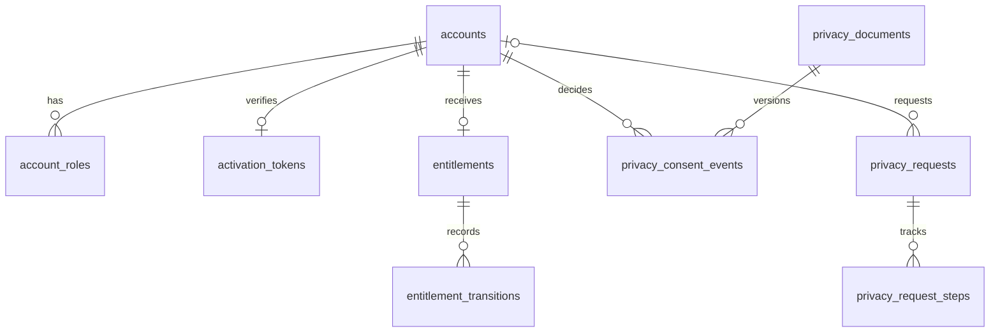
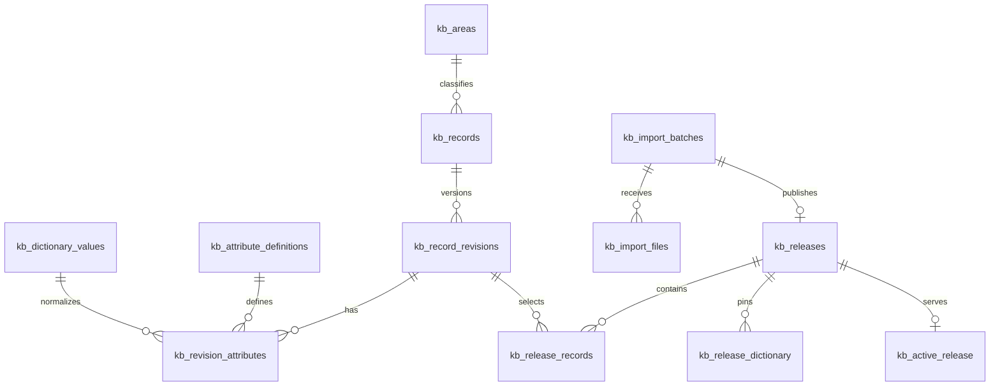
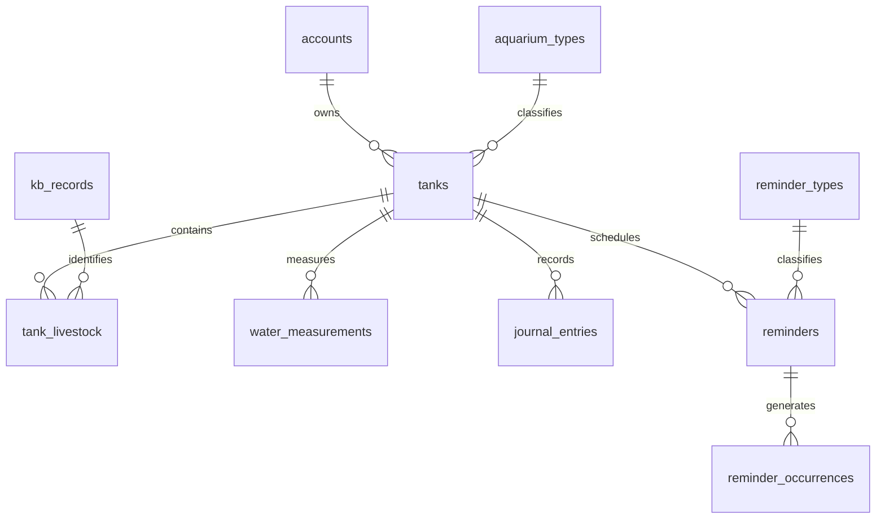
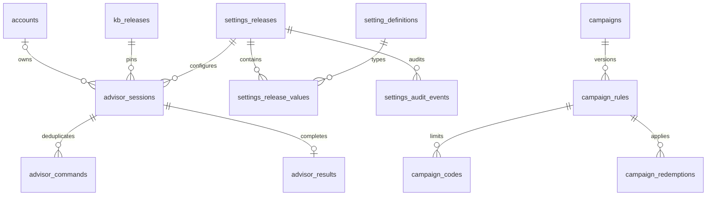
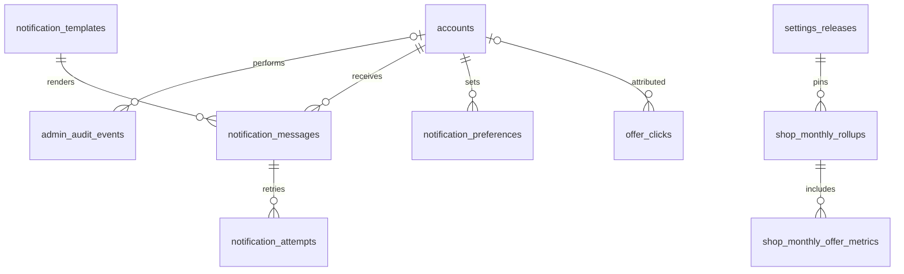

# Aikwarium v2 — model domeny i projekt aplikacji

> **Uwaga:** dokument jest częściowo nieaktualny. Konta (poziomy Drop / Tank / Fishroom), zbiorniki (pasma), doradca (trzy ścieżki) i baza wiedzy muszą zostać zaktualizowane zgodnie z sekcją „Zmiany w modelu domenowym” na końcu `10-domena-sklepu.md` oraz z `../01-analiza/60-aktualizacja-do-galezi-aktualnej.md`.

**Zakres etapu 2.** Nowy modularny monolit PHP 8.4, Laravel 13, Filament i Livewire, z MySQL 8.4 LTS oraz kolejką `database`. Filament obsługuje `/admin` i `/panel-sklepu`, a Blade + Livewire obsługują stronę publiczną i `/moje-akwarium`. Wersje Filament 5 i Livewire 4 wymagają potwierdzenia przez Composer w etapie 2. Akcje domenowe są wspólne dla webu i przyszłego API. Wnętrze Shops ma osobny projekt. `D:6–16`, `A:46–63,87–97`.

**Podstawa źródłowa.** Stan PoC przytaczam za analizami, które zawierają odsyłacze do kodu. Oznaczenia `plik:linia` poniżej wskazują przeczytane dokumenty. PHP, dane produkcyjne, runtime WP i Composer pozostały poza zakresem weryfikacji. Schematy, nazwy akcji i kontrakty stanowią projekt v2. **[HIPOTEZA]** oznacza niezweryfikowane założenie o stanie danych lub działania PoC.

| Skrót | Ścieżka |
|---|---|
| `D` | `aquawiedza-v2/docs/02-projekt/00-decyzje.md` |
| `A` | `aquawiedza-v2/docs/02-projekt/01-stack-i-architektura.md` |
| `E` | `aquawiedza-v2/docs/01-analiza/10-silnik-rekomendacji.md` |
| `U` | `aquawiedza-v2/docs/01-analiza/30-konta-i-panel-uzytkownika.md` |
| `W` | `aquawiedza-v2/docs/01-analiza/40-dokumentacja-wymagania.md` |

## 1. Moduły i granice

| Moduł | Odpowiedzialność i własność danych | Główna akcja lub port | Emituje → konsumuje |
|---|---|---|---|
| Identity & Access (`IdentityAccess`) | Konto, role platformy, hasło, aktywacja, jedna subskrypcja, historia. `accounts`, `account_roles`, `activation_tokens`, `entitlements`, `entitlement_transitions` | `ActivateAccount`, `GetAccess`, `ChangeEntitlement` | `AccountRegistered`, `AccountActivated`, `EntitlementChanged` → skonsumuje żądanie usunięcia przez akcję Privacy |
| Knowledge Base (`KnowledgeBase`) | Tożsamość encji, słowniki, rewizje, importy, publikowane zestawy. `kb_*` | `GetCatalogSnapshot`, `ResolveRecordKeys`, `ActivateCatalogRelease` | `CatalogActivated` → konsumenci odświeżają cache po numerze wydania |
| Advisor | Sesje, plany pytań, ranking, weryfikacja wskazanego rekordu i historia własna. `advisor_sessions`, `advisor_commands`, `advisor_results` | `StartAdvisorSession`, `SubmitAdvisorAnswer`, `SearchCatalog` | `AdvisorCompleted` → odczytuje wydanie KB, reguły Settings i dostęp IdentityAccess przez porty |
| Aquarium | Zbiorniki, obsada, pomiary, dziennik, przypomnienia, kalkulator. `tanks`, `tank_livestock`, `water_measurements`, `journal_entries`, `reminders`, `reminder_occurrences` i słowniki | `RecordMeasurement`, `CompleteReminderOccurrence`, `GetTankContext`, `CalculateRedfield` | `MeasurementRecorded`, `ReminderDue`, `ReminderCompleted` → sprawdza dostęp i pobiera ustawienia |
| Shops | Tożsamość sklepu, członkostwo, tożsamość ofert i widoczność publiczna. W niniejszym projekcie wyłącznie kontrakt | `FindVisibleOffers`, `ResolveOfferTarget`, `GetShopInventoryCounts` | `ShopRegistered`, `OfferVisibilityChanged`, `ShopPublicationChanged` → przyjmuje ocenę okresu z Metrics przez port |
| Tracking | Kanoniczny zapis kliknięcia w obu typach ofert i kontrola przekierowania. `offer_clicks` | `TrackOfferClick` | `OfferClicked` → odczytuje cel przez Shops, pobiera limity Settings |
| Metrics | Próbki dzienne, okresy, wiersze raportu, estymaty i telemetria. `shop_daily_samples`, `shop_monthly_rollups`, `shop_monthly_offer_metrics`, `analytics_events` | `SampleShopInventory`, `CloseShopMonth`, `GetShopReport` | `ShopMonthClosed` → konsumuje `OfferClicked`, odczytuje liczebność z Shops |
| Settings | Definicje, walidacja, jawnie publikowane wersje ustawień, audyt. `setting_definitions`, `settings_*` | `ResolveSettingsAt`, `PublishSettingsRelease` | `SettingsPublished` → konsumenci wybierają wersję przy starcie operacji |
| Campaigns | Okna kampanii, segmenty, kody, wykorzystania i ograniczone efekty. `campaigns`, `campaign_rules`, `campaign_codes`, `campaign_redemptions` | `ResolveCampaignBenefits`, `RedeemCampaignCode` | `CampaignRedeemed` → aktywacja konta i Shops pobierają efekt przez port |
| Notifications | Szablony, preferencje, wysyłka i stan dostarczenia. `notification_*` | `EnqueueNotification`, `SendNotification`, `RecordDeliveryOutcome` | `NotificationDeliveryChanged` → `AccountRegistered`, `AccountActivated`, `EntitlementChanged`, `ReminderDue`, zdarzenia Shops |
| Privacy | Wersje dokumentów, dowody decyzji, eksport, usuwanie i retencja. `privacy_*` | `RecordConsent`, `RequestDataExport`, `RequestAccountErasure` | `ConsentChanged`, `ErasureRequested`, `AccountErased` → moduły realizują własne operacje eksportu i usuwania |
| Admin | Kompozycja Filament, filtry, autoryzowane operacje operatora i audyt administracyjny. `admin_audit_events` | `ListAccounts`, `QueryAudit`, `GetOperationsOverview` | `AdminActionRecorded` → odczyt historii z portów właścicieli danych |

Rdzeń obejmuje pięć celów doradcy, konto i dostęp, prywatny panel akwarium, publiczne oferty i przekierowania, raporty oraz historię. Mapa usług, fakturowanie, publiczne API i funkcje AI pozostają w etapach wskazanych w wymaganiach i decyzjach. `D:4–15`, `W:44–87,93–125,147`.

### Interfejs Shops

| Kontrakt | Dane i reguła |
|---|---|
| `ShopRef` | `shopId`, publiczny `slug`, stan publikacji; mapowanie dawnych ID/slugów należy do Shops |
| `OfferRef` | Stabilne `offerId`, `shopId`, opcjonalny `RecordKey{area,legacyId}`, wariant. Stabilność ID obowiązuje przy edycji oferty |
| `FindVisibleOffers(recordKeys[])` | Jedno zapytanie wsadowe. Wynik grupowany po `RecordKey`, zawiera cenę w groszach lub `null`, wariant, rodzaj linku i publiczny URL trackera. Bramkę widoczności egzekwuje Shops |
| `ResolveOfferTarget(offerId, at)` | `not_found`, `not_visible` albo widoczny cel `internal`/`external`. Tracking używa wyniku przy każdym wejściu w link |
| `GetShopInventoryCounts(shopId, sampleDate)` | Liczba ofert live i liczba wewnętrznych, w tym obie równe zero. Źródło próbki stanowi Shops |
| `ApplyShopPeriodAssessment(shopId, period, rollupId, settingsReleaseId)` | Idempotentne po sklepie i okresie. Właściciel modelu publikacji zapisuje ocenę i ewentualne przejście stanu, a Metrics zachowuje wynik pomiaru |
| `ProvisionShopForAccount` / `CanManageShop` | Profil firmy i członkostwo pozostają w Shops. Rejestracja przekazuje dane firmy do tej akcji. Policy sprawdza członkostwo dla wskazanego `shopId` |

Publiczna ministrona zachowuje `/sklep/{slug}/`, a tracker `/go/shop/{id}/`. Stary slug prowadzi przez 301 do kanonicznego adresu, a tracker po zapisaniu albo rozpoznaniu duplikatu zwraca 302. Niedostępna oferta zwraca 404. Powiązanie oferty działa przez `RecordKey`, także dla korekty z innego obszaru. `A:95`, `E:398,419–421`, `W:94,99,103–105`.

## 2. Model danych MySQL 8.4

### 2.1 Konwencje wspólne

- `id` i wewnętrzne FK to `BIGINT UNSIGNED`; klucze złożone i publiczne wskazano jawnie. `DT` oznacza `DATETIME(6)` w UTC, `DATE` oznacza dzień kalendarzowy. Sufiks `_at` oznacza `DT`, a `_date` oznacza `DATE`.
- `PK(id)` jest domyślne dla tabel z `id`. `UQ` oznacza `UNIQUE`, `IX` indeks zapytania. Pola są `NOT NULL`, gdzie wyraźnie nie podano `NULL`. Jawnie nazwane klucze kodów mają `VARCHAR(48)` i porównanie binarne. Klucze publiczne UUID/ULID mogą być przechowywane binarnie.
- FK wskazany samym odsyłaczem `→` ma `ON DELETE RESTRICT`. `C` oznacza `CASCADE`, `N` oznacza `SET NULL` i wymaga nullable FK. Identyfikatory historyczne oznaczone `snapshot` są wartościami utrwalonymi przy zdarzeniu.
- `InnoDB`, `utf8mb4`. Kwoty w groszach, pomiary jako `DECIMAL`, procenty stawek w punktach bazowych. Dziedziny kodów mają słownik albo skończony `CHECK`. Zasady zależne od czasu, ustawień lub innych wierszy egzekwują akcje w transakcji.
- Indeks złożony pokrywający FK wystarcza. Migracje mają utrzymywać indeksy FK, także gdzie poniżej podano wyłącznie indeks odczytu.

### 2.2 Identity & Access i Privacy

| Tabela | Kolumny i ograniczenia |
|---|---|
| `accounts` | `id`, `public_id BINARY(16) UQ`, `email VARCHAR(254)`, `email_key VARBINARY(254) UQ`, `login VARCHAR(80)`, `login_key VARBINARY(80) UQ`, `name VARCHAR(160)`, `password_hash VARCHAR(255)`, `password_scheme VARCHAR(24)`, `account_kind CHECK(in aquarist,shop)`, `state CHECK(in pending,enabled,erasure_pending)`, `verified_at NULL`, `created_at`; `IX(state,created_at,id)` |
| `account_roles` | `account_id → accounts C`, `role_code VARCHAR(48) CHECK(in aquarist,operator)`; `PK(account_id,role_code)`, `IX(role_code,account_id)`. Członkostwo w sklepie rozstrzyga Shops |
| `account_legacy_links` | `source_code`, `legacy_account_id BIGINT UNSIGNED`, `account_id → accounts C`; `PK(source_code,legacy_account_id)`, `UQ(source_code,account_id)` |
| `activation_tokens` | `account_id PK → accounts C`, `token_digest BINARY(32) UQ`, `expires_at`, `issued_at`, `CHECK(expires_at>issued_at)`, `IX(expires_at)` |
| `entitlements` | `id`, `account_id → accounts C UQ`, `state CHECK(in trial,active,expired,suspended)`, `trial_started_at`, `trial_ends_at`, `settings_release_id → settings_releases`, `version INT UNSIGNED`; `CHECK(trial_ends_at>trial_started_at)`, `IX(state,trial_ends_at,id)` |
| `entitlement_transitions` | `id`, `entitlement_id → entitlements C`, `actor_id NULL → accounts N`, `version INT UNSIGNED`, `from_state NULL`, `to_state`, `old_trial_ends_at NULL`, `new_trial_ends_at`, `reason_code`, `occurred_at`; obie wartości stanu z tej samej dziedziny, `UQ(entitlement_id,version)` |
| `privacy_documents` | `id`, `document_code` (`terms`, `privacy_notice`, `marketing`), `version_no INT UNSIGNED`, `content_digest BINARY(32)`, `body TEXT`, `effective_at`, `UQ(document_code,version_no)`, `UQ(document_code,effective_at)` |
| `privacy_consent_events` | `id`, `account_id → accounts C`, `document_id → privacy_documents`, `purpose_code`, `decision CHECK(in accepted,granted,withdrawn,acknowledged)`, `occurred_at`, `source_code`; `IX(account_id,purpose_code,occurred_at,id)`. Akcja wymusza zgodność celu i decyzji z typem dokumentu |
| `privacy_requests` | `id`, `account_id NULL → accounts N`, `public_id BINARY(16) UQ`, `kind CHECK(in export,erasure)`, `state CHECK(in pending,running,done,failed)`, `requested_at`, `completed_at NULL`, `artifact_ref VARCHAR(255) NULL`, `artifact_expires_at NULL`; `IX(state,requested_at,id)`, `IX(account_id,kind,requested_at)` |
| `privacy_request_steps` | `request_id → privacy_requests C`, `module_code`, `state CHECK(in pending,done,failed)`, `updated_at`, `attempts INT UNSIGNED`; `PK(request_id,module_code)` |



- Aktywacja blokuje rekord konta, waliduje skrót tokenu, nadaje role i tworzy trial oraz wpis przejścia w jednej transakcji. Ponowne kliknięcie zwraca bezpieczny stan końcowy bez tworzenia trialu ani wydawania sesji na podstawie zużytego tokenu. Trial aktywny przy `now < trial_ends_at`, token aktywacyjny ważny także na granicy `now = expires_at`. `U:140–144`.
- `GetAccess` sprawdza termin bez zapisu. `ExpireEntitlements` materializuje przejście `trial → expired` także bez ruchu użytkownika. Operator może zmieniać cztery stany i datę. Zmiana daty wygasłego trialu sama nie wznawia dostępu. Warunek wejścia w `trial` w v2 to przyszły termin. Proponowana zmiana walidacji operatora wymaga odbioru. `U:143–145,162–164`.
- `terms` i zgoda marketingowa przechodzą odrębne zdarzenia. `privacy_notice` jest informacją, z opcjonalnym potwierdzeniem zapoznania się. Wysyłka marketingowa ponownie sprawdza zgodę przy wysyłce. Historyczne zgody bez znanej wersji wymagają odrębnego oznaczenia pochodzenia. `U:139,165–166`.
- Usunięcie najpierw blokuje sesje i mutacje, potem wykonuje wznawialne kroki modułów. Konto usuwa się po zakończeniu kroków, w tym po uzgodnionym przetworzeniu danych Shops. Retencja audytu, raportów i dowodów zgód wymaga decyzji przed migracją. Eksport odczytuje dane przez akcje modułów, a artefakt ma termin i kontrolę dostępu. `U:165–166,329–331`, `W:133–135`.

| Aktor | Konto i prywatne dane | Doradca i Redfield | Sklep |
|---|---|---|---|
| Gość | Rejestracja, aktywacja, logowanie, reset | Bazowo bramka na dobór i weryfikację. Publiczny kreator wymaga decyzji | Publiczne oferty według widoczności |
| `pending` | Aktywacja albo ponowne wydanie linku | Brak dostępu | Brak dostępu do panelu |
| `enabled` z ważnym `trial` lub `active` | Odczyt i mutacje własnych zbiorników | Dozwolone | Panel po członkostwie; publikacja według Shops |
| `enabled` z `expired`, `suspended` lub bez subskrypcji | Własny odczyt, samoobsługa, eksport i wniosek o usunięcie | Niedostępne | Bazowo panel po członkostwie; wpływ abonamentu na panel i widoczność wymaga decyzji |
| Operator | Czynności administracyjne wg Policy | Własne narzędzia wg zwykłej bramki | Konsola administracyjna osobno od członkostwa |

Macierz zachowuje bazę PoC opisaną w `U:275,336–351`. Wymagane rozstrzygnięcia dotyczą gościa, zawieszenia sklepu i zakresu 2FA. `A:52,105–106`, `W:131–132`.

### 2.3 Knowledge Base

| Tabela | Kolumny i ograniczenia |
|---|---|
| `kb_areas` | `id TINYINT UNSIGNED PK`, `code UQ`. Kanoniczne `fauna`, `flora`, `sprzet`, `pielegnacja`; mapowanie `equipment` i `maintenance` na brzegu kontraktu |
| `kb_records` | `id`, `area_id → kb_areas`, `legacy_id VARBINARY(64)`, `created_at`; `UQ(area_id,legacy_id)`, `UQ(area_id,id)` |
| `kb_import_batches` | `id`, `base_release_id NULL → kb_releases`, `actor_id NULL → accounts N`, `status CHECK(in staged,validated,rejected,activated)`, `manifest JSON`, `validation_report JSON`, `created_at` |
| `kb_import_files` | `batch_id → kb_import_batches C`, `area_id → kb_areas`, `name VARCHAR(255)`, `digest BINARY(32)`, `row_count INT UNSIGNED`; `PK(batch_id,area_id)` |
| `kb_record_revisions` | `id`, `record_id → kb_records`, `revision_no INT UNSIGNED`, `batch_id → kb_import_batches`, `raw_fields JSON`, `name_pl VARCHAR(255) NULL`, `name_latin VARCHAR(255) NULL`, `product_name VARCHAR(255) NULL`, `description TEXT NULL`, `search_text TEXT`, `content_digest BINARY(32)`; `UQ(record_id,revision_no)`, `UQ(record_id,id)` |
| `kb_dictionary_values` | `id`, `dictionary_code`, `value_code`, `UQ(dictionary_code,value_code)`, `UQ(dictionary_code,id)`. Kody stabilne, etykiety i porządek wersjonowane |
| `kb_attribute_definitions` | `id`, `area_id → kb_areas`, `attribute_code`, `dictionary_code`, `cardinality CHECK(in single,multiple)`; `UQ(area_id,attribute_code)`, `UQ(id,dictionary_code)` |
| `kb_revision_attributes` | `revision_id → kb_record_revisions C`, `attribute_id`, `dictionary_code`, `ordinal SMALLINT UNSIGNED`, `value_id`, `raw_token VARCHAR(255)`; `PK(revision_id,attribute_id,ordinal)`, FK `(attribute_id,dictionary_code)` do definicji i `(dictionary_code,value_id)` do wartości, `IX(attribute_id,value_id,revision_id)` |
| `kb_releases` | `id`, `batch_id → kb_import_batches UQ`, `version_no INT UNSIGNED UQ`, `activated_at`, `manifest_digest BINARY(32)` |
| `kb_release_dictionary` | `release_id → kb_releases`, `value_id → kb_dictionary_values`, `label VARCHAR(255)`, `sort_order SMALLINT UNSIGNED`, `metadata JSON`; `PK(release_id,value_id)` |
| `kb_release_records` | `release_id → kb_releases`, `area_id`, `record_id`, `revision_id`, `source_position INT UNSIGNED`; `PK(release_id,record_id)`, FK `(area_id,record_id)` do rekordów, FK `(record_id,revision_id)` do rewizji, `UQ(release_id,area_id,source_position)`, `CHECK(source_position>0)` |
| `kb_active_release` | `id TINYINT UNSIGNED PK CHECK(id=1)`, `release_id → kb_releases`. Jeden wskaźnik dla wszystkich czterech obszarów |



| Obszar | Nazwy i opisy | Słowniki znormalizowane |
|---|---|---|
| Fauna | Nazwa PL i łacińska | Region, wielkość fauny, temperatura, pH, temperament, strefa pływania, typ organizmu, litraż i typ akwarium |
| Flora | Nazwa PL i łacińska | Region, wielkość flory, trudność, strefa sadzenia, CO₂, kolor, litraż i typ akwarium |
| Sprzęt | Produkt, krótki opis | Kategoria, rodzaj, producent, segment marki, doświadczenie, zdalne sterowanie, litraż i typ akwarium |
| Pielęgnacja | Produkt, opis | Kategoria zadania, rodzaj zadania, obszar zastosowania, producent i segment marki |

- Wzorzec `bundled` ma **184 / 201 / 108 / 110** rekordów. Litraż i typ akwarium są wielowartościowe. `Wszystkie` to jawny kod wieloznaczny w danych, a `Nie wiem` reprezentuje odpowiedź sesji. Normalizacja daje m.in. `Nie → nie`, z zachowaniem surowej wartości i pozycji tokenu. Identyczne nazwy handlowe oraz powtórzone tokeny pozostają odtwarzalne. `E:56–126,204–207,421`.
- Import TSV/CSV waliduje kodowanie, komplet kolumn, ID, krotność, słowniki i zgodność obszaru atrybutu. Nieznany token albo duplikat klucza daje raport wiersza. Akcja edycji ręcznej tworzy rewizję i nowe wydanie tym samym procesem, kopiując powiązania niezmienionych rekordów.
- Aktywacja blokuje wskaźnik, porównuje wydanie bazowe, zatwierdza czteroczęściowy manifest i przestawia wskaźnik w jednej transakcji. Wydanie zmienione w międzyczasie wymaga ponownej walidacji względem aktualnego. Wycofanie wybiera wcześniejszy kompletny manifest przez nową aktywację. Sesje rozpoczęte zachowują swoje wydanie. `E:419–422`.
- Wygaszony rekord znika z bieżącego manifestu, a jego klucz i rewizje zostają dla obsady, ofert i historii. **[HIPOTEZA]** Produkcyjny manifest może różnić się od `bundled`. Import produkcyjny wymaga osobnego porównania; wartości 184/201/108/110 są kryterium dla fixture. `E:60–65,421–422`.

### 2.4 Aquarium

| Tabela | Kolumny i ograniczenia |
|---|---|
| `aquarium_types` / `reminder_types` | `id SMALLINT UNSIGNED PK`, `code UQ`, `label VARCHAR(100)`, `sort_order SMALLINT UNSIGNED`. Typy startowe poniżej |
| `tanks` | `id`, `owner_id → accounts C`, `type_id → aquarium_types`, `name VARCHAR(100)`, `volume_l SMALLINT UNSIGNED`, `notes TEXT NULL`, `timezone VARCHAR(64)`, `created_at`; `CHECK(volume_l>0)`, `IX(owner_id,created_at,id)` |
| `tank_livestock` | `id`, `tank_id → tanks C`, `area_id`, `kb_record_id`, `quantity INT UNSIGNED NULL`, `added_date`, `removed_date NULL`, `notes TEXT NULL`; złożony FK `(area_id,kb_record_id) → kb_records`, ograniczenie obszaru na stałe ID fauny/flory ze słownika, `CHECK(quantity IS NULL OR quantity>0)`, `CHECK(removed_date IS NULL OR removed_date>=added_date)`, `IX(tank_id,removed_date,added_date,id)` |
| `water_measurements` | `id`, `tank_id → tanks C`, `measured_date`, `measured_at NULL`, `measurement_timezone VARCHAR(64)`, kolumny poniżej, `settings_release_id → settings_releases`, `created_at`; `CHECK` co najmniej jednego parametru i nieujemnych podanych wartości, `IX(tank_id,measured_date,measured_at,id)` |
| `journal_entries` | `id`, `tank_id → tanks C`, `entry_date`, `body TEXT`, `created_at`; `CHECK(CHAR_LENGTH(TRIM(body))>0)`, `IX(tank_id,entry_date,id)` |
| `reminders` | `id`, `tank_id → tanks C`, `type_id → reminder_types`, `label VARCHAR(100) NULL`, `starts_date`, `interval_days SMALLINT UNSIGNED NULL`, `state CHECK(in active,completed,cancelled)`; `CHECK(interval_days IS NULL OR interval_days>0)`, `IX(tank_id,state,id)` |
| `reminder_occurrences` | `id`, `reminder_id → reminders C`, `due_date`, `state CHECK(in scheduled,done,cancelled)`, `completed_at NULL`, `actor_id NULL → accounts N`; `CHECK((state='done')=(completed_at IS NOT NULL))`, `UQ(reminder_id,due_date)`, `IX(state,due_date,id)` |

| `water_measurements` | Jednostka | Typ nullable | Próg ostrzeżenia startowego |
|---|---|---|---|
| `ph` | bez jednostki | `DECIMAL(4,2)` | 0–14 |
| `temp_c` | °C | `DECIMAL(4,1)` | 10–40 |
| `kh`, `gh` | °dH | `DECIMAL(5,1)` | 0–50 każde |
| `no3` | mg/l NO₃ | `DECIMAL(6,1)` | 0–500 |
| `po4` | mg/l PO₄ | `DECIMAL(6,3)` | 0–10 |



- Typy zbiorników `nano`, `community`, `planted`, `biotope_hard`, `specialist`. Typy przypomnień `water_change`, `fertilization`, `filter_cleaning`, `parameter_check`, `treatment`, `co2_check`, `other`. Własność dzieci wynika z jednego FK do zbiornika. Usunięcie zbiornika usuwa obsadę, pomiary, dziennik, przypomnienia i ich wystąpienia. `U:275–280,328–331`.
- Pomiar to jedna sesja, z wieloma opcjonalnymi parametrami. Data bez godziny zachowuje precyzję PoC przez `measured_at=NULL`. Dozwolone są różne sesje tego samego dnia. UI wprowadza NO₃ przed PO₄ i zachowuje pełną zapisaną precyzję PO₄. `U:278,283–296,329–331`, `W:83–86`.
- `RecordMeasurement` odrzuca dostarczone błędne wartości i przypadek bez żadnej poprawnej liczby. Akceptuje poprawny pomiar poza zakresem ostrzegawczym, zwracając ostrzeżenia. `NULL` oznacza brak pomiaru. W migracji `no2` jest osobnym problemem mapowania. `U:278,329–331`, `W:83–84`.
- `CompleteReminderOccurrence` blokuje przypomnienie i wskazane wystąpienie. Powtórzenie tego samego `occurrenceId` zwraca historię wykonania. Cykliczne tworzy dokładnie jedno następne wystąpienie `due_date + interval_days`, także gdy wciąż zaległe. Jednorazowe zamyka przypomnienie. Lista zbiorcza pokazuje zaległe i terminy `≤ dziś + 30 dni` wg strefy zbiornika. `U:279–280`.
- Redfield jest akcją obliczeniową bez własnej tabeli. Zwrot zawiera stosunek molowy, stosunek masowy, identyfikator strefy i komunikat. Zapis pomiaru i kalkulacja są odrębnymi akcjami. `U:298–314,328–332`, `W:87`.

### 2.5 Advisor, Settings i Campaigns

| Tabela | Kolumny i ograniczenia |
|---|---|
| `advisor_sessions` | `id`, `public_id BINARY(16) UQ`, `account_id NULL → accounts C`, `guest_scope_digest BINARY(32) NULL`, `kb_release_id → kb_releases`, `settings_release_id → settings_releases`, `engine_version VARCHAR(32)`, `stage CHECK(in k1,k2,done)`, `revision INT UNSIGNED`, `state JSON`, `expires_at`, `created_at`; `CHECK` dokładnie jednego właściciela, `IX(expires_at,id)`, `IX(account_id,created_at,id)` |
| `advisor_commands` | `session_id → advisor_sessions C`, `request_id BINARY(16)`, `request_digest BINARY(32)`, `result_revision INT UNSIGNED`; `PK(session_id,request_id)`. Ten sam klucz z inną treścią zwraca konflikt |
| `advisor_results` | `session_id PK → advisor_sessions C`, `result JSON`, `completed_at`. Dane z rozbiciem na kartę główną, alternatywy, korektę i dodatki |
| `setting_definitions` | `key_code VARCHAR(96) PK`, `type CHECK(in bool,int,decimal,string,list,object)`, `validation_schema JSON`, `owner_module`, `description VARCHAR(255)` |
| `settings_releases` | `id`, `base_release_id NULL → settings_releases`, `effective_at UQ`, `author_id NULL → accounts N`, `published_at`, `reason VARCHAR(255)`. Opublikowane pełne zestawy są niezmienne |
| `settings_release_values` | `release_id → settings_releases`, `key_code → setting_definitions`, `value JSON`; `PK(release_id,key_code)`. Typ JSON i zakres waliduje rejestr kluczy, relacje między kluczami waliduje publikacja |
| `settings_audit_events` | `id`, `release_id → settings_releases`, `actor_id NULL → accounts N`, `changes JSON`, `recorded_at`; `IX(release_id,recorded_at,id)` |
| `campaigns` / `campaign_rules` | `campaigns(id,code UQ)`; reguła ma `id`, `campaign_id → campaigns`, `revision INT UNSIGNED`, `starts_at`, `ends_at`, `segment_code`, `benefit_code`, `benefit_value JSON`, `priority SMALLINT UNSIGNED`, `enabled BOOLEAN`, `settings_release_id → settings_releases`; `UQ(campaign_id,revision)`, `IX(enabled,starts_at,ends_at)`, `CHECK(ends_at>starts_at)`. Zmiana okna lub efektu tworzy rewizję |
| `campaign_codes` | `id`, `rule_id → campaign_rules`, `code_digest BINARY(32) UQ`, `max_uses INT UNSIGNED NULL`, `uses INT UNSIGNED`; `CHECK(max_uses IS NULL OR (max_uses>0 AND uses<=max_uses))` |
| `campaign_redemptions` | `id`, `rule_id → campaign_rules`, `code_id NULL → campaign_codes`, `subject_kind CHECK(in account,shop)`, `subject_key VARBINARY(64)`, `operation_key BINARY(16) UQ`, `applied_value JSON`, `redeemed_at`; `UQ(rule_id,subject_kind,subject_key)` |



- `ResolveSettingsAt(t)` wybiera ostatnie `effective_at ≤ t`. Publikacja waliduje cały zestaw pod blokadą zapisu i sprawdza, czy wersja bazowa jest nadal właściwa. Wycofanie to publikacja wartości z poprzedniego zestawu z nową datą. Trial, sesja doradcy i rollup zapamiętują użyte wersje. Parametry techniczne środowiska, w tym sekrety i klucze podpisu, są konfiguracją wdrożenia. `D:7,15`, `A:29,91,97`.
- Kampania działa w `[starts_at,ends_at)`, dla kwalifikującego się segmentu. Efekty startowe to wydłużenie trialu, próg publikacji i darmowa publikacja. Reguły dla sklepu ocenia Shops. Projekt przyjmuje jeden efekt danego typu, wybierany wg priorytetu z deterministycznym kluczem końcowym. Konflikty i kumulacja wymagają decyzji właściciela. Zużycie kodu i efekt zapisują się w jednej transakcji. `D:7`, `A:60`.
- `subject_key` jest kluczem technicznym do deduplikacji. Privacy usuwa jego powiązanie według przyjętej retencji albo usuwa wykorzystanie i zachowuje zagregowany licznik kodu. Limit kodu liczy historyczne użycia mimo usuwania danych osobowych.

### 2.6 Tracking, Metrics, Notifications i Admin

| Tabela | Kolumny i ograniczenia |
|---|---|
| `offer_clicks` | `id`, `shop_id_snapshot BIGINT UNSIGNED`, `offer_id_snapshot BIGINT UNSIGNED`, `account_id NULL → accounts N`, `target_kind CHECK(in internal,external)`, `dedup_key BINARY(32) UQ`, `occurred_at`; `IX(shop_id_snapshot,occurred_at,offer_id_snapshot)`, `IX(account_id,occurred_at)` |
| `shop_daily_samples` | `shop_id_snapshot`, `sample_date`, `offer_count`, `internal_count` jako `INT UNSIGNED`, `sampled_at`; `PK(shop_id_snapshot,sample_date)`, `CHECK(internal_count<=offer_count)` |
| `shop_monthly_rollups` | `id`, `shop_id_snapshot`, `period DATE`, `avg_offers`, `avg_internal`, `sample_days` jako `INT UNSIGNED`, `settings_release_id → settings_releases`, `evaluated_at`; `UQ(shop_id_snapshot,period)`, `IX(period,shop_id_snapshot)`, `CHECK(DAY(period)=1 AND sample_days BETWEEN 1 AND 31 AND avg_internal<=avg_offers)` |
| `shop_monthly_offer_metrics` | `rollup_id → shop_monthly_rollups C`, `offer_id_snapshot`, `name VARCHAR(255)`, `variant VARCHAR(255) NULL`, `click_count INT UNSIGNED`, `price_grosze BIGINT UNSIGNED NULL`, `estimate_grosze BIGINT UNSIGNED NULL`; `PK(rollup_id,offer_id_snapshot)`. Cena raportowa i podstawa estymaty wymagają kontraktu domeny sklepu |
| `analytics_events` | `id`, `event_id BINARY(16) UQ`, `kind`, `account_id NULL → accounts N`, `occurred_at`, `properties JSON` wg listy dozwolonych pól, `IX(kind,occurred_at)`, `IX(account_id,occurred_at)`. Raport kliknięć czyta kanoniczne kliknięcia przez Tracking |
| `notification_templates` | `id`, `template_code`, `version INT UNSIGNED`, `locale VARCHAR(8)`, `subject VARCHAR(255)`, `body TEXT`, `published_at`; `UQ(template_code,locale,version)` |
| `notification_preferences` | `account_id → accounts C`, `topic_code`, `channel_code`, `enabled BOOLEAN`; `PK(account_id,topic_code,channel_code)` |
| `notification_messages` | `id`, `account_id → accounts C`, `template_id → notification_templates`, `dedup_key BINARY(32) UQ`, `state CHECK(in pending,sent,delivered,failed,cancelled)`, `scheduled_at`, `provider_message_id VARCHAR(255) NULL`, `payload JSON`; `IX(state,scheduled_at,id)` |
| `notification_attempts` | `id`, `message_id → notification_messages C`, `attempt_no SMALLINT UNSIGNED`, `started_at`, `outcome_code`, `provider_event_id VARCHAR(255) NULL UQ`, `UQ(message_id,attempt_no)` |
| `admin_audit_events` | `id`, `actor_id NULL → accounts N`, `action_code`, `subject_kind`, `subject_ref VARBINARY(64) NULL`, `changes JSON`, `correlation_id BINARY(16)`, `recorded_at`; `IX(subject_kind,subject_ref,recorded_at)`, `IX(actor_id,recorded_at)` |
| `outbox_messages` | Infrastruktura. `event_id BINARY(16) PK`, `event_type`, `payload JSON`, `correlation_id BINARY(16)`, `occurred_at`, `published_at NULL`; `IX(published_at,occurred_at)` |
| `event_receipts` | Infrastruktura. `consumer_code`, `event_id BINARY(16)`, `processed_at`; `PK(consumer_code,event_id)`. Potwierdzenie zapisuje się z efektem konsumenta |



- Tracking waliduje cel przekierowania, limituje zapis i deduplikuje po ofercie, pseudonimowym zakresie odwiedzającego i oknie. Obie ścieżki używają tej samej akcji. Klucz nie zawiera jawnego IP. Identyfikatory snapshot pozwalają zachować raporty zgodnie z polityką retencji po usunięciu oferty. `A:58,74,79`, `W:103–107,133`.
- Start harmonogramu wg PoC to **03:00** dla próbki i **04:00 pierwszego dnia miesiąca** dla rollupu poprzedniego miesiąca, w `Europe/Warsaw`. `ceil(sum/count)` osobno dla obu liczebności, `sample_days=COUNT(*)`, próbka zerowa liczy się jako próbka. Brak próbek wywołuje alarm i wstrzymuje ocenę. Niekompletny miesiąc daje diagnostykę, a bramka oceny publikacji wymaga decyzji właściciela. `W:108–110,135,150–152`.
- `CloseShopMonth` zamyka pomiar i wywołuje synchroniczny port Shops w tej samej transakcji MySQL. Ponowienie zwraca zapisane zamknięcie. Przy awarii wycofują się wynik, zastosowanie oceny i outbox. Raport rozróżnia kliknięcia, estymatę i późniejsze rozliczenie. `A:59,91–92,99`, `W:105–110,149–152`.
- Notifications deduplikuje po zdarzeniu biznesowym: dla wykonania cyklu po `occurrenceId`, dla końca trialu po `entitlementId + trialEndsAt + offset`. `sent` oznacza przyjęcie przez transport, `delivered` wymaga informacji zwrotnej. Przy timeoutach po wysyłce używa klucza idempotencji dostawcy, gdy dostawca go obsługuje. Poczta przypomnień akwarium jest rozszerzeniem. `U:148,280`, `W:101–102`.

## 3. Kontrakt Advisor

### 3.1 DTO i klasy czystego PHP

| Kontrakt | Zawartość |
|---|---|
| `StartAdvisorInput` | `Actor` lub wiązanie sesji gościa, `locale`, opcjonalny autoryzowany `TankContext`. Akcja przypina `kbReleaseId`, `settingsReleaseId`, `engineVersion` |
| `AdvisorCommand` | `sessionId`, `expectedRevision`, `requestId`, operacja `answer`, `select_record` albo `reset`, opcjonalnie `promptKey`, `optionCode`, `RecordKey` |
| `AdvisorState` | `stage`, `goal`, `unitIndex`, `answers`, `selectedRecordKey`, `revision`; rejestrowana jest odpowiedź z konkretnego pytania i kolejności |
| `AdvisorView` | `stage`, `revision`, `progress`, `prompt{key,type,field,options,context}`, `summaryGroups`, `planOverview`, `result?`, `errorCode?` |
| `AdvisorResult` | `area`, `rankMode`, `status`, `basis`, `candidateCount`, `rankedItems[]` albo `selectedItem`, `alternative?`, `correction?`, `supportingItems[]`. Licznik i kind karty mają jawne znaczenie |
| `AdvisorItem` | `RecordKey`, `revisionId`, `label`, `verdict`, `score`, `maxScore`, `criterionScores`, `matchPercent`, `fitLabel`, `reasons`, `warnings`, `details`, opcjonalna `compatibility[]` |
| `SearchCatalogInput` / `SearchHit` | `query`, przypięte wydanie, opcjonalny obszar / `RecordKey`, `revisionId`, `label`, `areaLabel`. Oferty są dociągane po uzyskaniu wyniku przez port Shops |

`SessionFlow`, `GoalPlanner`, `CandidateFilter`, `QuestionPlanner`, `CriterionScorer`, `Ranker`, `TieBreaker`, `RecordSearch`, `RecordCompatibility`, `AlternativeSelector` i `CorrectionSelector` przyjmują wartości, `CatalogSnapshot` i `AdvisorRules`. Akcje aplikacyjne obsługują SQL, dostęp, zegar i transakcję. Silnik nie zależy od Eloquent, Livewire, sesji HTTP ani Shops. Na zmianę odpowiedzi akcja sprawdza właściciela i `expectedRevision`, odtwarza pytanie oraz zapisuje nowy stan lub zwraca konflikt. `E:204–207,363–368,417–419`.

### 3.2 Reguły punktu odniesienia

| Etap | Reguła do odtworzenia przed zmianami |
|---|---|
| K1 | Cztery cele doboru pytają o litraż i typ. Skala litrażu `Nano <40`, `Małe 40–100`, `Średnie 101–250`, `Duże 251–500`, `Bardzo duże >500`. Dla fauny/flory wystarczy znany token litrażu z indeksem `≤` indeksu wyboru. Dla sprzętu wymagany dokładny token. `Wszystkie` przepuszcza, typ ma dokładne dopasowanie; bieżąca pielęgnacja bez obu pól przechodzi. `E:69–74,204–230` |
| K2 plan | Fauna wymaga `Typ` także przy jednej opcji. Ryba `Wielkość → Strefa → Temperament → Temperatura → pH → Region`; skorupiak/ślimak `Wielkość → pH → Region`. Flora `Wielkość → Strefa → CO2 → Kolor → Region`. Sprzęt `kategoria → rodzaj → marka → producent`. Pielęgnacja `kategoria zadania → rodzaj zadania → obszar → marka → producent`. `E:233–274,289–296` |
| K2 pula | Twarde `Typ` fauny, kategoria/rodzaj sprzętu, kategoria/rodzaj zadania/obszar pielęgnacji. Preferencje marki i producenta punktują. W faunie kolejny filtr usuwa wyniki `0` tylko gdy istnieje kandydat `≥2`. Pytanie zwykle przy 2–8 opcjach, bez autozapisu pominiętej odpowiedzi. `E:242–284,289–296` |
| K3 punktacja | Aktywne kryteria w kolejności planu, bez `Typ` fauny i `Nie wiem`. Skale `3/2/1/0` wg odległości 0/1/2/dalszej. Region, marka i producent `3/2/0`. Zgodność ścisła `3/0`. Maksima teoretyczne **18/9/15/12/15** dla ryb, pozostałej fauny, flory, sprzętu i pielęgnacji. Procent `round(100×suma/(3×n))`, przy `n=0` bazowo 100. `E:296–326,343–349` |
| K3 kolejność | Suma malejąco, liczba `3` malejąco, liczba `1` rosnąco, wektor malejąco. Następnie analogiczna dogrywka `[litraż,typ]`, potem `strcmp(id)` rosnąco. Dokładny token daje 3/2/1 przy 1/2/≥3 tokenach, sam wildcard litrażu daje 1, brak zgodności 0. Przy `n≤2` dogrywka porządkuje grupę, a status ex aequo wynika z głównego klucza. `E:307–343` |
| K3 karty | `single`, `tiebreak`, `partial_tie`, `full_tie`; limit 3 lub `max(3,n_remisu)`, wewnętrznie co najmniej pierwsze 5, o ile pula ma tyle rekordów. Etykiety przy `85/70/50%`, brak progu odrzucenia. `3` daje powód, `2` zwykle powód, a Region/Marka/producent uwagę, `1` ostrzeżenie, `0` ciszę. Limit 4 powodów i 3 ostrzeżeń. `E:328–351` |
| Znajdź produkt | Jedno wyszukiwanie po wszystkich czterech obszarach, backendowo substring od **3 znaków**, limit **20**, dawny debounce **150 ms**. Fauna/flora po ID i obu nazwach, sprzęt/pielęgnacja po ID, produkcie i producencie. Wybór wiąże rekord z przypiętym wydaniem. `E:354–357` |
| Weryfikacja | Fauna litraż/typ/pH/temperatura, flora litraż/typ/CO₂, sprzęt litraż/typ, pielęgnacja bez pytań. Dla litrażu `3` za dokładny/wildcard, `1` za sąsiada; pH, temperatura i CO₂ `3/2/0`; typ `3/0`. Próg `≥90` zgodny, `≥70` warunkowo. Poniżej 70 najwyżej jedna alternatywa tego samego obszaru i klasy z `≥90`, oraz jedna korekta wg pH → temperatura → CO₂. Przy równych alternatywach wygrywa kolejność źródłowa. Maks. 2 produkty współistniejące. `E:357–367` |

### 3.3 Status PoC i decyzje

| Status wg analiz | PoC i postępowanie w v2 | Właściciel |
|---|---|---|
| Działa | Cztery dobory, weryfikacja wskazanego produktu, `REGIONFIX`, `AUDITFIX`, miękkie preferencje producenta, remisy i zachowanie stabilnych ID. Zachować jako baseline. `E:296,417` | Zatwierdza przyszłe zmiany reguł |
| Działa częściowo | Sesje i walidacja są opisane, trwałość stanu oraz jednolite wyniki dwóch ścieżek wyszukiwania wymagają poprawy. Wprowadzić właściciela, rewizję, jeden backend i atomowy import. `E:204–207,356,418–419`, `W:72–73` | Zatwierdzić widoczny wpływ nowej kolejności wyszukiwania, jeżeli wystąpi |
| Błąd | Pusta pula wyświetla `Gotowe dopasowanie` (G09), a korekta sprzętowa trafia do Shop jako `fauna` (G14). Naprawić w testach integracyjnych, zachowując wejścia i wyniki punktowe. `E:393,398,419` | Odbiór dwóch jawnych zmian |
| Błąd reguły z decyzją | Opcja `Wysoka (>30 cm)` w nano miała zniknąć, lecz ograniczenie jest nadpisywane (G05). Utrwalić baseline, a wycofanie opcji opisać jako wersję reguł. `E:292,389,419` | **Wymagana decyzja** |
| Działa, znaczenie do zmiany | 100% przy zerze kryteriów (G04/G15), korekta z przypisanym 90%, heurystyki korekt i pokarm rybi dla ślimaków. Baseline dokumentuje liczby; nowy komunikat lub zmiana selekcji dostaje osobne fixture. `E:326,358–361,388,399,419` | **Wymagana decyzja** |
| Błąd danych i etykiet | NBSP w `FN0159`, powtórzona nazwa PL/łacińska i niespójny zakres wyszukiwania klient/serwer. Normalizację białych znaków i składanie etykiet objąć osobnymi asercjami. Zachować raw i odrębne ID powtarzających się produktów. `E:60–63,356,366,421` | Odbiór zmian w wynikach wyszukiwania |
| Martwy kod | Stare wagi, bonusy, pytanie o doświadczenie, inferencja typu i nieużywana dogrywka trudnością. Pominąć w ścieżkach v2. Edycja przypomnień ma metodę bez aktywnej ścieżki panelu. `E:370–377,420`, `U:330` | Rozszerzenia jako osobna funkcja |
| Udokumentowane, brak ścieżki | Kompletny plan ma relikty bez opcji UI; `AQS_Assistant_Messages` brak wg audytu; mail przypomnień akwarium jest rozszerzeniem. `E:377`, `U:280`, `W:65,123` | Kompletny plan i mail wymagają ustalenia zakresu |
| Wdrożone, bez aktualnej specyfikacji | Jedno konto sklepowe dla B2B i funkcji akwarysty z jedną subskrypcją. Zapisać regułę w macierzy odbioru. `U:142,338–351`, `W:53` | Zachować |
| Częściowe lub błędne | Pomiar może sprowadzić niepoprawne wartości do `NULL`; ponowienie wykonania cyklicznego może przesunąć następny termin kolejny raz. Poprawić walidację i zamknąć wykonanie na identyfikatorze wystąpienia. `U:278–280,329`, `W:84–86` | Odbiór zmiany walidacji |

## 4. Katalog akcji domenowych

| Moduł | Akcje `czasownik + rzeczownik` |
|---|---|
| IdentityAccess | `RegisterAccount`, `ActivateAccount`, `ReissueActivationToken`, `AuthenticateAccount`, `EndSession`, `RequestPasswordReset`, `ResetPassword`, `GetAccess`, `ChangeEntitlement`, `ExpireEntitlements`, `PurgePendingAccounts`, `ListEntitlementTransitions` |
| KnowledgeBase | `StageCatalogImport`, `ValidateCatalogImport`, `ReviseCatalogRecord`, `ActivateCatalogRelease`, `RestoreCatalogRelease`, `GetCatalogSnapshot`, `ResolveRecordKeys`, `ExportCatalogRelease` |
| Advisor | `StartAdvisorSession`, `StartAdvisorForTank`, `GetAdvisorView`, `SubmitAdvisorAnswer`, `SearchCatalog`, `SelectCatalogRecord`, `ResetAdvisorSession`, `ListAdvisorHistory`, `PurgeAdvisorSessions` |
| Aquarium | `CreateTank`, `UpdateTank`, `DeleteTank`, `ListTanks`, `AddLivestock`, `UpdateLivestock`, `RemoveLivestock`, `RecordMeasurement`, `ListMeasurements`, `DeleteMeasurement`, `AddJournalEntry`, `ListJournalEntries`, `DeleteJournalEntry`, `CreateReminder`, `ListUpcomingReminders`, `CompleteReminderOccurrence`, `CancelReminder`, `GetTankContext`, `CalculateRedfield` |
| Shops | `ProvisionShopForAccount`, `CanManageShop`, `FindVisibleOffers`, `ResolveOfferTarget`, `GetShopInventoryCounts`, `ApplyShopPeriodAssessment`, `GetPublicShop`, `ExportShopSubjectData`, `EraseShopSubjectData` |
| Tracking / Metrics | `TrackOfferClick`, `ReadOfferClicks`, `PruneOfferClicks`, `SampleShopInventory`, `CloseShopMonth`, `GetShopReport`, `ExportShopReport`, `RecordAnalyticsEvent` |
| Settings / Campaigns | `ResolveSettingsAt`, `ValidateSettingsRelease`, `PublishSettingsRelease`, `RestoreSettingsRelease`, `PublishCampaignRule`, `IssueCampaignCode`, `ResolveCampaignBenefits`, `RedeemCampaignCode` |
| Notifications | `PublishNotificationTemplate`, `SetNotificationPreferences`, `ScheduleTrialNotices`, `EnqueueNotification`, `SendNotification`, `RecordDeliveryOutcome` |
| Privacy / Admin | `PublishPrivacyDocument`, `RecordConsent`, `WithdrawConsent`, `RequestDataExport`, `BuildDataExport`, `RequestAccountErasure`, `EraseAccountData`, `ApplyRetentionPolicy`, `QueryAudit`, `GetOperationsOverview` |

`StartAdvisorForTank` przesyła autoryzowany snapshot litrażu i typu oraz opcjonalnego datowanego pomiaru. Wstępne wartości wymagają potwierdzenia, brakujące prowadzą do normalnego pytania. Użycie obsady lub pomiarów do nowej punktacji wymaga jawnej wersji reguł. `U:331–332`, `W:122–125`.

## 5. Katalog ustawień administratora poza domeną Shops

| Klucz | Typ | Start z PoC lub proponowany stan | Walidacja |
|---|---|---|---|
| `access.trial_days.aquarist`, `access.trial_days.shop` | `int` | **30**, **90**. `U:142–143` | Dodatnie dni kalendarzowe. Obliczenie w strefie biznesowej, zapis UTC. Zmiana dotyczy nowych nadań |
| `access.trial_notice_offsets_days` | `list<int>` | **[14,7]** dla sklepu. `U:148` | Unikalne dodatnie offsety; reguła dla akwarysty wymaga decyzji |
| `identity.registration.timer_seconds` | `{min:int,max:int}` | **3–3600**, włącznie. `U:138` | `0≤min≤max`, podpisany stempel z tolerancją zdefiniowaną przez akcję |
| `identity.registration.rate` | `{max:int,window_seconds:int}` | **5/IP/900 s**. `U:138` | Dodatnie, stałe okno od pierwszej próby; IP wyznaczony przez zaufaną konfigurację proxy |
| `identity.activation.lifetime_seconds`, `identity.pending.cleanup_batch` | `int` | **604800**, **100**. `U:140–141` | Dodatnie. Czyszczenie po efektywnym wygaśnięciu, bez usunięcia konta z ważnym ponownie wydanym tokenem |
| `identity.password.min_length` | `int` | **8 bajtów** w PoC. `U:135` | Jedna interpretacja dla web i API. Zmiana jednostki na znaki wymaga odbioru |
| `aquarium.tanks.volume_l` | `{min:int,max:int}` | **1–5000 l** z UI. `U:276` | Dodatnie, `max≤65535`. Przekroczenia w starych danych raportować, bez przycinania |
| `aquarium.reminders.horizon_days`, `aquarium.reminders.interval_days` | `int`, `{min:int,max:int}` | **30**, **1–365** z UI. `U:279–280` | Dodatnie, `min≤max≤65535`; dla jednorazowego interwał `NULL` |
| `aquarium.measurements.warning_ranges` | `object<decimal range>` | `ph 0–14`, `temp_c 10–40`, `kh 0–50`, `gh 0–50`, `no3 0–500`, `po4 0–10`. `U:283–296` | Znane klucze, jednostki kanoniczne, `min≤max`, granice włącznie, precyzja mieszcząca się w kolumnie |
| `aquarium.redfield.max_input_mg_l`, `aquarium.redfield.zone_edges` | `decimal`, `list<decimal>` | **100**, **[5,10,20,30]**. `U:300–314` | `NO₃≥0`, `PO₄>0`, oba `≤100`. Progi rosnące; przedziały `[0,5)`, `[5,10)`, `[10,20]`, `(20,30]`, `(30,∞)` |
| `advisor.search.min_chars`, `advisor.search.max_hits`, `advisor.search.debounce_ms` | `int` | **3**, **20**, **150**. `E:356` | Limity dodatnie, debounce nieujemny. Limit backendowy nadrzędny |
| `advisor.ranking.fit_thresholds`, `advisor.ranking.output_policy` | `list<int>`, `object` | **[50,70,85]**; karty **3**, shortlist **5**, pełna grupa remisu. `E:339–350` | Rosnące progi 0–100. Shortlist ≥ limit kart. Liczebność grupy remisu ma pierwszeństwo |
| `advisor.ruleset`, `advisor.verification.thresholds` | `object`, `list<int>` | Reguły K1–K3 z tabeli powyżej; **[70,90]** dla weryfikacji. `E:204–361` | Znane kody kryteriów, porządek skal i pola twarde zgodne z KB, oceny 0–3, progi uporządkowane, walidacja fixture przed publikacją |
| `advisor.verification.correction_rules` | `list<object>` | Kolejność pH → temperatura → CO₂, językowe selektory z `E:360` | Znany typ selektora i obszar, deterministyczna kolejność; stała 90% pozostaje wyłącznie w baseline do decyzji |
| `advisor.session.ttl_seconds`, `access.advisor.allow_guest` | `int`, `bool` | TTL do ustalenia, domyślnie gość bez doboru. `E:204,421`, `U:342`, `A:105` | Dodatni TTL. Włączenie gościa wymaga stabilnego powiązania sesji i limitów |
| `tracking.dedup_window_seconds`, `tracking.rate` | `int`, `object` | Liczby do decyzji. Analiza architektury wskazuje brak limitu publicznego trackera PoC. `A:79` | Dodatnie; testy różnych ofert, ponowienia, równoległego wejścia i granic okna |
| `metrics.sample_time`, `metrics.rollup_time`, `metrics.business_timezone` | `time`, `time`, `string` | **03:00**, **04:00**, **Europe/Warsaw**. `W:152` | `HH:mm`, strefa IANA, test zmiany czasu i zamknięcie poprzedniego miesiąca |
| `privacy.retention`, `notifications.retry_policy` | `object` | Brak zatwierdzonych wartości w analizach. `W:133,136` | Dodatnie okresy według kategorii danych oraz ograniczona liczba prób i rosnące opóźnienia |

Masy molowe NO₃ **62,004** i PO₄ **94,97** to stałe obliczenia. Dla 10/1 mg/l wynik molowy wynosi około **15,31675**, prezentacja **15,3**. Strefę wybiera się przed zaokrągleniem. Progi i teksty wskazówek są wersjonowane. `U:298–314`.

## 6. Struktura katalogów Laravel i reguły implementacji

```text
app/
  Domain/
    IdentityAccess/{Actions,Models,Data,Events,Policies,Contracts}/
    KnowledgeBase/{Actions,Models,Data,Events,Policies,Contracts,Import}/
    Advisor/{Actions,Models,Data,Events,Policies,Engine}/
    Aquarium/{Actions,Models,Data,Events,Policies,Contracts}/
    Shops/{Contracts,Data,Events}/
    Tracking/{Actions,Models,Data,Events,Contracts}/
    Metrics/{Actions,Models,Data,Events,Policies,Contracts}/
    Settings/{Actions,Models,Data,Events,Policies,Contracts}/
    Campaigns/{Actions,Models,Data,Events,Policies,Contracts}/
    Notifications/{Actions,Models,Data,Events,Jobs}/
    Privacy/{Actions,Models,Data,Events,Policies,Contracts}/
    Admin/{Actions,Models,Data,Policies}/
  Infrastructure/{Outbox,Clock,Persistence}/
  Filament/Admin/{Resources,Pages,Widgets}/
  Filament/Shop/{Resources,Pages,Widgets}/
  Providers/Filament/{AdminPanelProvider,ShopPanelProvider}.php
  Livewire/{PublicSite,Aquarist,Advisor}/
  Http/{Controllers,Middleware,Requests}/
resources/views/{public,aquarist,advisor,components}/
routes/{web,console}.php
database/{migrations,factories,seeders}/
tests/{Unit,Feature,Architecture,Golden}/
tests/Golden/Advisor/{Fixtures,Expected,LegacyBaseline}/
```

- Akcja `VerbNoun` ma `handle(Input): Output`, DTO są typowane i nieprzywiązane do HTTP. Zdarzenia `NounPastVerb` przenoszą wskazany zestaw identyfikatorów, czas, wersję, `eventId` i korelację. Frameworkowe modele pozostają w module właściciela.
- Zapytania Eloquent, SQL, relacje i zapisy dotyczą własnych tabel modułu. Do innych modułów prowadzą jawne porty zwracające DTO lub zdarzenia. Migracje mogą deklarować międzydomenowy FK. Admin zestawia wyniki portów i deleguje zmiany właścicielowi.
- Każda akcja chroniona przyjmuje aktora i egzekwuje Policy przed zapisem. UI używa tej samej polityki do widoczności przycisków. Dla operacji systemowej kontekst aktora systemowego zawiera przyczynę i korelację. Publiczna tożsamość identyfikatora nie nadaje dostępu.
- Operacja wielozapisowa i wpis outbox należą do jednej transakcji. Operacje wymagające wspólnego commitu korzystają z jawnego koordynatora i portów na tym samym połączeniu. SMTP i inne I/O wykonują się po commicie. Ponowienia korzystają z unikalności w bazie, kluczy operacji lub oczekiwanej rewizji.
- W przyszłym API warstwa transportowa mapuje żądanie na istniejący DTO i wynik na reprezentację HTTP. W etapie 2 zamrażamy kontrakty aplikacyjne oraz testy autoryzacji na poziomie akcji. `D:15`, `W:121,131`.

## 7. Testy, jakość i CI

| Warstwa | Kryterium |
|---|---|
| Pest Unit | Czyste K1/K2/K3, odległości i sortowanie, procenty i remisy, walidacja odpowiedzi, wyszukiwanie, tabele przejść, Redfield przy progach i granicach, arytmetyka dat i okresów |
| Golden G01–G04 | Fauna: główny remis ryb i kolejność, alternatywa skorupiaka **3/50%**, pięć ślimaków ex aequo, obowiązkowy `Typ` i **0 pkt/100%** dla `FN0162`. `E:385–388` |
| Golden G05–G07 | Flora: `FL0156/FL0155/FL0052` **100/67/33%**, cztery wyniki G06 **5/83%** z uwagą regionu, G07 `FL0174` wygrywa dogrywką przy identycznym **15/100%**. `E:389–391` |
| Golden G08–G11 | Sprzęt `SP0005/SP0009/SP0008` **12/100%**, pusta pula G09, pielęgnacja `CH0050` **15/100%** przed `CH0047/CH0048` **14/93%**, G11 `full_tie` po **9/100%**. `E:392–395` |
| Golden G12–G16 | Wyszukiwanie 3 znaków i dwa klucze Equilibrium, weryfikacja **67%** z alternatywą `FN0002`, **17%** z korektą `SP0057`, pielęgnacja **100%** bez pytań, `invalid_answer` i `missing_session`. `E:396–400` |
| Pest Feature na MySQL 8.4 | Aktywacja i ponowienie, trial na granicy czasu, kombinacje ról i tenantów, prawa do własnego zbiornika, usuwanie kaskadowe, cykl z dwoma równoległymi próbami `done`, import częściowy i zmiana wydania w trakcie sesji, oba linki Trackingu, ponowienie rollupu, eksport i usunięcie |
| Testy kontraktów | Shops zwraca oferty wsadowo po kluczu, 404 dla niewidocznej, właściwy `sprzet` w G14, trwałe stare URL, zgodność DTO web/przyszłego API |
| Pest Arch | Silnik Advisor bez zależności Laravel/Eloquent/UI. Domena bez Filament/Livewire/kontrolerów. Importy obcych `Models` zabronione, jawna lista publicznych `Contracts`, `Data`, `Events`. Reguła PHPStan dla użycia `DB::table` poza modułem właściciela pokrywa zależności niewidoczne dla testu importów |
| Larastan i Pint | Docelowo Larastan **level max** od szkieletu. Pint `--test`. Stan i schemat odtwarzalne z migracji bez ręcznych kroków |
| CI | Walidacja Composer i lockfile → instalacja PHP/JS → Pint, Larastan i Pest Arch → migracje na MySQL 8.4 → Unit, Golden i Feature → build assetów → smoke trzech paneli i strony publicznej w środowisku testowym |

Golden zapisuje pełną kolejność ID, wektory, powody, ostrzeżenia i pytania rzeczywiście zadane. Fixture ma manifest i sumy SHA-256. Najpierw porównanie na tej samej kopii danych z archiwalnym PHP **1.1.6**, następnie osobny zestaw oczekiwań dla zatwierdzonych różnic v2. G09 i G14 mają asercję baseline oraz asercję poprawionego UI/kontraktu. Oczekiwania z analizy obliczono lokalnym modelem. Weryfikacja przez runtime PHP/WP pozostaje zadaniem etapu 2. `A:33,97`, `E:379–400,417–422`.

## 8. Plan etapu 2

| Pakiet | Rozmiar | Zależności | Kryterium odbioru |
|---|---|---|---|
| WP-01 Szkielet i CI | M | — | Composer potwierdza wersje, MySQL 8.4 i kolejka `database` działają lokalnie, trzy panele i SSR mają smoke, CI egzekwuje architekturę |
| WP-02 Ustawienia i infrastruktura zdarzeń | M | 01 | Wersje efektywne w czasie, audyt, walidacja całego zestawu, transakcyjny outbox i powtarzalny efekt konsumenta |
| WP-03 Konta, dostęp i zgody | L | 01, 02 | Rejestracja obu typów, aktywacja, reset, trial 30/90, przejścia i macierz dostępu, dokumenty i zgody wersjonowane |
| WP-04 Baza wiedzy | L | 01, 02 | Fixture 184/201/108/110, klucze i rewizje stabilne, raw i normalized, czternaście ścieżek walidacji weryfikowanych według typów błędów importu, atomowa aktywacja i eksport |
| WP-05 Golden baseline | M | 01; fixture wydania z 04 do porównania integracyjnego | G01–G16 uruchomione na archiwalnym silniku i manifestach, zarejestrowane odchylenia i decyzje właściciela |
| WP-06 Doradca i panel publiczny | L | 02, 03, 04, 05; kontrakty 08 | Pięć celów, sesja z właścicielem i wersją, wyniki Golden, poprawki G09/G14 oraz osobne testy zatwierdzonych zmian |
| WP-07 Akwarium i panel akwarysty | L | 02, 03, 04 | Zbiornik, obsada, dziennik, pomiary, przypomnienia i Redfield. Po wygaśnięciu własny odczyt działa, testy równoległe nie dublują wykonania |
| WP-08 Kontrakty Shops i Tracking | M | 01, 02; 03 i 04 do integracji | Kontrakty przetestowane na implementacji zastępczej i następnie na dostarczonym Shops. Link wewnętrzny i zewnętrzny mają wspólny zapis, widoczność i stare URL |
| WP-09 Metrics i operacje raportowe | M | 02, 08 | Próbka zerowa, `68/3→23`, `5/3→2`, jeden rollup i jedno zastosowanie oceny po retry, alarm za brak danych, raport miesiąca |
| WP-10 Campaigns i Notifications | M | 02, 03; 07/08 do integracji | Efekt okna i segmentu, atomowe użycie kodu, maile aktywacji i trialu, preferencje i stan dostarczenia. Mail akwarium wg zatwierdzonego zakresu |
| WP-11 Privacy i próba migracji | L | 03, 04, 06, 07, 08, 09, 10 | Eksport i wznawialne usunięcie wszystkich danych w zakresie, retencja uzgodniona. Jeśli migrujemy, raport zgodności ID, slugów, dat, zgód, hashy i sierot |
| WP-12 Odbiór i gotowość do etapu 3 | M | 06–11 | Scenariusze przekrojowe gość/akwarysta/sklep/operator, próba schedulerów i kolejki, lista zaakceptowanych różnic względem PoC, gotowe przepływy do prac nad brandingiem |

WP-03, WP-04, WP-05 i prace nad kontraktami WP-08 mogą biec równolegle po ich zależnościach. WP-06 i WP-07 mogą biec równolegle po ustaleniu DTO kontekstu zbiornika. WP-09 oraz WP-10 można integrować niezależnie. Produkcyjny odbiór ścieżek sklepowych wymaga implementacji z osobnego projektu Shops.

**Decyzje przed odbiorem.** Właściciel rozstrzyga dostęp gościa, wpływ subskrypcji na panel i publikację sklepu, zakres 2FA, zmiany reguł G05/G04/G15 i heurystyk korekt, użycie maili akwarium, kumulację kampanii, retencję, sposób oceny przy niepełnym miesiącu oraz migrację produkcyjną. Przy migracji osobno potwierdzić aktywne wydanie KB, obsługę hashy WP i `pending`, pochodzenie zgód, `NO₂` oraz zachowanie starych URL i rozpoczętych sesji. `A:88–97,101–107`, `E:419–422`, `U:165–166,329–332,353`, `W:133–140`.
---

## 9. Poprawki po przeglądzie (obowiązują przy implementacji)

Zasada YAGNI: najpierw sprawdzamy, czy da się użyć mechanizmu wbudowanego w Laravel, zanim napiszemy własny.

| # | W projekcie | Decyzja | Powód |
|---|---|---|---|
| P1 | Tabela `accounts` | Zostaje standardowa tabela **`users`** i model `App\Models\User` w module IdentityAccess. | Konwencja Laravel, Filament i Sanctum działają bez konfiguracji. |
| P2 | Własny transakcyjny outbox (`Infrastructure/Outbox`) | **Bez własnego outboxa.** Zdarzenia i joby implementują `ShouldDispatchAfterCommit` / `afterCommit()`, a idempotencję zapewniają `UNIQUE` i klucze operacji. | Wbudowane w Laravel, wystarczy przy jednej bazie i jednym monolicie. Do outboxa wracamy, gdy pojawi się zewnętrzny broker. |
| P3 | `settings_*` z „wydaniami” | Jedna tabela wersji ustawień: `key`, `value` (JSON), `effective_from`, `created_by`, `reason`. Walidacja według definicji w kodzie (enum lub klasa). Odczyt przez `Settings::at($time)`. Bez osobnych „release”, chyba że panel admina będzie tego naprawdę wymagał. | Mniej tabel, ta sama odtwarzalność. |
| P4 | `advisor_commands` | Na start tylko `advisor_sessions` (stan + `version` do optymistycznej blokady) i `advisor_results`. | Historia komend nie jest wymagana przez żadną funkcję. |
| P5 | `Infrastructure/Clock` | Używamy `now()` i `Carbon::setTestNow()` w testach. | Wbudowane. |
| P6 | Larastan „level max od szkieletu” | Start od **level 6**, podnosimy, gdy kod się ustabilizuje. | We wczesnej fazie projektu level max od razu daje szum zamiast wartości. |
| P7 | Pakiety Spatie | `laravel-activitylog` dla audytu: tak. `laravel-settings`: **nie używamy**, bo nie obsługuje `effective_from`; własna tabela z P3. | Jedna abstrakcja zamiast dwóch. |
